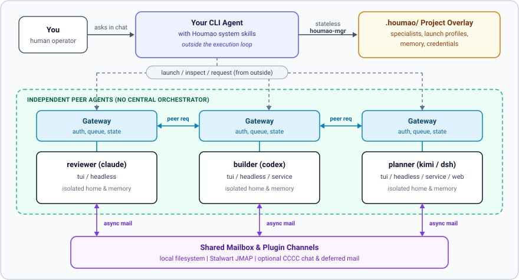
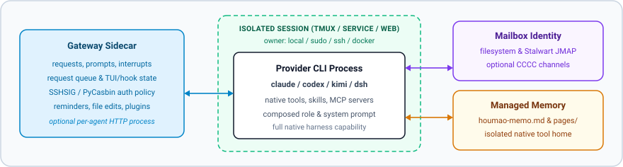

# Houmao
> Run teams of autonomous CLI agents that coordinate peer to peer, without a central orchestration layer.

Project docs: [https://igamenovoer.github.io/houmao/](https://igamenovoer.github.io/houmao/)

## Motivation

Houmao starts from two core motivations:

1. **No central orchestration layer.** Most multi-agent frameworks route every turn, tool call, and handoff through one central orchestrator. That layer becomes a **single point of failure**, **hardcodes team topology**, and forces humans or external services through **one bottleneck**. Real teams do not share one brain: each member owns an independent **workspace, inbox, and access rules**, then **coordinates directly with peers**.
2. **The native CLI agent as the basic unit.** Building a strong single agent from raw model APIs takes heavy engineering across tool use, file access, context compaction, and recovery. **CLI coding agents already solve that single-agent problem** and follow **plain-language instructions like human teammates**. Houmao gives each CLI agent a **durable session, memory, gateway, and mailbox** so agents **cooperate peer to peer** with no central controller.

**Who this is for:**

- **Multi-agent system developers** building peer-to-peer teams or connecting external hubs: start with [Agent Loops](#agent-loops), [`examples/writer-team/`](examples/writer-team/), and the [`houmao-mgr`](docs/reference/cli/houmao-mgr.md) and [`houmao-passive-server`](docs/reference/cli/houmao-passive-server.md) surfaces.
- **Agent system end users** delegating real tasks: Houmao runs independent, persistent agents that you instruct directly and let hand work to peers. Expect persistent agent threads that talk to you and each other, not a black-box orchestrator that hides the team behind one prompt.
- **Houmao extenders** building plugins or modifying the runtime: jump to [Development](#development), the [Gateway Plugins guide](docs/reference/gateway/plugins.md), and the [developer docs](docs/developer/).

## What It Is

> **Name Origin:** `Houmao` (猴毛, "monkey hair") comes from the classic novel *Journey to the West*. Sun Wukong plucks magical hairs that act independently in the world rather than hanging from puppet strings, and Houmao spins up autonomous helpers the same way.

Houmao builds and runs decentralized teams of CLI-based AI agents. You keep talking to your own CLI agent (`claude`, `codex`, or `kimi`), and Houmao lets it launch and coordinate independent peers across `claude`, `codex`, `kimi`, and `dsh` (DeepSeek Harness). (`copilot` is also supported as a target for installing Houmao's skills, not as an agent Houmao launches.)

The model has five load-bearing pieces:

- **Managed agent**: a real native agent process running in `tui`, `headless`, `service`, or `web` mode with its own isolated home, disk state, memory, and execution owner.
- **Specialist**: a named role you define once, bundling a provider tool, credentials, skills, tool parameters, and a system prompt. Houmao launches it as many managed agents as you need.
- **Project profile**: reusable launch defaults over one specialist, such as agent name, working directory, run mode, tmux server, or mailbox bindings.
- **Gateway**: an optional per-agent HTTP sidecar for prompt and work-request admission, state observation, reminders, signed access control, skill or MCP updates, and plugins.
- **Mailbox**: a shared async messaging layer over local files or Stalwart JMAP so peers exchange work without calling each other in process.

## Why This Design

**Eliminate the central orchestration bottleneck.** Agents do not live inside one Python object graph or depend on a resident master server. `houmao-mgr` is a stateless CLI that updates persisted manifests and exits, while each running agent keeps its own session, gateway sidecar, and mailbox bindings. Stopping your operator chat, one gateway, or an optional observer never takes down the rest of the team.

**Use native CLI agents as the atomic unit.** Houmao does not rebuild an LLM agent loop or flatten providers behind a lowest-common-denominator SDK. Each managed agent runs the real `claude`, `codex`, `kimi`, or `dsh` harness with its native tools, context management, skills, MCP servers, and system prompt intact.

**Manage agents like human contractors.** A specialist is the job description, written once with role, tool, credentials, and skills. The project profile is the standing assignment that sets where the agent works and how it starts. Each managed agent then works at its own desk with private notes (managed memory), an inbox, and per-agent permissions from observer up to admin.

**Let your CLI agent operate the system.** You do not learn a bespoke control console first. Install Houmao's skills into Claude, Codex, Kimi, or Copilot, then ask that assistant in plain language to create specialists, launch peers, inspect state, and supervise runs.

**Compile workflows instead of centralizing runtime control.** Start with one reviewer, then add peers that message each other directly over mail or authenticated gateways. When a workflow outgrows ad-hoc prompting, ask for a **loop**: a multi-agent plan compiled into contracts, skills, and mailbox wakeups so peers coordinate directly.

## Architecture at a Glance

Your CLI agent operates Houmao from outside the team through stateless `houmao-mgr` commands and installed system skills. Once launched, each managed agent runs independently under its execution owner (`local`, `sudo`, `ssh`, or `docker`) in `tui`, `headless`, `service`, or `web` mode. A per-agent gateway sidecar handles authenticated requests, prompt queueing, state observation, and plugins without routing traffic through a central server. Peers hand work to each other horizontally through shared mailboxes or direct gateway requests, while project definitions live in a `.houmao/` overlay inside your repo.



One managed agent, from the inside:



The normal experience stays conversational: your CLI agent reads Houmao's skills and invokes `houmao-mgr` for you. Direct CLI use and optional passive-server APIs remain supported, while this README shows the agent-driven path first.

## Quick Start

**Prerequisites:** Python 3.11+ with [`uv`](https://docs.astral.sh/uv/), tmux 3.3a or later, and Linux or macOS. The preferred skill installer also needs `npx`. Local managed sessions use tmux-backed supervision across your default server, a shared Houmao server, or isolated sockets.

```bash
# 1. Install the CLI: `houmao-mgr --version` should print a version after this
uv tool install houmao

# 2. Verify tmux is version 3.3a or later
tmux -V

# 3. Install Houmao skills into your CLI agent: select your agent and the complete
#    admin surface (welcome, admin entrypoint, shared routines, and both loop skills)
npx skills add https://github.com/igamenovoer/houmao-skills
```

The unqualified skills URL tracks the latest stable Houmao release. Append a matching tag such as `#v3.1.0` to pin the skills to an exact `houmao-mgr` version. Without `npx` or internet access, or when you need an explicit agent home, use `houmao-mgr system-skills install --tool <tool> --pack admin`. [System Skills CLI Reference](docs/reference/cli/system-skills.md)

Now start your CLI agent from the project directory and ask:

```text
$houmao-admin-welcome start-guided-tour
```

A `$name` line invokes an installed skill in your CLI agent's chat. If you learn only one Houmao invocation, learn this one. The welcome tour is read-only: it checks your setup and walks beginner, intermediate, and advanced paths. When you are ready to act, it hands execution to `$houmao-admin-entrypoint`. Both welcome and the actor entrypoints also answer `help` (for example, `$houmao-admin-welcome help`).

Your first real task looks like this:

```text
You: $houmao-admin-entrypoint create a houmao Codex backend-reviewer specialist
     for this repo, make a reusable launch profile, launch it, and ask it to
     review the current working tree.

AI:  Done. I initialized the Houmao project overlay, created specialist
     `backend-reviewer` (tool: codex), prepared profile
     `backend-reviewer-default`, launched managed agent `reviewer-1` with its
     gateway attached, and sent the review prompt. The agent is running; I will
     report when the turn completes.
```

Naming the entrypoint skill explicitly works best for the first request of a session. Later requests can drop the handle; keep the keyword `houmao` in the prompt so your agent routes them to Houmao skills. Underlying commands are documented in the [Easy Specialists guide](docs/getting-started/easy-specialists.md), the [Launch Profiles guide](docs/getting-started/launch-profiles.md), and the [`houmao-mgr` CLI reference](docs/reference/cli/houmao-mgr.md).

> **Provider version minimums.** Claude Code requires 2.1.296+. Codex requires 0.162.1+ (0.169.0+ for `service` mode). Kimi Code requires 2.1.1+ for `headless` and `tui`, or 2.6.0+ for `service` and `web`, and receives its composed role prompt through `$KIMI_CODE_HOME/SYSTEM.md` after `${base_prompt}`. DeepSeek Harness (`dsh`) requires 0.2.2-rc.1+ for `web` and 0.2.2-rc.3+ for `headless` and `service`. See [Launch Policy](docs/reference/build-phase/launch-policy.md).

## Agent-Driven Examples

Once an agent is running, later requests read naturally. Including `houmao` in the prompt keeps implicit routing reliable:

```text
You: Use houmao to ask reviewer-1 whether the migration is safe, then show me
     its current state.

AI:  Sent the prompt through reviewer-1's gateway and inspected the
     managed-agent state. It is running, the last turn is complete, and the
     response is ready.
```

Per-agent gateways give operators and peers a direct interface for attributed work requests, verbatim prompts, interrupts, state and usage queries, native home refresh, Web browser entry, and signed access control. You never need a central broker to reach one agent. See the [Gateway Reference](docs/reference/gateway/index.md), [Gateway Authorization Policy](docs/reference/gateway/operations/authorization-policy.md), and [Managed Agent Memory](docs/getting-started/managed-memory-dirs.md).

## Core Concepts

| Concept | Mental model |
|---|---|
| User CLI agent | The assistant you talk to now. It has Houmao skills installed and operates Houmao from outside the managed team. |
| Specialist | A reusable role, tool, skill, and credential definition: "backend reviewer", "story writer", "researcher", "release engineer". |
| Project profile | Reusable birth-time defaults over one specialist: agent name, working directory, run mode, tmux server, credential override, mailbox bindings, and skill policy. |
| Managed agent | An independent live agent (`tui`, `headless`, `service`, or `web`) running under its execution owner with durable manifest, registry, and memory state. |
| Gateway | An optional per-agent HTTP sidecar for request queueing, state, reminders, signed role-based access (`agent-observer` through `agent-admin`), versioned file edits, and plugins. |
| Mailbox | Shared async messaging over local filesystem or online Stalwart JMAP bindings (plus optional CCCC plugin channels) without a central orchestrator. |
| Loop | A generated multi-agent plan compiled into per-agent contracts, skills, and mailbox wakeups. Your CLI agent authors, launches, and observes it from outside the execution loop. |

Project state lives under a `.houmao/` overlay with specialists, profiles, credentials, projected content, mailbox roots, memory, and catalog metadata. Concrete setup routes through `$houmao-admin-entrypoint project-mgr ...`; layout details live in the [Quickstart guide](docs/getting-started/quickstart.md).

## Agent Loops

Complex multi-agent workflows still do not require a central orchestration server. Invoke `$houmao-agent-loop-pro` with a complex multi-agent plan, and your CLI agent compiles it into per-agent contracts, skills, and mailbox wakeups:

```text
You: $houmao-agent-loop-pro create a loop for this plan:
     three agents should design, implement, and review a migration.
     The planner decomposes the work, the builder edits code, the reviewer
     checks behavior, and the team should stop only after tests and review
     notes are complete.

AI:  I created the loop intention, clarified the topology, generated the
     execplan, prepared specialists and launch profiles, checked workspace
     and mailbox/gateway posture, launched the participants, started the run,
     and I will report status from outside the execution loop.
```

Pro loops own the schema-rich path: intention clarification, `tree-loop` versus `generic-loop` topology choice, generated contracts, harnesses, skills, validation, launch, run control, and recovery. The `houmao-agent-loop-lite` sibling is the lighter Markdown/direct-SQL path for smaller loops, without JSON schemas, Jinja2, or generated harnesses. Both loops require explicit invocation and an explicit `<loop-dir>` before any filesystem work.

The reusable [`examples/writer-team/`](examples/writer-team/) template shows a three-agent story-writing team with prompt files, a tree loop plan, a start charter, and local setup commands. A **story-writer** drafts and finalizes chapters, a **character-designer** builds profiles, and a **story-reviewer** checks logic and pacing while the operator watches from outside the loop.

The video below shows this writer team running: three managed agents drafting, refining, and reviewing chapters peer to peer while the operator observes.

https://github.com/user-attachments/assets/6cff608a-8b5b-4dcd-96fb-f2f0208a18b6

For the full loop-authoring workflow, see the [Loop Authoring Guide](docs/getting-started/loop-authoring.md) and the [System Skills Overview](docs/getting-started/system-skills-overview.md).

## System Skills

Houmao ships six system skills. Each directory works at rest and installs with a standard Agent Skills tool; Houmao does not assemble skill Markdown at runtime.

| Standalone skill | Pack | Role |
|---|---|---|
| `houmao-admin-welcome` | `admin` | **Start here.** Read-only first-use orientation with five guided paths; `$houmao-admin-welcome start-guided-tour` is the one invocation to learn first. |
| `houmao-admin-entrypoint` | `admin` | Router for any Houmao-related request from a human operator. Informational requests stay local; operational work keeps the admin frame and requires explicit targets. |
| `houmao-agent-entrypoint` | `agent` | Router for any Houmao-related request from a genuine managed-agent session. Operational work requires fresh identity verification first. |
| `houmao-shared-routines` | `admin`, `agent` | Advanced router for parent-scoped routines, including project definitions, messaging, gateway access, versioned files, and inspection. |
| `houmao-agent-loop-pro` | `admin`, `agent` | Explicit entrypoint for schema-rich loop authoring and run control. |
| `houmao-agent-loop-lite` | `admin`, `agent` | Explicit entrypoint for Markdown/direct-SQL loop authoring and run control. |

Routing follows the actor: in a human-operator session your agent selects the admin entrypoint, and in a genuine managed session it selects the agent entrypoint. Welcome and both loop skills run only when invoked explicitly, and advanced users may call `$houmao-shared-routines` directly. The complete admin pack installs five roots (welcome, admin entrypoint, shared routines, both loops); the agent pack installs four. Pack membership, install lifecycle, route selection, and the full route map live in the [System Skills Overview](docs/getting-started/system-skills-overview.md) and the [System Skills CLI reference](docs/reference/cli/system-skills.md).

For example, use `$houmao-admin-entrypoint agent-access help` for gateway permissions or `$houmao-agent-entrypoint agent-files help` for versioned skill and MCP edits on a peer gateway.

## Subsystems at a Glance

| Subsystem | Description | Docs |
|---|---|---|
| Gateway and Access Policy | Per-agent FastAPI sidecar for request queues, state, reminders, SSHSIG/PyCasbin permissions, versioned skill/MCP edits, AG-UI routes, Web dashboard, and plugins | [Gateway Reference](docs/reference/gateway/index.md), [Authorization Policy](docs/reference/gateway/operations/authorization-policy.md) |
| Mailbox and CCCC | Independent offline filesystem and online Stalwart JMAP bindings, plus optional `houmao-cccc` Actor chat and deferred mail | [Mailbox Reference](docs/reference/mailbox/index.md), [CCCC Integration](docs/reference/gateway/cccc.md) |
| Run Modes and Execution Owners | `tui`, `headless`, `service`, and `web` sessions across `local`, `sudo`, `ssh`, and `docker` execution contexts and configurable tmux servers | [Session Lifecycle](docs/reference/run-phase/session-lifecycle.md), [Execution Contexts](docs/reference/run-phase/execution-contexts.md) |
| TUI and Hook Tracking | Shadow terminal state machine, CLI hook observation channel, detectors, and replay engine | [TUI Tracking Reference](docs/reference/tui-tracking/state-model.md) |
| Usage and Native Refresh | Normalized per-turn usage ledgers and non-restarting native skill/MCP freshness inspection and refresh | [Usage Records](docs/reference/run-phase/usage-records.md), [Native Refresh](docs/reference/gateway/operations/native-refresh.md) |
| Passive Server | Optional stateless, registry-driven HTTP server for discovery, observation, and gateway or mail relay without owning agent sessions | [Passive Server Reference](docs/reference/cli/houmao-passive-server.md) |

## Demos and Examples

- [`examples/writer-team/`](examples/writer-team/) - Complete tree-loop template for the three-agent story-writing team shown above.
- [`examples/gateway-plugin/`](examples/gateway-plugin/) - Standalone gateway plugin package built on the `houmao.gateway.plugins` SDK.
- [`examples/cccc-gateway/`](examples/cccc-gateway/) - Live CCCC Actor chat and deferred mail attachment on an existing managed agent.
- [`examples/agent-authoring/`](examples/agent-authoring/) - Portable immutable agent-definition authoring and deployment example (`swe-critic`).
- [`scripts/demo/minimal-agent-launch/`](scripts/demo/minimal-agent-launch/) - Recipe-backed headless launch with Claude or Codex.
- [`scripts/demo/single-agent-mail-wakeup/`](scripts/demo/single-agent-mail-wakeup/) - Specialist plus gateway and mailbox-notifier wakeup.
- [`scripts/demo/single-agent-gateway-wakeup-headless/`](scripts/demo/single-agent-gateway-wakeup-headless/) - Headless specialist with gateway wakeup and turn evidence.
- [`scripts/demo/shared-tui-tracking-demo-pack/`](scripts/demo/shared-tui-tracking-demo-pack/) - Standalone tracked-TUI capture, watch, and replay validation.

## CLI Entry Points

| Entrypoint | Purpose | Status |
|---|---|---|
| `houmao-mgr` | Stateless operator CLI for project setup, specialists/profiles, launch, requests, gateway access, mailbox, memory, credentials, and `houmao-mgr manual` guides | **Active** |
| `houmao-passive-server` | Optional registry-driven stateless API server for discovering, observing, and relaying requests to running agents | **Active** |

Detailed command syntax lives in the [`houmao-mgr` CLI reference](docs/reference/cli/houmao-mgr.md), [System Skills CLI reference](docs/reference/cli/system-skills.md), [agents mail reference](docs/reference/cli/agents-mail.md), [agents gateway reference](docs/reference/cli/agents-gateway.md), and [internals graph reference](docs/reference/cli/internals.md). Use a [managed launch](docs/getting-started/quickstart.md) to start a worker. If an earlier release managed a manually started session, follow the [upgrade instructions](docs/reference/run-phase/session-lifecycle.md#upgrading-from-manual-session-adoption).

```bash
houmao-mgr --help
houmao-mgr manual
houmao-mgr --version
houmao-passive-server --help
```

## Full Documentation

Complete reference, guides, and developer docs are published at **[igamenovoer.github.io/houmao](https://igamenovoer.github.io/houmao/)**.

## Development

```bash
pixi run format
pixi run lint
pixi run typecheck
pixi run test-runtime
pixi run docs-serve
```

## License

Houmao is licensed under the [Apache License, Version 2.0](LICENSE).

---

> **Legacy note:** Houmao was originally inspired by [CAO (CLI Agent Orchestrator)](https://github.com/awslabs/cli-agent-orchestrator). Retired surfaces (`houmao-cli`, standalone `houmao-server`, and `cao_rest`) are no longer supported. Use `houmao-mgr`, `houmao-passive-server`, and decentralized per-agent workflows instead.
