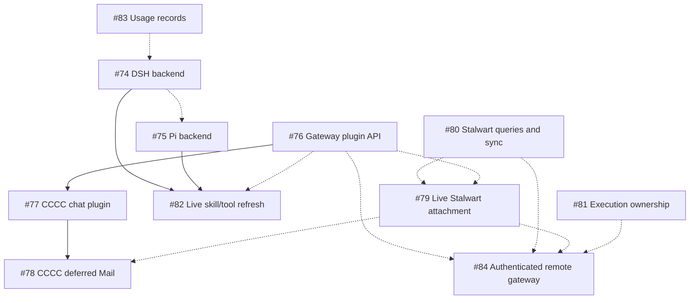

# Houmao Platform Extension Roadmap

## Purpose And Baseline

This roadmap sequences the eleven feature requests filed on 2026-11-13 as GitHub issues [#74 through #84](https://github.com/igamenovoer/houmao/issues). It uses commit `1675029c` (`v2.4.0`) as its code baseline. All eleven issues were open when this roadmap was written.

Status as of 2026-11-13: **2 of 11 work packages are done**. Usage records (#83) and the gateway plugin API (#76) are implemented and validated; the remaining nine work packages are pending. Completion evidence appears in the first two work packages below.

The common goal is to let an external hub provision identities, capabilities, budgets, and execution contexts while Houmao remains the per-agent runtime, gateway, and mailbox layer. Houmao should not become the hub's account provisioner, budget-policy engine, central task planner, or combined chat/mail service.

## Ordering Principles

- Publish shared usage and gateway-extension contracts before building their consumers.
- Make Stalwart access efficient before adding live attachment, another mailbox backend, and remote mailbox access.
- Add DSH and Pi after the usage contract exists, then implement runtime refresh against the resulting backend capability matrix.
- Schedule execution ownership and remote authentication after the launch, gateway, plugin, and mailbox surfaces stabilize. These changes cut across all of them.
- Treat each issue as a separately reviewable OpenSpec change with its own tests and documentation. Do not combine the entire roadmap into one change.

## Recommended Order At A Glance

| Order | Status | Issue | Primary Output | Reason For This Position |
| --- | --- | --- | --- | --- |
| 1 | Done | [#83](https://github.com/igamenovoer/houmao/issues/83): Normalized agent usage records | Queryable usage records with stable IDs, units, explicit unknowns, and incremental cursors | Defines the telemetry contract that DSH and Pi must implement |
| 2 | Done | [#76](https://github.com/igamenovoer/houmao/issues/76): Gateway plugin API | Namespaced routes, owner-bound context, admission hooks, and plugin lifecycle | Enables both CCCC integrations and provides lifecycle machinery for later runtime changes |
| 3 | Pending | [#80](https://github.com/igamenovoer/houmao/issues/80): Bounded Stalwart queries and incremental sync | Metadata-only listing, bounded filters, JMAP change tracking, and efficient notifications | Removes expensive mailbox behavior before more consumers depend on it |
| 4 | Pending | [#79](https://github.com/igamenovoer/houmao/issues/79): Live Stalwart mailbox attachment | Runtime attach, refresh, detach, and notifier reconfiguration without body restart | Builds on the improved client and notifier instead of reworking them later |
| 5 | Pending | [#77](https://github.com/igamenovoer/houmao/issues/77): CCCC chat gateway plugin | Live CCCC Group/Actor attachment and chat through the per-agent gateway | First real plugin consumer; validates #76 before CCCC Mail is added |
| 6 | Pending | [#78](https://github.com/igamenovoer/houmao/issues/78): CCCC deferred Mail backend | Explicit secondary mailbox backend with non-consuming status and ordered cursors | Reuses CCCC identity binding plus the mailbox attachment and cursor patterns |
| 7 | Pending | [#74](https://github.com/igamenovoer/houmao/issues/74): DeepSeek Harness backend | Managed DSH launch, ACP control, resume, interruption, events, and usage | Adds the primary new body after shared usage behavior is defined |
| 8 | Pending | [#75](https://github.com/igamenovoer/houmao/issues/75): Pi backend | Managed Pi launch, JSONL RPC control, resume, events, usage, and idle-only reload | Reuses the adapter patterns established by DSH |
| 9 | Pending | [#82](https://github.com/igamenovoer/houmao/issues/82): Live skill and tool refresh | Per-backend capability reporting and coordinated activation at safe execution boundaries | Requires DSH HMR, Pi idle-only reload, and gateway admission to exist |
| 10 | Pending | [#81](https://github.com/igamenovoer/houmao/issues/81): Execution-owner-aware launch and control | Execution profiles, ownership records, delegated launch, and target-context control routing | Touches every lifecycle path; landing it earlier would cause repeated rebasing |
| 11 | Pending | [#84](https://github.com/igamenovoer/houmao/issues/84): Authenticated remote gateway access | Authenticated exposure, peer/operator authorization, endpoint advertisement, and remote mailbox access | Must cover the final core, plugin, mailbox, and ownership surfaces |

## Dependency Map

Solid arrows show explicit or structural dependencies. Dotted arrows show recommended sequencing that reduces rework but is not an absolute code dependency.

## Work Packages

### Phase 1: Establish Shared Contracts

#### 1. #83: Expose Normalized Agent Usage Records For External Budget Controllers

**Done (2026-11-13).** Implemented in [commit `ec18da1f`](https://github.com/igamenovoer/houmao/commit/ec18da1f4c9d8da045b927f71498385df765d439). The [archived change](openspec/changes/archive/2026-11-13-expose-agent-usage-records/proposal.md) has [34 completed tasks](openspec/changes/archive/2026-11-13-expose-agent-usage-records/tasks.md), and its contract is synced to the [main specification](openspec/specs/agent-usage-records/spec.md).

- [x] Expose gateway `GET /v1/usage`, typed client access, and passive-server `GET /houmao/agents/{agent_ref}/usage`. Records include stable agent/session/generation/turn identifiers, tokens, reported cost, timing, provenance, units, and explicit unavailable or partial metrics.
- [x] Normalize structured headless output and bound native logs for qualified Claude, Codex, and Kimi profiles. Persist immutable records and incremental collection checkpoints in a runtime-session ledger; report unsupported sources and unknown private-subagent inclusion explicitly.
- [x] Cover replay, duplicates, restart generations, missing metrics, interrupted/failed turns, provider normalization, recovery, and cursor continuity with automated tests. Document bounded incremental retrieval and retain [managed headless/TUI qualification evidence](scripts/qualification/agent-usage/README.md#executed-qualification-on-2026-11-13).

Verification on 2026-11-13: **157 usage unit and integration tests passed**, covering the seven runtime usage unit modules, passive-server usage, and the [cross-surface usage workflows](tests/integration/agents/realm_controller/test_agent_usage_workflows.py).

The [usage reference](docs/reference/run-phase/usage-records.md) documents provider/version limits. TUI recording requires structured turn identity and terminal evidence; unverified managed/native turn associations stay pending without producing duplicate charges. Cost is client-reported when available, and budget policy remains the external controller's responsibility.

#### 2. #76: Provide A Supported Gateway Plugin API For External Service Integrations

**Done (2026-11-13).** Implemented in [commit `bd6f4f94`](https://github.com/igamenovoer/houmao/commit/bd6f4f9442228a28c7cecd0a567b64d7bae84e99). The [completed change](openspec/changes/add-gateway-plugin-api/proposal.md) has [31 completed tasks](openspec/changes/add-gateway-plugin-api/tasks.md) and an [acceptance map covering all 70 spec scenarios](openspec/changes/add-gateway-plugin-api/verification.md). Spec sync and archiving remain separate maintenance steps.

- [x] Publish the versioned `houmao.gateway.plugins` SDK, selected-only package discovery, strict configuration, Python launch/attach inputs, and scoped manager configuration. Persist selections across gateway restarts and document gateway-only restart requirements for code or immutable configuration changes.
- [x] Bind context, private state, credentials, and sender identity to the gateway owner. Validate the full namespaced route inventory before activation, disable every conflicting instance, and preserve core control and sanitized plugin status.
- [x] Supervise startup, workers, connection reporting, cancellation, and cleanup. Confirm ordinary event handoff against current readiness and body incarnation; return errors without queueing or automatic resend, leaving retention and retry to the sender.

Verification on 2026-11-13: **3,455 unit tests passed** (14 skipped), **19 targeted integration tests passed**, and **2 installed-wheel tests passed**. The [installed qualification](examples/gateway-plugin/qualification.md) covers detached and same-session gateway processes, body/gateway loss, recovery without replay, cursor continuity, sender retries, and completed cleanup. Formatting, lint, type checking, strict documentation, distribution builds, and strict OpenSpec validation passed.

The [plugin author and operator guide](docs/reference/gateway/plugins.md) and [independent example](examples/gateway-plugin/README.md) document the supported trusted-package contract. Actual CCCC chat and Mail integrations (#77 and #78), authenticated remote access (#84), and the broader public SDK (#69) remain separate work.

### Phase 2: Scale And Reconfigure Mailboxes

#### 3. #80: Add Bounded Metadata Queries And Incremental Stalwart Mailbox Synchronization

- Replace the current body-fetching list path in `src/houmao/mailbox/stalwart.py` with bounded server-side queries, metadata-only listing, explicit body retrieval, and JMAP state/change tracking where supported.
- Update notifier state to batch wakeups, suppress duplicates, recover from stale cursors, and avoid repeated full-body scans while preserving existing read, mark, archive, and reply semantics.
- Complete the issue with deterministic mocked-JMAP coverage and a documented load-test plan for query volume, bytes, latency, and backlog recovery.

#### 4. #79: Attach Hub-Provisioned Stalwart Mailboxes To Running Agents Without Relaunch

- Add CLI/API attach, credential refresh, reconnect, status, and detach operations using mailbox-level credentials rather than Stalwart management credentials.
- Reuse the gateway's manifest-backed mailbox loading and `bindings_version` adapter rebuild behavior in `gateway_service.py`; coordinate notifier and superseded-worker cleanup without restarting the agent body.
- Complete the issue when tests cover mailbox-disabled agents, bad credentials, endpoint failure, refresh, detach, ownership protection, secret redaction, and read/send after attachment.

### Phase 3: Add CCCC Integrations

#### 5. #77: Add A CCCC Chat Gateway Plugin For Already-Running Agents

- Implement live CCCC endpoint and Group/Actor attachment through the plugin API, with send, reply, bounded history, membership/status, reconnect, deduplication, and idle wakeup.
- Route incoming ordinary chat through gateway admission while keeping peer messages separate from privileged operator interruption. Keep any required transport client inside the plugin rather than the agent body.
- Complete the issue with two-actor gateway tests, sender isolation, reply threading, live attachment, reconnect recovery, and a runnable CCCC setup example.

#### 6. #78: Expose CCCC Deferred Mail As An Explicit Secondary Mailbox Backend

- Add caller-selectable CCCC Mail send, deferred-inbox read, reply, capability inspection, and delivery outcomes under the gateway owner's CCCC identity.
- Preserve ordered-batch cursor semantics and provide non-consuming status/peek behavior. Keep Stalwart and CCCC delivery separate, with no automatic mirroring, retry, or failover.
- Complete the issue with cursor, reconnection, Stalwart-unavailable, unsupported-recipient, and gateway-admission tests plus documentation of CCCC actor addressing and receipts.

### Phase 4: Add Managed Agent Backends

#### 7. #74: Add DeepSeek Harness As A Managed Agent Backend

- Extend `BackendKind`, launch-plan composition, role injection, and the `InteractiveSession` implementation with an ACP-based DSH adapter using an isolated home/profile, working directory, model configuration, and environment.
- Map acceptance, progress, tool activity, completion, cancellation, failure, interruption, resume, and provider usage into the existing session/gateway and #83 usage models.
- Complete the issue with isolated-profile integration tests for prompt/complete, cancel, unexpected exit, restart/resume, and a runnable setup guide. Record the validated DSH revision and ACP limitations in the change artifacts.

#### 8. #75: Add Pi As A Managed Agent Backend With Structured RPC Control

- Add Pi selection and isolated configuration, then implement JSONL RPC request/response correlation, continuous event consumption, prompt, abort, progress, completion, failure, and resume.
- Preserve provider-reported usage and expose idle-only resource reload as a backend capability for #82. Report unsupported session operations instead of silently starting a new session.
- Complete the issue with startup-failure, unexpected-exit, completion, cancellation, resume, and idle/reload-boundary tests. Record the validated Pi revision and RPC limitations.

### Phase 5: Coordinate Capability Refresh

#### 9. #82: Coordinate Live Skill And Tool Refresh With Gateway Admission And Backend Capabilities

- Report each backend's supported refresh operations, including rediscovery, external CLI update, plugin reload, DSH HMR configuration, Pi idle-only reload, and restart/resume requirements.
- Refresh only the selected agent's isolated roots, record revisions, coordinate idle or cooperative-cancellation boundaries, notify the agent of revised instructions, and distinguish installation from activation.
- Complete the issue with add/update/remove, active-turn, failed-reload, unsupported-backend, retry/recovery, and agent-isolation tests.

### Phase 6: Add Execution And Remote Security Boundaries

#### 10. #81: Support Execution-Owner-Aware Launch And Control Across Users, Containers, And Hosts

- Separate logical agent identity from execution owner, UID/GID, host/container reference, and authorized lifecycle controller in launch and session records.
- Define execution adapters that resolve working directory, home, credentials, session files, tmux endpoints, and subprocess context in the target environment. Keep communication-only imports free of lifecycle rights.
- Complete the issue with differing-UID, ownership, target-environment, control-routing, restricted-delegation, and unconfigured-target tests plus documented container and remote limits.

#### 11. #84: Support Authenticated Remote Gateway Access, Including Mailbox Operations

- Add authenticated deployment, separate bind/connect/advertised addresses, non-secret endpoint metadata, credential rotation, and documented TLS or proxy assumptions.
- Authorize ordinary message/mail operations separately from privileged interruption and raw control across both core and plugin routes. Replace the loopback-only mailbox guard only after an equivalent authenticated boundary exists.
- Complete the issue with unauthorized-caller, peer-versus-operator, remote-mailbox, endpoint-discovery, credential-rotation, secret-redaction, and safe-local-default tests.

## Reordering Rules

- #83, #76, and #80 are mutually independent and may proceed in parallel. Avoid concurrent edits to `gateway_service.py` unless the work packages explicitly coordinate ownership.
- The CCCC order is fixed: #76 before #77, and #77 before #78.
- If DSH is urgent, use the shorter path #83 → #74. The CCCC and mailbox phases can wait, but #82 must still wait for the backends whose refresh capabilities it exposes.
- #75 should normally follow #74 to reuse the new structured-backend adapter patterns. It may proceed independently if schedule pressure outweighs the expected duplication.
- #80 should precede #79 to avoid implementing the notifier twice. If live attachment is more urgent, #79 may go first only with an explicit task to migrate its notifier state in #80.
- #81 may move earlier for an urgent multi-user launch requirement, but later backend and gateway work will then need to preserve its execution-context contract.
- Keep #84 after #76, #80, and #79 so authentication covers plugin routes and remote mailbox behavior. Keep it after #81 unless the authorization design explicitly accounts for execution ownership another way.

## Verification And Maintenance

- Run `pixi run format`, `pixi run lint`, `pixi run typecheck`, and `pixi run test` for every change. Add targeted integration or live-provider qualification for subprocess, tmux, gateway, mailbox, DSH, Pi, and CCCC behavior.
- Use mocked external-service tests for deterministic CI and separate live smoke tests for real provider or service compatibility.
- Fetch and pin DSH, Pi, and CCCC references before their design work; no local checkouts currently exist under `extern/`. Stalwart source is available at `extern/orphan/stalwart`.
- Update this roadmap when issue scope, dependencies, or delivery order changes. Code paths and line references describe the `1675029c` baseline and should be refreshed rather than preserved when the code moves.
