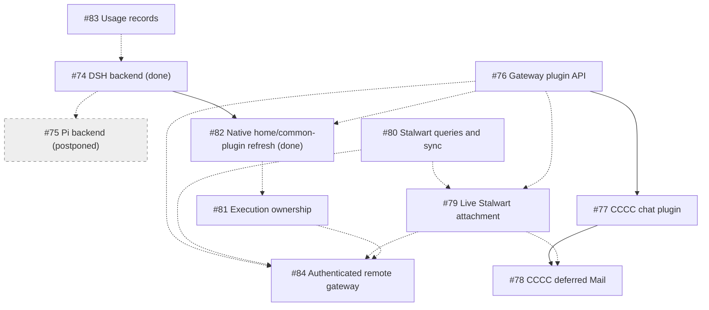

# Houmao Platform Extension Roadmap

## Purpose And Baseline

This roadmap sequences the eleven feature requests filed on 2026-11-13 as GitHub issues [#74 through #84](https://github.com/igamenovoer/houmao/issues). It uses commit `1675029c` (`v2.4.0`) as its code baseline. All eleven issues were open when this roadmap was written.

Status as of 2026-11-17: **8 of 11 work packages are done**. Usage records (#83), the gateway plugin API (#76), bounded Stalwart queries and incremental sync (#80), live Stalwart attachment (#79), CCCC chat (#77), CCCC deferred Mail (#78), DSH (#74), and native-home/common-plugin refresh (#82) are implemented and validated. **Pi integration (#75) is postponed**, with no scheduled start date; its GitHub issue remains open. The two active pending work packages are execution ownership (#81), followed by authenticated remote access (#84). Completion evidence appears in their respective work packages below.

The common goal is to let an external hub provision identities, capabilities, budgets, and execution contexts while Houmao remains the per-agent runtime, gateway, and mailbox layer. Houmao should not become the hub's account provisioner, budget-policy engine, central task planner, or combined chat/mail service.

## Ordering Principles

- Publish shared usage and gateway-extension contracts before building their consumers.
- Make Stalwart access efficient before adding live attachment, another mailbox backend, and remote mailbox access.
- Preserve the delivered native-home/common-plugin refresh contract and its qualified backend capability matrix. Qualify Pi-specific refresh behavior when Pi integration is reprioritized.
- Schedule execution ownership and remote authentication after the launch, gateway, plugin, and mailbox surfaces stabilize. These changes cut across all of them.
- Treat each issue as a separately reviewable OpenSpec change with its own tests and documentation. Do not combine the entire roadmap into one change.

## Recommended Order At A Glance

The order column shows the active sequence. Work-package headings below retain their original identifiers; Pi is outside the active sequence until explicitly reprioritized.

| Order | Status | Issue | Primary Output | Reason For This Position |
| --- | --- | --- | --- | --- |
| 1 | Done | [#83](https://github.com/igamenovoer/houmao/issues/83): Normalized agent usage records | Queryable usage records with stable IDs, units, explicit unknowns, and incremental cursors | Defines the telemetry contract that DSH and Pi must implement |
| 2 | Done | [#76](https://github.com/igamenovoer/houmao/issues/76): Gateway plugin API | Namespaced routes, owner-bound context, admission hooks, and plugin lifecycle | Enables both CCCC integrations and provides lifecycle machinery for later runtime changes |
| 3 | Done | [#80](https://github.com/igamenovoer/houmao/issues/80): Bounded Stalwart queries and incremental sync | Metadata-only listing, bounded filters, JMAP change tracking, and efficient notifications | Removes expensive mailbox behavior before more consumers depend on it |
| 4 | Done | [#79](https://github.com/igamenovoer/houmao/issues/79): Live Stalwart mailbox attachment | Runtime attach, refresh, detach, and notifier reconfiguration without body restart | Builds on the improved client and notifier instead of reworking them later |
| 5 | Done | [#77](https://github.com/igamenovoer/houmao/issues/77): CCCC chat gateway plugin | Live CCCC Group/Actor attachment and chat through the per-agent gateway | First real plugin consumer; validates #76 before CCCC Mail is added |
| 6 | Done | [#78](https://github.com/igamenovoer/houmao/issues/78): CCCC deferred Mail backend | Explicit secondary mailbox backend with non-consuming status and ordered cursors | Reuses CCCC identity binding plus the mailbox attachment and cursor patterns |
| 7 | Done | [#74](https://github.com/igamenovoer/houmao/issues/74): DeepSeek Harness backend | Headless ACP and owned interactive Web control, exact resume, interruption, events, and usage | Delivered the primary new body after the shared usage contract |
| 8 | Done | [#82](https://github.com/igamenovoer/houmao/issues/82): Native-home and common-plugin refresh | Authoritative home, read-only skills/MCP freshness, and non-restarting native refresh through CLI, gateway, and passive server | Delivered qualified DSH ACP/Web support and explicit best-effort secondary-tool limits; Pi qualification remains postponed |
| 9 | Pending | [#81](https://github.com/igamenovoer/houmao/issues/81): Execution-owner-aware launch and control | Execution profiles, ownership records, delegated launch, and target-context control routing | Touches every lifecycle path; landing it earlier would cause repeated rebasing |
| 10 | Pending | [#84](https://github.com/igamenovoer/houmao/issues/84): Authenticated remote gateway access | Authenticated exposure, peer/operator authorization, endpoint advertisement, and remote mailbox access | Must cover the final core, plugin, mailbox, and ownership surfaces |
| Deferred | Postponed | [#75](https://github.com/igamenovoer/houmao/issues/75): Pi backend | Managed Pi launch, JSONL RPC control, resume, events, usage, and idle-only reload | Retains its acceptance scope for future reprioritization; no start date is scheduled |

## Dependency Map

Solid arrows show explicit or structural dependencies. Dotted arrows show recommended sequencing that reduces rework but is not an absolute code dependency. DSH and native-home/common-plugin refresh are complete. Execution ownership is next, followed by authenticated remote access; Pi remains postponed.

## Work Packages

### Phase 1: Establish Shared Contracts

#### 1. #83: Expose Normalized Agent Usage Records For External Budget Controllers

**Done (2026-11-13).** Implemented in [commit `ec18da1f`](https://github.com/igamenovoer/houmao/commit/ec18da1f4c9d8da045b927f71498385df765d439). The [archived change](openspec/changes/archive/2026-11-13-expose-agent-usage-records/proposal.md) has [34 completed tasks](openspec/changes/archive/2026-11-13-expose-agent-usage-records/tasks.md), and its contract is synced to the [main specification](openspec/specs/agent-usage-records/spec.md).

- [x] Expose gateway `GET /v1/usage`, typed client access, and passive-server `GET /houmao/agents/{agent_ref}/usage`. Records include stable agent/session/generation/turn identifiers, tokens, reported cost, timing, provenance, units, and explicit unavailable or partial metrics.
- [x] Normalize structured headless output and bound native logs for qualified Claude, Codex, and Kimi profiles. Persist immutable records and incremental collection checkpoints in a runtime-session ledger; report unsupported sources and unknown private-subagent inclusion explicitly.
- [x] Cover replay, duplicates, restart generations, missing metrics, interrupted/failed turns, provider normalization, recovery, and cursor continuity with automated tests. Document bounded incremental retrieval and retain [managed headless/TUI qualification evidence](scripts/qualification/agent-usage/README.md#executed-qualification-on-2026-11-13).

Verification on 2026-11-13: **157 usage unit and integration tests passed**, covering the seven runtime usage unit modules, passive-server usage, and the [cross-surface usage workflows](tests/integration/agents/realm_controller/test_agent_usage_workflows.py).

The [usage reference](docs/reference/run-phase/usage-records.md) documents provider/version limits. TUI recording requires structured turn identity and terminal evidence; unverified managed/native turn associations stay pending without producing duplicate charges. Cost is client-reported when available, and budget policy remains the external controller's responsibility.

#### 2. #76: Provide A Supported Gateway Plugin API For External Service Integrations

**Done (2026-11-13).** Implemented in [commit `bd6f4f94`](https://github.com/igamenovoer/houmao/commit/bd6f4f9442228a28c7cecd0a567b64d7bae84e99). The [completed change](openspec/changes/archive/2026-11-16-add-gateway-plugin-api/proposal.md) has [31 completed tasks](openspec/changes/archive/2026-11-16-add-gateway-plugin-api/tasks.md) and an [acceptance map covering all 70 spec scenarios](openspec/changes/archive/2026-11-16-add-gateway-plugin-api/verification.md). Its specs are synchronized and the change is archived.

- [x] Publish the versioned `houmao.gateway.plugins` SDK, selected-only package discovery, strict configuration, Python launch/attach inputs, and scoped manager configuration. Persist selections across gateway restarts and document gateway-only restart requirements for code or immutable configuration changes.
- [x] Bind context, private state, credentials, and sender identity to the gateway owner. Validate the full namespaced route inventory before activation, disable every conflicting instance, and preserve core control and sanitized plugin status.
- [x] Supervise startup, workers, connection reporting, cancellation, and cleanup. Confirm ordinary event handoff against current readiness and body incarnation; return errors without queueing or automatic resend, leaving retention and retry to the sender.

Verification on 2026-11-13: **3,455 unit tests passed** (14 skipped), **19 targeted integration tests passed**, and **2 installed-wheel tests passed**. The [installed qualification](examples/gateway-plugin/qualification.md) covers detached and same-session gateway processes, body/gateway loss, recovery without replay, cursor continuity, sender retries, and completed cleanup. Formatting, lint, type checking, strict documentation, distribution builds, and strict OpenSpec validation passed.

The [plugin author and operator guide](docs/reference/gateway/plugins.md) and [independent example](examples/gateway-plugin/README.md) document the supported trusted-package contract. CCCC chat and Mail integrations (#77 and #78) now use this contract. Authenticated remote access (#84) and the broader public SDK (#69) remain separate work.

### Phase 2: Scale And Reconfigure Mailboxes

#### 3. #80: Add Bounded Metadata Queries And Incremental Stalwart Mailbox Synchronization

**Done (2026-11-14).** Implemented in [commit `2c743a2a`](https://github.com/igamenovoer/houmao/commit/2c743a2af946847dfc7675bcebed850cf1a51fee) together with #79. The [online attachment and sync change](openspec/changes/archive/2026-11-16-mail-02-attach-online-mail-and-sync-stalwart/proposal.md) has [32 completed tasks](openspec/changes/archive/2026-11-16-mail-02-attach-online-mail-and-sync-stalwart/tasks.md) and an [acceptance map covering all 36 requirements and 66 scenarios](openspec/changes/archive/2026-11-16-mail-02-attach-online-mail-and-sync-stalwart/acceptance.md). Its [identity and offline-mail foundation](openspec/changes/archive/2026-11-16-mail-01-establish-identity-and-offline-mail/acceptance.md) has 28 completed tasks and is synchronized into main specs. The online attachment specs are synchronized, and both mail changes are archived.

- [x] Replace body-fetching lists with server-filtered metadata pages, a finite default of 50 and maximum of 200, scoped state-validated cursors, explicit peek/read content retrieval, and visible content limits. Reuse validated account, identity, discovery, and mailbox-role state.
- [x] Persist account/query-scoped JMAP checkpoints and bounded metadata views atomically, recover within request/time budgets, and fence superseded observations and prompt effects. Preserve read, mark, archive, reply, readiness, and one-shot compaction semantics. Per user clarification, unchanged eligible work continues periodic reminders; deduplication suppresses same-cycle and overlapping wakeups rather than future due intervals.
- [x] Cover pagination, metadata-only wire requests, intermediate checkpoints, stale-state recovery, concurrent role changes, duplicate admission, and compaction eligibility with deterministic tests. Provide [qualification tools](scripts/qualification/stalwart-mail/README.md) and a [load-test plan](docs/reference/mailbox/operations/stalwart-qualification.md) measuring requests, bytes, latency, memory, and backlog recovery.

Verification on 2026-11-14: **3,651 unit tests passed** (14 skipped), **29 affected integration tests passed**, and formatting, lint, strict typing (449 source files), and strict OpenSpec validation passed. [Live Stalwart 0.15.5 evidence](openspec/changes/archive/2026-11-16-mail-02-attach-online-mail-and-sync-stalwart/qualification.md) includes real two-account send/read/reply/archive, bounded observation measurements, restart recovery, and two periodic reminder cycles with same-cycle deduplication. The 100-agent/million-message workload is documented but unexecuted; these representative checks do not establish target-scale capacity.

#### 4. #79: Attach Hub-Provisioned Stalwart Mailboxes To Running Agents Without Relaunch

**Done (2026-11-14).** Delivered with #80 in [commit `2c743a2a`](https://github.com/igamenovoer/houmao/commit/2c743a2af946847dfc7675bcebed850cf1a51fee). The shared [acceptance map](openspec/changes/archive/2026-11-16-mail-02-attach-online-mail-and-sync-stalwart/acceptance.md) records the attachment contract and its test evidence.

- [x] Add documented scoped CLI/API status, attach/explicit replacement, credential refresh, reconnect, and detach using protected normal-account credential references. Validate candidates before activation without management access, implicit account provisioning, or provider-password replacement.
- [x] Mutate the manifest-backed online slot with owner/revision checks while preserving the stable agent ID, offline binding, body PID, and conversation. Use private immutable credential snapshots and connection epochs; retire old operations, cancel stale pending reminders, and return scoped confirmed or uncertain mutation outcomes without automatic resend.
- [x] Test initially mailbox-disabled agents, invalid credentials, endpoint failure, account/address mismatch, refresh, detach, concurrent replacement, secret-safe projections, and read/send/reply/archive after attachment. [Real HTTP runtime integration](tests/integration/mailbox/test_online_runtime_contract.py) covers gateway restart, a persistent stand-in body subprocess, late polls, queued reminder cancellation, and prompt-effect retirement races. The [operator guide](docs/reference/mailbox/operations/stalwart-setup-and-first-session.md) and [developer fixture routine](skillset/dev/houmao-dev-launch-agents/commands/attach-online-mail.md) document the supported workflow.

The aggregate checks and live normal-account qualification are recorded under #80 above. Live runtime qualification preserved the stand-in body's PID and conversation marker through attach, refresh, reconnect, gateway reconstruction, and detach. Autonomous real-LLM conversation behavior is outside this qualification.

### Phase 3: Add CCCC Integrations

#### 5. #77: Add A CCCC Chat Gateway Plugin For Already-Running Agents

**Done (2026-11-16).** Implemented in [commit `06722493`](https://github.com/igamenovoer/houmao/commit/0672249363037ad87371913bc72e6468d3e113df). The [archived chat change](openspec/changes/archive/2026-11-16-cccc-01-add-owner-bound-chat-plugin/proposal.md) has [34 completed tasks](openspec/changes/archive/2026-11-16-cccc-01-add-owner-bound-chat-plugin/tasks.md) and an [acceptance map covering all 75 scenarios](docs/reference/gateway/cccc-acceptance.md). Its contracts are synchronized into main specs.

- [x] Add the independently installed `houmao-cccc` plugin with live attachment of externally provisioned CCCC endpoint and Group/Actor bindings. Expose owner-bound send, reply, bounded history, membership/status, reconnect, and explicit delivery outcomes through gateway HTTP and a thin CLI.
- [x] Route ordinary chat through gateway readiness and body-incarnation checks. Preserve sender isolation and native reply ancestry; report refused or uncertain handoffs and require explicit sender retries. Reconnect and recovery preserve receipts without replaying ordinary chat.
- [x] Cover two gateways with distinct Actors, live attachment, reply threading, bounded history, reconnect, deduplication, receiver lease expiry, and body/gateway failure. Publish the [runnable setup example](examples/cccc-gateway/README.md), [operator guide](docs/reference/gateway/cccc.md), and [service start instructions](SERVICES.md#cccc-external-receiver-test-service).

Verification on 2026-11-15: native receiver tests, actual-provider HTTP and process recovery tests, independent installed-wheel checks in both gateway modes, and the required two-real-agent chat smoke passed. The [chat qualification report](examples/cccc-gateway/qualification.md) records the tested versions and scope. The integration requires the pinned CCCC source plus the tracked protocol-v1 receiver patches; service provisioning remains external to the gateway plugin. Authenticated remote exposure remains work for #84.

#### 6. #78: Expose CCCC Deferred Mail As An Explicit Secondary Mailbox Backend

**Done (2026-11-16).** Delivered with #77 in [commit `06722493`](https://github.com/igamenovoer/houmao/commit/0672249363037ad87371913bc72e6468d3e113df). The [archived Mail change](openspec/changes/archive/2026-11-16-cccc-02-add-explicit-deferred-mail/proposal.md) has [26 completed tasks](openspec/changes/archive/2026-11-16-cccc-02-add-explicit-deferred-mail/tasks.md) and an [acceptance map covering all 35 scenarios](docs/reference/gateway/cccc-mail-acceptance.md). Its contract is synchronized into the [main specification](openspec/specs/cccc-deferred-mail/spec.md).

- [x] Add explicitly selected CCCC Mail send, deferred-inbox read, reply, capability inspection, and delivery outcomes under the gateway owner's Group/Actor identity. Keep CCCC Mail outside both email slots and restrict recipients to supported CCCC Actors.
- [x] Preserve ordered-batch consumption with non-consuming status/peek, bounded precommit limits, cursor preconditions, and durable read receipts. Report uncertain outcomes for explicit reconciliation; keep Stalwart and CCCC delivery independent, with caller-controlled backend selection and retries.
- [x] Verify reconnect and restart recovery, concurrent and lost-response reads, unsupported recipients and email operations, ordinary gateway admission, and continued CCCC exchange during a selected Stalwart outage. Publish [Mail operation and receipt documentation](docs/reference/gateway/cccc-mail.md) and [reproducible qualification tools](scripts/qualification/cccc/README.md).

Verification on 2026-11-15: **3,798 unit tests passed** (14 existing skips), **29 actual-service integration cases passed**, and formatting, lint, strict typing, distribution validation, and strict documentation checks passed. Independent-wheel Mail qualification passed in both gateway modes, including package upgrade with preserved body and conversation state. The required two-real-agent deferred send/read/reply smoke and real Stalwart fault/coexistence checks also passed; the [Mail qualification report](examples/cccc-gateway/mail-qualification.md) records this evidence. Representative checks establish the implemented contracts, while target-scale capacity and authenticated remote deployment remain unqualified.

### Phase 4: Add Managed Agent Backends

#### 7. #74: Add DeepSeek Harness As A Managed Agent Backend

**Done (2026-11-16).** Implemented in [commit `07e74da4`](https://github.com/igamenovoer/houmao/commit/07e74da419d04f716454cce343530abf19d32322). The ordered changes completed [29 headless tasks](openspec/changes/archive/2026-11-17-dsh-01-add-acp-headless-backend/tasks.md) and [35 interactive Web tasks](openspec/changes/archive/2026-11-17-dsh-02-add-interactive-web-backend/tasks.md). Both changes have synchronized main specifications and were archived on 2026-11-17 in [commit `5f12c09d`](https://github.com/igamenovoer/houmao/commit/5f12c09dbf520b21a52f8c8fb1c42205d2e999e1). [Issue #74 is closed](https://github.com/igamenovoer/houmao/issues/74#issuecomment-6918449890).

- [x] Add `dsh_acp` for headless launches and `dsh_web` for the existing interactive posture, with isolated homes, explicit provider/model configuration, literal role injection, selected skill roots, and distinct native Web/supervisor metadata.
- [x] Map native admission receipts, progress, tool activity, terminal outcomes, scoped interruption, exact continuation, and explicit relaunch into the runtime and gateway. Preserve independent browser/API credentials, execution-incarnation guards, and recovery without input replay.
- [x] Preserve provider-reported journal usage, actual model attribution, separate human turns, and one charge for mixed input. Qualify gateway, passive-server, mailbox, CCCC, and AG-UI integration with the [61-scenario headless map](docs/reference/run-phase/dsh-headless-acceptance.md) and [96-scenario Web map](docs/reference/run-phase/dsh-web-acceptance.md).

Verification on 2026-11-16: **4,150 unit tests passed** (14 skipped), **84 native tests passed**, and real DeepSeek ACP and browser/API Web qualification passed. Formatting, lint, strict typing, docs, builds, resource inventories, and secret/path audits passed. The [implementation record](context/plans/dsh-provider-integration/roadmap.md) records the qualified source/build, lifecycle and isolation evidence, and remaining boundaries.

The self-hosted live lane was unconfigured. The archive merge preserved the accepted headless scenarios and applied the successor Web contract in order. All 242 main specifications pass standard validation; existing strict-validation warnings are unchanged. Native-home/common-plugin refresh is now delivered under #82 below.

#### 8. #75: Add Pi As A Managed Agent Backend With Structured RPC Control

**Postponed (2026-11-16).** Pi is outside the current implementation sequence, with no scheduled start date. Issue #75 remains open for explicit reprioritization. The requirements below are retained for that future integration; existing-provider refresh is complete, and execution ownership and remote-access work can proceed independently.

- Add Pi selection and isolated configuration, then implement JSONL RPC request/response correlation, continuous event consumption, prompt, abort, progress, completion, failure, and resume.
- Preserve provider-reported usage and qualify idle-only resource reload against the established native-refresh contract. Report unsupported session operations instead of silently starting a new session.
- Complete the issue with startup-failure, unexpected-exit, completion, cancellation, resume, and idle/reload-boundary tests. Record the validated Pi revision and RPC limitations.

### Phase 5: Coordinate Capability Refresh

#### 9. #82: Coordinate Live Skill And Tool Refresh With Gateway Admission And Backend Capabilities

**Done (2026-11-17).** Implemented in [commit `08a2c9d6`](https://github.com/igamenovoer/houmao/commit/08a2c9d621bf7245e6551f45b29d4eb1927f13bf). The [archived change](openspec/changes/archive/2026-11-17-add-native-agent-home-refresh/proposal.md) has [33 completed tasks](openspec/changes/archive/2026-11-17-add-native-agent-home-refresh/tasks.md) and an [acceptance map covering all 112 scenarios](docs/reference/run-phase/native-refresh-acceptance.md). Its contracts are synchronized into the [main native-refresh specification](openspec/specs/native-agent-home-refresh/spec.md); archival and sync are recorded in [commit `5f12c09d`](https://github.com/igamenovoer/houmao/commit/5f12c09dbf520b21a52f8c8fb1c42205d2e999e1). [Issue #82 is closed with the accepted scope and qualification limits](https://github.com/igamenovoer/houmao/issues/82#issuecomment-6944745455).

- [x] Expose authoritative native-home inspection, read-only `refresh --check`, and observe-first `refresh` in single/self CLI scope, gateway HTTP, and passive-server projections. Report common-plugin (skills/MCP) coverage, freshness, health, and native boundaries independently of the writer or a Houmao update receipt. Confirmed current state produces a no-op; qualified automatic discovery retains its future boundary.
- [x] Preserve external installation ownership and current native material. DSH ACP consumes current home inputs on later ordinary invocations; owned DSH Web performs qualified configuration/resource reconciliation under immediate native admission. Preserve process/conversation identity, partial effects, responsive operator controls, one absolute deadline, and captured target authority without retrying lost confirmation.
- [x] Exercise add/update/remove, autonomous watchers, active-turn and child/browser races, failed replacement, response loss, MCP health/freshness differences, loaded-skill history, distinct-home isolation, and refresh-versus-relaunch behavior. Verify that refresh creates no model requests and never regenerates launch-derived material.

Refresh never restarts the harness or selects a replacement conversation. Restart and manifest-backed regeneration remain separate explicit `relaunch` operations. The common view covers skills and MCP; users inspect native-special-plugin state through native facilities, while native refresh may have broader, nontransactional effects. Existing skill tool results remain in conversation history; changed bodies become available at their qualified future load boundary.

Verification on 2026-11-17: **4,467 unit tests passed** (14 skipped), **28 native Web/public cases passed**, **10 ACP current-home/managed/fixture cases passed**, and **2 separate relaunch cases passed**. Formatting, lint, strict typing (472 source files), strict documentation, distribution builds, resource inventory, and metadata checks passed. The archive batch validated all 242 main specs with no new validation warnings.

DSH 0.2.2-rc.3 headless and Web are primary. The [compatibility matrix](docs/reference/run-phase/native-refresh-compatibility.md) records Kimi Code, Codex, and Claude Code native capabilities separately from their maintained Houmao transports, which currently report explicit unknown/unsupported refresh coverage. Arbitrary hot-code HMR is unqualified, and unavailable MCP implementation revisions remain unknown. Pi integration and its refresh qualification stay postponed under #75.

### Phase 6: Add Execution And Remote Security Boundaries

#### 10. #81: Support Execution-Owner-Aware Launch And Control Across Users, Containers, And Hosts

- Separate logical agent identity from execution owner, UID/GID, host/container reference, and authorized lifecycle controller in launch and session records.
- Define execution adapters that resolve working directory, home, credentials, session files, tmux endpoints, and subprocess context in the target environment. Keep communication-only imports free of lifecycle rights.
- Complete the issue with differing-UID, ownership, target-environment, control-routing, restricted-delegation, and unconfigured-target tests plus documented container and remote limits.

#### 11. #84: Support Authenticated Remote Gateway Access, Including Mailbox Operations

- Add authenticated deployment, separate bind/connect/advertised addresses, non-secret endpoint metadata, credential rotation, and documented TLS or proxy assumptions.
- Authorize ordinary message/mail operations separately from privileged interruption and raw control across both core and plugin routes. Replace the loopback-only mailbox guard only after an equivalent authenticated boundary exists.
- Complete the issue with unauthorized-caller, peer-versus-operator, remote-mailbox, endpoint-discovery, credential-rotation, secret-redaction, and safe-local-default tests.

## Reordering Rules

- #83, #76, and #80 are mutually independent and may proceed in parallel. Avoid concurrent edits to `gateway_service.py` unless the work packages explicitly coordinate ownership.
- The CCCC order is fixed: #76 before #77, and #77 before #78.
- DSH (#74) and native-home/common-plugin refresh (#82) are complete. Execution ownership (#81) is the next active work package, followed by authenticated remote access (#84).
- Keep #75 postponed until explicit reprioritization. When it resumes, reuse the DSH adapter patterns and qualify Pi against the established native-refresh contract.
- #80 should precede #79 to avoid implementing the notifier twice. If live attachment is more urgent, #79 may go first only with an explicit task to migrate its notifier state in #80.
- #81 may move earlier for an urgent multi-user launch requirement, but later backend and gateway work will then need to preserve its execution-context contract.
- Keep #84 after #76, #80, and #79 so authentication covers plugin routes and remote mailbox behavior. Keep it after #81 unless the authorization design explicitly accounts for execution ownership another way.

## Verification And Maintenance

- Run `pixi run format`, `pixi run lint`, `pixi run typecheck`, and `pixi run test` for every change. Add targeted integration or live-provider qualification for subprocess, tmux, gateway, mailbox, DSH, Pi, and CCCC behavior.
- Use mocked external-service tests for deterministic CI and separate live smoke tests for real provider or service compatibility.
- DSH qualification records its pinned source and tested build in the acceptance maps. Fetch and pin a Pi reference when that integration resumes. Local reference checkouts for CCCC and Stalwart are available at `extern/orphan/cccc` and `extern/orphan/stalwart`. The [CCCC Pixi workspace](tools/cccc/README.md) builds and runs its native development service without nested containers.
- Update this roadmap when issue scope, dependencies, or delivery order changes. Code paths and line references describe the `1675029c` baseline and should be refreshed rather than preserved when the code moves.
