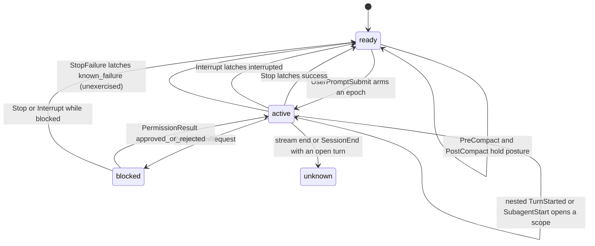

# Synthesis: Kimi Hook Observation Campaign (2026-10-20)

Date: 2026-10-20. Campaign: [debug-intent.md](../debug-intent.md). Iteration: [plan 1](../iterations/2026-10-20-plan-1-kimi-hook-capture-matrix.md). Status at writing: replay phase complete; this report is the campaign synthesis for the future `add-kimi-hook-observation` OpenSpec change.

Scope: evaluation of the source-derived theory against the 14 captured hook streams (18 run roots including empty controls and deviation runs), the replay reducer [`scripts/explore/kimi-hook-observation/replay_reduce.py`](../../../../../scripts/explore/kimi-hook-observation/replay_reduce.py), and the archived merge rules. No live sessions were run in this phase; no `src/` or `tests/` changes were made.

## 1. Replay Result

| Item | Result |
| --- | --- |
| Reducer self-test | `--self-test` **PASS**, 12/12 synthetic checks |
| Full matrix | `--all` **PASS** over 18 campaign roots, 113 events, exit 0 |
| Expectation checks | 18/18 run roots match their declared stream shape and final posture; 4 are empty controls |
| Label checks | 21 OK, 20 n/a, 0 mismatches |
| Harness roots | 17 G0 `self-test/run-*` roots detected as non-campaign streams and named as skipped |
| Replay-exposed correction | S7 generation 2 starts at `turn_id=1`; the capture note and catalog said 0 (corrected in both documents) |

The reducer is stdlib-only, reads `collector/events.ndjson` (including `sequence: null` / `via: command_fallback` rows ordered by `emitter_seq`), never imports production code, and uses only stream stamps plus run metadata (`launch.json` / `run-summary.json`) for the terminal fallbacks. It passed `pixi run ruff check` and `ruff format --check`.

### 1.1 Kimi merged transition model (as replayed)

Rules encoded by the reducer:

1. `UserPromptSubmit` arms an epoch and enters `active`; the following `TurnStarted(origin_kind=user)` binds the integer `turn_id`. A user `TurnStarted` without a prompt arms defensively.
2. `TurnStarted(origin_kind=system_trigger, origin_name=subagent)` and `SubagentStart` open a nested scope; `Stop` and `SubagentStop` close nested scopes before they can settle the parent. Parent and subagent `turn_id` values collide in S9, so scope, not id, disambiguates.
3. `Stop` latches `success`; `stop_hook_active=true` is a defensive non-terminal continuation; `StopFailure` would latch `known_failure`; `Interrupt(reason=cancelled)` latches `interrupted` in place of `Stop`.
4. `PermissionRequest` is the only entry to `blocked`; the window settles at `PermissionResult`, not `PostToolUse`. `approved` and `rejected` both return to `active`; `PostToolUseFailure` is non-terminal and the deny turn continues to `Stop`. This differs from the Codex deny-aborts-turn rule.
5. `PreCompact`/`PostCompact` hold the current posture and mark a maintenance boundary; the post-compact turn is a fresh epoch. Kimi emits no `SessionStart(source=compact)`.
6. `SessionEnd` loses presence; an open turn becomes `terminal_gap` with `turn.phase=unknown` and `last_turn=none`, never success. A stream that ends with an open turn is the same gap.
7. Headless `-p` with a clean exit (`rc=0`) and a latched `Stop` is terminal-settled; the missing `SessionEnd` is named `headless_session_end_gap`.
8. `SessionHeartbeat` is presence/liveness evidence only; the `work` axis stays `unknown` because Kimi's `Stop` has no background-task payload.

## 2. Theory Evaluation: Source-Derived Spec vs Live Surface

The source reading (kimi-code @ `67325c1`) was a strong predictor. The event set, config schema, execution contract, and most payload fields survived contact unchanged. The errors clustered in lifecycle timing and permission ordering.

### 2.1 Confirmed as promised

- The 20-event `HOOK_EVENT_TYPES` set; every event family the campaign exercised arrived under the documented name.
- Strict `[[hooks]]` schema (`event`, `matcher`, `command`, `timeout` only); one malformed entry voids the whole section; the TUI gives no warning and print-mode stderr carries the diagnostic.
- No trust gate; hooks run unattended with zero operator action in `--auto` TUI.
- Load-once hook table per process; mid-session appends have no effect until restart.
- `SessionStart`/`SessionEnd` are awaited at session create/close; the T1 `sleep 3` hooks delayed session creation by 3.007 s and exit by 3.016 s.
- Base payload `{hook_event_name, session_id, cwd}` plus `client_type`, `session_title` on later events, `model`/`profile` only on `SessionStart`, no `transcript_path`.
- `tool_call_id` on tool and permission events; `turn_id` on `TurnStarted`/`PermissionRequest`/`PermissionResult`/`Interrupt` and **not** on `PreToolUse`/`PostToolUse`/`PostToolUseFailure`/`Stop`/`UserPromptSubmit`.
- `UserPromptSubmit.prompt` as raw `ContentPart[]` with `is_steer`; `TurnStarted.prompt` as a plain string.
- Permission events only under ask policy; none under `--auto` or print mode.
- `PreCompact`/`PostCompact(trigger=manual)` with `token_count` / `estimated_token_count`; `Interrupt(turn_id, reason=cancelled)` with no `Stop`; 60 s `SessionHeartbeat` with `uptime_ms`.
- `UserPromptQueued(prompt_id, prompt, queue_length)`; `SubagentStart`/`SubagentStop(agent_name, prompt, response)`; `kimi -p` fires hooks.

### 2.2 Corrections (dated 2026-10-20)

| # | Earlier claim | Live/replay correction | Evidence |
| --- | --- | --- | --- |
| 1 | `SessionStart(source=startup)` fires at process launch, before any prompt | The TUI is session-less until the first message; `SessionStart` is awaited at **session creation**, which is lazy. It arrives ~0.24 s after the creating prompt, immediately before that prompt's `UserPromptSubmit`. Resume is the exception: `--continue` restores at launch and `SessionStart(resume)` arrives pre-prompt. | [S0](../evidences/2026-10-20-s0-gate-smoke.md), [S1](../evidences/2026-10-20-s1-normal-multiturn.md), [S7](../evidences/2026-10-20-s7-resume-hot-reload.md) |
| 2 | `session_title` is a base field | Absent on every fresh `SessionStart` (the title is generated after the first prompt) and absent on all headless events; present on the resume `SessionStart` and later TUI events. | [Catalog](../evidences/2026-10-20-kimi-hook-payload-catalog.md) |
| 3 | `turn_id` restarts at 0 after resume | It **continues**: S7 gen 1 `0`, gen 2 `1`. The counter is session-scoped. Replay refuted the note; the catalog and S7 evidence were corrected. | [S7](../evidences/2026-10-20-s7-resume-hot-reload.md) |
| 4 | Allow path: `PermissionResult` then `PostToolUse` | The allow path is `PostToolUse` **before** `PermissionResult` (the result follows tool execution); the blocked window settles at the result, not the tool event. | [S3](../evidences/2026-10-20-s3-permission-lane.md) |
| 5 | Deny path likely produces `Interrupt` or aborts the turn | Deny is `PermissionResult(rejected)` → `PostToolUseFailure` → `Stop`; **no `Interrupt`**, and the turn continues to a normal success. | [S3](../evidences/2026-10-20-s3-permission-lane.md) |
| 6 | The Agent tool emits `TaskStarted(kind=agent)` | It emits `SubagentStart`/`SubagentStop` and a nested `TurnStarted(origin_kind=system_trigger)` but **no `TaskStarted`**. | [S9](../evidences/2026-10-20-s9-subagent.md) |
| 7 | Headless `-p` emits `SessionEnd` | Four lifecycle events fire; **no `SessionEnd`** within 30 s of an rc-0 exit. Process exit is the terminal signal. | [S8](../evidences/2026-10-20-s8-headless.md) |
| 8 | `PostToolUse.tool_output` is structured and truncates at 2000 chars | It is a plain **string**; no `duration_ms`, no structured response. | [Catalog](../evidences/2026-10-20-kimi-hook-payload-catalog.md) |
| 9 | `Stop` carries `turn_id`/`prompt_id`/`last_assistant_message` | It carries none of them; correlation is by event order. `UserPromptSubmit` has no `prompt_id` either (`prompt_id` exists only on `UserPromptQueued`). | [Catalog](../evidences/2026-10-20-kimi-hook-payload-catalog.md) |
| 10 | Permission payloads carry only the documented fields | They also carry `id` (approval uuid), `action`, `display`, and `agent_id`; `scope`/`feedback`/`selected_label` were absent. `PostToolUseFailure.error` observed only `{code, message, retryable}`. | [S3](../evidences/2026-10-20-s3-permission-lane.md) |
| 11 | Typing while busy queues via Enter | Plain Enter buffers in the composer and submits **after** `Stop` (no `UserPromptQueued`); Ctrl-S is the queue/steer key. The steered message produces `UserPromptQueued` and **no second `UserPromptSubmit`/`Stop`**. | [S6](../evidences/2026-10-20-s6-queue-steer.md) |
| 12 | A slow `SessionStart` hook delays time-to-ready | Ready is unaffected because session creation is lazy; the delay lands on prompt→`SessionStart` (+3.007 s) and on exit (+3.016 s). | [T1](../evidences/2026-10-20-t1-slow-lifecycle.md) |
| 13 | Duplicate `[[hooks]]` entries could double-deliver | A byte-identical duplicate `UserPromptSubmit` entry produced exactly one delivery (first-wins dedup). | [S0](../evidences/2026-10-20-s0-gate-smoke.md) |
| 14 | A single armed-prompt supersede/time-window rule is enough | Kimi's steer path carries no second UPS, so `UserPromptQueued` is the queue signal; an overlapping UPS never occurred, so the archived FIFO rule remains defensive only. | [S6](../evidences/2026-10-20-s6-queue-steer.md), [KQ-5](../key-questions/KQ-5-merge-semantics.md) |

### 2.3 Replay-only finding

The reducer's declared S7 expectation initially used `turn_id=(0, 0)`, following the capture note. `--all` flagged one mismatch and the raw provider payload confirmed `"turn_id": 1` in generation 2. This is the concrete value of replaying against raw streams rather than against the prose catalog: one lifecycle assumption was wrong in the notes and only the stream exposed it.

## 3. E1-E4: Settled Variants for `add-kimi-hook-observation`

### E1 — Injection: append a marker-delimited `[[hooks]]` block to `$KIMI_CODE_HOME/config.toml` (chosen)

The winning variant is the one the harness already implements: seed/merge the 20 observer entries into the per-session scratch home, one `[[hooks]]` entry per event, `matcher` omitted, `timeout = 5`, command = `<pixi python> <abs emit_hook.py>` POSIX-quoted, then validate by `tomllib` read-back with a per-entry key whitelist `{event, matcher, command, timeout}`, the 20-name event enum, and an integer timeout in `1..600`. The install must fail loudly on validation, because the TUI never shows the section-drop warning. Alternatives: (b) the malformed-entry control is not an alternative but the documented failure mode — one extra key (`cwd`) drops all 21 entries and the channel dies silently; (c) hot-reload is refuted as a deployment strategy — the table loads once per process and the appended marker only fired after a restart in S7. Coexistence: the seeded prefix stays byte-identical, `kimi doctor config` returns OK, and a launch-policy field write **before** the merge coexists; the reverse order is a named leftover (P1.4). Version pinning via `KIMI_CODE_NO_AUTO_UPDATE=1` held at 2.2.0.

### E2 — Transport: HTTP collector primary, file-fallback emitter (chosen)

The dual-path emitter is the settled transport. HTTP POST to the loopback collector (1.5 s timeout below the 5 s hook timeout) gives millisecond UTC + monotonic stamps and monotonic `sequence`; on collector death the same emitter appends to `events.ndjson` with `via: command_fallback`, `sequence: null`, and a flock-protected `emitter_seq`, preserving order. D1 killed the collector after `SessionStart`: the next four events all arrived through the fallback in order 2,3,4,5 and the kimi session was unaffected. The emitter keeps stdout empty on every path (a `UserPromptSubmit` hook's stdout would enter the model context). The 5 s timeout is comfortable for both paths; the T1 3 s injected sleep completed. Latency remains bounded by the 5 fps recorder, not measured to the millisecond.

### E3 — Normalizer: event-name map + order correlation + scope handling (chosen)

The normalizer maps the 20 PascalCase names to the reducer vocabulary and keeps the provider payload untouched. Kimi-specific rules: `turn_id` is normalized as an integer; tool events are attributed to the currently open epoch by ordering (no `turn_id`); `prompt` is collapsed from `ContentPart[]` to text for diagnostics only; `tool_call_id` pairs pre/post/failure; permission events pair by `tool_call_id` and approval `id`; dedup is keyed by `(channel_generation, channel, sequence)` so HTTP and fallback counters cannot collide; `UserPromptQueued` is a queue signal, not a prompt submission; nested `TurnStarted`/`SubagentStart` open scopes. Unknown families (`TaskStarted`, `Notification`) are counted as unavailable diagnostics, never fatal. D1's fallback rows are normalized identically to HTTP rows.

### E4 — Merge replay: the kimi transition rules in Section 1.1 (chosen)

The archived provider-neutral rules survive with four kimi amendments:

1. `Interrupt` settles `interrupted` (the Claude rule that hooks never settle interrupted does not apply; this mirrors the Codex carve-out).
2. `blocked` settles at `PermissionResult`, not `PostToolUse`; deny is non-terminal and the turn continues (the Codex deny-abort rule does not apply).
3. `turn_id` is session-scoped and continues across resume; it is not a generation-local sequence, and it collides across parent/subagent scopes.
4. There is no compact `SessionStart`; `PreCompact`/`PostCompact` are the whole compaction signal, and the post-compact turn gets a fresh `turn_id`.

Terminal gaps and the headless clean-exit fallback are provider-specific namings of the same truthful-`unknown` policy; `work` stays `unknown`. The KQ-5 answer records each proposition and its evidence; this report does not restate the per-proposition prose.

## 4. KQ-5 Verdicts

| Proposition | Verdict | Key evidence | Named gap |
| --- | --- | --- | --- |
| P5.1 core turn lifecycle ports | Confirmed, one correction | S0/S1/S7 replay; 3 epochs; tool pairs; S7 `turn_id` 0→1 | S1 labels left `unknown`; fresh `SessionStart` is lazy |
| P5.2 hook-derived interrupted | Confirmed | S5 `Interrupt(cancelled)`; no `Stop`; pane "Interrupted by user" same second; detector flips to `interrupted=True` at `s000027` | Archived rule 5 needs the kimi amendment |
| P5.3 terminal gap on SIGKILL | Confirmed | F1: 73.560 s silence, 0 heartbeats, `terminal_gap`; prior run same | Heartbeat cadence 60 s; short sessions have no heartbeat signal |
| P5.4 real compaction window | Confirmed (idle case) | S4: 7.224 s window, fresh `turn_id=1`, no compact `SessionStart` | Active-turn compaction unexercised |
| P5.5 blocked in ask mode | Confirmed | S3 allow/deny; result-settled window; deny continues; 0 permissions under `--auto` | `cancelled`/`error` decisions unexercised |

## 5. Leftover List (Named, Not Solved)

1. **`StopFailure`** — never forced; `error_type`/`error_message` unverified; the reducer's `known_failure` terminal is defensive. Missing evidence: one controlled turn-level provider/agent failure with hooks active.
2. **`TaskStarted` / `Notification`** — the Agent tool emitted neither; `kind=agent` and `Notification(task.*)` remain source-only. Missing evidence: a background task that changes status, or a kimi version that dispatches `TaskStarted`.
3. **`is_steer=true`** — never observed; Ctrl-S produces `UserPromptQueued` with no second UPS, so the flag and the drained-second-turn path are unexercised. Missing evidence: a provider path that submits a steered prompt as a distinct turn.
4. **`PermissionResult(decision=cancelled|error)`** — unexercised; the reducer settles blocked to active and records `permission_result_unexercised_decision`. Missing evidence: a modal cancel/timeout or an approval-path error.
5. **P1.4 reverse-order write** — a launch-policy field written **after** the `[[hooks]]` block was not exercised; the append shape makes it a formatting risk, not a schema risk, but the diff is missing.
6. **Latency granularity** — pane-cause-to-collector latency is bounded by the 5 fps recorder and 1 s label stamps, not measured to the millisecond. The HTTP path is sub-second in every observed case.
7. Additional named but lower-priority gaps: active-turn compaction, background subagent outliving the parent turn, `SessionStart(source=clear|fork|compact)`, `SessionEnd` reasons other than `exit`, and heartbeat-only liveness for sessions shorter than 60 s.

## 6. Inputs for the Future OpenSpec Change

- **Injection/generator**: 20-entry `[[hooks]]` TOML merge with strict read-back, marker-delimited block, no matcher, timeout 5 s, absolute emitter command; detect the malformed-section failure by validation, never by a TUI warning; install once per provider start (load-once).
- **Collector/emitter**: reuse the Claude/Codex channel core; kimi adapter needs the TOML generator, a normalizer with the rules above, and adapter-scoped artifacts. No trust hash, no `hooks.json`, no provider-env synthesis.
- **Reducer**: port the Section 1.1 rules; add the four amendments; keep `work=unknown`; use the terminal-gap and headless fallbacks; keep `last_turn` hook-settled only by `Stop`/`Interrupt`/`StopFailure`.
- **Detector interaction**: hook `blocked` is the only blocked authority; the TUI detector's approval panel stays `active_evidence=True` with `approval_panel, modal_blocked` reasons (spot-checked at S3 samples `s000042`/`s000043`/`s000089`), never `blocked`; hook `Interrupt` corroborates the detector's "Interrupted by user" notice (spot-checked: `s000026` active, `s000027` onward `interrupted=True`) rather than replacing it.
- **Version floor**: the campaign measured 2.2.0; the registry floor `>=2.1.1` is source-settled for the event set but a floor-repeat of S1 (hook timing and payload shape) belongs in qualification.
- **Named non-goals**: background task/`TaskStarted` semantics, `StopFailure` forcing, steered-second-turn semantics, and the reverse-order config write can ship as defensive diagnostics rather than blocking the change.

## 7. Campaign Success Criteria Assessment

| Criterion | Verdict |
| --- | --- |
| ≥5 scenario sessions with paired hook + TUI streams and labels | Met: 13 arms / 16 launches captured; 18 run roots replayed (14 with streams, 4 controls/deviations) |
| Injection question answered with malformed and hot-reload failure modes | Met: E1 append-and-validate chosen; S2 and S1/S7 document both failure modes |
| Payload catalog confirmed/corrected per event at 2.2.0 | Met: 20-event catalog with availability by mode, field inventory, and a dated diff; one replay correction (`turn_id` resume) folded in |
| Every applicable archived rule demonstrated or named unresolved | Met: P5.1-P5.5 answered; the leftover list names the missing evidence |
| Each E1-E4 arm ends with a chosen variant and evidence | Met: Section 3 |
| Working capture/replay implementation verified with pane recordings | Met: capture harness G0 + 5 fps recordings; replay `--self-test` 12/12 and `--all` PASS |

The campaign's success criteria are met. The unresolved items are provider behaviors that need new live evidence, not open questions about the injection, transport, normalizer, or merge variants.

## Links

- Reducer: [`scripts/explore/kimi-hook-observation/replay_reduce.py`](../../../../../scripts/explore/kimi-hook-observation/replay_reduce.py)
- Harness README: [`scripts/explore/kimi-hook-observation/README.md`](../../../../../scripts/explore/kimi-hook-observation/README.md)
- KQ-5: [merge semantics](../key-questions/KQ-5-merge-semantics.md)
- Payload catalog: [2026-10-20 catalog](../evidences/2026-10-20-kimi-hook-payload-catalog.md)
- Archived rules: [state-transitions.md](../../../../../openspec/changes/archive/2026-10-20-add-cli-hook-observation-channel/design/state-transitions.md), [Codex amendments](../../../../../openspec/changes/archive/2026-10-20-add-codex-hook-observation/design/state-transitions.md)
