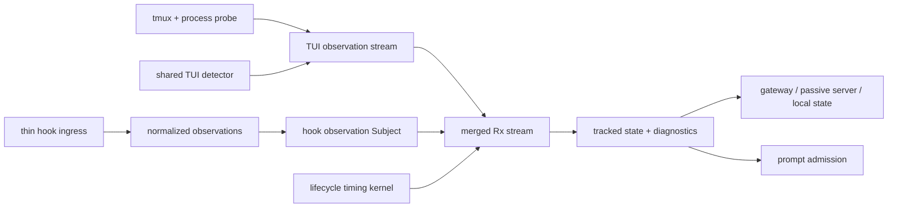
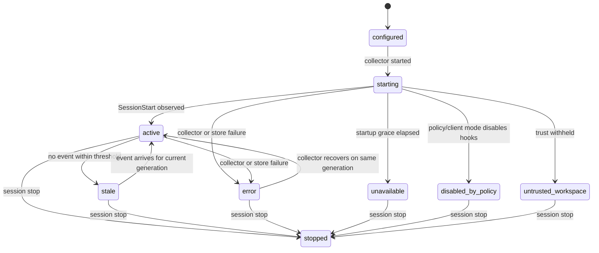

# Public Interfaces

## Scope

This document defines the provider-neutral interfaces for the CLI Hook Observation Channel: the event envelope, normalized observation model, channel health, hook posture, lifecycle, merge contract, public state additions, prompt-admission effects, persistence, security boundaries, errors, and compatibility rules.

Provider-specific event catalogs and launch integration live in [Claude Hook Adapter](claude-hook-adapter.md). Qualification and rollout live in [Qualification and Rollout](qualification-and-rollout.md).

## Covered Use Cases

- `UC-01`: Enable and Verify Hook Observation for a Managed Claude Launch
- `UC-02`: Merge Hook Lifecycle with TUI Surface State for a Normal Turn
- `UC-03`: Detect Permission Waits and API Failures from Hooks
- `UC-04`: Degrade to TUI-Only State When Hooks Are Unavailable

## Design Summary

The channel adds a fourth observation source alongside tmux/process probing, the shared TUI detector, and the lifecycle timing pipelines. Hook observations enter the existing RxPY resolution path as another observable source. They are not merged by a post-poll imperative reducer.



Hooks own lifecycle facts. The TUI owns surface facts. The merged Rx stream applies an explicit authority table through a reducer, and publishes conflicts instead of hiding them. The collector is an ingress adapter: it validates, stamps, persists, and emits into the hook `Subject`. It does not resolve turn state.

The decision is recorded in [ADR 0001](../adrs/0001-rx-stream-merge-for-hook-observations.md).

## 1. Provider-Neutral Observation Model

### 1.1 Raw Event Envelope

Every provider event is persisted in a session-scoped, append-only store with a thin envelope. The envelope is provider-neutral. The `payload` field is provider-specific and remains local.

```json
{
  "schema_version": 1,
  "channel_generation": "01J...",
  "provider": "claude",
  "provider_event": "Stop",
  "received_at_utc": "2026-10-18T16:30:12.412Z",
  "sequence": 42,
  "payload": {
    "session_id": "abc123",
    "prompt_id": "550e8400-e29b-41d4-a716-446655440000",
    "hook_event_name": "Stop",
    "last_assistant_message": "..."
  }
}
```

Required envelope fields:

- `schema_version`: Channel envelope revision.
- `channel_generation`: One id per provider launch. Events from an older generation are ignored after a relaunch.
- `provider`: Provider adapter id, for example `claude`.
- `provider_event`: Raw provider event name.
- `received_at_utc`: Collector or emitter receive time. This is the ordering clock for merge decisions.
- `sequence`: Monotonic per-generation sequence assigned by the collector.
- `payload`: Raw provider payload. Local only.

The collector assigns `received_at_utc`, `sequence`, and `channel_generation`. The provider payload is never trusted to supply ordering.

### 1.2 Normalized Observation

The normalizer converts each raw event into a typed observation. Unknown events become `unknown` observations and are counted, not rejected.

```python
HookObservationKind = Literal[
    "session_started",
    "session_ended",
    "prompt_submitted",
    "activity",
    "permission_requested",
    "permission_resolved",
    "turn_completed",
    "turn_failed",
    "maintenance_started",
    "maintenance_ended",
    "background_work_changed",
    "unknown",
]

TurnStateHint = Literal["none", "active", "blocked", "maintenance", "ended"]
TerminalResultHint = Literal["none", "success", "known_failure"]
```

```python
@dataclass(frozen=True)
class HookObservation:
    schema_version: int
    provider: str
    provider_event: str
    kind: HookObservationKind
    received_at_utc: str
    sequence: int
    channel_generation: str
    session_id: str | None
    prompt_id: str | None
    tool_use_id: str | None
    agent_id: str | None
    agent_type: str | None
    turn_state_hint: TurnStateHint
    terminal_result_hint: TerminalResultHint
    failure_class: str | None
    background_work_pending: bool
    final_text: str | None
    raw_payload_ref: str | None
```

Rules:

- `final_text` is provider-supplied assistant text only. For a failure event, it carries the provider error text or is omitted, not assistant prose.
- `failure_class` is a provider-scoped string such as a Claude API error class. It is diagnostic evidence, not a new public failure taxonomy.
- `raw_payload_ref` points into the local store. It is never serialized into a registry record or a remote API payload.
- `interrupted` is not a hook terminal hint. No provider currently exposes a reliable interrupt event for managed interactive sessions. Interrupt outcomes remain TUI-owned.
- Unknown fields are ignored. Unknown event names produce `kind=unknown` and increment `unknown_event_count`.

### 1.3 Channel Health

```python
HookChannelState = Literal[
    "active",
    "unavailable",
    "stale",
    "disabled_by_policy",
    "untrusted_workspace",
    "error",
    "stopped",
]
```

```python
@dataclass(frozen=True)
class HookChannelStatus:
    provider: str
    state: HookChannelState
    channel_version: int
    channel_generation: str
    last_event: str | None
    last_event_at_utc: str | None
    event_count: int
    malformed_event_count: int
    unknown_event_count: int
    dropped_event_count: int
    bound_session_id: str | None
    active_prompt_id: str | None
    detail: str | None
```

State meanings:

| State | Meaning | Merge behavior |
| --- | --- | --- |
| `active` | Events are arriving for the current generation and the channel passed startup checks. | Hook posture participates in merge. |
| `unavailable` | No observer configuration, no `SessionStart` within the startup grace period, or the provider does not support the channel. | TUI-only. |
| `stale` | The channel was active but the last event is older than the staleness threshold while the TUI is changing. | TUI regains lifecycle authority; the last hook posture is treated as unreliable. |
| `disabled_by_policy` | Organization policy or client mode disables hooks. | TUI-only. |
| `untrusted_workspace` | Interactive provider withheld hooks because the workspace is not trusted. | TUI-only; launch-level warning. |
| `error` | Collector, store, or transport failure, or repeated malformed events. | TUI-only for the affected window. |
| `stopped` | The session or channel generation ended and no live tracking is expected. | No merge; state remains readable for diagnostics. |

### 1.4 Hook Posture

The merge engine consumes a compact posture, not the raw event stream.

```python
@dataclass(frozen=True)
class HookPosture:
    turn_state: TurnStateHint
    terminal_result: TerminalResultHint
    active_prompt_id: str | None
    blocked_tool_name: str | None
    background_work_pending: bool
    last_final_text: str | None
    last_event_at_utc: str | None
    authority: Literal["none", "hook", "tui", "mixed"]
```

Posture transitions:

| Observation | Posture effect |
| --- | --- |
| `session_started` | Bind `session_id`, transcript path, model, and source. For `clear` or `fork`, reset turn posture. For `resume` and `compact`, preserve the previous terminal outcome. |
| `prompt_submitted` | Set `turn_state=active`, set `active_prompt_id`, clear `terminal_result`, clear blocked and maintenance flags. Idempotent when the same `prompt_id` is already active. |
| `activity` | Keep `turn_state=active` when a turn is armed. Refresh `last_event_at_utc`. Never create a terminal result. |
| `permission_requested` | Set `turn_state=blocked`, keep the turn armed, record `blocked_tool_name`. |
| `permission_resolved` | Clear blocked. Restore `active` if the turn is still armed, otherwise leave `none`. |
| `turn_completed` | Set `terminal_result=success`, `turn_state=ended`, record `last_final_text`, and set `background_work_pending` from the provider payload. Clear `active_prompt_id` after the terminal result is latched. |
| `turn_failed` | Set `terminal_result=known_failure`, `turn_state=ended`, record `failure_class`. Clear `active_prompt_id` after the terminal result is latched. |
| `maintenance_started` | Set `turn_state=maintenance`. Preserve the previous terminal result. |
| `maintenance_ended` | Clear maintenance. Restore `active` if a turn is still armed, otherwise `none`. |
| `background_work_changed` | Update `background_work_pending` only. |
| `unknown` | No posture change. Increment diagnostics. |

## 2. Channel Lifecycle



Lifecycle rules:

- The collector starts before the provider because `SessionStart` fires at provider startup and some providers cannot deliver it over HTTP.
- Each provider launch gets a new `channel_generation`. On relaunch or resume, the collector may append to the same store, but only the current generation participates in merge.
- On gateway attach after the provider has already started, the tracker replays events from the current generation to reconstruct posture. It does not replay older generations.
- On gateway detach and reattach without a provider relaunch, the same generation remains active and the event store is the source for reconstruction.
- On session stop, the collector stops and the channel transitions to `stopped`. Session cleanup decides whether artifacts are removed or retained for diagnostics.

## 3. Merge Contract

### 3.0 Reactive Stream Topology

The merge layer is a reactive pipeline that shares the existing `reactivex` dependency and test style.

```python
hook_observations: Observable[HookObservation] = hook_subject
tui_observations: Observable[TuiObservation] = tui_subject
lifecycle_observations: Observable[LifecycleObservation] = lifecycle_subject

merge_events = reactivex.merge(
    hook_observations.pipe(ops.map(_as_merge_event)),
    tui_observations.pipe(ops.map(_as_merge_event)),
    lifecycle_observations.pipe(ops.map(_as_merge_event)),
)

states = merge_events.pipe(
    ops.scan(_reduce_merge_event, seed=_MergeState()),
)

public_state = states.pipe(ops.map(_project_public_state))
```

Rules:

- **One resolution path.** Hook posture, TUI detector output, lifecycle observations, and timer events are reduced by one stream state machine. The collector and the TUI poller are producers, not resolvers.
- **Ingress ordering.** The collector assigns `channel_generation` and `sequence` in provider delivery order. The tracker stamps a monotonic ingest time when it accepts an event into the `Subject`. The exporter sequence is authoritative for provider events; the ingest time is the cross-source ordering clock.
- **Threading.** The ingress serializes `on_next` emission onto the tracker's Rx scheduler or a single emitter thread. A raw `Subject` must not receive concurrent emissions from multiple collector or poller threads without serialization.
- **Replay.** The stream state can be reconstructed from the current generation's event store. Replay uses the same reducer and a scheduler-backed clock, so live and replayed resolution do not diverge.
- **Virtual time.** Timer-driven transitions use the injected `Scheduler`, so qualification can drive stall, settle, and staleness behavior with `TestScheduler`.
- **Deterministic tie-break.** If a hook observation and a TUI observation share the same effective time, the reducer applies the hook lifecycle fact first and then the TUI surface fact. The authority table still prevents the TUI from overwriting a hook terminal result for the same prompt.
- **No hidden side effects.** The reducer is pure. Persistence, public API publication, and admission reads happen outside the reducer or through explicit output projections.

### 3.1 Authority Table

| Fact | Primary authority | Secondary evidence | Notes |
| --- | --- | --- | --- |
| Turn started | Hook `prompt_submitted` | Gateway submission record, TUI active evidence | Hook start arms the turn even for direct TUI input. |
| Turn ended successfully | Hook `turn_completed` | TUI completion dock and settle timer | Hook terminal bypasses the settle timer for `last_turn`, not for admission readiness. |
| Turn ended with failure | Hook `turn_failed` | TUI error-like surface | Hook supplies the failure class. |
| Blocked on operator | Hook `permission_requested` | TUI modal needles, delayed `Notification` | Hook wins even before the modal paints. |
| Tool or subagent activity | Hook `activity` | TUI spinner, footer, transcript growth | Hooks prevent false-ready during visually quiet work. |
| Maintenance window | Hook `maintenance_started` / `maintenance_ended` | TUI compaction surface | Maintenance does not invalidate the previous prompt outcome. |
| Final assistant text | Hook terminal payload | TUI dialog projection | TUI projection remains explicitly non-authoritative for answer association. |
| Background work pending | Hook terminal payload | None | New state fact with no current TUI equivalent. |
| Provider session binding | Hook `session_started` | Session manifest, tmux identity | Provider session id is secret-free but local. |
| Surface ready posture | TUI only | None | Hooks never assert `ready_posture=yes`. |
| Accepting input | TUI only | None | Hooks never assert composer readiness. |
| Draft or editing input | TUI only | None | A visible draft does not erase a hook terminal result. |
| Pending input | TUI only | None | No current hook exposes the provider queue. |
| Interrupt outcome | TUI only | Provider failure events for tool-level interrupts | No reliable hook event for a silent Esc abort. |

### 3.2 Observation Mapping to Existing State

| Existing field | Hook contribution |
| --- | --- |
| `turn_phase` | Hook active, blocked, or maintenance can force `active` even when the TUI looks ready. Hook terminal sets the phase to `ready` while TUI surface fields remain unchanged. |
| `last_turn.result` | Hook terminal sets `success` or `known_failure`. TUI continues to supply `interrupted`. |
| `last_turn.source` | Add `hook_observation` as a new source value, or preserve `explicit_input` when the gateway submission and hook event correlate. Direct input uses `hook_observation`. |
| `surface.ready_posture` | TUI only. Hook active may add a conflict note but does not overwrite the TUI value. |
| `surface.pending_input` | TUI only. |
| `surface.editing_input` | TUI only. |
| `active_reasons` | Add hook reasons such as `hook_prompt_submitted`, `hook_tool_activity`, `hook_subagent_activity`, `hook_compaction`. |
| `notes` | Add `hook_channel_active`, `hook_stop`, `hook_stop_failure:<class>`, `hook_background_work_pending`, and conflict notes. |
| `stability` | TUI only. Hook events do not reset or satisfy the TUI stability window. |
| `chat_context` | TUI only. Maintenance hooks may add a note. |

### 3.3 Correlation and Idempotency

- `channel_generation` and `sequence` are applied before correlation. Events from an older generation are dropped before they can arm a turn. Out-of-order events within the current generation are ordered by `sequence` when the reducer has not yet observed a newer terminal event.
- `session_id` binds an event to the tracked provider session. Events for a different session are orphaned and counted.
- `prompt_id` is the primary turn correlation key. A terminal event applies only to the active prompt with the same id, or to the current active turn when the id is absent.
- If `prompt_id` is absent, a terminal event may match an active turn by a bounded time window and the most recent turn start. The match is recorded as `prompt_id_missing` in diagnostics.
- A `prompt_submitted` event with the same `prompt_id` as the current active prompt is idempotent. It does not create a second turn.
- A `turn_completed` or `turn_failed` event with no active turn is recorded as an orphan. It may update diagnostics but must not manufacture a completed turn.
- Duplicate terminal events for the same `prompt_id` are idempotent. The first terminal result wins unless the provider emits an explicit correction.
- `SubagentStop` never terminates the parent turn. It updates subagent activity only.
- A `stop_hook_active=true` event means the provider is still continuing after another Stop hook blocked the stop. Treat it as active or waiting, not terminal, and record a diagnostic.

### 3.4 Conflict Rules

| Conflict | Resolution | Diagnostic |
| --- | --- | --- |
| Hook active, TUI ready | Hook active wins for lifecycle. Admission stays closed for `ready_only`. | `hook_active_tui_ready` |
| Hook blocked, TUI ready | Hook blocked wins. Admission stays closed for conditional policies. | `hook_blocked_tui_ready` |
| Hook terminal, TUI active | Hook terminal wins for `last_turn`. TUI surface remains as observed. Admission waits for TUI readiness. | `hook_terminal_tui_active` |
| Hook terminal success, TUI interrupt evidence | Hook success wins only if the terminal event has a matching prompt and no interrupt evidence. Otherwise keep `interrupted`. | `hook_success_tui_interrupted` |
| Hook terminal failure, TUI success dock | Hook failure wins for the current prompt. | `hook_failure_tui_success` |
| Hook stale, TUI changing | TUI wins. Hook posture is ignored for lifecycle until recovery. | `hook_stale_tui_authoritative` |
| Hook unavailable | TUI-only. | `hook_unavailable` |
| Hook event for an older generation | Ignore. | `hook_orphan_generation` |
| Hook event with unknown event name | Ignore for posture. Count it. | `hook_unknown_event` |
| Hook event malformed | Ignore. Count it. | `hook_malformed_event` |

Conflict diagnostics are bounded and secret-free. They include event names, timestamps, and conflict kinds, not raw payloads.

### 3.5 Staleness and Fallback

- Startup grace: if no `SessionStart` or first event arrives within the configured window, the channel becomes `unavailable`.
- Mid-turn staleness: if the channel was active and no event arrives for a threshold while TUI state changes, the channel becomes `stale`. A later event for the current generation restores `active`.
- A terminal hook event is not discarded merely because the channel later becomes stale. It remains the last known terminal fact unless a newer turn starts or a conflict rule rejects it.
- When the channel is `stale`, `unavailable`, `disabled_by_policy`, `untrusted_workspace`, or `error`, the merged state must be byte-equivalent to the TUI-only state for all existing fields.
- Reconciliation after recovery uses the current generation and the event sequence. Old events are never replayed into a new turn.

## 4. Public State Surface

### 4.1 Tracked State

Add one optional observation-channel projection to `HoumaoTerminalStateResponse`. `HookChannelStatus` is an internal frozen dataclass; the public field is a Pydantic projection with the same secret-free fields.

```python
class HookChannelStatusPayload(_HoumaoModel):
    provider: str
    state: HookChannelState
    channel_version: int
    channel_generation: str
    last_event: str | None = None
    last_event_at_utc: str | None = None
    event_count: int = 0
    malformed_event_count: int = 0
    unknown_event_count: int = 0
    dropped_event_count: int = 0
    bound_session_id: str | None = None
    active_prompt_id: str | None = None
    detail: str | None = None


class ObservationChannelStatus(_HoumaoModel):
    tui: str
    hooks: HookChannelStatusPayload
    process: str
```

```python
class HoumaoTerminalStateResponse(_HoumaoModel):
    ...
    observation_channels: ObservationChannelStatus | None = None
```

Rules:

- The field is optional and additive. Existing consumers must continue to work when it is absent.
- `HookChannelStatus` must not include raw payloads, raw tool inputs, prompt text, credentials, or collector tokens.
- `bound_session_id` may be exposed on local inspection surfaces. It must not be published to the shared registry.
- `detail` is a short human-readable reason such as `collector unreachable` or `startup grace elapsed`.

### 4.2 Diagnostics

The existing `HoumaoTrackedDiagnostics` gains optional fields:

```python
hook_channel_state: HookChannelState | None = None
hook_last_event: str | None = None
hook_last_event_at_utc: str | None = None
hook_event_count: int = 0
hook_malformed_event_count: int = 0
hook_unknown_event_count: int = 0
hook_conflict_reasons: tuple[str, ...] = ()
```

These fields are informational. They do not change `diagnostics.availability`.

### 4.3 Gateway and Passive Server

- `GET /v1/status` adds `observation_channels` to the gateway status payload.
- `GET /v1/control/tui/state` and its managed-agent projection include the same channel status and conflict reasons.
- `houmao-passive-server` local observation routes include the channel status when the observer can read the session-scoped store.
- Remote gateway proxy routes return whatever the gateway publishes. A passive server that cannot read the store reports `unavailable` with `detail=remote observation`.
- No route exposes the raw event store or collector token.

## 5. Prompt Admission Contract

Current admission policies are `ready_only`, `if_no_pending`, and `always`.

| Policy | Existing requirement | New hook requirement |
| --- | --- | --- |
| `ready_only` | TUI ready, stable, `pending_input=no` | Hook must not report `active` or `blocked`. If the channel is stale or unavailable, the existing TUI requirement is sufficient. |
| `if_no_pending` | `pending_input=no`; active is allowed | Hook must not report `blocked`. Hook active does not close this policy because queued follow-up is intentional. |
| `always` | None | Unchanged. |

Additional rules:

- Hook active suppresses a false-ready TUI for `ready_only`. This is the primary admission improvement.
- Hook terminal marks the turn complete, but `ready_only` still waits for TUI readiness, stability, and pending-input clearance before opening. This avoids submitting into a mid-repaint composer.
- Hook blocked closes both conditional policies until a resolution event or a new turn start.
- Hook `background_work_pending` does not by itself close admission. It is published as a separate fact. A policy may choose to consider it later.
- Admission records the merged facts in its decision payload:
  - `hook_channel_state`
  - `hook_turn_state`
  - `hook_terminal_result`
  - `hook_conflict_reasons`
- A stale or unavailable channel must not add new refusal reasons. Fallback is TUI-only, not a permanent closed gate.

## 6. Persistence and Cleanup

### 6.1 Layout

```text
<session-root>/
  hook-observation/
    <provider>/
      channel.json              # secret-free status and metadata
      events.ndjson             # append-only raw event store, mode 0600
      collector.json            # pid, loopback URL, generation, no token
      collector.log             # bounded collector diagnostics
      observer-settings.json    # generated provider settings source
      emit_hook.py              # optional command-hook fallback emitter
```

### 6.2 Permissions and Retention

- Directory mode `0700`; files mode `0600`.
- `events.ndjson` is append-only. Rotation or truncation is allowed only at a new channel generation.
- `channel.json` is written atomically and never contains tokens or raw payloads.
- Raw events are local diagnostic evidence. They are excluded from the shared registry, gateway status, remote APIs, and ordinary logs.
- Session cleanup removes the session-owned subtree by default. A diagnostic retention option may preserve it for a bounded period.
- Managed memory, provider homes, mailbox stores, and operator-owned paths are never touched by hook cleanup.

### 6.3 Collector Token

- The collector generates a per-session token.
- The token is passed to the provider environment or a `0600` file referenced by the observer settings.
- HTTP hooks send the token in an authorization header.
- The token is never written to `channel.json`, `collector.json`, public state, or logs.
- Command-hook fallback uses the same token or a local socket credential. A fallback that cannot authenticate writes to the local event store with an explicit `source=command_hook` marker.

## 7. Security and Privacy

### 7.1 Observer-Only Contract

- Command hooks must always exit 0 and write nothing to stdout.
- Command hooks must never exit 2. Exit 2 can block or alter provider behavior.
- HTTP hook handlers must return a 2xx response with no decision body.
- Observer hooks must not set `continue`, `decision`, `permissionDecision`, `updatedInput`, or any other behavior-changing field.
- A hook failure must be non-blocking. The collector and emitter must fail open for the provider and fail closed only for state claims.

### 7.2 Data Handling

- Raw hook payloads may contain prompts, file paths, tool inputs, command text, and secrets. Treat the event store as sensitive local state.
- Public state exposes event names, counts, tool names, failure classes, and conflict reasons only.
- Never publish `last_assistant_message`, `tool_input`, `tool_response`, `prompt`, or command text on a remote or registry surface.
- Diagnostic logs are bounded and redacted.
- Hook payload size is capped by the provider. The collector must reject oversized payloads with a counted diagnostic rather than writing unbounded data.

### 7.3 Trust and Policy

- Interactive Claude Code withholds hooks until the workspace is trusted. The managed launch must seed trust for unattended sessions.
- If trust is not seeded, the channel must report `untrusted_workspace` and the agent must still run.
- Organization policy can disable hooks or restrict HTTP hook URLs. The channel must detect silence and degrade.
- The collector binds loopback only. It must not be reachable from outside the host.

## 8. Errors

| Error Code | Condition | Behavior |
| --- | --- | --- |
| `hook_channel_unavailable` | No observer configuration or no `SessionStart` within the startup grace. | TUI-only; channel state `unavailable`. |
| `hook_channel_disabled_by_policy` | Managed policy, safe mode, bare mode, or another client mode disables hooks. | TUI-only; channel state `disabled_by_policy`. |
| `hook_workspace_untrusted` | Interactive provider withheld hooks because the workspace is not trusted. | TUI-only; channel state `untrusted_workspace`; launch warning. |
| `hook_collector_unreachable` | Collector is not listening or refuses the event. | Emitter falls back to the local store; channel may become `error`. |
| `hook_store_unwritable` | Event store cannot be opened or appended. | Channel `error`; TUI-only; bounded log entry. |
| `hook_event_malformed` | Payload is not valid JSON or lacks required correlation fields. | Skip and increment `malformed_event_count`. |
| `hook_event_unknown` | Event name or payload shape is unknown to the adapter. | Skip posture update and increment `unknown_event_count`. |
| `hook_correlation_orphan` | Event has no matching active turn or session. | Record diagnostic; do not manufacture a turn. |
| `hook_conflict` | Hook and TUI disagree under the authority table. | Apply authority rule and publish conflict reason. |
| `hook_version_unsupported` | Provider version lacks a required core event. | Disable or gate the channel; TUI-only. |
| `hook_settings_conflict` | Launch already supplies a conflicting settings source. | Fall back to managed-home injection or disable the channel with a diagnostic. |
| `hook_generation_mismatch` | Event belongs to an older channel generation. | Ignore; increment `orphan_generation_count`. |
| `hook_http_not_allowed` | HTTP hook URL is blocked by policy. | Use command-hook fallback if available; otherwise TUI-only. |

Errors are local diagnostics. They never fail the managed session unless the launch cannot start for an unrelated reason.

## 9. Compatibility and Versioning

- The channel envelope has its own `schema_version`. It is independent of the session manifest schema and the gateway protocol.
- `HookChannelStatus` and `ObservationChannelStatus` are additive fields. A consumer that does not understand them must ignore them.
- If `TrackedLastTurnSource` gains `hook_observation`, that is an additive enum extension. Consumers must treat unknown source values defensively rather than failing deserialization.
- Existing `TrackedStateSnapshot` semantics remain unchanged when the hook channel is absent or unhealthy.
- The provider adapter declares a minimum supported provider version and a per-event capability set. Events outside the capability set are not configured, and silence for an optional event is not treated as state.
- Unknown provider events are tolerated. They must not raise, fail the collector, or change posture.
- The raw event store is local implementation state. Its envelope is versioned; its `payload` shape is provider-owned and not a public contract.
- A future provider adapter may map its own events to the same normalized kinds without changing the merge contract.

## Open Questions

- Should the merged stream live inside `LiveSessionTracker`, or in a new `HookMergeSession` composed beside it that publishes into the existing tracker?
- What is the exact operator topology: `merge + scan`, `combine_latest + scan`, or a scheduler-driven queue feeding `scan`?
- How should a late TUI snapshot be handled after a hook terminal event: suppress the stale surface, publish it with a conflict note, or let the reducer keep the terminal result while the surface updates?
- Should `last_turn.source` gain `hook_observation`, or should direct-input turns continue to report `surface_inference` with a hook note?
- Should the channel publish `bound_session_id` on remote APIs, or keep it local-only?
- What startup grace and staleness thresholds should be defaults, and which should be launch-profile configurable?
- Should maintenance hooks close prompt admission, or only state transitions?
- Should the raw event store be removed at session stop by default, or retained until explicit cleanup?
