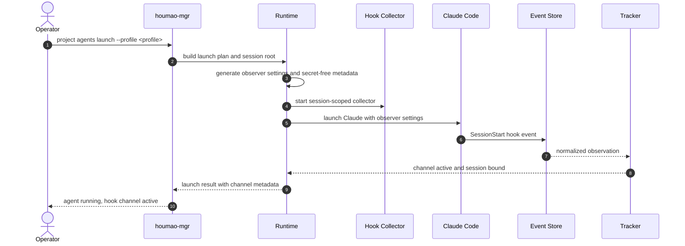

# Use Case 01: Enable and Verify Hook Observation for a Managed Claude Launch

## Actor Goal

As a Houmao operator or maintainer, I want a managed Claude Code launch to install and start the hook observation channel automatically, so that the runtime can use provider lifecycle events without any manual hook configuration or change to the agent's role.

## Use Case

A managed Claude launch already produces a runtime home, a session manifest, a tmux-backed TUI, a shared-registry record, managed memory, and optionally a gateway. This use case adds one more runtime-owned artifact family: a session-scoped hook observer configuration, a local collector, and an append-only event store.

The operator does not author hooks. The launch path generates an observer settings source, injects it into the Claude process, starts the collector before the provider, and records secret-free channel metadata in the session manifest. The first observable proof is a `SessionStart` event and a healthy channel state. The second observable proof is that the tracker publishes the same TUI-derived state as before when the channel is disabled.

This use case does not define the merge algorithm. It only establishes that the channel is installed, reachable, authenticated, and observable.

## Supported Actions

### Launch a Managed Claude Session with the Channel Enabled

- context
  - The operator has an initialized project overlay, a Claude specialist, a launch profile, and a trusted working directory.
  - The managed launch resolves a Claude Code version at or above the maintained floor.
- intent
  - The operator wants the hook channel active without editing the managed home's `settings.json` or the project's `.claude/settings.json`.
- action
  - The operator launches the managed agent through `houmao-mgr project agents launch` with hook observation enabled by the selected launch posture or feature flag.
- result
  - The session root contains a provider hook observer directory with a generated settings source, a collector record, and an empty event store.
  - The session manifest records the channel version, provider, and secret-free observer metadata.
  - The gateway or passive server can find the channel from the tracked-session identity.

### Verify Channel Health and Session Binding

- context
  - The managed session is live and the TUI process has started.
  - The collector was started before the provider process.
- intent
  - The operator wants proof that the provider loaded the observer configuration and that events reach the store.
- action
  - The operator inspects `houmao-mgr agents single --agent-name <name> state` or the gateway `/v1/control/tui/state` response and reads the observation-channel diagnostics.
- result
  - The channel reports `active`.
  - The diagnostics include the last event name, event count, provider, and bound `session_id`.
  - The event store contains a `SessionStart` event whose `session_id` matches the tracked provider session.
  - No raw payload, token, or secret appears in the public state response.

### Verify TUI-Only Equivalence When the Channel Is Disabled

- context
  - The operator launches, relaunches, or inspects a managed Claude session with the hook channel disabled or unavailable.
- intent
  - The operator wants assurance that the feature is additive and does not change existing state semantics.
- action
  - The operator compares the tracked state and admission outcomes against the current TUI-only qualification baseline.
- result
  - The channel reports `unavailable`, `disabled_by_policy`, or `untrusted_workspace`, with a diagnostic reason.
  - The tracker publishes the same TUI-derived turn, surface, stability, and last-turn fields as the TUI-only baseline.
  - Prompt admission behavior is unchanged.

### Stop and Clean Up the Channel

- context
  - The managed session is stopped, retired, or cleaned.
- intent
  - The operator wants no orphan collector, pointer, or hook configuration left behind.
- action
  - The operator stops the agent and runs the supported session cleanup path.
- result
  - The collector process is stopped.
  - Session-owned hook artifacts are removed or retained according to the session cleanup policy.
  - The registry record and shared state no longer reference the channel.
  - Managed memory and unrelated operator-owned paths are untouched.

## Main Flow

## Acceptance Criteria

- A managed Claude launch can install the observer without modifying operator-authored settings files.
- The collector starts before the provider and accepts an authenticated event within the configured startup grace period.
- A `SessionStart` event is recorded and correlated with the tracked session.
- The public state surface exposes channel health without exposing raw payloads or secrets.
- Disabling the channel produces TUI-only state and admission behavior identical to the current baseline.
- Stop and cleanup leave no live collector or dangling channel pointer.
- An untrusted workspace or a policy-disabled channel is reported explicitly and does not fail the managed session.

## Assumptions

- Claude Code event delivery is available for the selected version and client mode.
- The managed launch pre-seeds workspace trust for unattended sessions.
- The collector can bind a loopback listener and the provider can reach it.
- The session root is writable and owned by the Houmao user.

## Open Questions

- Should channel enablement be a launch-profile field, a global environment flag, or a default-on posture after qualification?
- Should the collector be a standalone process or a gateway-hosted endpoint when a gateway is attached?
- Should channel artifacts live under the session root or a dedicated runtime-owned subtree?
- What is the startup grace period before the channel is declared unavailable?
