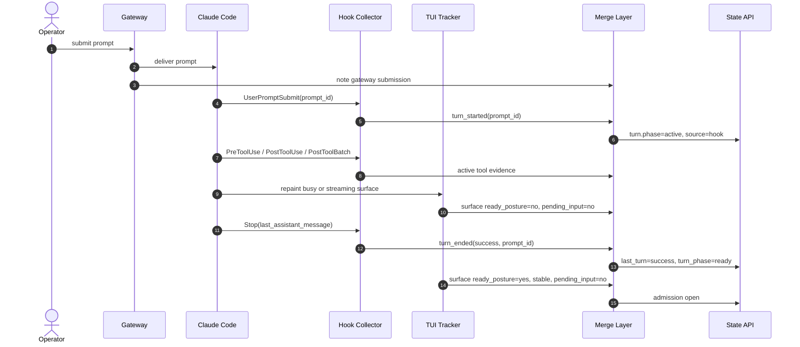

# Use Case 02: Merge Hook Lifecycle with TUI Surface State for a Normal Turn

## Actor Goal

As a Houmao operator or downstream controller, I want the tracker to combine provider hook lifecycle facts with TUI surface facts, so that a normal prompt turn reports active, completed, and ready states without waiting for heuristic terminal parsing.

## Use Case

A normal turn has two kinds of facts. The provider knows when the turn started, which tools ran, when the turn ended, and what the last assistant message was. The TUI knows whether the composer is ready, whether a draft exists, whether queued input is visible, and whether a modal holds the surface. The merged tracker must keep those facts separate and apply explicit authority rules instead of letting one channel overwrite the other.

This use case covers two turn origins:

- a prompt submitted by the gateway or `houmao-mgr`;
- a prompt typed directly into the managed TUI.

Both produce a hook turn-start event. The direct-input case is important because the gateway has no native submission record for it.

## Supported Actions

### Reconstruct a Gateway-Sent Turn

- context
  - The managed agent has an attached gateway, live TUI tracking, and an active hook channel.
  - The operator submits a prompt through the supported prompt path.
- intent
  - The operator wants the tracker to show the turn as active immediately, to surface tool activity, and to complete as soon as the provider reports the turn ended.
- action
  - The gateway submits the prompt, records its own submission, and the provider emits `UserPromptSubmit`, tool events, and `Stop`.
- result
  - The gateway submission and the hook turn start correlate by `prompt_id` or by a bounded text-and-time match and do not double-arm the turn.
  - `turn.phase` becomes `active` without waiting for the TUI to repaint a busy footer.
  - Tool and subagent events refresh activity evidence.
  - `Stop` publishes a completed turn with a terminal result of `success` and the provider's last assistant message as local turn evidence.
  - TUI surface fields remain TUI-owned: `accepting_input`, `editing_input`, `ready_posture`, and `pending_input`.
  - Admission does not reopen until the TUI is visibly ready, stable, and free of pending input.

### Reconstruct a Direct-Input Turn

- context
  - The operator types a prompt directly into the managed tmux pane, outside the gateway submission path.
- intent
  - The operator wants the tracker to recognize the turn even though Houmao did not send it.
- action
  - The provider emits `UserPromptSubmit` when the prompt is accepted, followed by tool events and `Stop`.
- result
  - The hook channel arms a turn with the observed `prompt_id`.
  - The tracker does not claim that a human typed the prompt. It records the turn start and, where available, the provider's optional prompt-source field as diagnostic evidence only.
  - Completion and failure use the same merge rules as a gateway-sent turn.

### Preserve TUI-Only Surface Facts

- context
  - A turn is active or just completed, and the operator types into the composer or queues another prompt.
- intent
  - The operator wants draft and queued-input information to stay accurate even while hooks own lifecycle facts.
- action
  - The tracker captures the TUI surface during the turn and after completion.
- result
  - `surface.editing_input` reflects whether the operator is composing a draft.
  - `surface.pending_input` reflects the provider-native queued-input surface.
  - A visible draft does not erase a hook-reported terminal outcome.
  - A hook `Stop` does not force `ready_posture=yes` when the TUI remains visually unsettled.

### Publish Conflict Diagnostics

- context
  - The hook channel and the TUI disagree about turn activity or terminal outcome.
- intent
  - The operator wants an explicit reason instead of a silently chosen winner.
- action
  - The tracker records the conflict and continues with the authority rules.
- result
  - Diagnostics include a conflict kind such as `hook_active_tui_ready`, `hook_terminal_tui_active`, or `hook_stop_missing_tui_active`.
  - The chosen authority and the rejected evidence remain visible in local diagnostics.
  - Admission fails closed for conditional policies when the conflict leaves activity or pending input unresolved.

## Main Flow

## Acceptance Criteria

- A gateway-sent turn and a direct-input turn both produce a hook turn start and a single logical turn in the tracker.
- A hook turn start suppresses a false-ready surface for prompt admission.
- A hook `Stop` produces a completed turn without waiting for the TUI settle timer, while admission still waits for TUI readiness, stability, and pending-input clearance.
- TUI draft and pending-input facts remain accurate and are not overwritten by hook lifecycle facts.
- A terminal outcome reported by hooks survives a later visible draft.
- Conflicts between hook and TUI facts are published as diagnostics, not hidden.
- When the hook channel is absent, the same turn is reconstructed by the existing TUI-only path with no regression.

## Assumptions

- `UserPromptSubmit` and `Stop` are available for the selected Claude Code version and client mode.
- The gateway submission path and the hook channel can correlate a prompt within a bounded window when `prompt_id` is unavailable.
- The TUI detector continues to publish readiness, editing, and pending-input facts during the turn.
- The provider's last assistant message is suitable as local turn evidence but is not treated as a task-completion guarantee.

## Open Questions

- What correlation window and matching rule should apply when the gateway submission lacks a `prompt_id`?
- Should a direct-input turn be attributed to `surface_inference` or to a new `hook_observation` source?
- Should the tracker expose the provider's `last_assistant_message` on the public state surface, or keep it in local evidence only?
- How should a hook `Stop` interact with a TUI stable-active recovery that is already pending?
