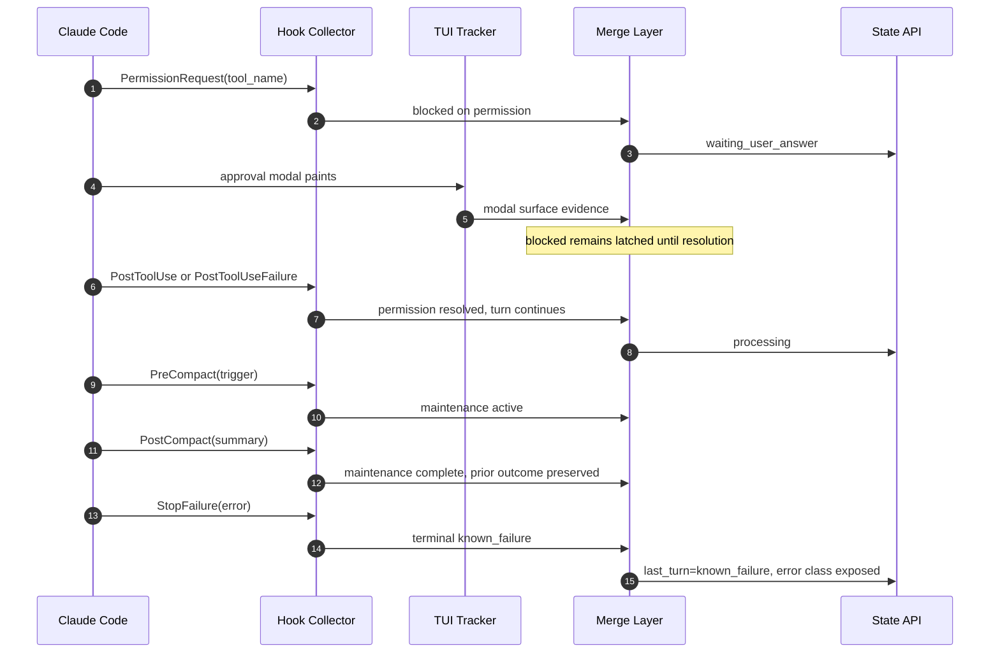

# Use Case 03: Detect Permission Waits and API Failures from Hooks

## Actor Goal

As a Houmao operator or downstream controller, I want the tracker to recognize when a Claude turn is waiting on an approval dialog or has ended because of an API error, so that state and admission decisions do not depend on version-specific modal or error text.

## Use Case

The Claude TUI detector recognizes approval panels, trust dialogs, model pickers, interruption lines, and error-like color patterns. Those cues are version-specific, can lag behind the provider, and do not identify the API failure class. Hooks provide a stronger signal:

- `PermissionRequest` fires when a permission dialog is displayed, with the tool name and input;
- `StopFailure` fires instead of `Stop` when an API error ends the turn, with an error class;
- `PostToolUseFailure` reports tool failures and interrupts;
- `PreCompact` and `PostCompact` identify maintenance windows that must not be mistaken for completion or idle;
- `Notification` provides delayed corroboration for permission, idle, and completion notifications.

This use case does not remove the TUI. It uses hooks to set the lifecycle fact first, then lets the TUI supply the visible surface details and the eventual resolution.

## Supported Actions

### Detect a Permission Wait

- context
  - A managed Claude turn is active and a tool call requires operator approval.
  - Interactive permission denial has no dedicated hook, so the provider may only expose the dialog and the eventual tool outcome.
- intent
  - The operator wants `waiting_user_answer` and a closed `ready_only` admission gate as soon as the permission dialog is requested.
- action
  - The provider emits `PermissionRequest` with `tool_name` and `tool_input`; the TUI may not have painted the modal yet.
- result
  - The merged state reports `operator_state.status=waiting_user_answer` and `readiness_state=blocked`.
  - A diagnostic records the tool name and the hook event. Raw tool input stays local.
  - `ready_only` and `if_no_pending` admission remain closed.
  - When the tool executes, fails, or the turn stops, the blocked posture clears through the corresponding event.

### Corroborate with Delayed Notifications

- context
  - A permission wait or an idle state persists long enough for a provider notification.
- intent
  - The operator wants a second, lower-authority signal that confirms the wait or idle posture.
- action
  - The provider emits a `Notification` with `permission_prompt`, `agent_needs_input`, `idle_prompt`, or a related type.
- result
  - The notification is recorded as corroborating evidence with its delay.
  - It does not override `PermissionRequest` as the primary blocked signal.
  - It does not mark a turn as complete when `Stop` has not fired.

### Detect an API Failure

- context
  - A turn ends because of a rate limit, authentication failure, overload, server error, token limit, billing failure, or another provider-classified API error.
- intent
  - The operator wants a terminal `known_failure` outcome and the error class without reading a rendered error banner.
- action
  - The provider emits `StopFailure` with `error`, optional `error_details`, and the API error text.
- result
  - The merged state publishes `last_turn.result=known_failure`.
  - Diagnostics record the provider error class, not a full raw payload.
  - `operator_state` reflects a failed or ready-but-failed posture according to the existing known-failure rules.
  - A subsequent successful turn clears the failure by the normal turn-start rules.

### Preserve Outcomes Across Compaction

- context
  - The provider compacts context during or between turns.
- intent
  - The operator wants compaction to appear as maintenance activity, not as a new prompt turn or a spurious completion.
- action
  - The provider emits `PreCompact`, then `PostCompact`.
- result
  - The turn tracking records a maintenance window.
  - The previous prompt turn's terminal outcome is preserved.
  - A completed look that appears only because compaction settled the surface does not create a new success.
  - The tracker resumes normal lifecycle tracking after `PostCompact`.

## Main Flow

## Acceptance Criteria

- A `PermissionRequest` produces a blocked operator state before the TUI modal is visible.
- Conditional prompt admission stays closed while the hook reports a permission wait.
- The blocked posture clears only on an event that proves the wait ended, or on a new turn start.
- A `StopFailure` produces `last_turn.result=known_failure` and records the provider error class.
- A compaction event does not erase the previous prompt turn's terminal outcome.
- A visible error banner or modal that disagrees with the hook fact produces a conflict diagnostic rather than a silent overwrite.
- No raw tool input, prompt text, or credential material appears in public state.

## Assumptions

- `PermissionRequest` and `StopFailure` are available for the selected Claude Code version, or the channel is version-gated accordingly.
- Interactive permission denial may not emit a dedicated hook, so the TUI or the following tool outcome remains part of the resolution path.
- `Notification` timing is delayed and is not used as the primary immediate signal.
- `PreCompact` and `PostCompact` are available, or the existing TUI-only maintenance handling remains in force.

## Open Questions

- Should `PermissionRequest` be treated as a terminal blocked state that only specific events can clear, or as a hint that decays after a timeout?
- Should `StopFailure` error classes map to the existing `known_failure` vocabulary directly, or to a new provider-scoped failure taxonomy?
- How should an interactive permission denial be represented when neither `PermissionDenied` nor `PostToolUseFailure` fires?
- Should a compaction window suppress prompt admission, or only state transitions?
- What is the timeout when a permission request has no matching resolution event?
