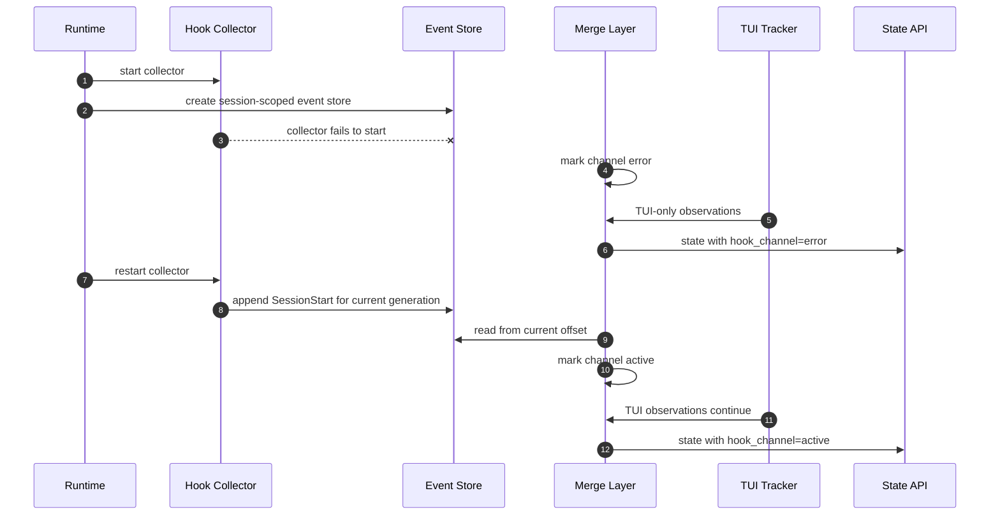

# Use Case 04: Degrade to TUI-Only State When Hooks Are Unavailable

## Actor Goal

As a Houmao operator or maintainer, I want the tracker to detect when the hook channel is missing, disabled, stale, or untrusted, so that state tracking continues with the existing TUI-only behavior and the operator can see why the second channel is not contributing.

## Use Case

Hooks are a conditional capability. They can be unavailable because the provider version lacks an event, the managed launch did not install the configuration, an organization policy disables hooks, the workspace is not trusted, the client runs in `--safe-mode` or `--bare`, the collector crashed, or the event store became unreadable. None of these conditions may break the managed agent or silently change state semantics.

The fallback contract is simple: when the hook channel is not healthy, the merged tracker must behave like the current TUI-only tracker. The channel state and its reason must be visible on inspection surfaces.

## Supported Actions

### Detect a Missing or Disabled Channel

- context
  - A managed Claude session starts without an observer configuration, or the provider policy blocks it.
- intent
  - The operator wants to know that hooks are not available without a failed launch.
- action
  - The tracker waits for the startup grace period and observes no `SessionStart` event, or reads a known policy-disable condition from launch metadata.
- result
  - The channel reports `unavailable`, `disabled_by_policy`, or `untrusted_workspace` with a bounded detail string.
  - The tracker publishes the TUI-only baseline state.
  - No admission policy changes.

### Detect a Stale Channel Mid-Turn

- context
  - The channel was healthy, then events stop arriving while the TUI still reports activity or completion.
- intent
  - The operator wants the tracker to stop treating hook silence as evidence and to fall back without losing the current turn.
- action
  - The tracker observes that the last hook event is older than the configured staleness threshold while the TUI state continues to change.
- result
  - The channel reports `stale`.
  - The current turn's TUI facts regain authority.
  - A diagnostic records the last event, its age, and the conflict or fallback reason.
  - The turn remains observable and stoppable.

### Detect a Collector or Store Failure

- context
  - The collector process exits, the loopback port closes, the event store becomes unwritable, or an event payload is malformed.
- intent
  - The operator wants a diagnosed degradation rather than a partial or corrupt state.
- action
  - The tracker records the transport error, malformed-event count, or write failure.
- result
  - The channel reports `error` while the TUI tracker continues.
  - Malformed events are skipped and counted; they do not change turn state.
  - The managed session remains alive and controllable.
  - Cleanup can remove or preserve the failed channel artifacts according to the session policy.

### Recover When the Channel Returns

- context
  - A collector restarts, a policy condition clears, or a new session starts with a working channel.
- intent
  - The operator wants the channel to recover without duplicating a turn or replaying stale events.
- action
  - The tracker validates the channel generation, reads new events from the current offset, and ignores events from an older session or generation.
- result
  - The channel returns to `active`.
  - State continuity is preserved; old events do not re-arm an old turn.
  - A recovery diagnostic records the generation change.

## Main Flow

## Acceptance Criteria

- Missing, disabled, untrusted, stale, and errored channels are distinguishable in diagnostics.
- In every degraded state, the merged state matches the TUI-only baseline for turn, surface, stability, and last-turn fields.
- Prompt admission behavior is unchanged when the hook channel is not active.
- Malformed, duplicate, unknown, and out-of-order events never crash the tracker.
- A stale channel does not keep a completed turn active or a blocked turn latched indefinitely.
- Recovery does not replay old turns or double-arm a prompt.
- The managed agent remains launchable, promptable, inspectable, and stoppable throughout.

## Assumptions

- The TUI tracker is available and qualified for the selected provider version.
- The session root and public state surface have room for additive channel diagnostics.
- The channel can distinguish a session generation from a provider session id.
- The tracker can read the event store without blocking the provider.

## Open Questions

- What are the startup grace period and the mid-turn staleness threshold?
- Should a degraded channel be a warning, an operator-visible state field, or both?
- Should the tracker attempt to restart a failed collector automatically, or leave recovery to the next session or relaunch?
- Should raw events from a previous generation be retained for diagnostics or deleted at generation change?
- How should a joined session report that hooks were never installed, as opposed to a managed session whose hooks failed?
