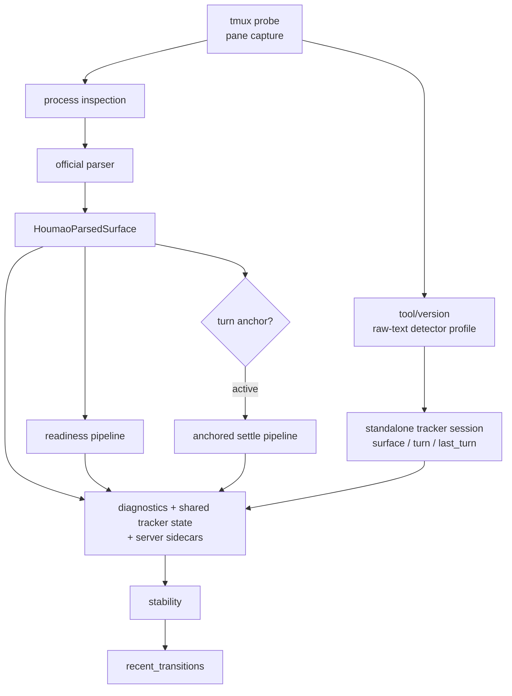

# Retired Houmao Server State Tracking

This page is internal reference for retained old-server TUI modules and shared tracking models. `houmao-server` is no longer a packaged executable or maintained public server API. Current API-based observation is exposed through `houmao-passive-server`, while this page explains retained implementation pieces that maintained code may still import.

The retained tracking model still distinguishes two live-tracking execution modes behind the same public models:

- Direct fallback: retained old-server modules can run the tracker locally for eligible managed TUI sessions.
- Gateway-owned tracking: an attached healthy per-agent gateway runs the live tracker for that one session, and maintained API surfaces can project the gateway state back through `/houmao/agents/*` routes.

This keeps one public state contract while enforcing single-owner tracking authority during attach, detach, and gateway health transitions.

The public models live in [`src/houmao/server/models.py`](../../../src/houmao/server/models.py), which re-exports core types from [`src/houmao/shared_tui_tracking/models.py`](../../../src/houmao/shared_tui_tracking/models.py). The standalone tracker engine now lives in [`src/houmao/shared_tui_tracking/session.py`](../../../src/houmao/shared_tui_tracking/session.py), while [`src/houmao/server/tui/tracking.py`](../../../src/houmao/server/tui/tracking.py) acts as the live host adapter that merges shared tracker state with server-owned diagnostics and lifecycle metadata. Timed readiness and completion behavior still reuse the shared ReactiveX lifecycle kernel in [`src/houmao/lifecycle/rx_lifecycle_kernel.py`](../../../src/houmao/lifecycle/rx_lifecycle_kernel.py). For the file-by-file package layout of the server watch plane, see [internals/tui_tracking_module.md](internals/tui_tracking_module.md).

## Public Contract

> For the full definition of each state value (intuitive meaning, technical derivation, operational implications), see the [State Reference Guide](state-reference.md). For state transition diagrams and operation acceptability, see the [State Transitions Guide](state-transitions.md).

The public state is intentionally small:

| Field | Values | Meaning |
|-------|--------|---------|
| `diagnostics.availability` | `available`, `unavailable`, `tui_down`, `error`, `unknown` | Whether the current sample is usable for normal tracked-state interpretation |
| `surface.accepting_input` | `yes`, `no`, `unknown` | Whether typed input would currently land in the prompt area |
| `surface.editing_input` | `yes`, `no`, `unknown` | Whether prompt-area input is actively being edited now |
| `surface.ready_posture` | `yes`, `no`, `unknown` | Whether the visible surface looks ready for immediate submit |
| `turn.phase` | `ready`, `active`, `blocked`, `unknown` | Current turn posture; `blocked` is hook-only |
| `last_turn.result` | `success`, `interrupted`, `known_failure`, `none` | Most recent completed terminal outcome |
| `last_turn.source` | `explicit_input`, `surface_inference`, `hook_observation`, `none` | Where that recorded terminal turn came from |
| `work` | `pending`, `clear`, `unknown` | Session-scoped background work from Claude hook payloads; `unknown` for Codex and Kimi and whenever hook evidence is absent or degraded |
| `settled` | boolean | Derived convenience: `turn.phase=ready` and `work=clear` |
| `observation_channels` | optional list of `HoumaoObservationChannel` | Additive hook channel state; null when no channel is configured |
| `chat_context` | `current`, `degraded`, `unknown` | Whether the current chat context is healthy, recoverably degraded, or unknown |
| `stability` | `signature`, `stable`, `stable_for_seconds`, `stable_since_utc` | Generic visible-state stability for the published response |
| `recent_transitions` | bounded list of `HoumaoRecentTransition` | Recent visible state changes kept in memory for diagnostics |

Low-level observation detail still remains available alongside the simplified model:

- `transport_state`
- `process_state`
- `parse_status`
- optional `probe_error`
- optional `parse_error`
- nullable `parsed_surface`
- optional `probe_snapshot`
- tracked-session metadata such as `tracked_session.observed_tool_version`
- optional hook diagnostics: `diagnostics.hook_channel_state`, `diagnostics.hook_counters`, and `diagnostics.hook_conflict_reasons`
- optional `last_turn.error_class`, populated for a hook-settled `known_failure`

Server-owned lifecycle sidecars still remain available for consumers that need timing or authority detail:

- `operator_state`
- `lifecycle_timing`
- `lifecycle_authority`

`lifecycle_timing` now includes the configured stale-active and final stable-active recovery windows in addition to readiness unknown and anchored completion timing.

Those lower-level fields are diagnostic evidence, not the primary consumer-facing lifecycle vocabulary.

## End-To-End Flow

> A more detailed state composition flowchart reflecting the `shared_tui_tracking/` module extraction is maintained in [state-transitions.md § State Composition](state-transitions.md#state-composition).

One tracking cycle moves through these layers:



`LiveSessionTracker.record_cycle()` keeps the internal timing and anchor bookkeeping, but it now maps those internals into the simplified public contract rather than exposing readiness/completion/authority terms directly. The standalone tracker session may combine single-snapshot detector output with profile-owned temporal hints over a recent sliding window before those public fields are published.

## Mapping Rules

### Diagnostics

`diagnostics.availability` is derived from the low-level observation outcome:

- `error`: probe or parse failed for this sample
- `unavailable`: tracked tmux target is gone
- `tui_down`: tmux is reachable but the supported TUI process is not running
- `available`: parser produced a supported parsed surface
- `unknown`: the server is still watching, but the sample is not classifiable confidently enough for normal interpretation

### Foundational Surface Observables

`surface.accepting_input`, `surface.editing_input`, and `surface.ready_posture` are built from raw tmux pane text through the shared tracker’s tool/version detector profile. Parsed surface data is published as server-owned sidecar evidence and does not feed tracker authority.

Important consequences:

- progress indicators are supporting evidence only; they are not required for `turn.phase=active`
- ambiguous interactive UI such as menus, selection boxes, permission prompts, or slash-command pickers degrades to `unknown` unless stronger active or terminal evidence exists
- unexplained churn may still change diagnostics, surface observables, stability, or transitions without creating a turn
- full tmux scrollback may still be captured for parser and history use, but current activity cues do not have to trust arbitrary historical rows

For Codex, the tracker intentionally splits the surface into two scopes:

- the prompt-scoped latest-turn region for interruption, success context, and temporal transcript growth
- the live-edge tail for current status-row and tool-cell activity

That split prevents stale historical `• Working (... esc to interrupt)` rows far above the prompt from pinning `turn.phase=active` when the current surface is already prompt-ready.

Prompt-adjacent Codex compact/server error cells are recoverable degraded-context evidence. They set current-error diagnostics and block success candidacy for that surface, but they do not force prompt readiness away from ready when the prompt/composer facts are otherwise ready. Historical compact/server error cells in long scrollback do not affect current `chat_context`.

### Turn Phase

`turn.phase` is intentionally narrower than the internal reducer graph:

- `ready`: the surface looks ready for another turn now
- `active`: there is enough evidence that a turn is currently in flight
- `blocked`: the provider is asking the operator for an action and will not proceed until it is settled; only hook observation enters this phase
- `unknown`: the server cannot safely classify the posture as `ready` or `active`

Explicit server-owned input acceptance is enough to arm an active turn immediately. Direct interactive prompting can still become `active` through shared-tracker raw-snapshot evidence without any parser-derived bridge. TUI parsing never emits `blocked`; a TUI-detected permission dialog keeps the existing `turn.phase=active` plus `operator_state=waiting_user_answer` presentation. Hook `PermissionRequest` enters `blocked`. For Claude, hook permission resolution, a hook terminal event, or TUI modal-dismissal evidence leaves it; for Codex, the paired `PostToolUse` (allow path) or `Interrupt` (deny path, which settles the turn interrupted) leaves it; for Kimi, the paired `PermissionResult` settles it for both decisions, and TUI evidence does not settle a Kimi blocked wait.

There are two host-owned corrections on top of the shared tracker. The narrow stale-active correction clears an unanchored session after it stays submit-ready for the configured stale-active recovery window while the shared tracker is still stuck on stale `status_row` evidence. The final stable-active correction uses a longer default 20-second window and clears a stable false-active posture when `turn.phase=active` and the rendered-surface signature derived from the tmux capture remains unchanged for that window. Unlike the narrow stale-active path, final stable-active recovery is parser-independent; it exists as the backstop for detector false positives, so parser-derived fields cannot veto its timer or participate in its recovery key. These recoveries:

- require parsed submit-ready posture plus `surface.accepting_input=yes` and `surface.editing_input=no` only for the narrow stale-active path
- keep the 5-second narrow recovery limited to unanchored stale `status_row` evidence
- allow the final 20-second recovery to correct `surface.ready_posture=no` without consulting parser readiness, active reasons, or tracker stability fields
- stop anchored completion monitoring when final recovery expires a stale active anchor
- do not manufacture `last_turn.result=success`
- preserve recoverable error diagnostics such as `chat_context=degraded` when recovery corrects a false active state

### Last Turn

`last_turn` is sticky and only changes when a tracked turn reaches a terminal outcome:

- `success`: the latest answer-bearing ready surface passed the settle window and has no current interrupt, failure, or advisory blocker
- `interrupted`: the detector saw a supported current interruption signature, or a Codex hook `Interrupt` settled the turn
- `known_failure`: the detector saw a specifically supported failure signature
- `none`: no terminal result has been recorded yet

Two clarifications matter:

- success does not require a `Worked for <duration>`-style marker on every turn
- a premature success may be retracted if a later observation proves the same turn surface was still evolving; the tracker keeps the success anchor alive briefly to allow that correction before expiry

## Turn Sources And Server Anchors

The public `last_turn.source` field and the server-owned lifecycle anchor state are related, but they are not the same thing.

Tracked state records three turn sources:

| Source | How it is armed | Public source |
|--------|-----------------|---------------|
| `terminal_input` | `POST /houmao/terminals/{terminal_id}/input` succeeds and the service calls `note_prompt_submission()` | `explicit_input` |
| `surface_inference` | raw tmux snapshots show enough active/success evidence for the shared tracker to infer a direct in-terminal turn | `surface_inference` |
| Hook terminal event (`Stop`, `StopFailure`, or Codex `Interrupt`) | latches the turn; a gateway submission record correlated with the same turn keeps `explicit_input` | `hook_observation` |

Separately, the server still owns explicit-input lifecycle anchors for parser-fed `operator_state`, `lifecycle_timing`, and `lifecycle_authority`.

- `explicit_input` can arm both the shared tracker and the server-owned lifecycle anchor.
- `surface_inference` is tracker-owned only. It can produce public `last_turn.source=surface_inference` while server-owned `lifecycle_authority.turn_anchor_state` remains `absent`.
- `hook_observation` is hook-owned. A hook terminal event settles the turn immediately, without waiting for the TUI settle window, and records the provider `error_class` for `known_failure`. On Claude, TUI temporal interrupt evidence for the same turn epoch, observed outside a maintenance window, may still override a hook success with `interrupted`. On Codex and Kimi, the hook `Interrupt` event supplies the interrupted outcome, and a latched outcome is final for its epoch.
- Parser-derived surface churn does not arm tracker authority. Parsed surface remains server-owned evidence and lifecycle input only.
- Observed tool version for tracker profile selection comes from tracked-session metadata, primarily manifest launch-policy provenance with graceful fallback when unavailable.

## Hook Observation Channel

Managed `local_interactive` sessions can opt into a hook observation channel that feeds provider-emitted lifecycle events into tracked state. The channel is off by default and opt-in per adapter: set `HOUMAO_HOOK_OBSERVATION_CLAUDE=1` for Claude Code 2.1.296 or later, `HOUMAO_HOOK_OBSERVATION_CODEX=1` for Codex 0.162.1 or later, or `HOUMAO_HOOK_OBSERVATION_KIMI=1` for Kimi Code 2.1.1 or later. Only the exact value `1` enables an adapter, and any other value leaves behavior unchanged. The supported pairs are `("claude", "local_interactive")`, `("codex", "local_interactive")`, and `("kimi", "local_interactive")`. `claude_headless`, `codex_headless`, `kimi_headless`, joined sessions, and unmanaged launches remain TUI-only.

A session with the channel configured has one collector process bound to `127.0.0.1` on an ephemeral port. Deliveries authenticate with a per-session bearer token, and the collector appends normalized events to `<session_root>/hook-observation/<adapter>/events.ndjson` with a secret-free `channel.json` alongside it; `<adapter>` is `claude`, `codex`, or `kimi`. Every tracking consumer tails that file with its own offset and folds new observations at its next read or poll cycle, so the gateway-owned tracker, the retained `houmao-server` tracker, and the passive server can all track the same session independently.

The channel is additive. When no channel is configured, every field described here keeps its previous value or default, and tracked behavior is byte-identical to TUI-only tracking.

### Adapter Coverage

All three adapters reuse the collector, store, health monitor, and reader. They differ in injection, event vocabulary, and posture rules.

| Adapter | Enablement | Observer injection | Subscribed events |
|---|---|---|---|
| Claude Code | `HOUMAO_HOOK_OBSERVATION_CLAUDE=1`, floor 2.1.296 | Marker merge into the managed home `settings.json`, with a session-scoped `--settings` fallback | Nine events |
| Codex | `HOUMAO_HOOK_OBSERVATION_CODEX=1`, floor 0.162.1 | Observer `hooks.json` in the runtime-owned `CODEX_HOME` plus a pre-trust block in the runtime-home `config.toml`; no bypass flag and no operator file | Fourteen events, ten dispatched at the supported floor |
| Kimi Code | `HOUMAO_HOOK_OBSERVATION_KIMI=1`, floor 2.1.1 | Marker merge of a 20-entry `[[hooks]]` observer block into the launch-owned runtime-home `config.toml`; no trust step and no operator file | Twenty events |

Codex subscribes `PreModelRequest`, `PostModelRequest`, `PreToolUse`, `PermissionRequest`, `PostToolUse`, `PreCompact`, `PostCompact`, `SessionStart`, `SessionEnd`, `UserPromptSubmit`, `SubagentStart`, `SubagentStop`, `Stop`, and `Interrupt`. At the supported floor, `PreModelRequest`, `PostModelRequest`, `SubagentStart`, and `SubagentStop` never fire; the reducer counts them as unavailable event families in diagnostics rather than failures and keeps the other ten families as the posture evidence. `SessionStart` is lazy: Codex dispatches it at the first turn start, not at process launch. Model-request events and `Stop` carry no token usage, and no Codex payload exposes a background-work mirror, so the Codex adapter publishes `work=unknown` and never claims `settled` from hook evidence alone.

Codex trust is automatic on the managed path. The launch writes the observer `hooks.json` into the runtime home and pre-trusts every handler through Houmao-owned `[hooks.state."<absolute hooks.json path>:<snake_case event label>:<group index>:<handler index>"]` entries with `trusted_hash` values in the same home's `config.toml`. The marker-delimited block is generation-scoped, rewritten at every provider start, and removed on cleanup; operator-authored `hooks.state` entries and every other `config.toml` line are preserved. The managed path never adds `--dangerously-bypass-hook-trust`, never writes the operator's Codex home or profile, and requires no operator action. See the [Codex Signal Reference](../tui-parsing/codex-signals.md#hook-observation-support) for the event and payload details.

Kimi subscribes `PreToolUse`, `PostToolUse`, `PostToolUseFailure`, `PermissionRequest`, `PermissionResult`, `UserPromptSubmit`, `UserPromptQueued`, `TurnStarted`, `Stop`, `StopFailure`, `Interrupt`, `SessionStart`, `SessionEnd`, `SessionHeartbeat`, `SubagentStart`, `SubagentStop`, `TaskStarted`, `PreCompact`, `PostCompact`, and `Notification`, with one synchronous entry each, an omitted matcher, and a 5-second timeout. `StopFailure`, `TaskStarted`, `Notification`, and the `cancelled` and `error` permission decisions were never exercised live at 2.2.0; they stay subscribed as silent or defensive families, and the normalizer counts unseen families in diagnostics rather than failing. Kimi correlation is two-phase: `UserPromptSubmit` arms a turn epoch and the following `TurnStarted(origin_kind=user)` binds the integer, session-scoped `turn_id`; tool events and `Stop` carry no `turn_id` and attribute to the armed epoch by stream order. Permission events exist only under an ask permission policy, so a never-ask session legitimately produces none. `Stop` carries no background-task payload, `SessionHeartbeat` is liveness evidence only, and the adapter publishes `work=unknown` for every sample; hooks alone never produce `settled`.

Kimi needs no trust step. The launch merges the marker-delimited observer block into the launch-owned `KIMI_CODE_HOME/config.toml` after launch-policy synthesis, rewrites it at every provider start, and removes it on cleanup while preserving every byte outside the block. The provider validates the hooks section against its own schema and silently voids the whole section when any entry is malformed; the TUI shows no warning, and only print-mode stderr carries the diagnostic. The installer therefore validates the merged file by strict `tomllib` read-back before launch: every key must be in `{event, matcher, command, timeout}`, every event must be in the pinned 20-name enum, and every timeout must be an integer in `1..600`. Any violation restores the pre-install text and degrades the channel to `unavailable` instead of launching a dead channel. Kimi loads its hook table once per process, so install-before-start ordering is sufficient and mid-session edits have no effect. See the [Kimi Signal Reference](../tui-parsing/kimi-signals.md#hook-observation-support) for the event, payload, and correlation details.

### Three Axes

| Axis | Values | Authority |
|---|---|---|
| `surface.*` | `accepting_input`, `editing_input`, `ready_posture`, `pending_input`, `stability` | TUI only |
| `turn.phase` | `ready`, `active`, `blocked`, `unknown` | Hook primary for lifecycle; TUI supplies surface-derived entry into `active` and `unknown` plus recovery |
| `work` | `pending`, `clear`, `unknown` | Hook primary on Claude; always `unknown` for Codex and Kimi; `unknown` whenever hook evidence is absent or the channel is degraded |
| `settled` | boolean | Derived: `turn.phase=ready` and `work=clear` |

No axis silently impersonates another. `surface.*` never borrows hook facts, and a hook terminal event does not rewrite TUI surface fields. `blocked` is hook-only: a TUI-detected permission dialog keeps the existing `turn.phase=active` presentation. `settled` recovers the pre-background-work meaning of "you can assign the next task" without treating prompt readiness as task completion; `work=pending` never closes gateway admission by itself.

### Channel Health

| State | Meaning |
|---|---|
| `active` | Current-generation hook events are arriving. Only this state grants hook lifecycle authority. |
| `unavailable` | Startup state before any event. After the 15-second startup grace with no event, or when the channel could not be installed, tracking is TUI-only. |
| `stale` | An active channel delivered no event for more than 30 seconds while the visible TUI kept changing. TUI regains lifecycle authority for new evidence, including new settlements. A terminal result already latched from hook evidence persists through the stale window; `work` becomes `unknown` and `settled` becomes `false`. |
| `disabled_by_policy` | Terminal policy state recognized from channel metadata. TUI-only. |
| `untrusted_workspace` | Terminal policy state recognized from channel metadata. TUI-only. |
| `error` | The event store could not be read. A read-failure error clears on the next healthy read; an `error` state published in channel metadata is terminal. |
| `stopped` | The collector stopped, or the session stopped. Terminal. A `collector.json` record with `status=stopped` for the same generation moves the channel to `stopped` on the next poll cycle. |

Every state other than `active` is degraded: the channel contributes no new lifecycle authority, gateway admission matches TUI-only behavior, `work` is `unknown`, and `settled` is `false`. A hook-latched `last_turn` remains the one persisted hook lifecycle fact during a stale window. A non-terminal channel moves to `active` on the first current-generation event and back to `active` from `stale` on the next event.

Codex adds one startup nuance. Because `SessionStart` is dispatched lazily at the first turn start, a fresh session that sits idle at the composer can legitimately report `unavailable` past the 15-second grace; the first turn's event still moves the channel to `active`. A provider upgrade that changes the trust hash algorithm or event names makes Codex skip the untrusted handlers silently. The channel detects that as startup event silence with a live collector, reports `unavailable` (degraded), and keeps tracking TUI-only; a channel that was already active and then loses events follows the ordinary staleness rule to `stale`. The trust-hash fixture tests pin Codex's published vectors, so an upstream algorithm change fails CI before a managed launch silently loses hooks.

Kimi has two startup nuances of its own. The provider awaits `SessionStart` at session creation, but a fresh TUI creates its session lazily on the first message, so the first event arrives after the first prompt; a resumed session restores at launch and delivers `SessionStart(resume)` before the first prompt. Judge startup event silence after the first prompt, never at launch. Separately, a provider upgrade that renames or removes a hook event would make Kimi void the whole `[[hooks]]` section silently, so the install-time read-back guard is the deterministic tripwire and any violation starts the channel as `unavailable`. Kimi loads its hook table once per process, so there is no reload race after install and no hot-reload recovery path.

### Authority And Conflict Diagnostics

When the channel is active, hook facts win where they speak:

| Situation | Resolution | Conflict reason |
|---|---|---|
| Hook `active`, TUI ready | Hook wins for lifecycle | `hook_active_tui_ready` |
| Hook `blocked`, TUI ready | Hook wins | `hook_blocked_tui_ready` |
| Hook terminal, TUI still active | Terminal latches; surface fields stay TUI-owned | `hook_terminal_tui_active` |
| Hook success, TUI interrupt evidence (Claude) | `interrupted` wins for that turn | `hook_success_tui_interrupted` |
| Hook failure, TUI success | Hook failure wins for the current prompt | `hook_failure_tui_success` |
| Codex or Kimi stream ends with an open turn, or `SessionEnd` arrives with an open turn | Presence lost, turn `unknown`, no success recorded | `hook_terminal_gap` |
| Stale channel, TUI still changing | TUI authoritative for new evidence; a hook-latched `last_turn` persists | `hook_stale_tui_authoritative` |
| Recovery disagrees with a TUI settlement | Hook corrects with an audit trail | `hook_correction_after_staleness` |
| Older-generation event | Dropped before correlation | `hook_orphan_generation` |
| Unknown or malformed event | Skipped and counted | `hook_unknown_event`, `hook_malformed_event` |
| Terminal without an armed prompt, or duplicate delivery | Counted, no `last_turn` manufactured | `hook_orphan_terminal`, `hook_duplicate_event` |

Conflict reasons are bounded, deduplicated, secret-free, and carried in `observation_channels[].conflict_reasons` and `diagnostics.hook_conflict_reasons`. Posture diagnostics such as `prompt_id_missing`, `permission_without_armed_prompt`, and `hook_stop_hook_active` remain local reducer diagnostics; they are not part of the public conflict list.

### Additive Public Fields

The tracked-state response adds these optional fields. Existing consumers remain valid because every field is optional or has a backward-compatible default.

| Field | Type | Notes |
|---|---|---|
| `turn.phase` | `TurnPhase` | Gains `blocked` |
| `last_turn.source` | `TrackedLastTurnSource` | Gains `hook_observation` |
| `last_turn.error_class` | `str` or null | Provider error class for a hook-settled `known_failure` |
| `work` | `HookWorkState` | `pending`, `clear`, or `unknown`; defaults to `unknown` |
| `settled` | boolean | Defaults to `false` |
| `observation_channels` | list of `HoumaoObservationChannel` or null | Null when no channel is configured |
| `diagnostics.hook_channel_state` | `HookChannelState` or null | Mirrors the first channel state |
| `diagnostics.hook_counters` | `HoumaoHookObservationCounters` or null | Bounded counters |
| `diagnostics.hook_conflict_reasons` | list of strings | Empty when no conflicts were observed |

`HoumaoObservationChannel` carries exactly `channel`, `provider`, `state`, `detail`, `generation`, `last_event_name`, `last_event_at_utc`, `last_sequence`, `counters`, and `conflict_reasons`. `channel` is `"hook"` and `provider` is the active adapter (`"claude"`, `"codex"`, or `"kimi"`). `HoumaoHookObservationCounters` carries `events_seen`, `normalized_events`, `unknown_events`, `malformed_events`, `orphan_terminals`, `orphan_generations`, `duplicate_events`, `steer_events`, `turn_epochs`, `compaction_boundaries`, `allow_settles`, `deny_settles`, and `terminal_gaps`.

The gateway publishes the same channel payload as `GatewayStatusV1.observation_channels` (`GatewayObservationChannelV1`, field-for-field identical) and records hook facts with prompt decisions. The passive server exposes `observation_channels` on `AgentTuiStateResponse` and `AgentTuiDetailResponse`; when the session store is not visible from the passive server host, the channel is reported as `state="unavailable"` with `detail="remote observation"`.

## Stability And Recent Transitions

`stability` is generic visible-state stability, not public completion vocabulary.

The stability signature includes:

- diagnostics
- parsed surface
- foundational surface observables
- public `turn`
- public `last_turn`

Any change resets `stable_since_utc` and `stable_for_seconds`.

`recent_transitions` is a bounded in-memory change log. It now records public transition facts such as:

- `diagnostics_availability`
- `surface_accepting_input`
- `surface_editing_input`
- `surface_ready_posture`
- `turn_phase`
- `last_turn_result`
- `last_turn_source`

The low-level transport/process/parse fields remain attached for debugging and coarse managed-agent availability projection.

Because stale-active and final stable-active recovery change the published `surface` / `turn` fields, they also reset visible-state stability just like any other public-state change.

## Maintainer Validation

Maintainer-facing validation is replay-grade and content-first:

```text
live tmux pane + runtime liveness
            |
            v
   content-first groundtruth
            ^
            | compare
     ReactiveX replay reducer
```

Use the `scripts/explore/claude-code-state-tracking/` workflow to compare groundtruth against replayed observations. When detector behavior is refined, capture the stable matcher change in `openspec/changes/.../tui-signals/` rather than leaving it implicit in code alone.
