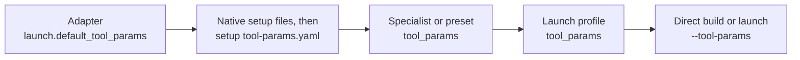

# Launch Overrides

## Raw Launch Arguments

Adapter `launch.args` supplies the initial argument list. A preset's `launch.overrides.args` or direct build's argument override can append to the list or replace it using the section's `mode` and `values`. When both overrides specify `args`, the direct override applies its mode to the adapter's initial list. The backend adds its protocol-required arguments separately.

## Typed Tool Parameters

Houmao validates each `tool_params` layer against the selected tool's schema. Later layers override individual fields, including fields inside nested objects. An explicit `null`, `false`, or empty value keeps its meaning when the schema permits it. DSH merges model entries by `id` and MCP servers by `name`, preserving earlier entries and appending new entries in order.



The setup file contains the mapping itself. Preset and launch-profile YAML store it at the top level under `tool_params`. Move older preset parameters from `launch.overrides.tool_params` to the top level. The tool's Python adapter owns validation and runtime projection following the removal of `launch.metadata.tool_params`.

Recognized permission settings in the selected native setup count as setup values. Within each argument layer, Houmao lifts supported native aliases such as Codex `--sandbox` into the corresponding permission fields. Typed values win within the same layer. Raw argument-section selection still controls which argument aliases participate.

For example, a Codex setup `config.toml` may supply `sandbox_mode = "workspace-write"`. An unattended launch inherits that sandbox and supplies `never` for omitted approval. Use `--tool-params '{"sandbox_mode":"read-only"}'` to select a different sandbox for one launch. The setup file retains its original value.

For example, a Claude headless profile can request partial messages by storing:

```yaml
tool_params:
  include_partial_messages: true
```

Set the same value for a single launch with `--tool-params '{"include_partial_messages":true}'`. The option also accepts `@params.yaml` or `@params.json`. Delegated launches read the file in the execution owner, where relative paths resolve from the selected project directory. The resulting configuration applies to the new launch and leaves stored definitions intact.

See [Launch Profiles](../../getting-started/launch-profiles.md) for authoring and [DSH Headless](../run-phase/dsh-headless.md) for DSH parameters and credential references.

## Protocol-Required Arguments

Protocol-required arguments are owned by the backend and **cannot** be overridden through the launch overrides mechanism. These include arguments that are structurally necessary for the backend to function correctly, such as:

- `claude -p` (headless prompt mode)
- `codex exec --json` (structured output)
- `kimi -p --output-format stream-json --skills-dir <home>/skills` (headless prompt mode)
- `--resume` / `--continue` (session continuation)

Supplying a reserved setting causes a validation error before provider startup or force takeover. Presence alone is enough, including an identical value, explicit null, or an argument in a shadowed layer. Remove the reserved setting and use the corresponding Houmao control when available, such as the managed relaunch selector for native session identity.

Kimi TUI accepts a supported `permission_mode` or native `--auto` or `--yolo` alias. Houmao derives the session selector and reserves `--agent` and `--agent-file` to protect the native role prompt. See [Launch Policy](launch-policy.md) for supported values, continuation limits, and omitted-field defaults.
