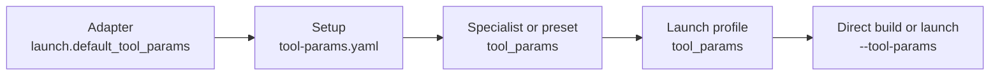

# Launch Overrides

## Raw Launch Arguments

Adapter `launch.args` supplies the initial argument list. A preset's `launch.overrides.args` or direct build's argument override can append to the list or replace it using the section's `mode` and `values`. When both overrides specify `args`, the direct override applies its mode to the adapter's initial list. The backend adds its protocol-required arguments separately.

## Typed Tool Parameters

Houmao validates each `tool_params` layer against the selected tool's schema. Later layers override earlier layers. Omitted fields inherit their previous values, including fields inside nested objects. An explicit `null` overrides a value when the schema permits it. DSH merges model entries by `id` and MCP servers by `name`, preserving earlier entries and appending new entries in order.



The setup file contains the mapping itself. Preset and launch-profile YAML store it at the top level under `tool_params`. Move older preset parameters from `launch.overrides.tool_params` to the top level. The tool's Python adapter owns validation and runtime projection following the removal of `launch.metadata.tool_params`.

For example, a Claude headless profile can request partial messages by storing:

```yaml
tool_params:
  include_partial_messages: true
```

Set the same value for a single launch with `--tool-params '{"include_partial_messages":true}'`. The option also accepts `@params.yaml` or `@params.json`. Delegated launches read the file in the execution owner, where relative paths resolve from the selected project directory. The resulting configuration applies to the new launch and leaves stored definitions intact.

See [Launch Profiles](../../getting-started/launch-profiles.md) for authoring and [DSH Headless](../run-phase/dsh-headless.md) for DSH parameters and credential references.

## Protocol-Required Arguments

Protocol-required arguments are owned by the backend and **cannot** be overridden through the launch overrides mechanism. These include arguments that are structurally necessary for the backend to function correctly, such as:

- `claude -p` (headless prompt mode)
- `codex exec --json` (structured output)
- `kimi -p --output-format stream-json --skills-dir <home>/skills` (headless prompt mode)
- `--resume` / `--continue` (session continuation)

Supplying a protocol-required argument through a launch override causes a validation error when Houmao resolves the launch backend.

Kimi TUI unattended permission posture is launch-policy owned. Use `operator_prompt_mode` or project `launch.prompt_mode: unattended` for managed Kimi automation rather than raw `--auto` or `--yolo` overrides. For Kimi Code 2.1.1 or later, Houmao canonicalizes caller inputs, keeps `default_permission_mode = "auto"` as a managed-home fallback, and appends exactly one native `--auto` after the fresh/latest/exact session selector is resolved. `--agent` and `--agent-file` are rejected because they can bypass the managed native system prompt.
