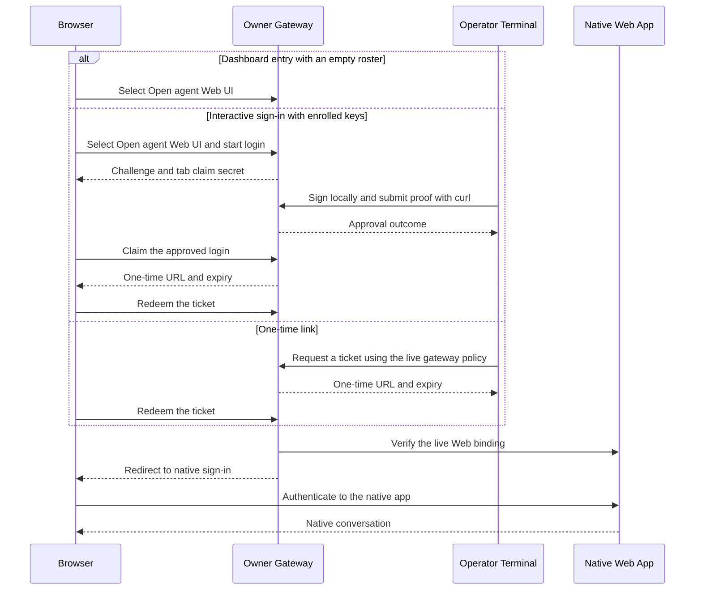

# Gateway Access and Remote Deployment

Every gateway and passive ingress evaluates the retained policy for the selected agent's observed owner context. Permissions name an exact resource and action. A verified empty administrator roster gives every caller `agent-admin` authority for supported operations. With a keyed roster, the target evaluates current admin keys, managed-self proof, retained peer assignments, exact grants, and the configured default. The initial `agent-requester` default allows status, qualified inbound mail, and wrapped work requests without enrollment. [Authorization Policy](authorization-policy.md)

First-key registration requires proof of the proposed key. Protected operations return HTTP 401 for missing or invalid proof, HTTP 403 when a verified caller lacks permission, HTTP 409 for a stale target or conflicting change, and HTTP 503 when required policy is unavailable. A 401 response includes the challenge location. Public health and endpoint metadata remain available if retained policy cannot be read. Audit records distinguish caller identity from the mailbox sender, plugin Actor, and native execution owner. [Authorization Policy](authorization-policy.md)

The verified owner can run `houmao-mgr agents single --agent-id "$agent_id" access list` to inspect the roster mode, configured default group, and retained enrollments. Direct `grant` and `revoke` commands report the recorded change and policy revision on stderr. Open admission still authorizes supported operations at an open revision. For a keyed roster, use `access explain PRINCIPAL RESOURCE ACTION` to see the applicable permissions. With `--print-json`, the policy result appears on stdout.

## Provision and Retain Admin Access

Use `houmao-mgr agents launch --gateway-admin-seed "$seed_file" ...` to record initial enrollment in the owner-written manifest. The seed file is owner-private JSON outside the checkout or in a purpose-specific subdirectory of its Git-ignored `tmp/` tree. Use `"schema_version": 2` and an `admin_keys` array of objects with `principal` and `public_key` fields. Use a complete OpenSSH public key line for each entry and a distinct public key for each enrollment. An omitted file or `{"schema_version":2,"admin_keys":[]}` selects the empty initial list.

Each supported managed launch commits a new Ed25519 managed-self key for its generation in the execution owner's `authorization.sqlite3`. Launch commits the key before starting the native agent. Gateway readiness requires a matching private key and public registration. Gateway and passive ingress verify signatures from the public registration and its revision. Owner-local commands load the private key only for the verified live generation. Detach and reattach preserve the registration and issue fresh challenges for the new listener.

The execution owner's captured configuration root locates the database. Its owner-only directory, database, and SQLite sidecars stay outside runtime manifests, shared registry artifacts, and remote file exports. Houmao stores the signing key without application-level encryption. Stable peer and admin enrollments, grants, and roles remain in the retained policy across restart and relaunch. Upgrade an existing SQLite policy in place and relaunch the managed agent to prepare its new self key. For earlier file-based roster state, explicitly initialize policy with `agents single access init --seed` or `--empty` before relaunching.

When `access init` reports an open roster, its stderr guidance points to `access admin-add --first`. Initialization can use retained policy while detached. First-admin enrollment needs a verified attached gateway and proof of the proposed key. [Change a Live Admin Roster](authorization-policy.md#change-a-live-admin-roster)

Run `houmao-mgr agents self access self-key rotate` to replace the current self key using its own proof. Add `--retained` when the gateway is detached. Use `revoke` to invalidate the key and keep its registration revision. An effective admin can recover a revoked or missing private key while the native runtime remains live with `houmao-mgr agents single --agent-id "$agent_id" access self-key rotate --retained --signer "$admin_key"`. Recovery and rotation commit a new revision and invalidate outstanding proofs from the previous key. These commands return the generation, key fingerprint, registration revision, and active state.

The gateway exposes `PUT /v1/auth/managed-self` with `operation`, `generation_id`, and `expected_revision`. The verified owner generates the replacement inside the registration transaction. A remote CLI call requires its expected revision and exact gateway coordinates.

Owner-private gateway access storage lives outside the project checkout or in a purpose-specific subdirectory of its Git-ignored `tmp/` tree. Keep launch and attach input files and signer files in approved private storage too. Other checkout directories and nested worktrees remain rejected. Processes running under the same UID share that account's filesystem authority. Use separate OS accounts or container isolation when one process must be unable to read or replace another process's access state.

## Bind, Connect, and Advertise

Select deployment settings in an owner-private JSON file. This example expects an HTTPS reverse proxy to reach port 43123 through the owner's loopback interface.

```json
{
  "schema_version": 1,
  "bind_host": "127.0.0.1",
  "bind_port": 43123,
  "public_input_enabled": true,
  "advertised_url": "https://gateway.example.org/agents/writer"
}
```

```bash
houmao-mgr agents single --agent-name writer gateway attach --access-config "$access_file"
```

- The bind host and port describe the backend listener. The default bind is `127.0.0.1`. Use `0.0.0.0` only with explicit validated settings and a network boundary that protects the backend leg. Omit the port to let the OS assign it on first attach. Later equivalent attaches reuse the resolved port.
- The owner-local connection uses `http://127.0.0.1:<resolved-port>` even if the bind is wildcard. An owner-loopback URL from another execution context belongs to that context.
- The advertised base URL is the client endpoint. Configure the proxy to strip its prefix once, preserve the original `Host`, set `X-Forwarded-Proto: https` on the trusted backend leg, and preserve the method, raw query, and request bytes. Protect that leg with owner loopback or a verified deployment boundary. Publish the per-agent gateway through the proxy and keep global passive administration isolated.

The endpoint descriptor at `GET /v1/endpoint` gives the advertised URL, target, live presence, current access requirements, and enabled public operations. Its `admin_mode` is `open`, `keyed`, or `unavailable`. The descriptor gives the `sshsig-v2` proof protocol and the challenge path. Registry metadata provides a locator and can lag membership changes. Live admission reads retained authority. Detach removes live endpoint publication and preserves the roster. Detach before reattaching with changed deployment settings.

Remote clients verify HTTPS through platform certificate trust or a deployment CA bundle provisioned independently of the endpoint. Clients can also select an exact numeric loopback HTTP URL for a configured encrypted tunnel. Gateway clients refuse redirects and retain the selected URL prefix. If endpoint or target identity changes, explicitly select a new binding. For owner-local admin commands, an optional `admin_signer_path` in the private access configuration selects an absolute private key path. The signer must belong to a current admin when keys are required.

## Enroll or Rotate a Key

This Python example uses a private signer already provisioned in approved private storage and its corresponding public key. Set `GATEWAY_URL` to the selected advertised base URL and `GATEWAY_CA` to the deployment CA bundle when needed. Confirm `GATEWAY_AGENT_ID` and `GATEWAY_CONTEXT_ID` from the owner's deployment record before binding a signer.

```python
import os
from pathlib import Path

from houmao.agents.realm_controller.gateway_client import GatewayClient
from houmao.gateway.access import GatewayAdminKey, GatewayClientBinding, GatewayOwner

owner = GatewayOwner(
    agent_id=os.environ["GATEWAY_AGENT_ID"],
    context_id=os.environ["GATEWAY_CONTEXT_ID"],
)
signer_path = os.environ["GATEWAY_SIGNER"]
key = GatewayAdminKey(
    principal="writer-operator",
    public_key=Path(os.environ["GATEWAY_PUBLIC_KEY"]).read_text().strip(),
)
binding = GatewayClientBinding(
    base_url=os.environ["GATEWAY_URL"],
    owner=owner,
    purpose="register",
    private_key_path=signer_path,
    ca_bundle_path=os.environ.get("GATEWAY_CA"),
)
first = GatewayClient(binding=binding, registration_key=key)
key_id = first.add_admin_key(key)
admin = GatewayClient(binding=binding.model_copy(update={"purpose": "caller"}))
status = admin.status()
```

The client requests a challenge from `POST /v1/auth/challenge`, checks the issuer, owner, target incarnation, listener presence, purpose, key, and exact operation, and signs the canonical challenge in the Houmao SSHSIG namespace. The operation carries the challenge ID in `Houmao-Challenge` and the encoded SSHSIG in `Houmao-Signature`. Challenges expire, authorize only the exact method, path, query, and body digest, and can be consumed once. Keep proof in headers and out of URLs and logs. The gateway verifies standard SSHSIG in process.

Use an already listed key to add another with `admin.add_admin_key(other_key)`. After verifying the new signer, use `admin.remove_admin_key(key_id)` to remove the old key’s admin qualification. The credential keeps its scoped access until the local owner revokes it. If two callers compete to register the first key, only the first successful commit changes the roster. **Removing the final admin qualification immediately gives everyone who can reach the listener the gateway-admin role.** Restrict reachability first when anonymous access is unintended.

## Open a Live Web Agent

On the execution owner, use `houmao-mgr agents single --agent-id "$agent_id" gateway status` to find the live gateway's `gateway_port`. Open the owner-local base URL, for example `http://127.0.0.1:43123/`. The dashboard shows the agent's name or ID, backend, run mode, gateway health, native Web availability, and public roster mode. The roster mode is open, keyed, or unavailable. Use owner-local `access list` for enrollment details.

Select **Open agent Web UI** when the dashboard offers it. The page explains whether to expect direct entry or sign-in. The link opens `/v1/web/enter`, which checks the live policy when selected. With a valid empty admin roster, the gateway opens the native app immediately. With enrolled keys, it opens the Houmao sign-in page.

For DSH Web, the handoff opens the manifest-bound conversation in the Workspace for its launch workdir. You can navigate to other native conversations. Houmao prompts and mail notifications still target the bound session. Select **Open agent Web UI** again to return to it. [DSH Browser Entry](../../run-phase/dsh-web.md#browser-entry-and-exact-session-selection)

Browser entry works while the native Web agent is busy or waiting for input. The dashboard explains when the action is unavailable, including for agents in other modes or on advertised proxy connections. Use the owner-local address or private TCP forwards for browser entry. The managed agent's `native_surface` publishes the native origin and conversation ID. [Reach Both Owner Addresses](#reach-both-owner-addresses)

### Sign In From the Browser

1. Select **Start Login** on the sign-in page. To use one key, enter an absolute private-key path or a path relative to the terminal's working directory. Write the full home path in place of `~`. The field trims surrounding whitespace and preserves spaces inside the path. An empty result selects supported keys from the terminal's SSH agent.
2. Check the agent and gateway address shown by the page. Select **Copy Command** and run the command in a trusted POSIX-compatible shell with `ssh-keygen` supporting `-Y sign` and `curl`. Blank-path selection also needs `ssh-add`, an active SSH agent, and the standard `mktemp`, `wc`, `rm`, and `rmdir` utilities. OpenSSH signs locally and prompts for any passphrase in the terminal. Curl sends the proof directly to the displayed gateway address.
3. Keep the initiating tab open. It continues to the native app after the terminal approves the login. The login attempt expires after two minutes. To recover after expiry, restart, or refusal, return to the dashboard and select **Open agent Web UI**.

### Issue a One-Time Link

For keyed access, use `--signer` to select an enrolled key with `web.enter`, or configure the owner’s `admin_signer_path`. An empty roster permits unsigned issuance. Run it on the execution owner:

```bash
houmao-mgr --print-json agents single --agent-id "$agent_id" gateway web-entry
```

The command prints `url` and `expires_at_utc`. Open the URL in the browser within 60 seconds to go directly to the native app. Keep the link private and out of shared logs. Anyone who can reach the exact gateway address and holds the unused link can redeem it once.

A signed script can also call `issue_web_entry_ticket()` on a `GatewayClient` with a caller binding and `web.enter` for the exact owner-local base URL. Use the bound signer and target from the enrollment example, with the owner-local address in place of the advertised address and direct transport selected:

```python
local_binding = binding.model_copy(
    update={"base_url": "http://127.0.0.1:43123", "purpose": "caller", "ca_bundle_path": None}
)
local_admin = GatewayClient(binding=local_binding, respect_proxy_env=False)
ticket = local_admin.issue_web_entry_ticket()
```

The script receives the same one-time gateway URL. The client refuses HTTP redirects. Give the link to the browser for native authentication.

For a gateway with a valid empty roster, use the unsigned owner-local client:

```python
local_gateway = GatewayClient(base_url="http://127.0.0.1:43123", respect_proxy_env=False)
ticket = local_gateway.issue_web_entry_ticket()
```



DSH exchanges its authentication query for a browser cookie and redirects to a clean page. Select the managed conversation in the native sidebar. Kimi accepts a token fragment and opens the bound conversation. The native app controls the resulting browser session's lifetime. [DSH Web](../../run-phase/dsh-web.md), [Kimi Web](../../run-phase/kimi-web.md)

### Reach Both Owner Addresses

Open Web entry on the execution owner or forward both loopback listeners using private TCP forwarding. Preserve the exact host and port of the owner-local gateway and the published native origin on the browser's machine. The terminal running the generated command must also reach the gateway address shown by the page. For example, if the gateway is `http://127.0.0.1:43123` and the native origin is `http://127.0.0.1:52000`, run this on the browser and terminal machine and keep the connection open:

```bash
ssh -N -o ExitOnForwardFailure=yes \
  -L 127.0.0.1:43123:127.0.0.1:43123 \
  -L 127.0.0.1:52000:127.0.0.1:52000 \
  owner@example.org
```

For a browser and terminal in separate network namespaces, make the exact gateway address reachable from both. Keep the native forward within the browser's private network boundary. The advertised HTTPS gateway applies the live roster to its API. Exclude Web entry and login routes from its reverse proxy and use the owner-local addresses for browser handoff. [Gateway Protocol and State Contracts](../contracts/protocol-and-state.md#web-entry-and-login)

## Open a Managed Tmux Terminal

Run `houmao-mgr agents single --agent-id "$agent_id" gateway status` in the execution owner's context to find the running gateway port. If the gateway is detached, use `gateway attach` explicitly. Open the exact owner-local base URL, such as `http://127.0.0.1:43123/`.

**View tmux terminal** opens a read-only view of the recorded live terminal. Viewing on the direct owner-local gateway works regardless of roster mode. A service or native Web launch can expose its supervisor console, and a headless launch can expose its headless console. A native Web agent with both surfaces also shows **Open agent Web UI**.

**Interact with tmux** appears when the gateway verifies an enrolled administrator roster. Follow the page's instructions to sign in with a current administrator key. Interaction supplies normal tmux input to the running session. Closing the browser tab detaches its client and leaves the agent running.

From another machine, use a private TCP forward that preserves the gateway's loopback host and port. The browser terminal uses that one gateway listener.

```bash
ssh -N -o ExitOnForwardFailure=yes \
  -L 127.0.0.1:43123:127.0.0.1:43123 \
  owner@example.org
```

Open `http://127.0.0.1:43123/` while the forward is active. Advertised HTTPS or HTTP proxy ingress cannot carry browser terminal entry. For a one-time link from the owner's command line, use [`gateway terminal-entry`](../../cli/agents-gateway.md#terminal-entry).

## Submit an Authenticated Prompt

Use the enrolled admin client from the previous example to submit a ready-only prompt. The client signs the exact request to `POST /v1/control/prompt`.

```python
from houmao.agents.realm_controller.gateway_models import GatewayPromptControlRequestV1

receipt = admin.control_prompt(
    GatewayPromptControlRequestV1(
        prompt="Summarize the current work without changing files.",
        admission_policy="ready_only",
    )
)
```

The receipt reports how far the request reached. A handoff confirms delivery to the native surface. Model completion requires evidence for the same request. After a lost response, inspect the existing operation or the agent's state before sending any new prompt.

## Send Public Input

Public input is disabled by default and has a finite admission budget. The gateway marks input on these two routes as public even when a key holder sends it.

```bash
curl --fail-with-body --cacert "$GATEWAY_CA" "$GATEWAY_URL/v1/messages" \
  --json '{"source_event_id":"mail-421","text":"A review request is available in the offline mailbox."}'
curl --fail-with-body --cacert "$GATEWAY_CA" "$GATEWAY_URL/v1/public/prompt" \
  --json '{"source_event_id":"review-422","prompt":"If policy permits, review the public release notes and mail a brief summary to reviewer@example.org."}'
```

HTTP 200 reports `disposition: dispatched` and the source event ID after confirmed handoff. The response carries no model reply or private result. A caller may ask for a reply by an independent channel, such as mail or an agreed shared file. The agent decides whether policy allows the destination and content. Public payloads cannot select privileged execution controls.

Busy or unavailable work is refused immediately and never queued for later dispatch. HTTP 429 indicates the public budget was exhausted. If confirmation is lost after submission, the caller may receive an uncertain outcome. Retrying can duplicate delivery even with the same source event ID.

## Use Private Mail From a Managed Session

```bash
houmao-mgr agents self mail resolve-live
houmao-mgr agents self mail status
houmao-mgr agents self mail list --channel offline --expected-binding-id "$binding_id"
```

The scoped self commands sign live private operations inside the CLI. Select the current channel and binding ID from scoped mailbox output. Admin callers can use their own bound signer. Owner-file paths on send, reply, and post require `mail.attachment.owner_file` on the same mailbox resource. See the mailbox facade for channel-specific behavior and the separately authorized manager path when the gateway is detached. [Gateway Mailbox Facade](mailbox-facade.md)

## Apply Protected Mail Rules

Enroll a separate Ed25519 owner public key at the trusted mailbox backend. On the owner side, use `houmao.mailbox.policy.MailPolicyUpdate` and `sign_mail_policy_update(update, signer)` to sign the exact backend ID, binding or registration ID, expected rule revision, operation ID, and sender list. The initial revision is zero. Keep the signing key outside the gateway account.

Gateway administrators can submit `POST /v1/mail/{channel}/policy/apply` with `expected_binding_id` and the signed object under `signed_update`. An independently authorized owner can also submit directly to the trusted backend. First check backend support and verify any applied revision through the backend's independent inspection path. Reuse the exact signed update to reconcile an uncertain result.

For an online binding, set `stalwart_policy_url` to the independent connector's HTTPS origin in the owner-private gateway access configuration. A configured connector can still report unsupported for an unqualified binding. [Offline Registry](../../mailbox/operations/offline-registry.md#protected-recipient-filtering) · [Stalwart Qualification](../../mailbox/operations/stalwart-qualification.md)
