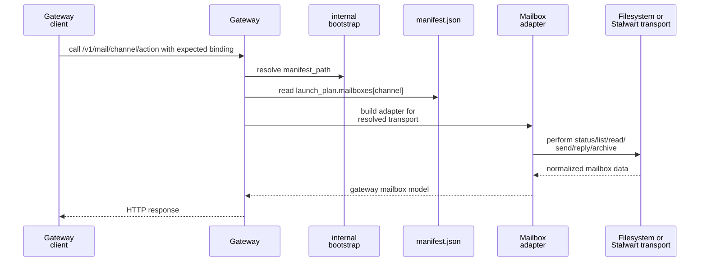

# Gateway Mailbox Facade

Mail operations select `offline` or `online` explicitly. `GET /v1/mail/status` summarizes both channels; `resolve-live` returns revisioned slots under `mailboxes.offline` and `mailboxes.online`. Every lifecycle request uses schema version 3 and includes `expected_binding_id`, including fresh send/post. Keep notifier rounds pinned to their supplied URL, channel, and binding; stop on mismatch rather than re-resolving and resending. Canonical online-first mail identity never selects delivery.

- Who this is for: operators and maintainers who need to understand how a live gateway exposes shared mailbox routes for filesystem-backed and Stalwart-backed sessions.
- What it explains: why `/v1/mail/*` exists, how adapter selection works, when the routes are available, and how notifier polling uses the same abstraction.
- Assumes: you already understand basic gateway attach and lifecycle concepts from [Lifecycle And Operator Flows](lifecycle.md).

## Mental Model

The gateway mailbox facade is the shared mailbox control surface for one attached session.

- It exists so mailbox reads and sends do not compete with the terminal-mutation queue behind `POST /v1/requests`.
- It hides transport differences behind one gateway-local contract backed by a manifest-resolved adapter.
- It does not replace mailbox semantics, filesystem repair rules, or Stalwart mailbox storage; it routes to the transport that the runtime already selected for the session.

## Boundary Table

| Layer | Owns | Defers to |
| --- | --- | --- |
| Gateway mailbox facade | route availability, manifest-backed resolution, adapter selection, notifier polling cadence, notifier audit history | mailbox semantics and route payload details described in mailbox and gateway contract pages |
| Filesystem adapter | shared mailbox route implementation against filesystem mailbox state | gateway listener lifecycle, queue semantics, notifier scheduling |
| Stalwart adapter | shared mailbox route implementation against JMAP plus session-local credential material | gateway listener lifecycle, runtime manifest persistence, Stalwart account provisioning |

## Shared Mailbox Surface

| Route | Purpose | Exact contract |
| --- | --- | --- |
| `GET /v1/mail/status` | report whether the live gateway exposes the shared mailbox facade and both configured channels, their binding scope, canonical identity, and independent availability | [Protocol And State Contracts](../contracts/protocol-and-state.md) |
| `POST /v1/mail/{channel}/list` | page normalized mailbox metadata with explicit continuation and no bodies | [Protocol And State Contracts](../contracts/protocol-and-state.md) |
| `POST /v1/mail/{channel}/peek` | inspect one selected message without marking it read | [Protocol And State Contracts](../contracts/protocol-and-state.md) |
| `POST /v1/mail/{channel}/read` | inspect one selected message and mark it read | [Protocol And State Contracts](../contracts/protocol-and-state.md) |
| `POST /v1/mail/{channel}/send` | send a new message without consuming the terminal-mutation slot | [Protocol And State Contracts](../contracts/protocol-and-state.md) |
| `POST /v1/mail/{channel}/post` | post an operator-origin note into the attached session's mailbox | [Protocol And State Contracts](../contracts/protocol-and-state.md) |
| `POST /v1/mail/{channel}/reply` | reply to an existing message via opaque `message_ref` | [Protocol And State Contracts](../contracts/protocol-and-state.md) |
| `POST /v1/mail/{channel}/mark` | mark selected mailbox messages read, answered, or archived | [Protocol And State Contracts](../contracts/protocol-and-state.md) |
| `POST /v1/mail/{channel}/move` | move selected mailbox messages to another box | [Protocol And State Contracts](../contracts/protocol-and-state.md) |
| `POST /v1/mail/{channel}/archive` | archive selected mailbox messages | [Protocol And State Contracts](../contracts/protocol-and-state.md) |
| `GET|PUT|DELETE /v1/mail-notifier/{channel}` | inspect or control gateway mail-notifier behavior | [Protocol And State Contracts](../contracts/protocol-and-state.md) |

## Why `/v1/mail/*` Exists

`POST /v1/requests` is for terminal-mutating work such as prompt submission and interruption. Shared mailbox reads and sends are different:

- they have a distinct contract,
- they should not consume the single active terminal-mutation slot,
- they need one transport-neutral surface that works for both filesystem-backed and Stalwart-backed sessions.

That is why the gateway exposes a separate mailbox facade instead of treating mailbox work as just another queued prompt kind.

## How Adapter Selection Works

The session manifest owns independent optional offline and online slot envelopes. The registry host owns offline membership and storage. The gateway selects only the channel named by the request and validates its expected binding ID before dispatch; canonical identity never chooses an adapter.

Sequence:

1. The live gateway resolves the runtime-managed session manifest through its internal bootstrap state.
2. In the current implementation, that bootstrap state usually comes from `attach.json.manifest_path`.
3. The gateway reads `payload.launch_plan.mailboxes.<channel>` from that manifest. Each slot retains its revision even while empty.
4. The gateway compares `expected_binding_id`, checks owner scope, and builds the local filesystem, remote registry, or online provider adapter for that binding.
5. Shared mailbox routes call the adapter for status, listing, message inspection, send, operator-origin post, reply, marking, moving, or archive actions.

Both mail slots can coexist. Offline access can be local or remote to the selected registry host; online access uses the configured provider. Reassignment or replacement creates a different binding ID, so old references fail instead of reaching another mailbox. The precise payload shapes remain centralized in [Protocol And State Contracts](../contracts/protocol-and-state.md).

When gateway diagnostic logging is enabled, each mailbox facade route records safe start, success, and failure entries. Those diagnostics include operation names, route/status context, message counts, and repair hints for repairable mailbox-local failures. They do not include mailbox bodies, raw prompt text, attachment contents, auth headers, cookies, bearer tokens, credential material, or environment secrets by default.

## Availability Rules

The mailbox facade is deliberately narrower than generic gateway availability.

| Condition | Result |
| --- | --- |
| session is gateway-capable but no live gateway is attached | no `/v1/mail/*` routes are available |
| live gateway is attached with a usable mailbox binding and a valid empty admin list | routine mail, operator post, and mailbox binding controls admit anonymous callers |
| live gateway has a nonempty admin list | routine mail accepts current self or verified admin proof. Operator post and mailbox binding controls require verified admin proof |
| readable manifest with neither channel configured | summary status reports both channels absent |
| a lifecycle request selects an absent channel, stale binding, or wrong-scope reference | explicit failure with no other-channel fallback |
| manifest is unreadable | mailbox operations fail explicitly |

Private send and reply forms with owner-file attachment paths accept current anonymous authority with an empty list or verified admin proof with a nonempty list. The gateway checks authority before opening a file or calling the provider. The configured mailbox supplies the sender identity. The gateway tracks the initiating caller separately. [Gateway Access and Remote Deployment](access.md)

## Direct Versus Gateway Mailbox Paths

The mailbox facade does not eliminate direct transport-specific mailbox behavior.

- If no gateway is attached, use the maintained scoped manager mail command with explicit channel and expected binding ID. The manager owns provider access; ordinary discovery supplies no credential file or private store path.
- With a live gateway, run `houmao-mgr agents self mail ...` for current self proof. An operator selects an explicit admin signer for protected HTTP calls. Admission refusal ends the call.
- `message_ref` stays opaque in both paths.

That split is why the mailbox docs and gateway docs stay adjacent but separate. Use [Stalwart Setup And First Session](../../mailbox/operations/stalwart-setup-and-first-session.md) for the operator path and [Mailbox Runtime Contracts](../../mailbox/contracts/runtime-contracts.md) for the slot, resolver, and prompt contract.

## Notifier Polling Uses The Same Facade

The mail-notifier is gateway-owned, but mailbox truth is transport-owned.

- The notifier checks eligible inbox mail through the same shared mailbox facade used for `list`.
- Mode `any_inbox` treats any unarchived inbox mail as eligible, including read or answered mail. Mode `unread_only` limits eligibility to unread unarchived inbox mail.
- Each owner/channel/binding has independent notifier configuration, schedules, appendix text, audit, and compaction state. The gateway still owns notifier cadence, readiness-gated reminder delivery, last-error bookkeeping, and per-poll audit history in `queue.sqlite`.
- This is what allows the notifier to work for both filesystem-backed and Stalwart-backed sessions without hard-wiring itself to filesystem mailbox-local SQLite.
- Current reminder behavior is intentionally bounded: one reminder may summarize the eligible inbox snapshot, the agent decides which messages to inspect and handle after listing current mailbox state, and the later turn archives successfully processed work through the shared mailbox facade.

Use [Agents And Runtime](../../system-files/agents-and-runtime.md) for the broader runtime-managed filesystem placement around `gateway/` and session-local secret material.

## Common Confusions

- A session can be gateway-capable without exposing a live mailbox facade right now.
- `/v1/mail/*` is not a generic replacement for `POST /v1/requests`; it exists alongside it.
- The gateway owns route exposure and adapter selection, not mailbox storage semantics.
- Stalwart-backed gateway access still depends on the runtime-owned session-local credential file materialized from `credential_ref`.

## Source References

- [`src/houmao/agents/realm_controller/gateway_service.py`](../../../../src/houmao/agents/realm_controller/gateway_service.py)
- [`src/houmao/mailbox/services.py`](../../../../src/houmao/mailbox/services.py)
- [`src/houmao/agents/realm_controller/gateway_storage.py`](../../../../src/houmao/agents/realm_controller/gateway_storage.py)
- [`src/houmao/agents/mailbox_runtime_support.py`](../../../../src/houmao/agents/mailbox_runtime_support.py)
- [`src/houmao/mailbox/stalwart.py`](../../../../src/houmao/mailbox/stalwart.py)
- [`tests/unit/agents/realm_controller/test_gateway_support.py`](../../../../tests/unit/agents/realm_controller/test_gateway_support.py)
- [`tests/integration/agents/realm_controller/test_gateway_runtime_contract.py`](../../../../tests/integration/agents/realm_controller/test_gateway_runtime_contract.py)

## Bounded Metadata Pages

All three adapters return the same finite page contract: a default of 50 messages, maximum 200, page-only counts, `next_cursor`, `has_more`, and `complete`. Offline uses its authoritative metadata index and receives no provider synchronization cache. Online filters on the server before limiting, then fetches metadata in a bounded batch. `include_body` and CLI `--include-body` are rejected with guidance to use `peek` or `read`.

Keep a cursor with its original channel, expected binding, and filters. Local metadata changes or online query-state changes invalidate continuation rather than merging inconsistent pages. Restart the list after a stale-cursor result. Content requests expose completeness and applied byte limits. See the [Stalwart Client Contract](../../mailbox/contracts/stalwart-client.md) for provider details.
