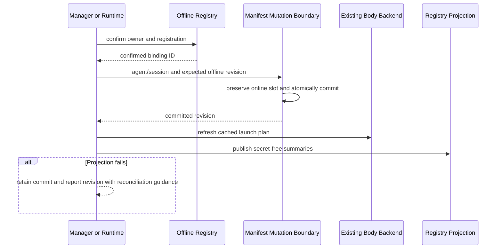

# Mailbox Runtime Integration

This reference is for contributors changing build, runtime, gateway, or manager code. Mailbox attachment belongs to the agent's stable identity and persists independently of a body process, gateway instance, or friendly name.

## Build and Launch

`build_brain_home()` installs the complete `agent` skill pack. Mailbox children remain below the shared-routines sibling, while the agent entrypoint verifies self identity and selects the requested route. A live attachment does not depend on changing the running CLI's inherited environment or reloading its native skill catalog.

`start_runtime_session()` resolves the already selected agent ID before mailbox work. `resolve_effective_mailboxes_config()` prepares `mailboxes.offline` and `mailboxes.online` independently:

| Slot | Launch preparation | Durable binding scope |
| --- | --- | --- |
| Offline filesystem | Verify selected registry/store association, bootstrap the store, claim the address safely | Stable agent owner and confirmed registration ID |
| Online Stalwart | Existing launch-time management provisioning and private credential materialization | Same agent owner, independent provider binding ID and protected credential reference |

Both can run during one launch. Empty slots retain a revision. Configuration never derives an owner from an email address or lets one slot replace the other.

## Persistence Authority

`manifest.py` provides the session-scoped OS lock, complete validation, private temporary write, atomic replace, and directory flush. Binding mutation checks expected slot revision, agent ID, and session ID. A successful mutation advances the selected revision, stamps `bindings_version`, and preserves the other slot.

Ordinary controller persistence merges the current mailbox envelopes under that same lock, then reflects them into the controller and supported backend caches. An old controller cannot restore detached or replaced mail. Server-owned gateway routing fields and runtime-owned endpoint fields have separate atomic mutation ownership.

Prepare membership, provider resources, and credentials before entering the manifest lock. Network operations, worker shutdown, and terminal mutations remain outside it.

A projection failure cannot undo a confirmed claim. Join retry reuses the registration and prepared credentials. Release retry targets the original registration and cannot release a later owner's claim. Warnings identify the committed binding or empty-slot revision; release warnings do not recommend joining again.

## Resume and Availability

`mailboxes_resolved_config_from_payload()` reconstructs the required current slot envelopes. It preserves persisted IDs and revisions and performs no credential materialization. Current-format records missing identity fail validation. Unsupported old formats require explicit backup and rebootstrap.

Credential paths are private locators. Missing or expired online credentials degrade online availability without hiding configured offline mail or changing canonical identity. Discovery publishes safe owner/channel/binding/address/revision summaries rather than secret-resolution inputs.

## Mail and Notifier Dispatch

Reusable contracts, scoped references, and adapters live under `src/houmao/mailbox/`. Manager, gateway, and registry HTTP handlers call those services. Offline access selects a local filesystem backend or authenticated registry client; online access selects its provider backend.

`agents self mail` verifies the caller's manifest and active generation before reaching the current gateway or an authorized local mailbox adapter. The manifest supplies the agent and mailbox bindings. The gateway and adapter read current mailbox contents from the owning store. The definition directory is used when planning a launch or relaunch.

Lifecycle operations require an explicit channel and expected binding ID before backend I/O. A message reference also carries owner/channel/binding scope. The gateway uses `/v1/mail/{channel}/...`; summary status uses `GET /v1/mail/status`. The manager resolves authority once and does not retry an action on a replacement binding after conflict.

Notifier state is keyed by owner/channel/binding through `/v1/mail-notifier/{channel}`. Both channels preserve periodic reminders for eligible unchanged work, readiness and terminal admission, and one-shot compaction. Archive closes inbox work. Read or answered flags alone do not complete it.

The lower-level prompt fallback uses `ensure_mailbox_command_ready()`, `prepare_mail_prompt()`, and `run_mail_prompt()` with explicit channel and binding scope. Verified service execution remains authoritative; TUI submission and optional transcript previews remain non-authoritative.

## References

- [Runtime Contracts](../contracts/runtime-contracts.md)
- [Offline Registry Setup](../operations/offline-registry.md)
- [Binding Models](../../../../src/houmao/agents/mailbox_runtime_models.py)
- [Manifest Mutation Boundary](../../../../src/houmao/agents/realm_controller/manifest.py)
- [Runtime Controller](../../../../src/houmao/agents/realm_controller/runtime.py)
- [Shared Mail Services](../../../../src/houmao/mailbox/services.py)
- [Runtime Integration Tests](../../../../tests/integration/agents/realm_controller/test_mailbox_runtime_contract.py)
- [Registry Process Tests](../../../../tests/integration/mailbox/test_offline_registry_process.py)
