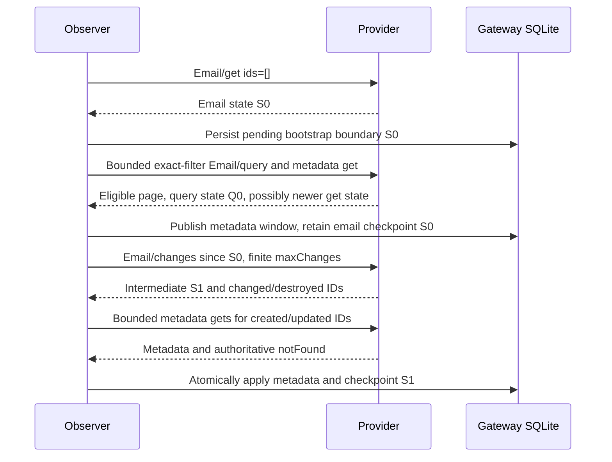

# Bounded Stalwart Observation

This reference is for contributors integrating online mail observation with gateway scheduling. The observer is `houmao.mailbox.sync.SyncObserver`; `houmao.mailbox.observation.observe_online()` adds runtime fencing, scoped metadata normalization, and bounded compaction revalidation. Provider message state remains authoritative. These modules never send mail, mark messages read, archive work, or persist message bodies.

## Scope and Persistence

The gateway-owned SQLite database contains `mail_sync_observations`, keyed by owner agent ID, online binding ID, provider account, and the exact query fingerprint. The fingerprint includes the effective wire filter, mailbox-role IDs, sort, and thread-collapse policy. Credential revision, connection epoch, gateway PID, and body incarnation are excluded. A same-account refresh or reconnect can reuse its checkpoint; another account or binding starts a separate scope even when provider IDs overlap.

Each row atomically stores its applied email-object checkpoint and bounded eligible metadata window. Query state remains a separate field. The row also records phase, completeness, safe last-success/error data, and reconnect backoff. `mail_sync_revalidation` stores a disposable rotating position for checking remembered compaction references. Neither table is a message-delivery spool or another mailbox authority.

Only selected metadata fields enter the cache. Previews are capped at 512 characters and each encoded metadata record is limited to 64 KiB. Bodies, body values, MIME data, attachment bytes, credentials, and raw provider exceptions are excluded. The default initial page has 50 entries; the cache retains at most 200 metadata entries. Eviction means the view is a sample, not that an evicted message was processed or became ineligible.

## Bootstrap and Intermediate Checkpoints

Capture S0 before the filtered query. An arrival between the query and metadata retrieval may produce a newer get-state. That state never replaces S0 or an intermediate `Email/changes.newState`. Created and updated IDs must all be fetched or reconciled through authoritative `notFound`; destroyed IDs are removed before the batch checkpoint commits. A failed fetch or SQLite transaction leaves the batch retryable.

When `hasMoreChanges` is true, the next batch continues from the last applied intermediate state. A cycle yields when its method/time allowance is exhausted. While catch-up remains pending, the next cycle refreshes one bounded current filtered page before processing more historical changes. Inbox work can therefore become visible without scanning the retained archive first.

## Budgets and Recovery

| Limit | Default | Maximum or Additional Constraint |
| --- | --- | --- |
| Initial metadata page | 50 messages | 200; honor a smaller provider result/get limit |
| Cached eligible metadata | 200 messages | 200 |
| Email change batch | 100 IDs | 500; also constrained by remaining metadata-get capacity |
| Observation and remembered-eligibility work | 5 JMAP methods per cycle | Count methods, including optional query probes |
| Observation wall time | 10 seconds | Each request receives only remaining time |
| Failure backoff | Starts at 2 seconds | Exponential, capped at 60 seconds |

Connection discovery/account validation is separately finite and cached per immutable epoch before the observation cycle. Its initialization methods are reported separately in qualification. Ordinary warmed cycles include page probes, changes, metadata gets, and compaction revalidation within their shared five-method budget. A nonempty page can cost three methods: query, finite end probe, and metadata get. Bootstrap can therefore yield before its first changes request; that is `catching_up`, not proof of full synchronization.

`cannotCalculateChanges`, `tooManyChanges`, or stale state invalidates the derived view. Recovery captures another email-state boundary and issues a fresh bounded filtered query. It never increases a delta to unlimited size or enumerates all archive IDs. Unsupported email changes produce an explicit bounded-requery capability rather than a false incremental guarantee.

`Email/queryChanges` is optional and disabled by default. Enable it only for qualified behavior compatible with the exact cached query. An empty delta updates query state only. A nonempty, oversized, unsupported, or expired delta causes a bounded filtered requery. Query changes have no `hasMoreChanges` pagination contract and never advance the email-object checkpoint. The local source checkout and running Stalwart release can differ; qualify the actual release before enabling this optimization.

## Fencing and Reminder Independence

Network requests run outside the terminal lock and manifest authority section. Workers capture owner, session, binding ID, revision, account, and connection epoch. Each local checkpoint publication uses `OnlineConnectionAuthority.commit_observation(fence, callback)` around a short SQLite transaction. A superseded worker cannot publish metadata into the replacement binding or supply a later wake-up. Gateway reminder insertion uses the same final fence separately. A pure cached query-fingerprint check also runs inside checkpoint/write guards and before final revalidation publication. If another request refreshes mailbox roles after scope capture, the old observation yields `query_policy_changed` without advancing its old row or clearing compaction memory. The next cycle bootstraps under the new role/filter scope.

Synchronization can progress while a body is busy. A checkpoint acknowledges observed provider changes, not a delivered reminder or completed task. Periodic reminders remain eligible for unchanged open work. Read/answered/archive truth stays with the provider.

The helper revalidates remembered compaction references absent from the sample using only remaining method/time budget. It rotates across the stable-order remembered sequence without scanning the whole set. Only destroyed IDs, authoritative missing IDs, or confirmed filter loss clear remembered eligibility. Eviction, reconnect, source-file replacement, and an exhausted revalidation budget preserve uncertain entries.

## Status and Reconnect Example

`read_online_sync_status()` reads safe progress from SQLite without contacting the provider. It selects the current owner/binding/account and notification policy, returns at most 16 compatible views, and omits cached message contents. Core phases are `idle`, `catching_up`, `rebasing`, `degraded`, and `unsupported`. `complete` describes the bounded query view, independently of whether the email-object checkpoint has caught up.

After a gateway restart, a persisted `catching_up` observation first refreshes its finite current inbox page, then resumes changes from its saved intermediate state. If that state has expired, status becomes `rebasing` until a new boundary/page is established. A transport failure reports `degraded` and a safe retry time. Provider failure does not detach the account, change canonical mail identity, release offline membership, or select another channel.

The deterministic method tests are [test_sync.py](../../../../tests/unit/mailbox/test_sync.py). Actual HTTP checkpoint tests share the fake JMAP server in [test_stalwart_jmap.py](../../../../tests/unit/mailbox/test_stalwart_jmap.py). See the [client wire contract](../contracts/stalwart-client.md) and [qualification plan](../operations/stalwart-qualification.md).
