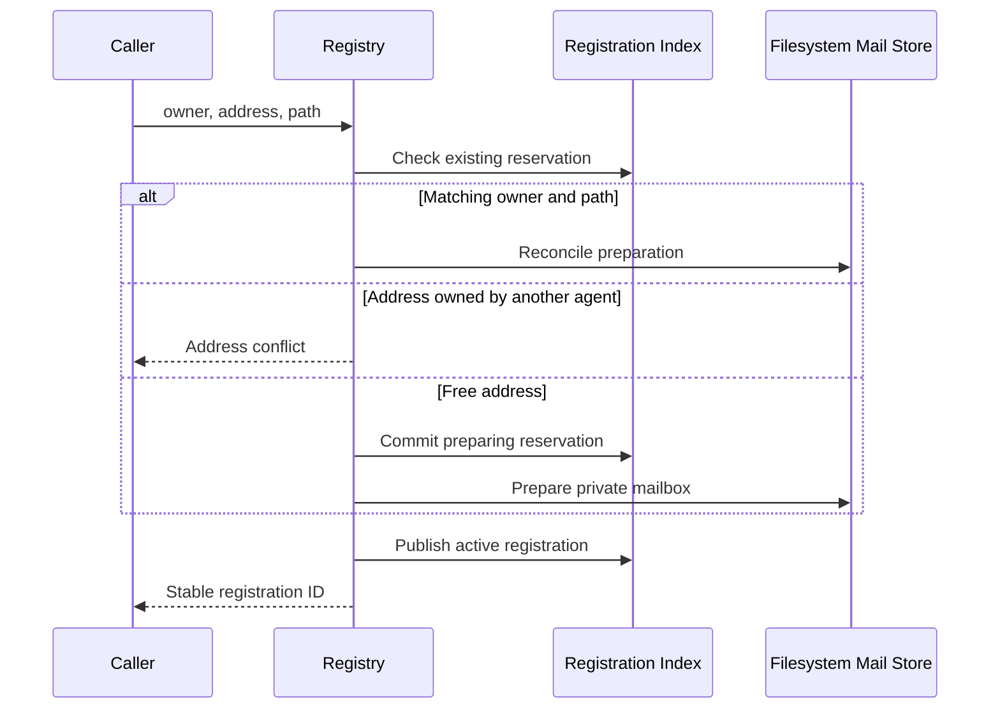

# Mailbox Registration Lifecycle

The selected registry owns offline address allocation and its filesystem mail store. Each registration binds a full address to an owner, registration ID, concrete mailbox path, and lifecycle status. Agent ownership uses persisted `agent_id`; human and reserved system principals retain their own identity rules.

## Exclusive Join

`safe` is the only registration mode. The same owner, address, and path reuse an existing registration. A conflicting owner or path fails before filesystem preparation. Administrative confirmation cannot bypass this conflict; force/stash modes and register `--yes` are rejected.

A transaction first reserves the address as `preparing`. Only successful mailbox preparation makes it `active`. The same owner can retry after interruption without allocating another registration. Competing processes cannot each acquire the same address. OS-owned address/index locks release after process exit.



The registry root's `offline-mail.json` selects one store. Generic and project registration validate this association. Project-aware maintenance root selection remains available, but cannot silently create another mail group in the selected registry. Initialize explicitly with `houmao-mgr mailbox init --registry-root ... --mailbox-root ...`.

## Explicit Release

Stopping a body, losing its gateway, expiring runtime presence, or attaching online mail does not release offline membership. Registered stopped recipients continue receiving mail. Release requires an authorized owner/admin operation.

`deactivate` is the default leave policy. It retires routing and retains private history. In-root mailbox directories move under `history/<registration-id>/`; a later claimant receives a fresh directory and registration. Symlink release removes only the registry routing entry and preserves the external target. Another owner cannot register that retained private target as its own mailbox.

`purge` explicitly removes the selected registration's projections and mutable state. It preserves canonical messages and external symlink targets. Canonical recipient address snapshots remain meaningful after registration removal. Released registrations and their old references never give a new address owner access to old private history.

## Maintained Commands

```bash
pixi run houmao-mgr mailbox init --registry-root /abs/path/registry --mailbox-root /abs/path/shared-mail
pixi run houmao-mgr mailbox register --registry-root /abs/path/registry \
  --mailbox-root /abs/path/shared-mail --address alice@houmao.localhost --principal-id "$agent_id"
pixi run houmao-mgr mailbox unregister --registry-root /abs/path/registry \
  --mailbox-root /abs/path/shared-mail --address alice@houmao.localhost
pixi run houmao-mgr mailbox cleanup --mailbox-root /abs/path/shared-mail --dry-run
```

Use scoped `agents single ... mailbox offline status|join|leave` or `agents self mailbox offline ...` for existing locally controlled bodies. Those commands preserve online bindings and require no body restart. See [Offline Registry Setup and Remote Access](offline-registry.md) and the [scoped CLI reference](../../cli/agents-mailbox.md).

## Maintenance Boundaries

`mailbox cleanup` removes only inactive historical registrations under explicit age/retention selection. Active memberships remain intact. Runtime live-record cleanup operates separately and cannot release addresses. Canonical messages survive registration cleanup.

`mailbox clear-messages` and its project wrapper clear delivered messages while preserving registered accounts. Their existing destructive confirmation applies to message deletion, not ownership takeover. Runtime-owned Stalwart credential cleanup remains a separate operation.

## Source References

- [Registration and delivery services](../../../../src/houmao/mailbox/managed.py)
- [Registry membership and private authorization](../../../../src/houmao/mailbox/registry.py)
- [Filesystem registration index](../../../../src/houmao/mailbox/filesystem.py)
- [Ownership and lifecycle tests](../../../../tests/unit/mailbox/test_managed.py)
