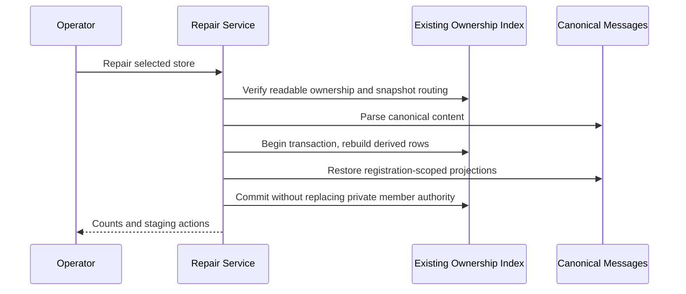

# Mailbox Repair and Recovery

Repair rebuilds derived message indexes around retained canonical messages and readable registration authority. It preserves private membership verifiers and upload ownership in the existing index. A normal rebuild replaces derived rows transactionally, so a failed rebuild cannot silently replace address ownership.

## Recovery Boundary

Repair can restore canonical message indexes, inbox/sent projections, mailbox-local lifecycle state, thread summaries, and attachment metadata. It can quarantine or remove orphaned staging files. Existing ownership rows determine which registration receives each projection; message addresses and filenames do not establish a new agent identity.

The ownership index must remain readable. A missing, corrupt, or unsupported ownership format requires an explicit operator backup restore or store rebootstrap. Repair cannot reconstruct credential verifiers, prove ownership from a mailbox directory, or invent content that no longer exists in canonical message files. Back up the complete compatible state before rebootstrap; do not discard the only copy of canonical or private history.

An interrupted new registration stays `preparing` until its owner retries preparation. A registry restart does not release it. Repeating the same owner/address/path request reconciles the reservation. OS-owned locks release after a worker exits.

## Repair Procedure

Use the maintained command against the intended maintenance root:

```bash
pixi run houmao-mgr mailbox repair --mailbox-root /abs/path/shared-mail
```

The managed `repair_index.py` diagnostic helper retains its `--mailbox-root` and optional `--payload-file` interface. It defaults to staging cleanup with quarantine. Its result reports recovered message/projection/registration counts and restored versus defaulted lifecycle state.



Staging cleanup handles incomplete composition artifacts. Quarantine preserves these for inspection. It does not act on delivered history or substitute for explicit membership release.

## Source References

- [Managed repair implementation](../../../../src/houmao/mailbox/managed.py)
- [Registry authorization persistence](../../../../src/houmao/mailbox/registry.py)
- [Derived-index repair tests](../../../../tests/unit/mailbox/test_managed.py)
- [Membership preservation tests](../../../../tests/unit/mailbox/test_offline_registry.py)
