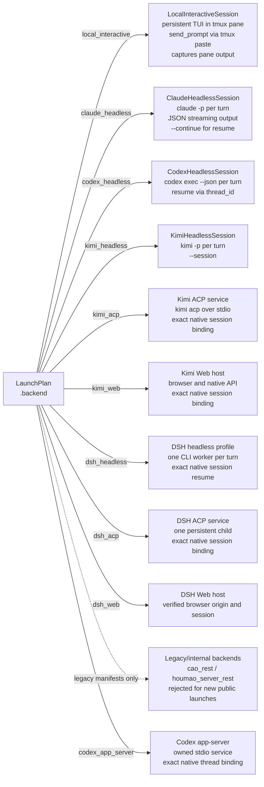

# Backends

All agent sessions in Houmao are executed by a backend. Each backend implements the `InteractiveSession` protocol, providing a uniform interface for prompt delivery, interruption, and termination regardless of the underlying agent tool or execution mode.

The canonical backend list is defined by the `BackendKind` literal type in `src/houmao/agents/realm_controller/models.py`. Adding a new backend requires updating `BackendKind`, wiring the backend through `launch_plan.py`, and implementing the `InteractiveSession` protocol.

## BackendKind

```python
BackendKind = Literal[
    "local_interactive",
    "claude_headless",
    "codex_headless",
    "kimi_headless",
    "kimi_acp",
    "kimi_web",
    "dsh_headless",
    "dsh_web",
    "dsh_acp",
    "codex_app_server",
    "cao_rest",
    "houmao_server_rest",
]
```

## Backend dispatch



## Backend reference

### local_interactive (primary)

**Source:** `backends/local_interactive.py`

The primary backend for interactive agent sessions. The agent runs as a real interactive CLI process inside a tmux pane, preserving the tool's native user experience (colors, interactive prompts, streaming output). Maintained local interactive tools are Claude Code, Codex, and Kimi Code.

- **Session class:** `LocalInteractiveSession`
- **Prompt delivery:** via tmux paste-buffer with bracketed paste and a separate final submit key.
- **Relaunch continuation:** provider-native startup arguments are applied before respawning the TUI in tmux window `0`.
- **Interrupt:** Escape is the primary interrupt/cancel key for maintained TUI providers, including Kimi Code.
- **Role injection:** tool-dependent; see [Role Injection](role-injection.md).
- **Use case:** development, debugging, and any workflow where direct interactive access to the agent is valuable.

#### Kimi Code local interactive

Kimi local interactive support starts the interactive `kimi` TUI under backend `local_interactive`; it does not reuse or rename `kimi_headless`.

- **Process recognition:** live process inspection treats both `kimi-code` and `kimi` as supported Kimi TUI process names.
- **Role injection:** Kimi Code 2.1.1 or later loads the complete composed Houmao prompt from managed `$KIMI_CODE_HOME/SYSTEM.md` before TUI startup. Houmao preserves Kimi's built-in prompt with `${base_prompt}` and does not submit a role chat turn.
- **Model selection:** launch-owned Kimi model selection is projected as `--model <alias>` for fresh and resumed Kimi TUI startup.
- **Update suppression:** managed Kimi TUI launches set `KIMI_CODE_NO_AUTO_UPDATE=1` so startup does not stop on the interactive update preflight.
- **Managed skills:** Houmao does not add managed `--skills-dir` arguments to Kimi TUI launches. The maintained `--skills-dir <KIMI_CODE_HOME>/skills` projection remains Kimi headless prompt-mode behavior.
- **Unattended prompt mode:** for maintained Kimi Code 2.1.1 or later, launch policy writes the migration marker and `default_permission_mode = "auto"` fallback, canonicalizes permission inputs, appends one native `--auto`, and pre-seeds the provider workspace-trust record for the launch working directory so startup does not stop on the "Trust this folder?" modal. The ready TUI is already unattended; `as_is` leaves provider approval and trust behavior unchanged.
- **Relaunch continuation:** `tool_last_or_new` maps to `kimi --continue`; `exact` maps to `kimi --session <session_id>`. The runtime never uses bare `kimi --session` for managed relaunch because that opens Kimi's interactive picker.
- **Resume behavior:** Kimi Code 2.1.1 or later accepts native `--auto` with `--continue` and `--session <session_id>`. Houmao strips conflicting caller permission flags, preserves the resolved resume selector, verifies and repairs `SYSTEM.md`, and appends one strategy-owned `--auto`; `--model <alias>` remains allowed.

### claude_headless

**Source:** `backends/claude_headless.py`

Runs Claude Code CLI in headless mode (`claude -p --verbose`). Output is captured programmatically rather than displayed in an interactive terminal.

- **Session class:** `ClaudeHeadlessSession` (extends `HeadlessInteractiveSession`)
- **Resume:** `--continue` resumes the provider's latest stored conversation; `--resume <session_id>` resumes an exact provider session.
- **Role injection:** when the role prompt is non-empty, Houmao passes `--append-system-prompt <prompt>` and sends one bootstrap message on the first turn. Empty prompts skip both startup inputs.
- **Use case:** automated pipelines, batch processing, and non-interactive agent orchestration.

### codex_headless

**Source:** `backends/codex_headless.py`

Runs Codex CLI in headless mode (`codex exec --json`). Produces structured JSON output for programmatic consumption.

- **Session class:** `CodexHeadlessSession` (extends `HeadlessInteractiveSession`)
- **Resume:** `resume --last` asks Codex to continue its latest stored chat; `resume <session_id>` resumes an exact provider session.
- **Role injection:** when the role prompt is non-empty, Houmao passes `-c developer_instructions=<prompt>`. Empty prompts skip the developer-instructions flag.
- **Use case:** automated pipelines, structured output processing, and non-interactive agent orchestration.

### kimi_headless

**Source:** `backends/kimi_headless.py`

Runs Kimi Code CLI in prompt mode (`kimi -p <prompt> --output-format stream-json`).

- **Session class:** `KimiHeadlessSession` (extends `HeadlessInteractiveSession`)
- **Auth lanes:** managed Kimi homes use `KIMI_CODE_HOME` and support OAuth material through projected `config.toml` plus `credentials/kimi-code.json`, or env-model material through allowlisted `KIMI_MODEL_*` values.
- **Managed skills:** Houmao-owned Kimi skills project into top-level `skills`, and managed launches pass `--skills-dir <KIMI_CODE_HOME>/skills` so they do not depend on user-global skill discovery.
- **Resume:** `--continue` asks Kimi to continue the latest stored session for the working directory; `--session <session_id>` resumes an exact provider session. Resume stays bound to the same recorded working directory/project context.
- **Role injection:** managed-home native `SYSTEM.md`, verified before each fresh or resumed provider start. A promptless build removes a stale file.
- **Use case:** automated pipelines and non-interactive agent orchestration for Kimi Code.

Managed Kimi headless and TUI support starts at version 2.1.1 and has no upper version limit. Both modes force `KIMI_CODE_LEGACY_FLAG=0`, reject explicit or project agent profiles that outrank `SYSTEM.md`, and reject any `${identifier}` token in the complete effective prompt before provider launch.

#### Kimi validation checklist

- OAuth lane: create or import a Kimi auth bundle with `config.toml` and `credentials/kimi-code.json`, build or launch a managed Kimi home, and confirm `KIMI_CODE_HOME` points at that constructed home.
- Env-model lane: create a Kimi auth bundle with `KIMI_MODEL_NAME` and `KIMI_MODEL_API_KEY`, build or launch a managed Kimi home, and confirm those env vars are exported without depending on user-global `~/.kimi-code`.
- Skill projection: inspect the constructed home and confirm selected and Houmao-owned skills land under `skills/`.
- Native prompt projection: inspect `SYSTEM.md`, confirm it starts with `${base_prompt}`, compare its recorded effective and rendered SHA-256 digests, and confirm the first user prompt is substantive work rather than role delivery.
- First-turn capture: verify the first `stream-json` Kimi turn emits a `session.resume_hint` event and that Houmao persists its `session_id` into the managed session manifest.
- Resume behavior: send a follow-up Kimi prompt from the same working directory and confirm Houmao launches `kimi --session <persisted-session-id> -p <prompt> --output-format stream-json`; changing the working directory should fail explicitly.
- Local-interactive unattended posture: launch fresh, latest-resume, and exact-resume Kimi TUI sessions with `operator_prompt_mode = unattended`; confirm each effective command contains one strategy-owned `--auto`, the migration picker is suppressed, and no confirmation appears before managed prompts.

### dsh_web

The DSH project default starts an owned native Web host with a private home and loopback listener. Houmao reports the verified browser origin and session ID. The gateway uses structured native operations and tmux supervises the host. [DSH Web](dsh-web.md).

### dsh_headless

The DSH headless backend starts one native `--profile headless` CLI worker per prompt. It writes the task through private stdin, reads JSON events, and resumes the recorded native conversation by exact session ID. The managed supervisor remains available between prompts. [DSH headless launch and configuration](dsh-headless.md), [DSH headless integrations](dsh-headless-integrations.md).

### dsh_acp

DSH service mode keeps one native `--profile acp` process and logical session across managed turns. The manager and authenticated gateway reach the same supervised owner. [DSH ACP service](dsh-service.md).

### kimi_acp

Kimi Code `2.6.0` uses `kimi acp` over a private persistent connection. The manager, gateway, and AG-UI use the same native session and request admission. [Kimi Code ACP Service](kimi-acp-service.md).

### kimi_web

Kimi Code `2.6.0` exposes one native conversation to the browser and Houmao's authenticated control path. The owner checks readiness immediately before sending ordinary input and preserves Kimi's queued receipt if the browser wins after that check. [Kimi Web](kimi-web.md).

### codex_app_server

Codex CLI `0.169.0` runs as an owner-private stdio service with one bound native thread. Native handle, terminal status, and partial output use exact turn evidence. [Codex App-Server Service](codex-app-server-service.md).
- **Role injection (historical):** native developer instructions (same as `codex_headless`).

### cao_rest (legacy/internal)

**Source:** `backends/cao_rest.py`

Legacy backend that delegated session management to an external REST API. Public operator starts for this backend are retired and fail with migration guidance.

- **Role injection:** profile-based injection via the external server.
- **Note:** standalone operator use of `backend='cao_rest'` is retired in favor of maintained `houmao-mgr` local/headless flows and `houmao-passive-server` API workflows.

### houmao_server_rest (legacy/internal)

**Source:** removed public backend implementation; retained manifests are rejected before new session creation.

Legacy old-server-backed path. New runtime manifests with this backend are not supported.

- **Role injection:** profile-based injection via the server.
- **Note:** use maintained local/headless runtime backends or passive-server-owned headless launch APIs.

## Headless backend base class

The maintained native headless backends (`claude_headless`, `codex_headless`, `kimi_headless`, `dsh_headless`) share the `HeadlessInteractiveSession` base class.

This base class manages:

- **tmux-backed process execution:** even in headless mode, the agent process runs inside a tmux pane for uniform process management, signal delivery, and output capture.
- **Resumable session state** via `HeadlessSessionState`, which tracks:
  - `session_id` — backend-specific session/thread identifier for resume.
  - `turn_index` — number of prompt turns completed in this session.
  - `role_bootstrap_applied` — whether the first-turn role bootstrap message has been delivered.

This shared infrastructure ensures consistent behavior across headless backends for concerns like process lifecycle, output buffering, and session persistence.

## Relaunch Chat-Session Mapping

Tmux-backed relaunch accepts a relaunch-only chat-session selector. It does not affect first launch and is distinct from gateway prompt-control chat-session selectors.

| Tool | Local interactive latest | Local interactive exact | Native headless latest | Native headless exact |
| --- | --- | --- | --- | --- |
| Claude Code | `claude --continue` | `claude --resume <session_id>` | `claude -p --continue <prompt>` | `claude -p --resume <session_id> <prompt>` |
| Codex | `codex resume --last` | `codex resume <session_id>` | `codex exec resume --last <prompt>` | `codex exec resume <session_id> <prompt>` |
| Kimi Code | `kimi --continue` | `kimi --session <session_id>` | `kimi --continue -p <prompt>` | `kimi --session <session_id> -p <prompt>` |
| DSH | Unsupported | Unsupported | Unsupported | Unsupported |

When the relaunch selector is omitted, the runtime uses `new` and starts a fresh provider chat. When a local interactive relaunch resumes an existing provider chat, bootstrap-message role injection is not replayed into that chat.

## InteractiveSession protocol

All backends implement the `InteractiveSession` protocol:

```python
class InteractiveSession(Protocol):
    def send_prompt(self, prompt: str) -> list[SessionEvent]: ...
    def interrupt(self) -> SessionControlResult: ...
    def terminate(self) -> SessionControlResult: ...
    def close(self) -> None: ...
```

See [Session Lifecycle](session-lifecycle.md) for details on how the protocol is used.

## See also

- [Launch Plan](launch-plan.md) — how backend-specific launch plans are composed
- [Role Injection](role-injection.md) — per-backend role injection strategies
- [Session Lifecycle](session-lifecycle.md) — how backends are used within the session lifecycle
