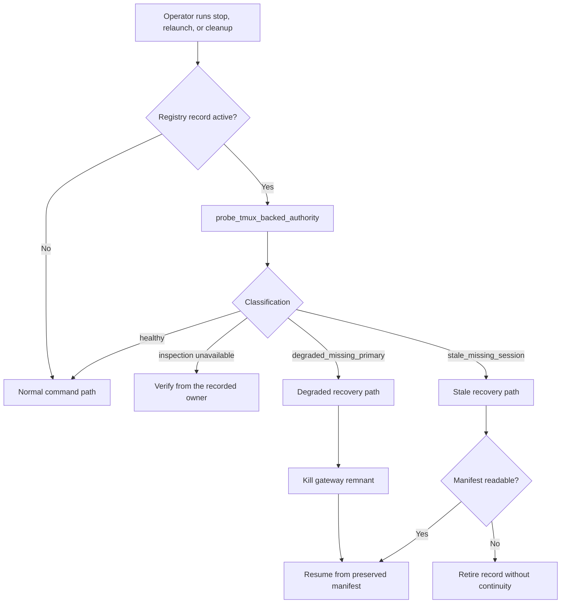

# Degraded and Stale Active Recovery

## When Recovery Triggers

When the selected agent has an active registry record, the following commands can recover a confirmed broken tmux session.

- `houmao-mgr agents single --agent-id <id> stop`
- `houmao-mgr agents single --agent-id <id> relaunch`
- `houmao-mgr agents single --agent-id <id> cleanup session --purge-registry`

Houmao selects the agent and its saved execution owner and tmux socket before it probes the recorded session. Before recovery changes anything, it checks that the selected generation and owner still match.

## Probe Classification

The probe checks the exact session on its recorded socket. For an existing session it inspects the primary window at index `0` and checks the saved pane handles when available.

| Result | Evidence |
|---|---|
| `healthy` | The selected session and its required primary surface are present. |
| `degraded_missing_primary` | The selected session exists and its primary window or pane is missing. A gateway remnant may survive. |
| `stale_missing_session` | A completed query on the recorded socket confirms the session is absent. |
| Inspection unavailable | An owner mismatch, inaccessible socket, permission error, timeout, or failed query leaves the terminal condition unknown. |

The probe can also report a dead pane, ambiguous primary panes, or stale saved handles. Automatic broken-active recovery requires a confirmed missing session or a missing primary surface. To tear down a surviving session, Houmao verifies the observed session ID against the agent ID and manifest path published in the session.

For unavailable inspection, verify the session from the recorded execution owner before retrying. The runtime artifacts and registry record remain available for verification.

## Recovery Flow

## Recovery Paths

### Degraded (`degraded_missing_primary`)

The tmux session exists and the primary window or pane is missing. A gateway remnant may still be alive.

**`agents single ... stop`**

1. Stops the verified surviving tmux session.
2. Publishes a stopped record when the saved manifest supports relaunch.
3. Removes the broken active record when relaunch authority is unavailable.

**`agents single ... relaunch`**

1. Stops the verified surviving tmux session.
2. Restarts through the saved manifest, rebuilding the primary surface and reprovisioning the gateway according to its recorded posture.
3. Directs the operator to `houmao-mgr project agents launch` if the saved authority cannot support a revival.

### Stale (`stale_missing_session`)

The tmux session is entirely missing.

Stop publishes a stopped record when the saved manifest supports relaunch. Relaunch revives the session from that authority. If the authority is unavailable, Houmao removes the broken active record and directs the operator to `houmao-mgr project agents launch` for a fresh launch.

## Cleanup Integration

`agents single ... cleanup session --purge-registry` can remove the runtime artifacts and registry record for confirmed broken active local authority.

- A completed probe must establish the missing session or missing primary surface on the recorded socket.
- If a session survives, cleanup verifies ownership and requires successful teardown before removing artifacts.
- Registry purge follows successful session-root removal or validated absence.
- With `--dry-run`, cleanup reports actions supported by the same evidence.

Default cleanup of a stopped session retires the registry record after artifact removal.

## See also

- [Session Lifecycle](session-lifecycle.md) — start, resume, prompt, stop, and relaunch
- [Managed Agent API](../managed_agent_api.md) — direct agent control API surface
- [Registry Discovery and Cleanup](../registry/operations/discovery-and-cleanup.md) — registry maintenance commands
