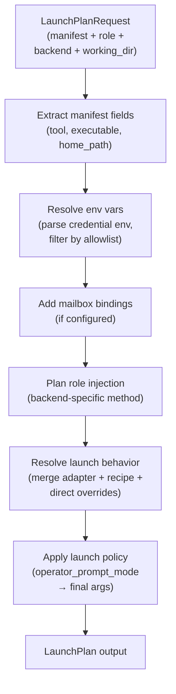

# Launch Plan

Module: `src/houmao/agents/realm_controller/launch_plan.py` — Launch-plan composition for brain + role inputs.

The launch plan is the bridge between Houmao's build phase and run phase. It takes a built brain manifest and a role package, resolves environment variables, merges launch overrides, binds mailbox configuration, and produces a fully resolved, backend-specific plan that a session backend can execute directly.

For operator prompt policy, the launch plan consumes the manifest's resolved `launch_policy.operator_prompt_mode` intent. Current builds resolve omission to `unattended`, while `as_is` means launch-plan composition leaves provider startup posture untouched.

## Resolution pipeline



## LaunchPlanRequest

`LaunchPlanRequest` is a frozen dataclass that captures everything needed to compose a launch plan.

| Field | Type | Description |
|---|---|---|
| `brain_manifest` | `dict[str, Any]` | Loaded brain manifest (output of the build phase) |
| `role_package` | `RolePackage` | Loaded role prompt containing `role_name`, `system_prompt`, and `path` |
| `backend` | `BackendKind` | Target backend for the session |
| `working_directory` | `Path` | Working directory for the agent process |
| `mailbox` | `MailboxResolvedConfig \| None` | Optional resolved mailbox configuration for inter-agent messaging |
| `intent` | `LaunchPolicyApplicationKind` | Launch intent; defaults to `"provider_start"` |

## build_launch_plan

```python
def build_launch_plan(request: LaunchPlanRequest) -> LaunchPlan
```

Composes a backend-specific launch plan from the given request. The function performs the following steps:

1. **Resolves allowlisted environment variables** from the brain home directory, ensuring only declared env vars are propagated to the agent process.
2. **Merges launch overrides** from the brain manifest with backend-specific typed-parameter translation (e.g., translating generic override keys into CLI flags appropriate for the target backend).
3. **Binds mailbox configuration** when inter-agent messaging is requested.
4. **Applies the role injection strategy** appropriate for the target backend (see [Role Injection](role-injection.md)).

The result is a fully resolved `LaunchPlan` that a backend can execute without further interpretation. The runtime `LaunchPlan` is derived and ephemeral; it is **not** a user-authored object and is not persisted as project-local source.

### Launch-profile inputs flow through the manifest

When a managed agent was launched from a reusable launch profile (either an easy `project profile` or an explicit `internals native-agent launch-dossiers`), the build manifest carries launch-profile-derived inputs into run-phase resolution. At minimum, the following profile-owned values reach the manifest before `build_launch_plan` consumes it:

- effective auth selection (rendered by auth display name; secrets remain in the auth bundle, never inline, and stored relationships resolve through auth-profile identity),
- operator prompt-mode intent (`unattended` or `as_is`),
- durable non-secret env records,
- requested and resolved managed system-skill policy provenance, including source/profile policy payloads and resolved installed Houmao-owned skill names,
- declarative mailbox configuration (transport, root, address, principal, Stalwart-only fields when applicable),
- managed-agent identity defaults (`agent_name`, optionally `agent_id`),
- the **effective launch prompt** — prompt composition happens in this order: source role prompt, launch-profile prompt overlay resolution, launch-owned appendix append when present, structured render into `<houmao_system_prompt>`, then backend-specific role injection. The runtime does not replay the overlay, appendix, or managed header later as separate bootstrap steps on resumed turns.
- secret-free `inputs.houmao_system_prompt_layout` metadata describing the rendered structured prompt layout for new builds.
- secret-free relaunch chat-session policy, when the launch profile stores one. This policy is not consumed during first launch; the runtime reads it later when `agents single ... relaunch` is invoked without a direct chat-session override.

The build manifest and the resulting runtime launch metadata also preserve secret-free **launch-profile provenance** sufficient for inspection and replay: the source lane (specialist or recipe), the birth-time lane (`easy_profile` or `launch_profile`), and the originating profile name when available. Inspection commands such as `houmao-mgr agents single ... state`, `houmao-mgr agents global list`, and the easy `houmao-mgr project agents get|list` surfaces report that provenance.

For the shared conceptual model that ties launch profiles to this run-phase composition step, see [Launch Profiles](../../getting-started/launch-profiles.md).

## LaunchPlan

`LaunchPlan` is a frozen dataclass representing the fully resolved, ready-to-execute launch configuration.

| Field | Type | Description |
|---|---|---|
| `backend` | `BackendKind` | Target backend |
| `executable` | `str` | Resolved executable path or command |
| `args` | `list[str]` | Command-line arguments for the agent process |
| `working_directory` | `Path` | Working directory for the agent process |
| `home_env_var` | `str` | Environment variable name pointing to the runtime home (e.g., `CODEX_HOME`) |
| `home_path` | `Path` | Absolute path to the runtime home directory |
| `env` | `dict[str, str]` | Effective native process environment, including values saved in the owner-private launch record |
| `public_env` | `dict[str, str] \| None` | Launch values selected for publication to the owning tmux session |
| `env_var_names` | `list[str]` | Auditable names of durable launch inputs |
| `role_injection` | `RoleInjectionPlan` | Backend-specific role injection plan (see [Role Injection](role-injection.md)) |
| `metadata` | `dict[str, Any]` | Additional metadata carried through from the brain manifest. When the launch came from a reusable launch profile, this carries secret-free launch-profile provenance such as the profile name, the profile lane (`easy_profile` or `launch_profile`), the source kind (`specialist` or `recipe`), and prompt-overlay metadata. |
| `mailbox` | `MailboxResolvedConfig \| None` | Resolved mailbox configuration, if any |
| `launch_policy_provenance` | `LaunchPolicyProvenance \| None` | Provenance information for the applied launch policy |

### Managed Launch Environment

Houmao starts the provider with an owner-side baseline, declared settings, and runtime bindings. Declare ordinary non-secret settings in a specialist or launch profile to keep them across relaunch. For one live generation, use `houmao-mgr project agents launch --env-set NAME=value` or `--env-set NAME` to resolve a value from the execution owner's environment. One-off settings override ordinary durable settings with the same name.

Declared non-secret values are visible in the owning tmux session and to the provider and its tools. Supply API keys and other credentials through the selected auth bundle. Houmao delivers credential values through the owner-private launch inputs and keeps them out of tmux publication and public runtime metadata. Assignments using runtime-owned names or selected credential bindings fail with a diagnostic that names the variable.

### Kimi Config and Environment Ownership

Use native Kimi TOML for model catalogs, provider routing, thinking, telemetry, and runtime preferences with persistent settings. Examples include `[loop_control].max_steps_per_turn`, `[mcp].startup_timeout_ms`, and `[identity].name`. Set background-task preferences in the `[task]` or `[background]` table supported by the installed Kimi version. Launch records and one-off assignments using the corresponding environment names fail with a diagnostic pointing to the native setting. Fresh launch and relaunch clear inherited values for those names from the owned tmux session. [Kimi configuration reference](https://github.com/MoonshotAI/kimi-code/blob/56145f849caa305d42acd09b67fb65d11146f887/docs/en/configuration/config-files.md)

The provider receives explicitly referenced credentials and selected sampling and completion-cap variables through private launch inputs. `KIMI_CODE_HOME` and startup controls remain process inputs. See [current reasoning projection](../build-phase/launch-policy.md#current-reasoning-projection) for the setup and credential config precedence.

### Kimi TUI unattended launch ownership

For Kimi Code 2.1.1 or later, `build_launch_plan()` records the resolved TUI permission mode and produces the native `--auto` or `--yolo` flag when applicable. Unattended launch fills an omitted mode with `auto`. An explicit `manual` setting uses the native home configuration on fresh TUI startup. `as_is` with an omitted field keeps native approval behavior. Policy takes effect before managed conversation starts.

For both `kimi_headless` and Kimi `local_interactive`, provider-start planning verifies `$KIMI_CODE_HOME/SYSTEM.md` immediately before launch and repairs drift to the canonical `${base_prompt}` plus complete effective-prompt form. `metadata.native_system_prompt` records the method, relative path, projection state, effective and rendered hashes, built-in-prompt preservation, engine requirement, detected provider version, and validation result. The final environment always contains `KIMI_CODE_LEGACY_FLAG=0`; a later truthy runtime override fails before process start.

## backend_for_tool

```python
def backend_for_tool(
    tool: str,
    prefer_cao: bool = False,
    prefer_local_interactive: bool = False,
) -> BackendKind
```

Returns the default backend for a given tool name.

**Default mapping:**

| Tool | Default Backend |
|---|---|
| `claude` | `claude_headless` |
| `codex` | `codex_headless` |
| `kimi` | `kimi_headless` |

**Override behavior:**

- When `prefer_local_interactive=True`, returns `local_interactive` for Claude, Codex, and Kimi. Kimi local interactive starts the Kimi Code TUI and remains distinct from the `kimi_headless` prompt-mode backend.
- `prefer_cao=True` is legacy/internal compatibility input. New public operator workflows do not request standalone `cao_rest` launches.

## See also

- [Backends](backends.md) — backend implementations that execute a `LaunchPlan`
- [Role Injection](role-injection.md) — how role prompts are delivered per backend
- [Session Lifecycle](session-lifecycle.md) — how launch plans are used to start and resume sessions
