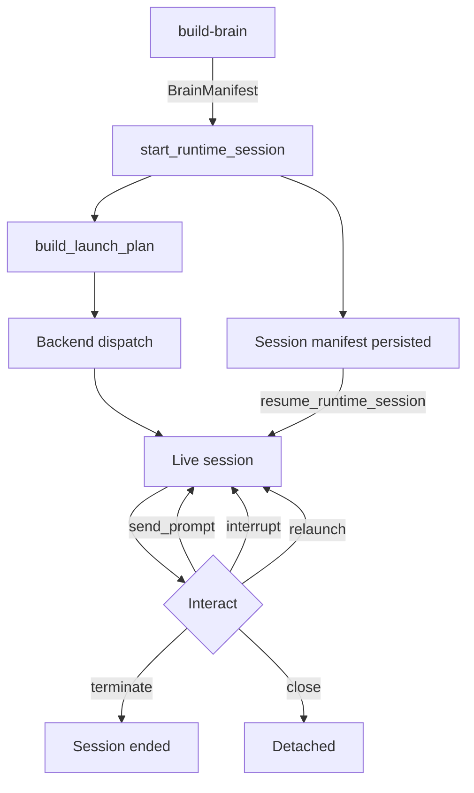
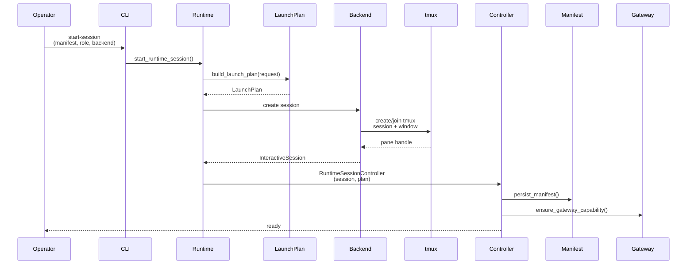
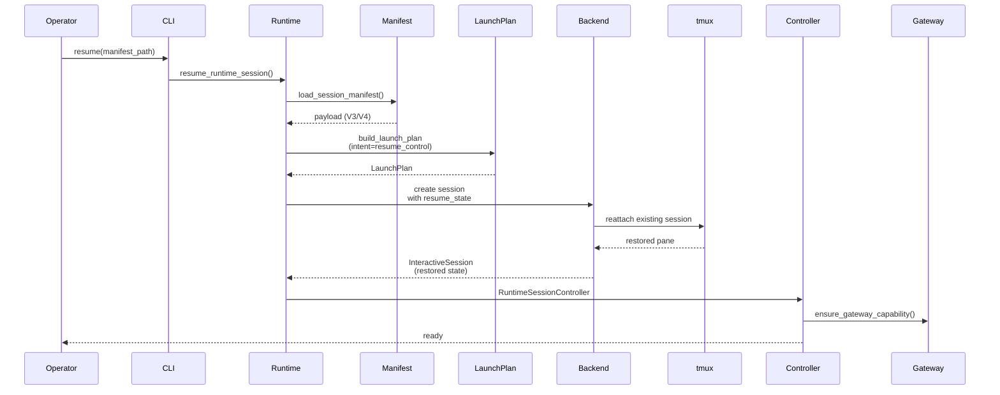
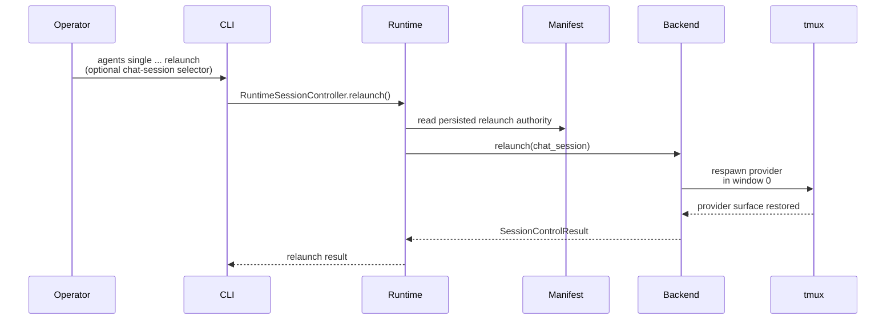

# Session Lifecycle

Module: `src/houmao/agents/realm_controller/runtime.py` — High-level session runtime orchestration.

The session lifecycle covers starting, interacting with, resuming, and stopping agent sessions. The `RuntimeSessionController` is the main controller class that manages this lifecycle, backed by persisted session manifests that enable resume across process restarts.

On the skill surface, a human operator uses `$houmao-admin-entrypoint agent-instance ...` with an explicit target. A managed agent uses `$houmao-agent-entrypoint agent-instance ...` after self-identity verification; self-scoped follow-up defaults to verified self. Both entrypoints delegate to the parent-scoped `houmao-shared-routines->houmao-agent-instance` child.

## Run Modes and Handoff

`houmao-mgr project agents launch --mode <mode>` selects a tool's native entrypoint. The manager uses the direct selection, the stored `defaults.posture.mode`, or the project default, in that order. Prompt policy (`unattended` or `as_is`), gateway attachment, and execution owner are independent choices.

| Mode | Process and interface | Handoff |
| --- | --- | --- |
| `headless` | One native CLI worker per prompt with logical session continuation | Manager and gateway control |
| `service` | Persistent native protocol process | Manager and gateway control |
| `tui` | Native terminal UI | Verified tmux terminal target |
| `web` | Native browser application | Token-free browser origin and bound native session ID |

Claude supports `headless` and `tui`. Codex also supports `service`, and Kimi supports all four modes. DeepSeek Harness (DSH) supports `headless`, `service`, and `web`. Project launches default to `web` for DSH and `tui` for the other tools. Passive headless birth requires `headless`. The low-level Codex runtime start defaults to `headless` when both mode and backend are omitted.

Launch and inspection report `tool`, `mode`, `backend`, and `native_surface`. A terminal launch from a script includes a tmux attach command. A Web launch reports the native browser origin and session ID. For a routed launch, browser origins and tmux targets refer to the execution owner. Service and headless supervision panes are available for diagnostics. Relaunch selects the saved mode and backend even if the profile has changed.

The launch result and agent identity share these fields. The sample uses a representative local origin and native session ID.

```json
{
  "tool": "dsh",
  "mode": "web",
  "backend": "dsh_web",
  "native_surface": {
    "kind": "web",
    "origin": "http://127.0.0.1:36733",
    "native_session_id": "session-example"
  }
}
```

The current launch plan uses schema 3, the session manifest uses schema 6, the registry record uses schema 5, and the execution locator uses schema 2. Stop RC2 agents with RC2 before switching to the current runtime, then start fresh agents. Replace `defaults.posture.headless` with an explicit mode or omit it to use the project default.

## RuntimeSessionController

`RuntimeSessionController` is the primary entry point for managing a live agent session. It is constructed via one of two class-level factory functions: `start_runtime_session` (for new sessions) or `resume_runtime_session` (for previously persisted sessions).

### Starting a new session

```python
@classmethod
def start_runtime_session(
    *,
    agent_def_dir: Path,
    brain_manifest_path: Path,
    role_name: str | None,
    runtime_root: Path | None = None,
    backend: BackendKind | None = None,
    mode: RunMode | None = None,
    working_directory: Path | None = None,
    api_base_url: str = "http://localhost:9889",
    cao_profile_store_dir: Path | None = None,
    agent_identity: str | None = None,
    agent_name: str | None = None,
    agent_id: str | None = None,
    cao_parsing_mode: CaoParsingMode | None = None,
    mailbox_transport: str | None = None,
    mailbox_root: Path | None = None,
    mailbox_principal_id: str | None = None,
    mailbox_address: str | None = None,
    mailbox_stalwart_base_url: str | None = None,
    mailbox_stalwart_jmap_url: str | None = None,
    mailbox_stalwart_management_url: str | None = None,
    mailbox_stalwart_login_identity: str | None = None,
    blueprint_gateway_defaults: BlueprintGatewayDefaults | None = None,
    gateway_auto_attach: bool = False,
    gateway_host: str | None = None,
    gateway_port: int | None = None,
    tmux_session_name: str | None = None,
    registry_launch_authority: RegistryLaunchAuthorityV1 = "runtime",
) -> RuntimeSessionController
```

Starts a new runtime session by:

1. Loading the brain manifest from `brain_manifest_path`.
2. Resolving the role package from `role_name` within the agent definition directory (or using a brain-only placeholder when `role_name` is `None`).
3. Building a `LaunchPlan` via `build_launch_plan` (see [Launch Plan](launch-plan.md)).
4. Dispatching the launch plan to the chosen backend.
5. Persisting a session manifest to the session root for later resume.

**Parameters:**

| Parameter | Description |
|---|---|
| `agent_def_dir` | Path to the agent definition directory containing roles, brains, and blueprints |
| `brain_manifest_path` | Path to the built brain manifest (JSON) from the build phase |
| `role_name` | Name of the role to apply (resolved from `roles/<role_name>/system-prompt.md`); `None` for brain-only sessions |
| `runtime_root` | Optional runtime root override; defaults to the standard resolved root |
| `backend` | Target backend (see [Backends](backends.md)); resolved from manifest if omitted |
| `working_directory` | Working directory for the agent process |
| `api_base_url` | Legacy/internal REST authority metadata; new public launches do not create `cao_rest` or `houmao_server_rest` sessions |
| `agent_identity` | Legacy agent identity string for session addressing |
| `agent_name` | Friendly managed-agent name |
| `agent_id` | Authoritative managed-agent identifier |
| `mailbox_transport` | Mailbox transport type for inter-agent messaging |
| `mailbox_root` | Filesystem mailbox root path |
| `mailbox_principal_id` / `mailbox_address` | Mailbox identity overrides |
| `mailbox_stalwart_*` | Stalwart JMAP connection parameters |
| `blueprint_gateway_defaults` | Gateway defaults from the resolved blueprint |
| `gateway_auto_attach` | Whether to automatically attach a gateway at launch time |
| `gateway_host` / `gateway_port` | Host and port overrides for gateway attachment (require `gateway_auto_attach`) |
| `tmux_session_name` | Explicit tmux session name override |
| `registry_launch_authority` | Authority identifier for agent registry registration (default: `"runtime"`) |

### Resuming a session

```python
@classmethod
def resume_runtime_session(
    agent_def_dir: Path,
    session_manifest_path: Path,
    read_only: bool = False,
) -> RuntimeSessionController
```

Resumes a previously started session from its persisted session manifest. The manifest contains all information needed to reconnect to the live agent process (or restart it if needed), including the original launch plan, backend state, and session identifiers.

**Parameters:**

| Parameter | Description |
|---|---|
| `agent_def_dir` | Path to the agent definition directory |
| `session_manifest_path` | Path to the persisted session manifest written during `start_runtime_session` |
| `read_only` | Restore saved launch intent without memory, hook, native-home, tmux, or gateway preparation |

Read-only reconstruction reads the selected credential references and persisted launch intent. It does not run provider version probes, synthesize launch policy, normalize tmux surfaces, publish session environment, or repair missing materials. Owner-side query commands use this mode. An enclosing `execution_read_only_scope()` also suppresses implicit reconstruction effects and rejects controller mutations until that scope exits; a reconstructed controller can still service a later explicit mutation under its saved owner binding.

### Session manifest persistence

Each session writes a manifest to its session root (`<runtime-root>/sessions/<backend>/<session-id>/`) upon creation. This manifest captures:

- The original launch plan and backend configuration.
- Session identifiers (tmux session name, backend-specific session IDs).
- Gateway state and attachment information.
- Runtime artifacts and metadata.

The session root serves as the persistent root for all session-related state, including the session manifest, gateway state files, and any runtime artifacts produced during the session. The session root is distinct from the brain runtime home (which holds projected configs and skills) and from the per-agent memory root under `<active-overlay>/memory/agents/<agent-id>/`.

### Execution Owner Authority

New runtime launches record an observed execution binding independently of `agent_id`. The binding identifies the actual owner UID/GID, host and durable context ID, state roots, execution profile, and admitted controller scope. Current-account launch records existing local-user authority without changing the caller's launch environment or requiring an executor configuration file. It initializes `execution-context.json` under the resolved runtime root when the launch prepares its runtime authority.

The manifest stores the binding in `runtime.execution_binding` and the persisted launch plan. Strict validation requires those copies to agree. Resume restores the saved binding before backend reconstruction; controller operations restore it independently in each worker thread. A mismatched admitted context or actual UID/GID fails before control. Relaunch keeps this binding while updating live generation and surface handles. The owner lifecycle registry record publishes the same secret-free binding; discovery does not itself grant delegation rights.

### Tmux Server Authority

The manifest's `tmux.socket_path` records the absolute socket path in the execution owner's filesystem. Session, window, and pane identifiers are meaningful only on that server. Launch captures the selected socket once; resume and later controls restore that selector rather than choosing a server from a matching session name. A current-session join captures the enclosing socket before recording its primary handles.

Command-based tmux calls, libtmux pane/session access, generated headless completion signals, passive discovery, and registry cleanup use the same recorded selector. Explicit execution scopes remove inherited `TMUX` and `TMUX_PANE` from tmux subprocess environments without changing the enclosing operator's environment. Nested and concurrent runtime scopes retain independent selectors.

Stop and cleanup address the selected agent's resources. They do not kill or restart a shared tmux server or terminate unrelated sessions. Tests create unique explicit `-S` sockets, clear both inherited tmux variables before setup, and clean up only those isolated servers. `TMUX_TMPDIR` alone does not establish isolation.

## InteractiveSession protocol

All backends expose a common `InteractiveSession` protocol for interacting with a running agent. The `RuntimeSessionController` delegates to this protocol for prompt delivery and session control.

### send_prompt

```python
def send_prompt(prompt: str) -> list[SessionEvent]
```

Sends a user prompt to the running agent session and returns a list of `SessionEvent` objects representing the agent's response and any side effects. This is the primary interaction method for delivering work to an agent.

### interrupt

```python
def interrupt() -> SessionControlResult
```

Interrupts the agent's current operation. The specific behavior depends on the backend — headless backends may send a SIGINT to the underlying process, while interactive backends may send a Ctrl-C sequence via tmux.

### terminate

```python
def terminate() -> SessionControlResult
```

Terminates the agent session. This stops the underlying agent process and cleans up backend-specific resources. The session manifest remains on disk for inspection but the session cannot be resumed after termination.

### close

```python
def close() -> None
```

Releases resources held by the session controller without necessarily terminating the underlying agent process. Use this when detaching from a session that should continue running.

### Native Home and Refresh

Use scoped `agents single ... home` or `agents self home` to inspect the active native home. `refresh --check` observes common skill/MCP freshness without initiating reload. `refresh` chooses verified no-op, automatic future discovery, or a qualified native reload. It preserves the running agent and conversation, can have broader native extension effects, and never applies edited Houmao launch profiles or regenerates launch-derived materials. See [Native Home and Common-Plugin Refresh](native-refresh.md).

### relaunch

```python
def relaunch(
    *,
    chat_session: RelaunchChatSessionSelection | None = None,
) -> SessionControlResult
```

Relaunches a tmux-backed managed session without rebuilding the brain home. Relaunch reuses the runtime-owned session root, existing built home, persisted launch authority, and tmux window `0`. It is the runtime primitive behind `houmao-mgr agents single ... relaunch`, the narrower `houmao-mgr agents self relaunch`, and gateway-managed relaunch recovery.

A successful relaunch rotates the live registry generation while retaining logical identity and execution ownership. Registry publication replaces the captured previous generation under the same runtime owner lock. Stale writers and teardown requests cannot publish or remove the replacement generation. Starting a new headless conversation also resets its native conversation turn counter; persisted native-session caches from a prior runtime generation do not select that conversation again.

For DSH ACP, an already-attached local gateway retains the execution controller from its original generation. After relaunch, use `houmao-mgr agents single --agent-id <id> gateway detach` followed by `houmao-mgr agents single --agent-id <id> gateway attach` to submit through a gateway bound to the new generation.

Fresh project launch can also intentionally target a preserved home through `houmao-mgr project agents launch --reuse-home`, but that is a different lifecycle shape. Reuse-home launch rebuilds current Houmao-managed launch inputs onto one compatible preserved home, creates a new live session root and new registry authority, and does not automatically consume relaunch-only chat-session policy. Relaunch remains the supported path when the operator wants to restart the same built session/home posture rather than request a fresh launch over preserved provider-local state.

The optional relaunch chat-session selector controls provider-native startup behavior:

| Mode | Meaning |
| --- | --- |
| `new` | Start a fresh provider chat. This is the default and preserves prior relaunch behavior. |
| `tool_last_or_new` | Ask the provider CLI to continue its latest stored chat, falling back according to that provider's native behavior. |
| `exact` | Resume the exact provider-native session id supplied by the caller. |

For local interactive TUI sessions, the selector is translated into startup arguments before the provider process is respawned in tmux window `0`. The maintained mappings are Claude Code `--continue` or `--resume <session_id>`, Codex `resume --last` or `resume <session_id>`, and Kimi Code `--continue` or `--session <session_id>`. For native headless sessions, the selector is stored as the startup/default chat-session policy for the next managed headless prompt; relaunch itself does not send a provider turn.

When a local interactive relaunch resumes an existing provider chat, the runtime does not replay bootstrap-message role injection into that resumed chat. For Kimi, it verifies and repairs the managed native system prompt before respawning the provider, without submitting any role turn.

For Kimi Code 2.1.1 or later, resumed startup accepts native `--auto` with `--continue` or `--session <session_id>`. Houmao canonicalizes caller permission flags, preserves the selected resume selector, validates prompt precedence, repairs `$KIMI_CODE_HOME/SYSTEM.md` when needed, and appends exactly one strategy-owned `--auto`; `--model <alias>` remains valid.

For Kimi Code local-interactive sessions built with `operator_prompt_mode = unattended`, both fresh and resumed launches reach initial readiness in native auto mode. The runtime does not send `/auto on`. `as_is` relaunch leaves the provider's approval behavior unchanged.

## Degraded and stale recovery

When a managed agent's registry record claims `active` but the underlying tmux session is broken, selected-agent `agents single ... stop` and `agents single ... relaunch` route through dedicated recovery helpers instead of failing with a generic unusable-target error. The runtime probes tmux authority first, classifies the session as `healthy`, `degraded_missing_primary`, or `stale_missing_session`, and then dispatches to the appropriate recovery path.

For degraded sessions, the gateway remnant is cleaned up and the primary surface is rebuilt. For stale sessions with unreadable manifest authority, the record is retired and the operator is directed to a fresh `project agents launch`. See [Degraded and Stale Active Recovery](degraded-stale-recovery.md) for the full probe model, recovery paths, and cleanup integration.

## Lifecycle flow



## Start session sequence



## Resume session sequence



## Relaunch sequence



## Finalized Usage and Turn Artifacts

Managed headless execution registers an accounting turn before launching the provider. When a caller omits an artifact ID, the runtime generates a unique `turn-<uuid12>` and returns it in the completion event's `turn_id`. A failed attempt can reuse the provider's numeric turn index, but its accounting ID and artifact directory remain distinct. Explicit caller-supplied IDs are preserved; conflicting reuse is rejected before another attempt can overwrite existing evidence.

Ordinary runtime, gateway, and passive-server headless artifacts live under `<session-root>/<manifest-stem>.turn-artifacts/<turn-id>/`. Passive-server submissions use their accepted submission ID as the turn ID. Accounting records for all paths enter `<session-root>/usage/records.sqlite3`.

The private accounting evidence includes:

| Artifact | Purpose |
| --- | --- |
| `usage-start.json` | Original agent/runtime/generation identity, turn ID, source binding, and verified starting boundaries/baselines. |
| `usage-final.json` | Original terminal outcome and timing, plus the frozen source cutoff used for accounting. |
| `usage-record.json` | Assembled immutable record that can be committed again after a recorder outage. |
| `usage-interrupt.json` | Interruption intent retained for consistent normal and recovered outcomes. |

Completed, failed, and interrupted headless turns produce final lifecycle records even when token metrics are unavailable. An interruption can preserve known request measurements with partial availability. Controller timeout alone leaves accounting pending while the provider process remains active.

Gateway startup and passive-server recovery resume source checkpoints and reconcile missing final records using their original evidence. Relaunch does not relabel older records with the new registry generation. Provider-chat reset establishes a separate provider binding or counter epoch while preserving the runtime-session usage cursor.

Qualified TUI agents use their bound native JSONL logs and structured lifecycle markers. Direct native turns can produce native-observed records. A managed prompt whose provider-turn association is unresolved remains an explicit collection limitation rather than producing a guessed or duplicate charge.

Use gateway `GET /v1/usage` or maintained `GET /houmao/agents/{agent_ref}/usage` to read finalized history. These reads remain available during active work and retain a resumable cursor after an empty page. See [Usage Records](usage-records.md) for provider-specific scopes, collection boundaries, record examples, and recovery limits.

## Execution-Bound Lifecycle

Project launch can select a provisioned execution context with `--executor <name>`. Delegation occurs before project projection, credential/native-home preparation, runtime directories, or tmux creation. Later selected-agent controls enter the saved owner route rather than reconstructing a foreign manifest in the operator process. Logical agent identity, OS ownership, admitted controller scope, and live generation remain distinct.

Resume/inspect, interrupt, stop, and relaunch preserve the owner binding. Relaunch changes live generation and handles within that context; it does not migrate the agent when an execution profile changes. Stop returns owner-qualified cleanup pointers and retains the locator for later recovery. Concurrent generation replacement produces a conflict; route loss or an indeterminate result never triggers automatic replay or caller-local fallback.

Every tmux operation uses the captured socket and exact agent handles. Delegated entry clears both TMUX and TMUX_PANE, while current-session adoption captures the enclosing socket explicitly. Teardown affects only the selected agent and never restarts or kills the shared localhost tmux server. Owner-side control retains its existing backend/gateway contracts; interactive terminal forwarding and unbounded streaming are outside the finite execution transport.

See [agent execution contexts](execution-contexts.md) for trusted profile configuration, independent same-user credential bindings, transport limits, and failed-publication reconciliation.

## See Also

- [Launch Plan](launch-plan.md) — how launch plans are composed from brain manifests and roles
- [Backends](backends.md) — backend implementations that execute launch plans
- [Role Injection](role-injection.md) — how role prompts are delivered to agents
- [Degraded and Stale Active Recovery](degraded-stale-recovery.md) — recovery paths for broken active tmux-backed sessions
- [Usage Records](usage-records.md): finalized accounting, native-log collection, and cursor polling
