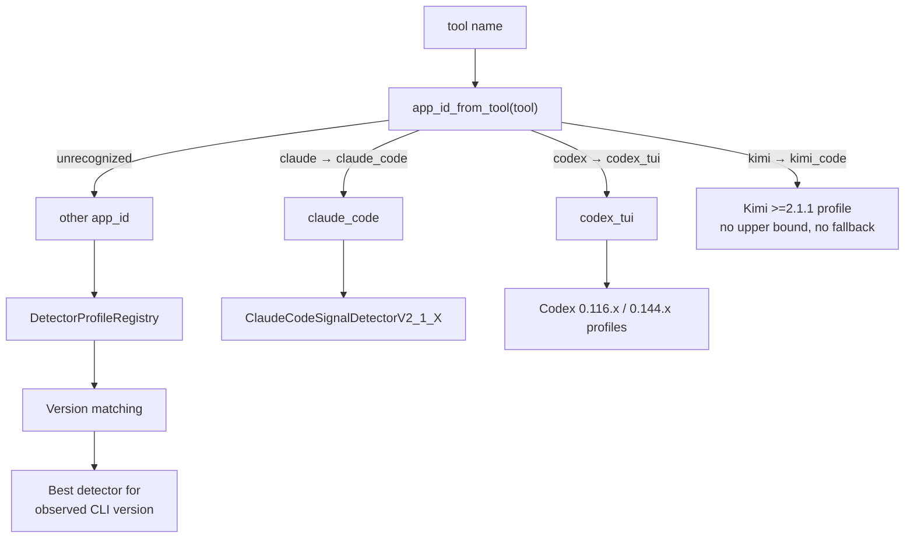

# TUI Tracking Detectors

Module: `src/houmao/shared_tui_tracking/detectors.py` — Shared detector/profile contracts plus compatibility exports.

## Detector Selection

## BaseTrackedTurnSignalDetector

Abstract base class defining the contract for all TUI signal detectors. Each detector is responsible for analyzing a single observation frame (a raw pane snapshot and parsed surface context) and producing structured turn signals.

### Properties

| Property | Type | Description |
|---|---|---|
| `temporal_window_seconds` | `float` | The time window (in seconds) over which this detector considers recent frames for temporal analysis |

### Methods

#### `detect(output_text, parsed_surface) → DetectedTurnSignals`

**Abstract.** Performs one-frame signal detection on the given pane output text and parsed surface context. Returns a `DetectedTurnSignals` instance capturing all observable signals from this single frame — prompt visibility, active evidence, error patterns, completion candidates, and surface signature.

This method must be stateless with respect to the detector instance; all temporal reasoning is handled separately via `build_temporal_frame` and `derive_temporal_hints`.

#### `build_temporal_frame(output_text, signals, observed_at_seconds) → object | None`

Builds a temporal profile frame from the current observation. The returned frame object is detector-specific and is accumulated into a sliding window for `derive_temporal_hints`. Returns `None` if the detector does not support temporal profiling.

#### `derive_temporal_hints(recent_frames) → TemporalHintSignals`

Derives lifecycle hints from a window of recent temporal frames. These hints inform the state machine about patterns that are only visible across multiple observations — such as sustained activity, stalled output, or gradual convergence toward a ready state.

## Concrete Detectors

### Claude Code Detectors

- **`ClaudeCodeSignalDetectorV2_1_X`** — Signal detector for Claude Code ≥ 2.1.x. Recognizes Claude Code's prompt patterns, status line formats, interrupt indicators, and error surfaces. Handles the tool-use confirmation dialogs and permission prompts specific to Claude Code's TUI.

### Codex TUI Detectors

- **`CodexTuiSignalDetector`** — Base Codex TUI signal detector.
- **`CodexTuiSignalDetectorV0_116_X`** — Codex TUI signal detector targeting Codex CLI ≥ 0.116.x. Recognizes Codex's input prompt, status bar, streaming output indicators, and completion patterns.
- **`CodexTuiSignalDetectorV0_144_X`** — Maintained Codex 0.144.x profile for current prompt styling, GPT-5.6 activity, tool cells, and collaboration wait cells. A current `Waiting for …` collaboration cell is active until a later `Finished waiting` or assistant response supersedes it. Codex 0.144.1 can restore an interrupted request directly into the editor without an interruption banner, so this profile also recognizes the bounded active-to-restored-draft transition from recent temporal evidence.
- **`CodexTrackedTurnSignalDetector`** — Tracked turn signal detector for Codex sessions. Builds on the TUI signal detector with additional turn-level tracking logic.

### Kimi Code Detectors

- **`KimiCodeSignalDetectorV2_1_X`** — The single maintained Kimi Code profile, selected for every observed version at or above the 2.1.1 support floor, with no upper bound. Qualified against the frozen 2026-10-10 campaign recordings of kimi-code 2.1.1 (zero false-ready / zero false-busy; `context/campaigns/debug/2026-10-10-kimi-code-tui-parsing/`). Busy evidence is the live-edge spinner union (moon frames directly; braille frames qualified by the 2.1.x labels `Thinking…`/`Working…`, `Retrying (N/M)`, `Compacting context…`, `Orchestrating…`, `… Agent Running (…)`); modal surfaces (approvals, question dialog, goal-start prompt, workspace trust) report active-with-`modal_blocked` and close input acceptance; a visible composer accepts input while a turn is active; scrollback interrupt notices are suppressed while concurrent activity is visible. The class carries `qualified_through_version = "2.1.1"` metadata.

Kimi has no fallback detector: an observed version below 2.1.1, or unparseable version metadata, raises `UnsupportedToolVersionError` at tracker resolution. Pre-2.1.1 Kimi recordings are historical evidence only.

### Fallback Detectors

- **`FallbackClaudeDetector`** — Fallback detector used when no versioned Claude Code detector matches the installed CLI version. Provides conservative signal detection that avoids false positives.
- **`FallbackCodexTuiSignalDetector`** — Fallback detector for unrecognized Codex CLI versions.
- **`FallbackTrackedTurnSignalDetector`** — Fallback tracked turn detector for unsupported or unrecognized tools.

## DetectorProfileRegistry

Defined in `src/houmao/shared_tui_tracking/registry.py`.

The registry resolves a supported TUI application identifier to its closest-compatible detector profile. This allows the tracking subsystem to select the correct detector implementation based on the tool and version being tracked.

### DetectorProfileRegistration

A registration entry in the registry.

| Field | Type | Description |
|---|---|---|
| `app_id` | `str` | Application identifier (e.g., `"claude_code"`, `"codex_tui"`) |
| `detector_name` | `str` | Human-readable detector name |
| `detector_version` | `str` | Detector version string |
| `minimum_supported_version` | `str` | Minimum CLI version this detector supports |
| `maximum_supported_version` | `str \| None` | Exclusive upper bound for bounded evidence intervals, or `None` for a maintained minimum-only registration |
| `profile_factory` | callable | Factory that produces a configured detector profile |
| `qualified_through_version` | `str \| None` | Code-side metadata recording the newest CLI version the profile was qualified against, when known |

### ResolvedDetectorProfile

The resolved profile for one tracker session, selected only when the observed version lies inside a maintained bounded interval or at or above a maintained minimum-only registration. Version gaps and missing versions use the app-specific fallback when one exists; apps with a floor-gated maintained profile and no fallback (currently only `kimi_code`, floor 2.1.1) raise `UnsupportedToolVersionError` instead. Tests may request an exact registered detector-version override for recorded experiments.

### `app_id_from_tool(tool: str) -> str`

Maps a tool name (as used in brain recipes and backend kinds) to the canonical app ID used by the detector registry. For example, `"claude"` maps to `"claude_code"` and `"codex"` maps to `"codex_tui"`.

## App-Specific Detector Implementations

Detector implementations are organized by application under `src/houmao/shared_tui_tracking/apps/`:

### `claude_code/`

Claude Code signal detection. Contains the versioned detector implementations, surface parsing logic for Claude Code's TUI layout (prompt region, output region, status/footer bar), and pattern matchers for Claude Code-specific indicators (tool-use confirmations, permission dialogs, error banners).

### `codex_tui/`

Codex TUI signal detection with temporal hint logic. Includes versioned detectors, surface parsers for the Codex TUI layout, and temporal profiling that tracks output streaming velocity and idle patterns to distinguish between "still thinking" and "done."

### `kimi_code/`

Kimi Code signal detection for the pi-tui surface, qualified on kimi-code 2.1.1 recordings from the 2026-10-10 debug campaign with source inspection under `extern/orphan/kimi-code`. It scopes activity to the current turn/live edge (spinner union with 2.1.x labels), treats approval detection as bounded panel structure, detects the 2.1.x modal surfaces (question dialog, goal-start prompt, workspace trust), and suppresses stale scrollback interrupt notices while concurrent activity is visible.

### `unsupported_tool/`

Fallback handler for tools that do not have a dedicated detector. Produces conservative signals that avoid false readiness or completion claims, ensuring the tracking subsystem degrades gracefully when encountering an unknown TUI application.
