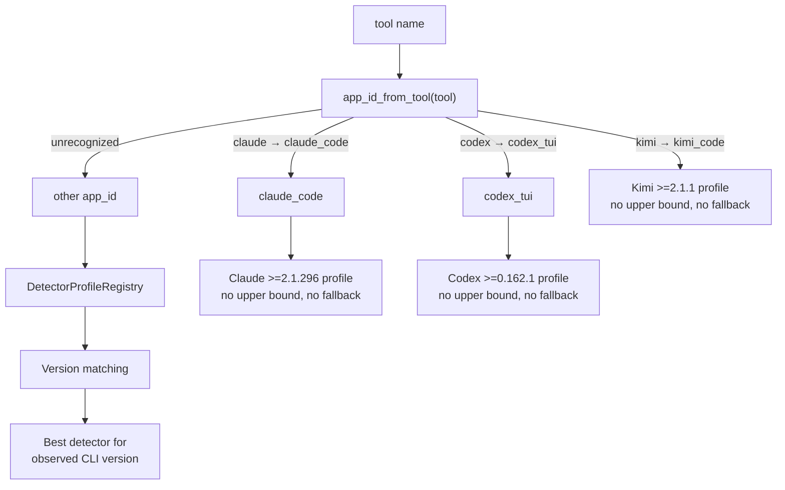

# TUI Tracking Detectors

Module: `src/houmao/shared_tui_tracking/detectors.py` — Shared detector/profile contracts plus compatibility exports.

## Detector Selection

## BaseTrackedTurnSignalDetector

Abstract base class defining the contract for all TUI signal detectors. Each detector is responsible for analyzing a single observation frame (a raw pane snapshot and parsed surface context) and producing structured turn signals.

### Properties

| Property | Type | Description |
|---|---|---|
| `temporal_window_seconds` | `float` | The time window (in seconds) over which this detector considers recent frames for temporal analysis |

### Methods

#### `detect(output_text, parsed_surface) → DetectedTurnSignals`

**Abstract.** Performs one-frame signal detection on the given pane output text and parsed surface context. Returns a `DetectedTurnSignals` instance capturing all observable signals from this single frame — prompt visibility, active evidence, error patterns, completion candidates, and surface signature.

This method must be stateless with respect to the detector instance; all temporal reasoning is handled separately via `build_temporal_frame` and `derive_temporal_hints`.

#### `build_temporal_frame(output_text, signals, observed_at_seconds) → object | None`

Builds a temporal profile frame from the current observation. The returned frame object is detector-specific and is accumulated into a sliding window for `derive_temporal_hints`. Returns `None` if the detector does not support temporal profiling.

#### `derive_temporal_hints(recent_frames) → TemporalHintSignals`

Derives lifecycle hints from a window of recent temporal frames. These hints inform the state machine about patterns that are only visible across multiple observations — such as sustained activity, stalled output, or gradual convergence toward a ready state.

## Concrete Detectors

### Claude Code Detectors

- **`ClaudeCodeSignalDetectorV2_1_X`** — The single maintained Claude Code profile, selected for every observed version at or above the 2.1.296 support floor, with no upper bound. Qualified against the frozen 2026-10-12 campaign recordings of Claude Code 2.1.296 (`context/campaigns/debug/2026-10-12-claude-code-tui-parsing/`; session-1 1.0000/1.0000, session-2-002 1.0000/1.0000, session-2-001 1.0000/0.9995 on the admission booleans, zero false-ready). Modal surfaces (workspace trust, `Do you want to …` approval panels with their cancel footer, the `Select model` picker) force all four surface booleans to `no` with activity suppressed while mounted. Completion reads from the `✻ <Verb> for <Nm Ns>` dock scoped to the latest-turn region; busy evidence uses the `esc to interrupt` footer as primary with a suffix-tolerant spinner as secondary, and readiness asserts `no` while busy. Interruption matches `⎿ Interrupted` and `⎿ User rejected` status lines; queued input reads from the composer placeholder (`Press up to edit queued messages`); success candidacy is refused while the composer carries a draft; the settle-identity signature hashes state-bearing lines only. The temporal channel (600 s window) infers silent Esc aborts (active → idle with no modal, no interrupt line, no fresh region dock), carries busy evidence across the slash-autocomplete blink, and restores a pre-modal interrupted outcome on modal dismissal. The class carries `qualified_through_version = "2.1.296"` metadata.

Claude has no fallback detector: an observed version below 2.1.296, or unparseable version metadata, raises `UnsupportedToolVersionError` at tracker resolution. Pre-2.1.296 Claude profiles (`FallbackClaudeDetector`, the 2.1.81-era registration) were removed; older recordings are historical evidence only.

### Codex TUI Detectors

- **`CodexTuiSignalDetectorV0_162_X`** (also aliased as `CodexTuiSignalDetector` / `CodexTrackedTurnSignalDetector`) — The single maintained Codex profile, selected for every observed version at or above the 0.162.1 support floor, with no upper bound. Qualified against the frozen 2026-10-12 campaign recordings of codex-cli 0.162.1 (`context/campaigns/debug/2026-10-12-codex-tui-parsing/`; session-1 0.9995/0.9984 and session-2 1.0000/1.0000 on the admission booleans). Busy evidence checks the bounded status-row label family (`Working`, `Compacting context`, …) before transcript prose; compaction rows carry a distinct `compaction_status` reason so the reducer treats provider maintenance turns as non-authoritative. Operator surfaces (workspace trust, list-selection pickers, warnings screen, approval and send-input dialogs) close input admission while mounted. Pending input is recognized from the queued-echo surface (`› <text>` above the status row); the turn dock is `Worked for Ns • HH:MM`, and temporal hints are dock-aware (undocked growth with turn content counts as active; a ≤1 s status-row blink carries active). The class carries `qualified_through_version = "0.162.1"` metadata.

Codex has no fallback detector: an observed version below 0.162.1, or unparseable version metadata, raises `UnsupportedToolVersionError` at tracker resolution. Pre-0.162 Codex profiles (`0.116.x`, `0.144.x`) and the codex fallback were removed; older recordings are historical evidence only.

### Kimi Code Detectors

- **`KimiCodeSignalDetectorV2_1_X`** — The single maintained Kimi Code profile, selected for every observed version at or above the 2.1.1 support floor, with no upper bound. Qualified against the frozen 2026-10-10 campaign recordings of kimi-code 2.1.1 (zero false-ready / zero false-busy; `context/campaigns/debug/2026-10-10-kimi-code-tui-parsing/`). Busy evidence is the live-edge spinner union (moon frames directly; braille frames qualified by the 2.1.x labels `Thinking…`/`Working…`, `Retrying (N/M)`, `Compacting context…`, `Orchestrating…`, `… Agent Running (…)`); modal surfaces (approvals, question dialog, goal-start prompt, workspace trust) report active-with-`modal_blocked` and close input acceptance; a visible composer accepts input while a turn is active; scrollback interrupt notices are suppressed while concurrent activity is visible. The class carries `qualified_through_version = "2.1.1"` metadata.

Kimi has no fallback detector: an observed version below 2.1.1, or unparseable version metadata, raises `UnsupportedToolVersionError` at tracker resolution. Pre-2.1.1 Kimi recordings are historical evidence only.

### Fallback Detectors

- **`FallbackTrackedTurnSignalDetector`** — Fallback tracked turn detector for unsupported or unrecognized tools. (Claude, Codex, and Kimi have no fallback; see above.)

## DetectorProfileRegistry

Defined in `src/houmao/shared_tui_tracking/registry.py`.

The registry resolves a supported TUI application identifier to its closest-compatible detector profile. This allows the tracking subsystem to select the correct detector implementation based on the tool and version being tracked.

### DetectorProfileRegistration

A registration entry in the registry.

| Field | Type | Description |
|---|---|---|
| `app_id` | `str` | Application identifier (e.g., `"claude_code"`, `"codex_tui"`) |
| `detector_name` | `str` | Human-readable detector name |
| `detector_version` | `str` | Detector version string |
| `minimum_supported_version` | `str` | Minimum CLI version this detector supports |
| `maximum_supported_version` | `str \| None` | Exclusive upper bound for bounded evidence intervals, or `None` for a maintained minimum-only registration |
| `profile_factory` | callable | Factory that produces a configured detector profile |
| `qualified_through_version` | `str \| None` | Code-side metadata recording the newest CLI version the profile was qualified against, when known |

### ResolvedDetectorProfile

The resolved profile for one tracker session, selected only when the observed version lies inside a maintained bounded interval or at or above a maintained minimum-only registration. Version gaps and missing versions use the app-specific fallback when one exists; apps with a floor-gated maintained profile and no fallback (`claude_code`, floor 2.1.296; `codex_tui`, floor 0.162.1; `kimi_code`, floor 2.1.1) raise `UnsupportedToolVersionError` instead. Tests may request an exact registered detector-version override for recorded experiments.

### `app_id_from_tool(tool: str) -> str`

Maps a tool name (as used in brain recipes and backend kinds) to the canonical app ID used by the detector registry. For example, `"claude"` maps to `"claude_code"` and `"codex"` maps to `"codex_tui"`.

## App-Specific Detector Implementations

Detector implementations are organized by application under `src/houmao/shared_tui_tracking/apps/`:

### `claude_code/`

Claude Code signal detection. Contains the versioned detector implementations, surface parsing logic for Claude Code's TUI layout (prompt region, output region, status/footer bar), and pattern matchers for Claude Code-specific indicators (tool-use confirmations, permission dialogs, error banners).

### `codex_tui/`

Codex TUI signal detection with temporal hint logic. Includes versioned detectors, surface parsers for the Codex TUI layout, and temporal profiling that tracks output streaming velocity and idle patterns to distinguish between "still thinking" and "done."

### `kimi_code/`

Kimi Code signal detection for the pi-tui surface, qualified on kimi-code 2.1.1 recordings from the 2026-10-10 debug campaign with source inspection under `extern/orphan/kimi-code`. It scopes activity to the current turn/live edge (spinner union with 2.1.x labels), treats approval detection as bounded panel structure, detects the 2.1.x modal surfaces (question dialog, goal-start prompt, workspace trust), and suppresses stale scrollback interrupt notices while concurrent activity is visible.

### `unsupported_tool/`

Fallback handler for tools that do not have a dedicated detector. Produces conservative signals that avoid false readiness or completion claims, ensuring the tracking subsystem degrades gracefully when encountering an unknown TUI application.
