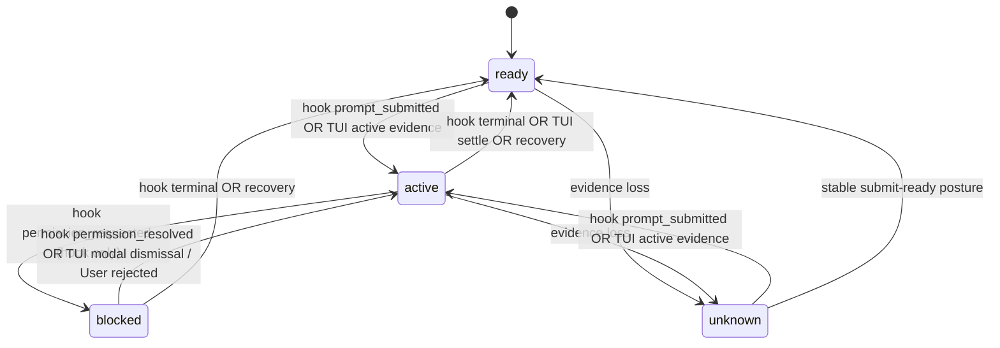

# State Transition Rules

Normative transition rules for merged tracked state when the hook observation channel is present. This document is the single reference for how hook observations, TUI evidence, and lifecycle timing move the tracked state. Design rationale lives in `design.md`; behavior requirements live in `specs/`; this file defines the transitions those requirements produce.

## 1. State Axes

Tracked state is three orthogonal axes plus the last-turn record. No axis may silently impersonate another.

| Axis | Values | Authority |
| --- | --- | --- |
| `surface.*` | accepting_input, editing_input, ready_posture, pending_input, stability | TUI only |
| `turn.phase` | `ready`, `active`, `blocked`, `unknown` | Hook primary for lifecycle; TUI for surface-derived entry into `active`/`unknown` and recovery |
| `work` | `pending`, `clear`, `unknown` | Hook primary; `unknown` whenever hook evidence is absent or degraded |
| `last_turn` | result: `success`, `interrupted`, `known_failure`, `none`; source: `explicit_input`, `surface_inference`, `hook_observation`, `none` | Hook terminal events first; TUI settlement when no hook terminal exists; TUI owns `interrupted` |

`blocked` semantics: the provider is asking the operator for an action and will not proceed until it is settled. Only hook evidence can enter `blocked`. TUI parsing never enters it; a TUI-detected permission dialog keeps the existing presentation (`phase=active` with `operator_state=waiting_user_answer`).

`settled = (turn.phase == ready) AND (work == clear)` is derived state. It recovers the pre-background-work meaning of "you can assign the next task" without treating prompt-ready as task-terminal.

## 2. Inputs

- TUI snapshots and the TUI session's own products: settle-timer results, temporal interrupt evidence, modal presence and dismissal, `User rejected` dialog lines, activity evidence.
- Hook observations: `session_started`, `prompt_submitted`, `activity`, `permission_requested`, `permission_resolved`, `turn_completed`, `turn_failed`, `maintenance_started`, `maintenance_ended`, `background_work_changed`, `unknown`.
- Lifecycle kernel observations and recovery timers (readiness, anchored completion, stale-active and final-stable-active recovery).
- Gateway prompt-submission records.

## 3. Turn Phase Transitions

Rules:

1. Hook `prompt_submitted` enters `active` from any non-terminal posture and (re)arms the turn. It clears the previous terminal result.
2. Only hook `permission_requested` enters `blocked`. The transition records the blocked tool name when present.
3. `blocked` exits to `active` on hook resolution events, or on TUI modal-dismissal evidence (modal leaving without tool execution, including a positive `User rejected` line). The turn remains armed.
4. A hook terminal event moves `active` or `blocked` to `ready` immediately, without waiting for the TUI repaint or settle window. The repaint window stays visible through TUI surface fields and the `hook_terminal_tui_active` conflict note.
5. `blocked` is never a terminal resting state; a terminal event exits it toward `ready`.
6. Hook `active` or `blocked` holds `turn.phase` against a ready-looking TUI surface (`hook_active_tui_ready`, `hook_blocked_tui_ready` conflict notes).
7. `maintenance_started` marks a maintenance window without invalidating the previous terminal outcome; `maintenance_ended` restores `active` when a turn is still armed, otherwise the pre-maintenance posture.
8. Maintenance posture does not close prompt admission by itself; TUI surface facts govern admission during compaction.
9. TUI stale-active and final-stable-active recovery rules are unchanged and may return `active` to `ready` when their conditions hold.

## 4. Last-Turn Settlement

1. A hook terminal event latches the turn: `turn_completed` sets `last_turn.result=success`; `turn_failed` sets `known_failure` with the provider error class recorded. Settlement is immediate, ahead of the TUI settle window.
2. `last_turn.source` is `hook_observation` for hook-settled turns, or `explicit_input` when a gateway submission record correlates with the same turn.
3. Once a hook terminal event has latched a turn, the pending TUI settle for that turn is suppressed. Later TUI evidence for that turn is discarded with one exception: TUI temporal interrupt evidence may still flip the result to `interrupted` (the Esc abort case, conflict note `hook_success_tui_interrupted` when applicable).
4. TUI settlement rules run unchanged when no hook terminal event exists for the turn.
5. Hook events never settle `interrupted`.
6. A terminal event with no armed turn is an orphan diagnostic and never manufactures a `last_turn`. Duplicate terminal events for the same prompt are idempotent; the first terminal result wins.

## 5. Armed-Prompt Correlation

> **Correction (2026-10-19, campaign iteration 1):** the original single-armed-prompt supersede rule is replaced by a FIFO armed-prompt queue. Live S7 data showed a queued prompt's `UserPromptSubmit` fires at type time while the previous turn is still active and carries the in-flight turn's `prompt_id`; the provider then executes the queued turn and its `Stop` carries a fresh `prompt_id` (observed sequence: `prompt_submitted, prompt_submitted, turn_completed(turn1), turn_completed(turn2)`, the two terminals back-to-back). Correlation by `prompt_id` alone is therefore wrong for queued input. Evidence: `context/campaigns/debug/2026-10-19-claude-hook-observation/evidences/2026-10-19-s7-queue-resume.md`.

Rules:

1. The posture holds a FIFO queue of armed prompts, keyed by `prompt_id` when present, by bounded time-window correlation otherwise (`prompt_id_missing` diagnostic). The bounded time-window fallback for missing `prompt_id` and the generation-drop rule (rule 5) are unchanged.
2. A `prompt_submitted` arriving while a prompt is already armed **enqueues** behind it; it does not supersede. A terminal event consumes the oldest armed prompt in arrival order. A terminal arriving with no armed prompt (and no bounded time-window candidate) is an orphan diagnostic (`hook_orphan_terminal`) and never manufactures a `last_turn`.
3. True duplicate re-deliveries of the same event are idempotent no-ops; the first terminal result for a consumed prompt wins. A queued prompt's own `prompt_id` may differ between its `prompt_submitted` (in-flight turn's id) and its terminal event (fresh id), so prompt-id mismatch across the queue boundary is expected and is not itself a duplicate or orphan signal; arrival order governs.
4. Gateway submission records correlate with hook turn starts by time window; a correlated pair arms one turn, not two.
5. Events from an older channel generation are dropped before correlation (`hook_orphan_generation` diagnostic).

## 6. Staleness and Recovery

1. Startup: no startup or later event within the grace period (default 15 s) makes the channel `unavailable`; tracking is TUI-only.
2. Mid-turn: no event within the staleness threshold (default 30 s) while the TUI keeps changing makes the channel `stale`; TUI regains lifecycle authority, including settlement.
3. A terminal hook event already recorded is not discarded when the channel later goes stale.
4. Recovery delivers buffered current-generation events. For a turn the TUI already settled during the stale window: agreement is a no-op and keeps the TUI source; disagreement applies the hook result as an explicit correction, with a new transition and the `hook_correction_after_staleness` conflict note naming both results.
5. While `stale`, `unavailable`, `disabled_by_policy`, `untrusted_workspace`, or `error`, tracked state and admission are byte-equivalent to TUI-only behavior.

## 7. Work Axis Transitions

1. `work` starts each channel generation as `clear` once the first terminal event reports no outstanding background work, or as `pending` when one does. Before any hook evidence exists, and whenever the channel is degraded, `work` is `unknown`.
2. A `turn_completed` event replaces the flag from its payload: background work listed sets `pending`, none listed sets `clear`. A `turn_failed` event makes no background-work statement and leaves the axis unchanged.
3. **Correction (2026-10-19, campaign iteration 1):** the spike question is answered. Background completion IS observable between turns as a provider-synthesized ghost turn: a `UserPromptSubmit` whose `prompt` is a `<task-notification>` XML document (task id, tool-use id, output file, status, exit-code summary), followed by its own `Stop` whose `background_tasks` reflects the new reality (`[]` when the last task finished). Ghost turns arm and settle like any turn; they are provider-initiated and are never evidence of operator input (design `claude-hook-adapter.md` section 1.1's caveat applies directly, and turn arming rules must exclude `<task-notification>`-shaped prompts from operator-input correlation). The work axis updates from every terminal event's `background_tasks` payload, including ghost-turn terminals. The payload-mirror rule remains as corroboration between turns. A `turn_failed` terminal still makes no background-work statement. Named gap: `Notification`/`idle_prompt` semantics are unverified (Notification is not subscribed in v1), so idle-prompt behavior while work runs is not claimed. Evidence: `context/campaigns/debug/2026-10-19-claude-hook-observation/evidences/2026-10-19-s5-background-work.md`.
4. Session stop clears the axis. `work=pending` never blocks admission in this release; it is published state, and `settled` is the orchestrator-facing derivation.

## 8. Admission Interaction

| Policy | Existing TUI requirement | Added hook requirement (active channel only) |
| --- | --- | --- |
| `ready_only` | stable prompt-ready contract, `pending_input=no` | hook posture neither `active` nor `blocked` |
| `if_no_pending` | `pending_input=no` | hook posture not `blocked` |
| `always` | none | none |

A degraded channel adds no refusal reasons. `work=pending` and maintenance posture never close admission by themselves. Every decision record carries the hook channel state, hook posture facts, and conflict reasons used.

## 9. Conflict Diagnostics

| Conflict | Resolution | Diagnostic |
| --- | --- | --- |
| Hook active, TUI ready | Hook wins for lifecycle | `hook_active_tui_ready` |
| Hook blocked, TUI ready | Hook wins | `hook_blocked_tui_ready` |
| Hook terminal, TUI active | Terminal latches; surface fields unchanged | `hook_terminal_tui_active` |
| Hook success, TUI interrupt evidence | `interrupted` wins | `hook_success_tui_interrupted` |
| Hook failure, TUI success dock | Hook failure wins for the current prompt | `hook_failure_tui_success` |
| Stale channel, TUI changing | TUI authoritative until recovery | `hook_stale_tui_authoritative` |
| Recovery disagreement | Hook corrects with audit trail | `hook_correction_after_staleness` |
| Older-generation event | Dropped | `hook_orphan_generation` |
| Unknown event or malformed payload | Skipped, counted | `hook_unknown_event`, `hook_malformed_event` |

Conflict diagnostics are bounded and secret-free: event names, timestamps, conflict kinds, and counter deltas only.
