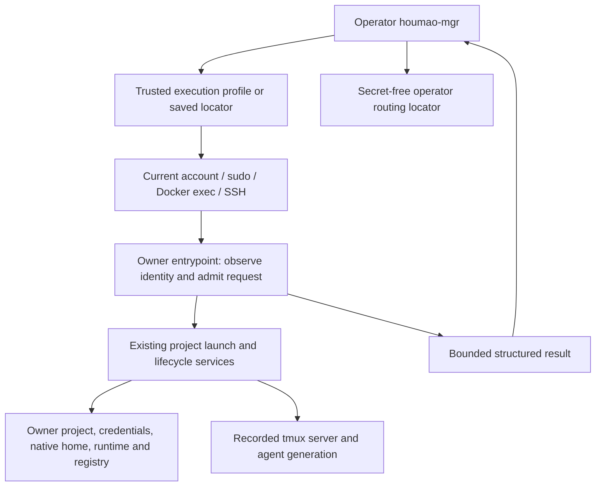

# Design

## Context

See [proposal.md](proposal.md) for motivation and scope. The owner-context contract is in [agent-execution-contexts](specs/agent-execution-contexts/spec.md); the other deltas describe birth and registry routing.

The current code has reusable owner-local runtime behavior, but no boundary for entering another owner's environment:

- [`project.py`](../../../src/houmao/srv_ctrl/commands/project.py) stores the project selector without resolving the overlay. [`project_easy.py`](../../../src/houmao/srv_ctrl/commands/project_easy.py) then validates some paths through Click and enters `_ensure_project_overlay()` before source resolution, catalog projection, credentials, or runtime launch. Delegation must precede those steps, including eager caller-side path checks.
- [`models.py`](../../../src/houmao/agents/realm_controller/models.py) describes a launch command, workdir, home, environment, and backend. [`runtime.py`](../../../src/houmao/agents/realm_controller/runtime.py) resolves local paths and constructs or reconstructs sessions. Neither currently identifies another execution owner.
- [`managed_agents.py`](../../../src/houmao/srv_ctrl/commands/managed_agents.py) resolves local lifecycle records, probes local tmux, and reconstructs a controller; external communication-only records take a separate pair-API path. Delegated locators must be recognized before any local probe or manifest open.
- [`boundary_models.py`](../../../src/houmao/agents/realm_controller/boundary_models.py) currently validates manifest schema 5. [`registry_models.py`](../../../src/houmao/agents/realm_controller/registry_models.py) validates owner lifecycle schema 4 and a distinct communication-only schema. These are strict contracts, so execution ownership requires deliberate schema changes and updated fixtures.
- [`tmux_runtime.py`](../../../src/houmao/agents/realm_controller/backends/tmux_runtime.py) invokes `tmux` and constructs `libtmux.Server()` without a socket parameter. The local reference checkout at `extern/orphan/libtmux/src/libtmux/server.py` confirms explicit `socket_path` support and server destruction on context-manager exit. Other direct tmux/libtmux calls in CLI helpers and passive discovery also need the recorded selector.

Local prerequisite checks on 2026-11-17 confirmed `sudo -n id` as root and `sudo -n -H -u nobody id` as UID/GID 65534. Account-management tools, `visudo`, OpenSSH client/server, and tmux are installed. Docker and Podman were not found on PATH. These checks establish available test preparation, not completion of execution-adapter qualification. The user authorized temporary test-account creation; no test accounts were created while preparing this proposal.

## Goals / Non-Goals

**Goals:** Put one execution boundary before existing launch preparation and control reconstruction. Keep the backend runtime owner-local, preserve exact context and generation checks, and make supported operations observable through a small transport contract. Permit a designated non-root controller to operate through restricted delegation while keeping agent credential selection independent of the OS user.

**Non-Goals:** This change does not distribute project trees or keys, provision production accounts or containers, build a generic remote filesystem/process API, implement an executor daemon, or add public HTTP authentication. It does not add an executor field to reusable launch profiles: `--executor` is an explicit operator choice, while the selected birth profile is resolved in the target project. Interactive terminal forwarding, unbounded event streaming, nested multi-hop executors, and migration of an existing agent to another context are outside the first transport contract.

## Decisions

### 1. Enter the Owner Context Before Preparing or Reconstructing an Agent

Use a thin operator-side router and a fixed owner-side Houmao entrypoint. The router selects transport and validates trusted route configuration. The owner entrypoint observes the actual identity, admits an operation, and calls the maintained application services.



Add a small supported product package under `src/houmao/execution/` for typed profiles/bindings, transport orchestration, and owner dispatch. Register the internal stdio entrypoint under `houmao-mgr internals executor serve-stdio`. Extract only the application-level entrypoints needed from launch/control command handlers; both Click and the owner dispatcher call those services. Do not duplicate runtime behavior or use testing CLI runners in production.

For launch, parse selectors and explicit values without opening target paths, then dispatch before `_ensure_project_overlay()` or catalog projection. Replace eager `exists=True` checks on execution-sensitive launch paths with owner-side validation. `project_context` already stores the project path lazily; retain that property. For controls, add an executor-managed target variant before local controller reconstruction in the shared resolver, including its relaunch and gateway variants.

Alternative considered: switch UID only around the harness subprocess. That leaves homes, credentials, manifests, registry ownership, and later controls in the operator context. Per-backend delegation branches would duplicate the same ownership problem, so the boundary belongs above backend dispatch.

### 2. Keep Execution Profiles Separate From Birth Profiles and Backend Selection

Resolve named profiles from an operator-controlled `executors/` directory under `resolve_houmao_home_root()`. Do not discover transport definitions in the target project or agent home. Profiles use a strict versioned model, an explicit transport kind, expected account/context, installed owner-entrypoint path, target project root, target environment allowlist, and a controller-policy reference. Transport-specific fields are closed rather than arbitrary shell fragments.

The initial transport set is:

| Transport | Native Mechanism | Required Target Prerequisites | Initial Limits |
| --- | --- | --- | --- |
| Current account | Same owner admission and services | Current installation and accessible project | Existing local workflows retain their owner; record the observed context |
| Linux account | Non-interactive sudo to the fixed owner entrypoint | Existing account, target-readable assets, administrator-approved delegation | Linux; no password prompts, account creation, or `sudo -E` |
| Container | Docker exec into an existing container as the configured user | Operator already has authorized container exec; target contains Houmao and assets | Pin full container ID; no container creation, host socket mounts, arbitrary runtime hooks, or automatic Podman fallback |
| SSH | Batch, non-TTY OpenSSH to a configured host account and fixed entrypoint | Pre-established host-key trust, authentication, target installation and assets | Single hop; no agent forwarding, interactive authentication, file deployment, or unauthenticated HTTP handoff |

Docker is the first maintained container runtime because the repository already groups Docker service tooling under `dockers/`. Another runtime can be added after its native behavior is qualified; a profile naming an unimplemented runtime returns unsupported. The user explicitly deferred live Docker qualification on 2026-11-17 and directed current verification to the host. Implement and unit-test the Docker route, report it as unqualified, and retain live qualification as follow-up.

The public birth command remains source-scoped:

```text
houmao-mgr project agents launch --profile reviewer --executor worker-alice
houmao-mgr agents single --agent-id <id> state
houmao-mgr agents single --agent-id <id> home
houmao-mgr agents single --agent-id <id> refresh
houmao-mgr agents single --agent-id <id> relaunch
```

The existing `home` command is retained with context-qualified results, including its plain-text rendering. Controls use the saved route rather than a fresh `--executor` override. The execution profile supplies the target project root when `--project-dir` is omitted. An explicit project directory or workdir is a target-context path, interpreted relative to the configured target project where relative input is supported. Never infer remote paths from caller cwd. Without `--executor`, current-account project discovery retains its existing defaults.

Alternative considered: store an executor selector on every launch profile. That requires reading a caller-side profile to discover where the authoritative target profile lives and lets shared project content influence delegation. Explicit selection avoids that dependency and keeps profiles reusable across execution contexts.

### 3. Authenticate Through the OS Transport and Admit a Fixed Operation Set

Administrator policy determines who may enter the owner context. A restricted sudo deployment authorizes a fixed installed entrypoint or trusted wrapper for designated RunAs users. The wrapper fixes the controller-policy reference and any narrower operation/project scope. SSH or container deployments may use a similarly constrained entrypoint; a full account login or container-exec grant already carries the corresponding OS permissions.

The owner helper reads its provisioned admission policy, observes actual effective UID/GID and groups, and admits only supported operations within that policy. Controller descriptors record the admitted principal/policy and allowed scope. A controller label or claimed UID inside JSON is never authorization. Same-UID owner access remains subject to the actual OS permission model; this design does not create a security boundary against that owner.

Launch profiles, role prompts, skills, manifests, and registry locators cannot supply arbitrary delegation argv. The profile loader and native transport enforce typed fields; sudoers, SSH policy, or container authorization remains the actual permission gate. Validate operation arguments rather than accepting a remote shell command or unrestricted manager argv.

Keep the entrypoint deployment trust visible in documentation: a restricted sudo command pointing to an operator-writable executable or environment is not restricted delegation. Operators do not need unrestricted root rights, and ordinary agent launches never receive sudo configuration or operator transport credentials.

Alternative considered: add lifecycle authorization to the existing HTTP servers. That would expand public network trust and overlap #84. This change uses the already authorized OS channel, with no new listener or daemon. Existing owner-local gateways can still serve their current role behind the owner helper.

### 4. Persist Observed Execution Bindings and Pin Existing Routes

Use a strict execution binding with these responsibilities:

| Field Group | Meaning |
| --- | --- |
| Logical identity | Existing authoritative `agent_id` and friendly name, separate from the binding |
| Context identity | Persistent owner-context ID and observed host identity; immutable container ID for container execution |
| Owner | Actual account, effective UID/GID, and observed groups where available |
| State authority | Owner-side registry/runtime roots and relevant project authority |
| Controller | Admitted controller/policy reference, authority kind, and allowed operation scope |
| Route | Named execution-profile reference and normalized non-secret target coordinates |
| Live authority | Existing generation and exact tmux/session/backend handles, stored separately from stable ownership |

A durable context ID lives with the owner-side Houmao state. Create it atomically on the first admitted mutating setup; read-only inspection reports an uninitialized context without creating it. Bind it to observed owner and host/container coordinates. A recreated account/home or replaced container must not be accepted merely because its username or container name matches.

Persist the binding in the strict session manifest and owner lifecycle record, and include it in the redacted launch/inspection contracts where relevant. Keep transport authentication secrets outside it. A per-agent binding includes the admitted route/controller, so multiple controllers using one account do not overwrite account-global identity.

For later control, resolve the saved profile reference and compare its normalized target with the captured binding before dispatch. The owner then compares observed identity and context with the request's expected binding. Profile edits that change account, host, container, state roots, or admitted controller fail explicitly. Non-authority settings such as a shorter timeout may change. Missing profiles do not authorize a fallback. Transport-key rotation may continue when native trust and the same execution identity still validate.

The owner resolves the current agent generation during a read-only describe step. The following mutation carries that generation and existing native-refresh/runtime authority fields, checked at admission against current owner state. A concurrent relaunch causes a conflict. A later relaunch updates generation and concrete handles without changing the stable binding.

Alternative considered: trust usernames, mutable container names, copied local manifests, or the latest profile contents. Those values cannot establish that a later command reaches the agent created at birth.

### 5. Resolve Target Materials and Per-Agent Credentials Inside the Owner

Pass path selectors and explicit launch values through the request as data. Resolve and validate them only inside the target. Reuse existing project/profile precedence and selected-source validation there. No asset transfer is performed: deployments must already make project definitions, credential references, and the installed native tool available to the target account.

Build a target environment from observed account identity and provisioned execution settings. Do not copy the caller's full environment, `HOUMAO_*` roots, provider credentials, `TMUX`, or `TMUX_PANE`. Bare `--env-set NAME` looks up NAME in the authorized target environment; `--env-set NAME=value` remains an explicit declared value. Resolve `HOME`, `USER`, and `LOGNAME` against the target account rather than trusting an inherited caller HOME. Existing launch/profile rules continue to decide allowed agent environment fields.

Native home and runtime state remain per agent. Two agents sharing one execution profile can select different auth references or supported private-key references through existing credential materialization. Do not edit shared `~/.ssh` defaults, shared provider login files, or another agent's selection to implement this behavior. Transport SSH keys belong to the operator's route; agent keys belong to the selected target-side credential binding. Disable transport SSH-agent forwarding and do not pass an operator authentication socket, Docker socket, or sudo metadata to the harness.

Same-user processes still share account permissions and may be able to access each other's files. Per-agent homes express selection and avoid accidental overwrites; they do not promise confidential key isolation. A stronger boundary requires separate users or containers provisioned outside Houmao.

Alternative considered: materialize as the operator and chown afterward. Besides permission and path failures, that exposes the wrong credential context and leaves later runtime operations dependent on copied state.

### 6. Use One Finite Stdio Protocol Without Automatic Mutation Replay

The private entrypoint accepts one versioned, size-bounded JSON request on stdin and returns one structured response on stdout; diagnostics use stderr. The request contains a correlation ID, a whitelisted operation and typed arguments, deadline budget, and expected binding/agent/generation when applicable. The response identifies the observed binding, admission/outcome state, supported capabilities, and result or typed error. Fix protocol byte/depth limits as shared constants and document them when implementing.

Native subprocess calls use argv. SSH's fixed remote entrypoint must be quoted as a fixed command without interpolating request values into a remote shell; the JSON body carries variable data. Use batch authentication, established host verification, no PTY, and no agent forwarding. Docker exec receives stdin but no interactive TTY. Close inherited descriptors and sanitize environments before entering the owner context.

Support finite launch, describe/state, inspect/capture, prompt, interrupt, stop, resume, relaunch, native-home/status, and refresh when the backend already supports them. Finite gateway operations and selected-agent cleanup use the same route when exposed. Return a capability error for interactive attach, unbounded watch/streaming, or unsupported backend operations. Do not implement a generic remote command or file API. Large output or a lost result after admission cannot be represented as a safe pre-admission failure.

A transport failure before admission, a rejected request, and an indeterminate post-admission operation are distinct results. Use request IDs in owner-side launch/control provenance and diagnostics so inspection can help reconcile a lost response. Do not add automatic retries for launch, prompts, refresh, stop, or relaunch. A timeout can stop waiting or terminate the transport helper; it does not establish that the owner operation or agent stopped. Report that uncertainty with target and correlation information. Reconnect with read-only inspection before any deliberate follow-up. This contract does not promise exactly-once delivery.

Alternative considered: implement request replay journals or a persistent executor service immediately. Neither is needed to provide explicit uncertainty and avoid duplicated mutations. Add such machinery only if later requirements demand durable asynchronous operation recovery.

### 7. Keep Owner State Authoritative and Add Operator Routing Locators

Add an `executor_agents/<agent_id>/record.json` collection to the operator's existing registry root, with a distinct strict schema and `kind=executor_managed`. Store only the logical ID/name, execution-profile reference, captured binding, and safe owner lookup information. The owner registry, manifest, and gateway remain the runtime authorities. A foreign manifest path or loopback endpoint is qualified metadata, never something to open/connect to on the operator host.

Resolve owner-local lifecycle records and execution locators as one managed tier before external communication-only imports. Exact IDs deduplicate equivalent bindings and reject conflicting owners. Friendly names across that tier require uniqueness. Existing local tmux aliases stay local; they do not select an executor. Explicit `--port` retains the existing pair-authority bypass and grants no execution rights.

For an executor locator, enter the pinned route and ask the owner for current lifecycle state, then use existing owner-local controller/gateway logic. Do not scan operator runtime roots for stopped recovery. Refresh and native-home queries follow the same path, retaining read-only inspection and refresh's no-restart/no-reprojection semantics. A saved route is an authority boundary even if its owner is unreachable: failure does not continue into local or default-server fallback.

Listing queries known owner routes with bounded deadlines and reports verified active state separately from unavailable/unverified targets. Default active output includes confirmed active agents; `--all` exposes known unavailable entries. Listing/inspection does not write owner homes or publish repaired runtime state. Local stale cleanup excludes `executor_agents/`; an unreachable owner is not evidence of stopped state. Locator removal affects only the lexical operator entry and does not terminate the agent.

After a successful delegated birth, publish the locator atomically. If operator-side publication fails after owner launch, report partial success with the admitted agent ID, binding, and recovery information; do not launch again. Provide a bounded owner-route reconciliation operation to find the admitted agent and republish a locator explicitly. Owner-side stop retains the locator for relaunch and returns context-qualified cleanup pointers. Existing external communication-only records remain separately stored and retain lifecycle rejection; an executor profile never upgrades them by name matching.

Expose recovery as `houmao-mgr admin executors reconcile --executor <name> --agent-id <id>`. It verifies owner admission and the saved binding before publishing, and cannot retarget an existing locator. `houmao-mgr admin executors forget --agent-id <id>` removes only the operator's execution locator. These are locator maintenance operations; execution profiles remain explicitly provisioned configuration rather than a new profile-authoring API.

Alternative considered: copy owner runtime records into `live_agents/` or reuse `external_agents/`. The former triggers incorrect local tmux/lease/path behavior; the latter conflates delegated lifecycle control with communication-only imports.

### 8. Thread Explicit Tmux Authority Through Every Owner-Side Path

Record the concrete owner-side tmux socket/server selector and exact session/window/pane handles. Add the selector to the manifest/registry authority contract and launch planning where needed. Pass it through shell invocations, `libtmux.Server(socket_path=...)`, helper subprocesses, gateway construction, discovery, and controller reconstruction. Cover direct callers such as buffer loading, pane-cwd lookup, current-session lookup, and passive discovery rather than fixing only `run_tmux`.

Delegated entry discards inherited `TMUX` and `TMUX_PANE` before any tmux use. A configured delegated profile chooses an explicit owner socket, with an owner-private Houmao socket as the default for that context. Current-account workflows may retain their existing selected server by capturing and validating its concrete socket once, then using it explicitly. Current-session join captures its enclosing socket and handles before handoff; it does not infer a different server from a matching session name.

Stop and cleanup target only the addressed agent's validated handles. Never kill or restart the shared/default localhost server, and never use the libtmux server context manager for a user-owned server. Tests clear both inherited variables, use unique explicit sockets, and tear down only their isolated resources. `TMUX_TMPDIR` alone is insufficient. Losing server authority or encountering a replaced agent produces a mismatch rather than a default-server retry.

Alternative considered: set a process-global tmux environment or PATH wrapper. That is useful in isolated tests but insufficient for production reconstruction, direct libtmux calls, or multiple runtime contexts within one service.

### 9. Verify Changed Risks With Real Execution Boundaries

Place hermetic contract/routing tests under `tests/unit/` and opt-in multi-user/container/SSH tests under `tests/integration/execution/`. Reuse existing backend and native-refresh tests; add coverage for changed behavior rather than repeating every backend assertion for every transport.

Use temporary operator and owner accounts with differing UIDs. Provision a narrowly scoped, validated temporary sudoers rule for the test operator to invoke the fixed helper as designated owner accounts. Verify admitted operations and denial for another account/command; root is test setup authority only. Account creation, policy installation, and deletion belong to fixture setup/teardown, never the product. Track exact fixture names/UIDs, owned PIDs, policy paths, directories, and socket paths; cleanup must not target pre-existing users, services, or sessions.

Exercise real owner-side file ownership, target-only project/workdir, HOME/environment selection, separate credential bindings for two same-user agents, inherited tmux selectors, and identical session names on isolated caller/owner servers. Verify state/interrupt/stop/relaunch routing and generation conflicts, plus context-qualified read-only home/status and no-restart refresh. Check denial, missing prerequisites, profile retargeting, revoked delegation, lost responses, and operator-locator publication failure without fallback or replay.

Use a fixture-owned SSH daemon with temporary host/client keys and known-hosts state outside the checkout; do not reconfigure or restart the host SSH service. Qualify Docker exec against an explicitly selected existing test container. The SSH route must execute the real stdio helper and at least launch/inspect/stop/relaunch in a target-only project, with observed ownership and context checks. Docker live execution remains explicitly deferred and unverified until a later actual run supplies evidence; ordinary tests must not imply that it was qualified.

Use the maintained `scripts/agents/test-fixtures/fixture.py` workflow with an explicit case and model for native-agent qualification. Prioritize controlled DSH ACP/Web coverage and reuse existing non-DSH backend regression evidence, adding a focused non-DSH owner-routing smoke where needed. Keep credential-bearing runs and generated test keys outside the checkout, use synthetic/local credentials where possible, and never fall back to ambient authentication.

Document the executor/backend/operation support matrix and qualification commands/results in `docs/reference/run-phase/`, with links from CLI, lifecycle, native refresh, and registry ownership references. Product code stays under `src/houmao/`; account/transport fixtures are CI files under `tests/`; any reusable manual qualification helper belongs under `scripts/qualification/`; disposable evidence goes under an ignored purpose-specific scratch tree.

## Risks / Trade-offs

- [Delegated helper deployment can accidentally grant broad authority] → Document fixed trusted executable paths and administrator-owned policy; test a genuinely restricted operator rather than relying only on the development account's unrestricted sudo.
- [Owner paths or loopback endpoints resemble caller-local resources] → Require context-qualified outputs and dispatch before local path resolution or endpoint connection. Add target-only-path and same-port/session-name tests.
- [Transport interruption hides a completed mutation] → Return indeterminate status, correlation information, and explicit inspection/reconciliation guidance; never replay automatically.
- [Owner launch succeeds but operator publication fails] → Preserve owner state, return partial success, and offer explicit locator reconciliation without another birth.
- [A profile or target is replaced] → Compare captured route coordinates, durable context ID, actual UID/GID, host/container identity, and owner roots before admitting control.
- [Shared UID permits access to sibling credentials] → State the OS permission limit and preserve independent bindings; require separately provisioned isolation for stronger confidentiality.
- [Tmux selector plumbing misses an alternate caller] → Audit shell and libtmux paths and use same-name isolated-server tests across discovery, gateway, reconstruction, and teardown.
- [Container qualification is unavailable locally] → Retain user-deferred Docker qualification as an explicit follow-up and distinguish its unit tests from live host evidence.

## Migration Plan

1. Add strict profile/protocol/binding models and owner admission, then wire current-account launch/control through the same ownership contract. Update repository-owned schema fixtures and maintain explicit unsupported-schema errors.
2. Add native transports and owner-side dispatch, then publish executor locators only after successful owner admission. Existing communication-only imports stay on their current schema and authority contract.
3. Update affected manifest/registry schemas and all producers/readers together. Do not invent an owner for old delegated metadata. Existing unsupported runtime artifacts require an explicit fresh launch or owner-local recovery supported by their actual schema; no automatic cross-context migration is planned.
4. Qualify the Linux-account and SSH routes with isolated fixtures, then publish configuration and capability documentation. Record user-deferred Docker qualification explicitly; do not claim live container validation.
5. Rollback requires stopping affected agents through their owning installation before reverting schema readers. Keep owner artifacts and operator locators until state is deliberately reconciled; do not attempt schema downgrade or caller-side cleanup of foreign artifacts.

