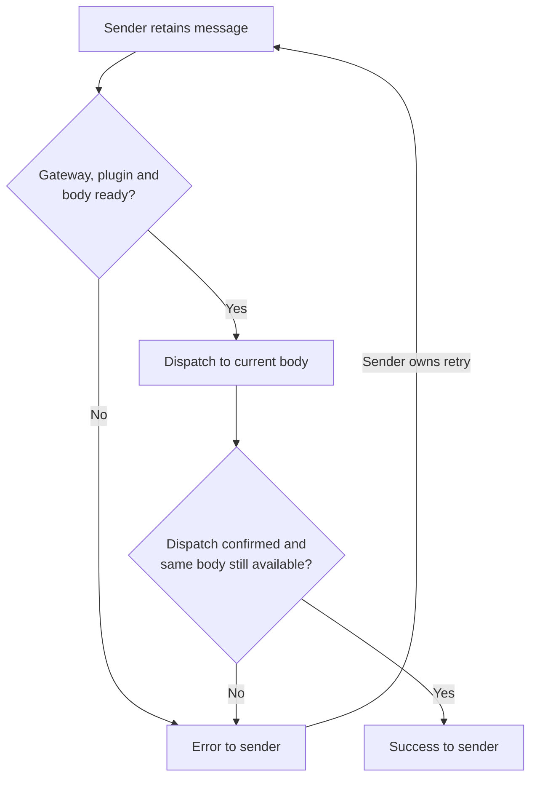

# Design

## Context

See [proposal.md](proposal.md) for motivation and scope. The user selected trusted Python packages for the first release. Each plugin must be independently installable and usable without editing Houmao.

The current implementation shapes the design:

- `gateway_service.create_app()` defines core routes and explicitly calls `register_ag_ui_routes()`. AG-UI offers a useful route-module pattern, but no external package discovery contract.
- `runtime._start_gateway_process()` and `_same_session_gateway_shell_command()` launch a separate interpreter using `sys.executable`. Parent-process registration does not reach that child. Both execution modes repeatedly reconstruct `GatewayDesiredConfigV1`, so new selections must survive every reconstruction.
- `_GatewayUvicornServer.startup()` starts runtime workers after listener binding resolves the actual port. Ordinary FastAPI startup runs earlier, so independently adding plugin startup handlers would create two inconsistent lifecycle orders.
- Direct prompt control, durable requests, reminders, and the mail notifier have different admission paths. The [admission reference](../../../docs/reference/gateway/internals/prompt-admission-and-tui-observation.md) explicitly warns that a new automatic prompt source must select its own readiness policy.
- The existing credential CLI supports Claude, Codex, and Kimi tool bundles. It is not a generic service-secret registry. Plugin credentials need a narrow, explicit file-reference contract rather than an invented reuse of those tool kinds.
- `control_prompt()` already offers immediate `ready_only` gating, but the local-headless branch returns as soon as a worker thread starts. A plugin dispatch cannot use that early return as evidence that the message reached the body. Its adapter needs a dispatch-confirmation boundary and detection of body loss/replacement while the request is in flight.
- Runtime manifests and shared registry records already carry `registry_generation_id` for managed relaunches. A local gateway adapter's coarse `instance_id` can remain the runtime-session ID, so continuity checks must use the actual execution incarnation rather than treating that stable logical identifier as process identity.

## Goals / Non-Goals

**Goals:** Make package installation and explicit per-agent configuration sufficient for extension; keep implementation details behind a small public SDK; make route ownership deterministic; and dispatch ordinary notifications only when they can reach the current ready agent body.

**Non-Goals:** This SDK covers gateway extensions. It does not establish a general hook system for every Houmao subsystem, promote plugins into lifecycle controllers, sandbox Python, or implement CCCC. Plugin HTTP operations in this release are ordinary owner-bound service operations. The host does not cache notification payloads, acknowledge a pending inbox, replay messages after recovery, or operate a sender retry scheduler. Queue-schema changes and a new reconciliation workflow are excluded. Existing queued prompt and mail-notifier APIs are outside this immediate plugin-event contract.

## Decisions



### 1. Publish the SDK Inside Houmao and Discover Installed Definitions

Add the supported import namespace `houmao.gateway.plugins`. The gateway host depends on these public contracts; external plugins depend only on them and their own service libraries. SDK modules must not import the gateway service or require private runtime types in public signatures.

The initial public contracts are:

| Contract | Role |
| --- | --- |
| `PluginDefinition` | SDK version, strict configuration model, deterministic binding identity, and instance factory |
| `GatewayPlugin` | Relative HTTP router and asynchronous resource lifespan |
| `GatewayPluginConfiguration` | Validated instance selections, credential references, and finite request bounds |
| `PluginContext` | Immutable owner and binding identity, selected credential reader, scoped state, safe logging/status reporting, worker supervisor, and immediate ordinary-event dispatch |
| `PluginEvent`, `PluginDispatchResult`, and `PluginDispatchError` | Ordinary notification input, confirmed dispatch result, and explicit retryable or permanent failure |
| `PluginStatus` | Sanitized lifecycle, connection, worker, and current-request snapshot |

SDK version 1 is independent of the Houmao distribution version. Definitions declare that version, and packages declare their supported Houmao release range in package metadata. An unsupported SDK version fails its configured instances before activation. It does not receive a best-effort adapter.

External packages advertise a definition object:

```toml
[project.entry-points."houmao.gateway_plugins"]
acme-notifications = "acme_notifications.plugin:definition"
```

The child interpreter enumerates entry-point metadata, selects configured names, and loads only those definitions. If different distributions advertise the same selected name, all instances using that name fail with an ambiguity diagnostic naming the distributions. Unselected implementations are never imported. Discovery does not install packages, modify `sys.path`, search the agent worktree for modules, or execute registration scripts.

This follows [standard package discovery](https://packaging.python.org/en/latest/guides/creating-and-discovering-plugins/#using-package-metadata). `pluggy` was considered for shared hooks and ordering, but this contract instantiates independent services rather than aggregating hook results. A separate SDK distribution would add release coordination before there is a need to install the contracts independently of Houmao.

### 2. Resolve Explicit Configuration in the Gateway Process

Add a keyword-only `gateway_plugins` input to `start_runtime_session()` and a `plugin_config` input to `RuntimeSessionController.attach_gateway()`, both using the public configuration model. A launch-time input requires gateway auto-attach, matching existing listener-override validation. The maintained scoped `gateway attach` command accepts `--plugins-config PATH`; a dedicated loader parses a versioned YAML or JSON document:

```yaml
schema_version: 1
gateway:
  plugins:
    team-chat:
      implementation: acme-notifications
      credential_ref:
        file: /absolute/private/owner-chat.json
      config:
        endpoint: http://127.0.0.1:9000
        account: owner-chat
```

Each mapping key is an instance ID matching `[a-z][a-z0-9-]{0,62}`. Unknown host fields, duplicate YAML/JSON keys, invalid IDs, and invalid bounds reject the entire supplied document before persistence or process changes. An omitted selection preserves persisted selections; an explicit empty mapping clears them. Configuration replacement is whole-set replacement, not a field-by-field merge.

Persist validated selections and references in `gateway/desired-config.json`. The plugin host validates each implementation-specific configuration after loading its definition; an invalid plugin configuration fails that instance with safe field locations. Root document errors and per-instance load failures are deliberately different outcomes.

Every capability-publication, foreground attach, detached attach, and desired-config rewrite must retain the selections. The gateway records an opaque active configuration digest in its plugin snapshot. Attaching with an equivalent configuration reuses a live gateway. A changed configuration while a gateway is live returns an explicit restart-required conflict, leaves active and persisted selections unchanged, and requires an operator-directed gateway detach/attach. No library input is serialized as a callable, module object, or live plugin instance.

The first release does not extend the launch-profile catalog or blueprint schema with another configuration source. Library callers can supply the typed launch input, and operators can configure an already-running agent through gateway attach.

### 3. Stage and Validate Routes Before Activating Instances

Factories prepare routers and local objects without opening connections, reading credentials, starting workers, or mutating the root app. The host stages every candidate router, constructs the complete effective route inventory, and only then publishes surviving routes and activates their instances.

The host owns these routes:

- `GET /v1/plugins`: sanitized status for configured instances.
- `GET /v1/plugins/{instance_id}/_status`: one instance's status, or 404 for an unknown instance.

Custom routes receive `/v1/plugins/{instance_id}` as their host-assigned prefix. The `_status` subtree is reserved. Plugins cannot register root middleware, startup/shutdown handlers, nested mounts, WebSocket routes, custom path converters, host-based routes, or arbitrary global exception handlers through SDK v1. Streaming HTTP responses remain ordinary HTTP routes.

Registration accepts literal segments, ordinary single-segment parameters, and terminal `path` parameters. It rejects full URLs, traversal segments, backslashes, encoded path separators, repeated separators, and unsupported route syntax. Parameter names do not distinguish routes. Normalize trailing slashes conservatively because slash redirects can make them aliases. Compare actual method sets, including any automatically supplied methods.

A conflict exists when method sets intersect and path patterns can match the same request. Thus `GET /messages/{id}` conflicts with `GET /messages/{name}` and `GET /messages/latest`; a catch-all conflicts with any overlapping suffix. `GET /messages` and `POST /messages` coexist. A segment-based overlap check over the restricted grammar avoids reliance on router registration order or arbitrary regular-expression analysis.

Build the conflict graph for the whole candidate set, including reserved host/core routes. Mark every plugin instance participating in a conflict failed, mount none of its custom routes, and activate no resources for it. Core routes remain authoritative. An invalid attempt against a core route fails the plugin rather than the core. Distinct valid instance IDs normally prevent cross-plugin collisions by construction; global inventory validation remains a defensive invariant.

The host retains a status endpoint and a custom-namespace availability guard for failed instances. Calls into a failed instance return a safe 503 without invoking plugin code. Conflict diagnostics identify instance/implementation, method, patterns, and counterpart; they exclude configuration values and credentials. Reordering configuration or installed distributions cannot change the result.

Rejecting the conflicting set was chosen over selecting the first registration, which would make behavior dependent on import order. The validation stage runs again for every gateway process start, before any plugin activation.

### 4. Bind Context and Credentials to One Owner and Service Identity

Construct owner identity from the manifest-backed agent and runtime-session authority. A plugin cannot supply or override it. The definition's pure `binding_identity(validated_config)` returns a deterministic, secret-free service/account identity. Persist a scoped identity derived from owner, runtime session, instance ID, implementation name, and that binding identity. Polling settings, gateway PID, process restart, package version, and credential bytes do not create a new service identity.

Private plugin state is contained under `gateway/plugins/{instance_id}/bindings/{binding_digest}/`. Validate containment and symlink boundaries. Reusing an instance name for another service/account gets another binding directory and never reuses the previous account's service cursor. This state may hold service configuration and a cursor for successfully dispatched events; it must not become a gateway-side message cache, retry spool, or pending-delivery inbox.

`credential_ref.file` selects one absolute private JSON-object file. The reference is optional for implementations that support unauthenticated services; its absence grants no credential access and never selects ambient auth. Resolve a supplied reference from trusted local launch/attach configuration, require an owner-private file outside the project checkout, reject symlinks and unexpected ownership/permissions, and fail explicitly if it is missing or unreadable. The first version has no credential scanning, ambient environment fallback, or generalized credential management CLI. A plugin receives a reader for its selected document only, not a registry it can enumerate. Reading is permitted only during an active lifespan. Refresh reopens the same selected source and allows key rotation without recording key bytes.

The plugin owns provider-specific credential interpretation and must validate that its authenticated service identity matches the configured binding. Request payloads cannot replace owner, sender, credential source, or binding identity. Changing any configured reference requires a gateway restart. Generic service administration, provisioning, and privileged operator actions are outside the supported route contract.

This is an API and deployment contract for trusted code. A Python package could independently access process resources or call core loopback endpoints; SDK scoping does not create an in-process security sandbox.

### 5. Dispatch Immediately and Leave Retry Ownership With the Sender

`context.events.dispatch(event)` is a request-scoped operation. It takes a stable source event ID, ordinary text, and bounded service metadata. The host supplies owner and binding provenance. The caller cannot select interrupt, raw input, context reset, an execution override, another chat session, or a readiness bypass. The default envelope-size bound is 64 KiB; the configuration accepts validated finite alternatives.

Before dispatch, require a running loopback gateway, an active plugin/context, open core admission, an available current body, and no conflicting active execution or accepted work. For TUI targets, require stable prompt readiness, `pending_input=no`, and the existing active-hook gates for `ready_only`. For headless targets, require no overlapping active turn. A busy, unavailable, uncertain, starting, stopped, or otherwise inadmissible target produces an immediate error. Do not wait for it to become ready, persist the message, insert a queue row, or create a deferred-success acknowledgement.

Render a normal notification envelope with host provenance and quoted service content. Text such as `/new`, `/compact`, and control-key-looking strings remains content. Use the direct semantic dispatch seam with a short readiness/reservation critical section. Do not route plugin events through `/v1/requests`, create an internal `plugin_event_prompt` kind, or modify notifier/request queue storage. Plugin service I/O and waiting for a dispatch confirmation run outside the terminal-mutation lock.

Keep the original request open until the adapter confirms dispatch to the captured execution incarnation. Merely starting a worker thread, writing a pending job, or accepting a request into another queue is insufficient for a positive result. Local headless delivery needs a bounded handoff signal from the executing worker/client path, or a synchronous execution result. Managed headless adapters must likewise distinguish a confirmed handoff from an upstream queued acknowledgement. Reuse existing readiness logic without inheriting its early-success response where that response precedes actual handoff.

Capture the expected incarnation at admission and check it again before a successful response. Use existing registry-generation and native lifecycle/process evidence as appropriate to each backend; do not rely solely on the local adapter's stable runtime-session `instance_id`. If the body dies, restarts, or is replaced during the request, or if the handoff fails or cannot be confirmed within its deadline, return an error. Drop request-owned message state, cancel any not-yet-dispatched attempt, and prevent surviving worker callbacks from delivering to the replacement. Cleanup must not reset an unrelated active body or replay a possibly dispatched message. Where an adapter cannot establish the required handoff/continuity evidence, fail explicitly rather than returning an unverified success.

The HTTP-facing failure contract follows the current immediate-control distinction: 409 with `retryable=true` for a readiness/conflict refusal; 503 with `retryable=true` for transient gateway/plugin/body unavailability, body loss/replacement, or inability to confirm dispatch; and 422 with `retryable=false` for invalid or unsupported event input. Configuration/listener-policy failures are explicit permanent failures until repaired. SDK callers receive equivalent typed errors. Include a safe error code, source event ID, and `dispatch_outcome=not_sent|unknown` where applicable. A gateway process that is absent or dies cannot manufacture an HTTP response: connection failure, connection loss, or timeout is an unsuccessful attempt for the sender to handle.

A 200 result with `disposition=dispatched` is returned only after confirmed dispatch to the same still-observed body. It means the dispatch completed, not that the agent finished processing the message or its turn. TUI confirmation is limited to successful semantic input delivery plus current-body observation; it does not invent a provider acknowledgement that the native client cannot supply. Lifecycle observation is not atomic with arbitrary external process termination. Any death/replacement observed before response finalization must fail the request; a later crash cannot retroactively change an already completed response.

The sender or upstream delivery service retains the authoritative message and chooses when to retry. A plugin maps a local refusal/failure back to its caller or an upstream negative/uncommitted acknowledgement; it must not positively acknowledge consumption before local dispatch confirmation or spool the message inside the gateway for later resend. Adapters whose upstream transport consumes irreversibly need sender-side recovery outside this host contract. Connection-retry workers may reconnect service clients, but must not turn that reconnect into cached message replay.

The source event ID is correlation and integration-level deduplication metadata. There is no generic durable receipt ledger or exactly-once guarantee. If a body receives a message but the response is lost, the sender may retry and cause a duplicate; expose uncertain dispatch honestly, and leave service-specific duplicate policy with the sender/integration. An error or gateway/body restart never schedules an automatic second attempt on the agent side.

### 6. Coordinate One Lifecycle Without Letting Plugin Failures Own Core Health

The gateway host owns all plugin lifespans. Route construction is resource-free. After listener binding and core runtime initialization, start per-instance asynchronous activation tasks and return core readiness without waiting for remote service availability. Custom routes and immediate dispatch remain gated until their instance reaches `running`. A running instance can report its connection as unattached, connected, reconnecting, or degraded independently of lifecycle state.

Use asynchronous resource lifespans and a per-instance supervisor, with default startup and cooperative shutdown deadlines of 10 and 5 seconds. Network clients require finite timeouts. Never invoke plugin callbacks or perform service I/O under the gateway terminal-mutation lock. Keep exception boundaries per instance; a single global task group must not cancel every plugin and core worker when one listener fails.

For partial startup failure, close already acquired resources, revoke context admission, cancel that instance's supervised workers, and publish a sanitized failure. Unexpected worker termination fails its instance. Plugins implement their own bounded connection reconnect/backoff within a supervised worker and report attempts/status. Message payload retries belong to the sender; the host does not replay event dispatch or arbitrary failed callbacks. A terminally failed instance recovers through a gateway restart.

On shutdown, first close custom-route/event admission and revoke context generation handles. Fail in-flight plugin delivery requests where a response is still possible, release not-yet-dispatched attempts, and retain no message for the next process. Then cancel/await supervised workers and exit resource lifespans while core facilities still exist. Afterwards stop core runtime workers and remove live publication. Startup exceptions, cancellation, normal shutdown, and service detach all release their resources. A cooperative cleanup timeout is visible and does not hold the core lock. Trusted code that blocks the event loop or ignores cancellation requires outer process supervision; SDK v1 does not provide fault isolation for it.

Keep one orchestrated lifecycle for the service runner and public app construction used by embedded hosts/tests. Preserve the production post-bind ordering and make equivalent lifecycle entry/exit available to ASGI tests; do not initialize plugin workers only in the CLI wrapper. The host-owned entry/exit coordinator supplies the resolved listener when available and prevents double startup/shutdown.

### 7. Keep Status Readable and Service Routes Loopback-Only

Plugin status queries read host-maintained snapshots without calling service APIs or invoking arbitrary plugin health callbacks. Report selected implementation/distribution version, SDK version, lifecycle/connection state, worker failures, connection-retry reporting, current-request counts, opaque binding identity, configuration digest, and safe error/conflict codes. Persist a private status snapshot for offline diagnostics and provide typed gateway-client reads. Do not persist message payloads or promise receipt lookup/replay. Unknown instances return 404; a known failed instance's status remains readable.

Core `/health`, `/v1/status`, operator control, usage, mailbox, and AG-UI routes retain their existing contracts. A plugin's failed connection is not core gateway failure. Diagnostic defaults exclude event bodies, credential paths/bytes, configuration values, provider exception dumps, headers, and environment secrets. Plugin authors must follow the same rules in their own logs.

With `0.0.0.0`, keep sanitized core plugin-status queries available but disable plugin custom routes, credential resolution, workers, and event intake before loading implementation code. Report `disabled_by_listener_policy`. This preserves the existing security posture until authenticated remote exposure in #84 defines a broader boundary.

### 8. Separate Code Configuration From Live Service Connection

Changing enabled implementations, package code, immutable config, or credential references requires a gateway restart. Persisted selections survive stop/start; live Python objects do not. Restarting the gateway must not restart or rebuild the agent body. If the selected package was removed, its instance becomes failed while core and available instances start normally.

A loaded plugin can connect, disconnect, and reconnect using its selected configuration and can refresh the same credential source. Its own ordinary HTTP operations may initiate those transitions only within the already authorized owner/service binding. The host exposes no HTTP operation that installs code, replaces the selected package, changes the sender binding, or accepts a credential path from a route caller. Broader live binding replacement is reserved for a separately authorized management design.

### 9. Validate the Installed-Package Boundary

Place public supported code in `src/houmao/gateway/plugins/` and private host/admission integration beside the realm-controller gateway. A standalone sample in `examples/gateway-plugin/` is a utility example rather than a packaged built-in plugin. Synthetic distributions belong in `tests/fixtures/gateway-plugins/`; disposable builds, wheelhouses, and virtual environments belong under an ignored `tmp/gateway-plugin-qualification/` tree or pytest temporary roots.

The decisive integration builds the Houmao wheel and an external example wheel, installs them into a fresh environment from pre-provisioned local dependency wheels, and launches the normal gateway subprocess from outside the repository with repository paths absent from import search paths. Network access to package indexes and provider APIs is disabled during qualification. Missing qualification prerequisites are explicit failures or setup gaps, never passing skips.

Exercise both detached and auxiliary-window launch paths, typed and CLI configuration, two owners/instances, deterministic collisions, listener policy, initialization/worker failures, cleanup, immediate busy/unavailable errors, sender-controlled retries, provider pending/unknown posture, hook gates, operator access, and death/replacement before dispatch confirmation. Verify that a rejected message never appears later merely because the body becomes ready or either process restarts, and that thread creation/queued upstream acceptance cannot produce early success. A deterministic execution adapter/client stub supplies terminal behavior; no paid model or CCCC service is required. Verify a conforming plugin imports only the public SDK and ordinary dependencies.

## Risks / Trade-offs

- Trusted Python shares gateway process resources: require asynchronous cooperative code, finite I/O timeouts, and explicit outer-supervision limits.
- Restricting route grammar rejects some routers that FastAPI could otherwise serve: use common single-segment parameters and terminal catch-alls so overlap checks remain deterministic and explainable.
- External package availability depends on the actual launcher environment: include interpreter/distribution diagnostics and test both process modes with installed wheels.
- A response can be lost after actual dispatch: return honest unknown outcomes where possible, preserve source IDs for correlation, and document that sender retry can duplicate delivery.
- A native client can die after the last observation or after a successful response: bound the promise to confirmed dispatch and observed incarnation continuity before response finalization, rather than promising completion of agent work.
- Existing direct headless control can acknowledge before handoff: require a worker/adapter confirmation signal for plugin delivery and tests that force launch failure/replacement before that signal.
- The restricted SDK reduces supported authority but cannot constrain malicious trusted code: document that limitation and leave process/RPC isolation outside this change.

## Migration Plan

1. Ship the SDK, host, immediate dispatch seam, and docs together. Existing configurations with no plugins resolve to an empty selection.
2. Add persisted plugin configuration/status without adding a message inbox, delivery ledger, queue table/column, or new internal queued request kind. Gateway-root recreation is not required by this feature.
3. Install external plugin packages in the interpreter environment used by `houmao-mgr`, configure/attach, and inspect plugin status before sending messages.
4. Configure the sender to retain unsuccessful messages and retry transient failures. Restarting a gateway restores plugin selections and service clients, never a backlog of event payloads.
5. Roll back by detaching the gateway, removing the plugin selection through supported configuration, and using the prior environment. Ordinary runtime artifacts for execution that already started remain subject to their existing lifecycle; they are not a plugin resend mechanism.
