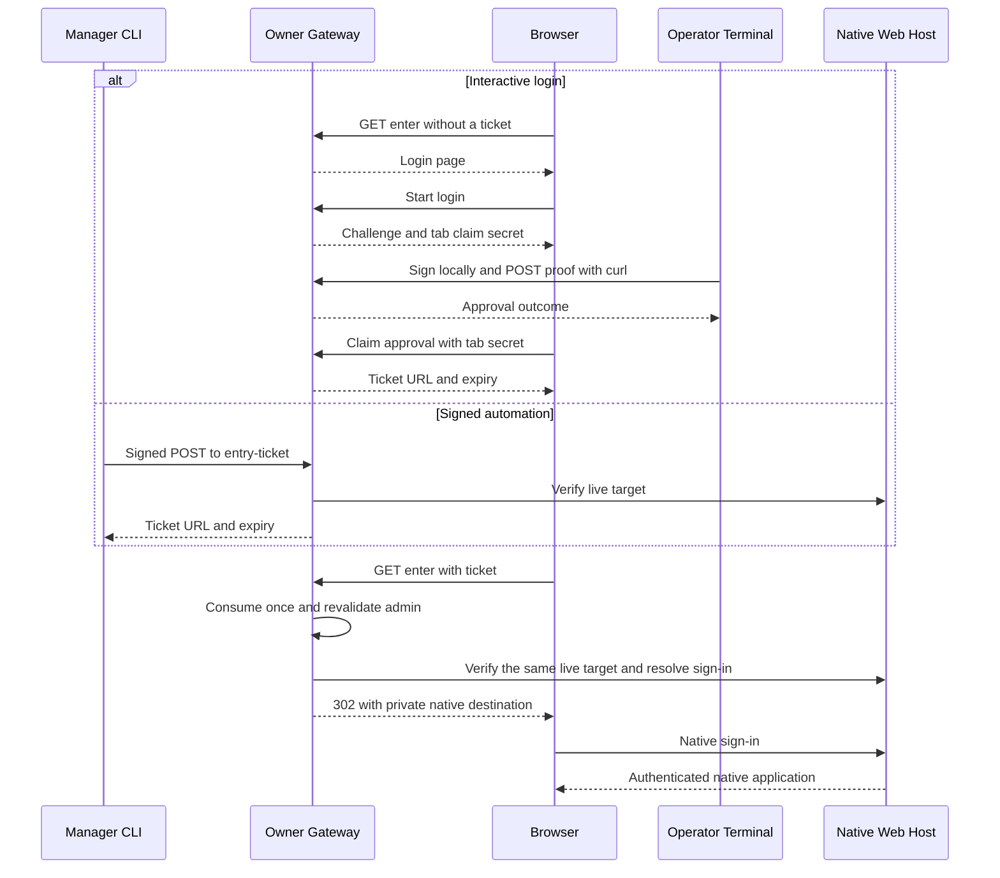

# Design

## Context

The [proposal](proposal.md) establishes the browser handoff. `WebNativeSurfaceV1` already publishes a token-free loopback origin. `GatewayWebExecutionIdentityV1` carries the managed generation, runtime session, native host, native agent, and conversation identities. The gateway can recover the binding through its read-only Web adapter.

DSH 0.2.2-rc.3 uses a root query token for browser authentication and a separate `/connect` exchange for API peers. Its stock client restores its own selection. Kimi's current browser helper verifies the owned listener and server identity, then uses native fragment authentication.

## Goals / Non-Goals

The browser entry flow grants a bounded redirect for an existing live execution. Native browser authentication, cookie or token lifetime, and conversation selection belong to the native application. The deployment boundary is the owner-local listener or a private TCP tunnel presenting the same two loopback addresses. [Web entry contract](specs/gateway-web-entry/spec.md)

## Decisions

### Require Direct Enrolled Admin Proof

Register issuance with the gateway's proof-required route admission. Use the existing signed-request contract and require a verified `admin` grant before any body or native destination processing. Ordinary admin admission allows an empty roster to grant anonymous access, which is unsuitable for releasing native authentication material. Apply the direct-proof requirement where the gateway still knows how the caller proved authority. A relay can otherwise produce the same grant role as a direct signature.

Interactive login uses a separate proof purpose for a pending browser attempt. The terminal callback verifies an enrolled admin signature for that attempt and grants one browser claim. Both flows use the same ticket issuance helper. Entry remains independent of public prompt enablement. Keep the routes discoverable through protocol documentation and command help. Preserve the public endpoint descriptor's list of anonymous operations.

### Start Interactive Login at the Shared Entry URL

`GET /v1/web/enter` serves a minimal login page when the query is empty. The page shows the owner gateway address and selected agent, an optional local key path, a copyable signing command, and login status. A valid ticket request uses the same URL path. An invalid, expired, or used ticket returns a safe refusal and a link to the bare page. Reject duplicate or extraneous query parameters.

Allocate pending state on an explicit action from the page through same-origin `POST /v1/web/login`. Capture the current managed Web execution identity. Return an attempt ID, the exact canonical challenge bytes encoded for the command, a UTC expiry, and a separate unguessable claim secret. Keep the claim secret in the initiating tab's memory and store only its digest on the gateway. Use a bounded per-listener pending store and a two-minute attempt lifetime to allow for local key selection and passphrase entry. The existing API challenge and entry ticket keep their respective lifetimes.

### Sign in the Terminal and Submit With Curl

The challenge binds its purpose, nonce, absolute gateway origin, exact approval operation and attempt, full Web execution identity, and expiry. Use the `houmao-web-entry-login-v1` SSHSIG namespace. The existing request-bound API challenge requires a selected key ID. Reuse the bounded SSHSIG parsing, signature verification, and retained enrollment checks for the new challenge, whose signer can be any currently enrolled admin.

Generate the command from a fixed template and the exact challenge bytes. Prepare the command in the tab so an entered key path stays local. Preserve the literal path with shell quoting. With a blank path, enumerate public identities from the local SSH agent and let OpenSSH sign with each available supported identity. If the generated command needs temporary inputs, store only public keys and challenge or proof data with private permissions and clean them up. Report unavailable keys and signing failures with guidance to select a key path.

The command sends one bounded batch of complete SSHSIG armor blocks to `POST /v1/web/login/<attempt-id>/prove` at the verified owner-local gateway origin. Use a direct curl request without ambient proxies, curl configuration, or redirect following. Parse the bounded body and identify each embedded public key before looking it up in the current admin roster. Validate candidates against the same canonical challenge and require one valid enrolled signer. An unknown or invalid candidate leaves the other candidates eligible. Commit at most one approval atomically and return a fixed outcome to the terminal. Keep proof bodies out of route logs.

### Let the Waiting Tab Continue

The page polls `POST /v1/web/login/<attempt-id>/claim` with its own claim secret in a request header. The terminal command carries only the signed challenge and approval address. A valid pending claim returns a waiting status. After approval, revalidate the approving enrollment, attempt deadline, and live native binding, then atomically claim the approval and issue one normal 60-second ticket. Navigate the tab to that ticket on the shared entry URL.

Keep the login page and requests same-origin. Use a restrictive content security policy, prevent framing, and keep the challenge and claim data out of shared browser storage. A bare page visit or unverified terminal submission grants no gateway session. The resulting native browser state follows the provider's existing lifecycle.

### Bind and Consume the Ticket in the Gateway

On issuance, verify the owner's manifest and live native Web binding. Return an opaque URL and UTC expiry. Generate the URL from the verified owner connect origin and fixed route. Store a digest of an OS-generated random bearer in a bounded, per-listener in-memory collection. Associate it with the owner binding, full Web execution identity, verified admin grant, and monotonic expiry. Use 60 seconds for the first release. Prune expired entries and return a safe capacity refusal if the collection fills.

On redemption, first verify the local transport and the exact single ticket parameter. In one synchronized operation, check expiry and remove the matching ticket. Release the ticket lock before native I/O. Compare a freshly verified owner/native binding to the ticket identity. Bound that check by the remaining ticket lifetime, then revalidate the admin enrollment and deadline before sending the response. Consumption is final even when revalidation fails. This avoids retrying a grant against a replacement host.

### Resolve the Destination Inside the Verified Backend

Use the read-only Web adapter to obtain a private entry descriptor. Its fields cover the verified clean origin, backend-selected path, and structured query or fragment values. Compare its origin with the owned Web binding. Construct the URL with component encoding and reject any result with an altered scheme, host, port, or credential authority. Read private bootstrap material through the verified backend. Keep the descriptor out of shared models, state serialization, diagnostic representations, and ticket storage.

DSH uses the root `token` query. Verify the private bootstrap source and expected origin, the supervised listener, and the current companion identity before releasing it. DSH exchanges the token for its browser cookie and redirects to a clean root. The browser selects the published native session in the sidebar. The API peer continues to use native `/connect`.

Kimi uses its native token fragment and the existing owner, listener, and server verification. Qualify the native `/sessions/<id>` link on the supported 2.6.0 build. Use that link when qualified or the existing native root with explicit UI selection. Verify the bound native conversation in either case.

### Keep the Gateway and Browser on Their Respective Protocols

Use the existing signed `GatewayClient` for issuance through the resolved owner-local gateway. Select the deployed admin signer explicitly. The CLI reports a detached gateway, missing signer, or unsupported route using the selected target's safe diagnostics. The browser follows the redirect through its native networking stack. Keep the signed client's existing redirect refusal.

Require the exact configured owner-local origin and a loopback peer on every Web entry and login route. Validate browser navigation, login start, proof submission, and claiming independently because those requests bypass normal signed issuer validation. Refuse advertised or proxy ingress and delegated proof. Deployments that publish other routes through an HTTP reverse proxy exclude all Web entry and login routes. Operators using a private TCP tunnel forward the exact loopback addresses and ports for both listeners. The terminal uses the gateway address displayed by the page.

## Risks / Trade-offs

- **Bearer exposure.** Claims and entry tickets are sensitive. Send `Cache-Control: no-store` and `Referrer-Policy: no-referrer` on entry and login responses. Route telemetry uses the static route name and fixed failure categories. Reject invalid forms without reflecting the proof, query, path input, or redirect destination.
- **Signing a copied command.** Display the gateway address, agent, operation, and expiry next to the command. Require the already enrolled admin key and bind the signed bytes to that exact operation. The browser's separate claim secret keeps the proof callback from transferring control to the terminal.
- **Owner-local address scope.** An advertised gateway on another host can lead a browser to an unrelated local listener. Enforce the direct owner endpoint and document exact private forwarding as a browser precondition.
- **Lifecycle changes during handoff.** Verify the live owner and native listener immediately before the redirect. The browser's next request uses the provider's current authentication rules. A newly issued ticket is required after gateway restart, expiry, or a refused handoff.

## Migration Plan

An attached gateway picks up the routes on upgrade and restart. Enroll an admin, then open the bare entry URL for a running Web agent or request a link through the scoped manager command. Existing Kimi owner-local browser opening and established native browser sessions keep their native lifecycle. Managed fixture qualification exercises both flows in fresh browser contexts. Rollback clears pending logins and outstanding tickets when the gateway process exits.
