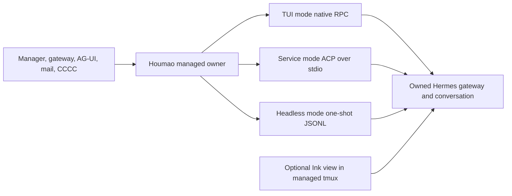

# Design

## Context

[The proposal](proposal.md) introduces three Hermes run modes. Houmao already has a persistent ACP supervisor, a finite headless runner, and tmux-backed terminal attachment. Hermes v0.23.4 adds a constraint common to all three modes. Its gateway owns the native conversations and executes turns. Ink, the ACP adapter, and the finite CLI connect to that authority. A client process can disappear while Hermes still owns accepted work. [Houmao backend contracts][houmao-backends] · [Hermes programmatic interfaces][hermes-interfaces] · [Hermes ACP process][hermes-acp-entry] · [Hermes finite client][hermes-finite]

## Goals / Non-Goals

Give each managed Hermes agent one owned native authority, one selected run mode, and one verified conversation destination. Use the existing Houmao control and permission contracts at every entrypoint. The initial provider is an explicitly selected custom OpenAI-compatible Chat Completions endpoint. The qualified terminal UI is the packaged Ink CLI. Browser automation, desktop control, and Hermes messaging integrations are outside the launch profile for this change.

## Decisions

### Share Authority Ownership Across the Three Modes

Reuse Houmao's managed launch and supervisor contracts. Store the chosen executable, version evidence, run mode, workspace, private home, and native conversation binding in the launch and runtime records. Default ordinary Hermes launches to `service`. The passive headless birth route selects and validates `headless` explicitly. Reject unsupported mode or execution-context combinations during preflight.

The Houmao supervisor owns a foreground `hermes gateway run --external-supervisor` in the saved execution context. Give the daemon and all its clients the same private `HERMES_HOME` and `HERMES_GATEWAY_LOCK_DIR`. The latter isolates Hermes's account-wide gateway rendezvous. Verify the daemon's process incarnation, discovered endpoint, profile, and advertised protocol before accepting readiness. On restart, bind the new authority before admitting work. A Hermes restart request can return exit code 75 to the supervisor. Re-establish the same owned authority and reconcile outstanding requests before starting another turn. If the binding cannot be proven, report unavailable. Attachment or recovery may only target this agent's proven authority.

Resolve the existing executable from the selected execution context and check the capabilities used by the mode. The adapter uses Hermes's local authenticated bootstrap for native RPC. Keep its short-lived tickets, raw endpoint, and pipes inside the owner boundary. Starting the foreground daemon explicitly makes its liveness and termination observable. Letting a client auto-start it gives the client and daemon separate lifetimes without establishing Houmao ownership. [Hermes gateway lifecycle][hermes-supervisor] · [Hermes lock scope][hermes-locks] · [Hermes ticket bootstrap][hermes-attach]

### Project One Managed Profile Into Hermes

Prepare the private native home through Houmao's existing launch materialization. Write the composed role to `SOUL.md` and copy the selected managed skills, including permitted system skill packs, to the native skills directory. Project the selected model, custom API route, and credential references from the resolved launch inputs. Keep secret material in the private owner context. Resolve a credential from the selected bundle and fail preflight if the bundle cannot supply it. Sharing the installed Hermes executable and tool store is compatible with separate conversation state and credentials.

Configure Hermes to exclude browser and desktop-control toolsets and prevent lazy provisioning of those dependencies. Apply a mode-appropriate native policy for approvals and tools, and verify its effective configuration before reporting support. An unattended ACP transport selects an advertised explicit rejection for unresolved approval callbacks. A TUI operator can answer approvals with the native UI under the selected policy. Treat Houmao gateway permissions, native approvals, and agent-facing request text as distinct boundaries. Ordinary service-originated requests continue to use the existing request-fence envelope. [Hermes role and context files][hermes-soul] · [Hermes approval bridge][hermes-approval] · [Houmao gateway protocol][houmao-gateway]

### Pin the Managed TUI Conversation

Create a fresh logical conversation with native `session.create`, `source: "tui"`, a stable launch request ID, and the selected workspace. For exact continuation, resolve the previously recorded logical ID in the same home and workspace. Launch the packaged Ink TUI in the managed tmux pane with `hermes --tui --resume <native-id>` only after establishing the native binding. Verify the native response and current authority. Treat a physical continuation caused by compaction as part of the same verified logical conversation.

Track UI attachment independently of the managed destination. The packaged launcher creates a private active-session hint under its temporary directory and removes it on exit. Give each managed Ink incarnation a private temporary directory and qualify reading that hint together with process liveness and the native session binding. The hint can be empty, partial, delayed, or missing. A change to a different conversation reports an attachment mismatch and leaves managed dispatch pinned to the original conversation. Reattachment requires the original verified destination. Closing Ink removes the terminal surface while an owned authority can continue tracking an admitted turn. This design uses the native session protocol for readiness, submission, events, and cancellation. Terminal output remains available for human observation. [Hermes TUI launcher][hermes-ink-launch] · [Ink attachment updates][hermes-ink-lifecycle] · [Hermes logical identity and recovery][hermes-recovery]

### Distinguish Readiness, Admission, and Completion

For a ready-only TUI request, verify the current Houmao policy, authority incarnation, and pinned native session. Read fresh native readiness immediately before sending. Known busy, stale, ambiguous, or unavailable readiness follows the existing refusal behavior. Native readiness is a best-effort observation because a person can begin a turn after that read. Once the request is authorized and sent, retain any positive native admission receipt, including `queued`. Hermes owns that queue. The ordinary event path adds no separate Houmao retry queue.

Use this normalized admission path for direct prompts, AG-UI, ordinary plugin events, CCCC, and mail. An exact positive native receipt counts as handoff of the corresponding CCCC batch and ends its delivery retry. Record accepted mail reminders until settlement so a later poll cannot duplicate the same in-flight reminder. AG-UI keeps its run open through queueing and execution and settles it only from the matching terminal evidence. Surface queue state separately from execution state so a human turn and the queued managed request can both be visible.

Persist the TUI submission identity, scope, and payload digest before native `prompt.submit`. Reconciliation by idempotent submit requires the original authenticated native principal, pinned logical conversation, stable submission ID, and unchanged payload under the original request's authority. For ordinary plugin events, retain only the correlation and outcome evidence. If a later observer lacks an exact receipt and cannot reconstruct the authorized tuple under the route's existing retention rules, the result remains uncertain. Once an admission ID is known, inspect `prompt.receipt` and request its stored terminal result where available. Correlate updates to the native authority, session, admission, and execution generation when present. Use the replay epoch and sequence to detect event gaps. A pending-list disappearance or another admission's completion conveys no settlement for the managed request. Interpret explicit native cancellation, replacement, or steering as their own outcomes. [Hermes durable admission][hermes-admission] · [Hermes event replay][hermes-event-replay] · [Hermes receipt and cancellation][hermes-receipt]

### Preserve the Distinct Service and Headless Contracts

In service mode, reuse the persistent ACP transport but qualify Hermes's session and permission dialect. Run `hermes acp` against the same owned authority and keep its stdio private. Open admission after initialization and successful new or exact session binding. Keep any binding-time transcript replay outside the live request interval. Send prompts via `session/prompt` and interrupt via `session/cancel`. Match the currently bound session and request while servicing reverse requests. Correlated ACP settlement and attributable native evidence set the request outcome. Transport loss can leave the outcome unknown because the viewer and daemon have separate lifetimes. An ACP failure leaves service mode unavailable until the owned session is verified again. Native RPC may inspect the authority without becoming a substitute submission path.

In headless mode, start one finite native process per invocation with `hermes chat --oneshot --query-file - --format stream-json`, continuing through `--resume <native-id>` when an exact session is selected. Deliver text through private stdin and retain the native JSONL result and correlated event stream. Keep stdout protocol frames separate from private stderr diagnostics. Reuse the owned gateway across finite clients and enforce one active managed operation for the bound conversation. Record the exact native terminal evidence when the supported wire or auxiliary native receipts prove attribution. The CLI generates its own native submission ID and can exit while the daemon is waiting for a human or still owns unresolved work. When exact evidence is absent, keep the operation uncertain and hold further ordinary work until verification or an authorized disposition. CLI exit alone cannot certify interruption, and failed observation cannot justify resending text. [Hermes ACP prompt and cancellation][hermes-acp-prompt] · [Hermes finite client][hermes-finite] · [Hermes JSONL result][hermes-jsonl]

For headless exact continuation, bind the recorded logical ID and workspace in the owned daemon before launching the CLI. Protect that binding by keeping the home, daemon, and conflicting session operations under the managed owner. Qualify the preflight and attachment path against a missing ID with a matching title and against a daemon replacement during client startup. Stock Hermes can fall back to a title lookup after an ID miss, and automatic local attachment can start a daemon. Enable the mode only when the chosen launch path prevents those behaviors from dispatching outside the verified binding. [Hermes CLI session selection][hermes-cli-selection] · [Hermes native gateway connection][hermes-native-connect]

## Risks / Trade-Offs

- **Build or protocol drift.** Qualify v0.23.4 against the installed executable and its advertised capabilities. Fail closed for missing required capabilities. Probe the stock packaged launcher so an undocumented attachment hint remains a tested compatibility boundary.
- **Native queue recovery.** A restart can recover a never-started admission from the native FIFO. A lost started claim can become unknown and block followers. Preserve its original identity, recover exact receipts where available, and require explicit disposition for uncertain execution. [Hermes logical identity and recovery][hermes-recovery]
- **Unattributed output and usage.** ACP context updates and cumulative counters are observations. Expose request-scoped output and usage only with qualified evidence for the exact operation. An event gap can reduce live detail even when a native receipt establishes the terminal result.
- **Separately owned processes.** A closed TUI, ACP link, or finite CLI does not prove that the native daemon stopped. Verify owned process and session incarnations during cleanup, reconnect, and interruption. Treat a replacement endpoint as a new authority until verified.

## Migration Plan

Verify the protocol mappings with hermetic fake peers and qualify the installed build with a controlled Chat Completions fixture and explicitly selected credentials. Run each mode through both its raw native lane and its managed lane. Cover fresh and exact resume, role and skill projection, provider isolation, streaming, approval handling, interrupt and stop, and daemon restart. Use an isolated tmux server for Ink tests. Exercise a TUI conversation switch, a human turn beginning between readiness and submit, lost admission acknowledgement, event replay gaps, and a finite CLI exiting while its daemon still owns the operation. Prove manager, gateway, AG-UI, CCCC, and mail observe the same native admission and terminal outcomes.

Enable Hermes per launch profile after qualification. Roll back by removing that profile's Hermes selection and stopping the verified owned runtime. Preserve the private home and recorded turn evidence for inspection or exact continuation with a compatible build.

[houmao-backends]: ../../../docs/reference/run-phase/backends.md
[houmao-gateway]: ../../../docs/reference/gateway/contracts/protocol-and-state.md
[hermes-interfaces]: https://github.com/NousResearch/hermes-agent/blob/v0.23.4/website/docs/developer-guide/programmatic-integration.md
[hermes-acp-entry]: https://github.com/NousResearch/hermes-agent/blob/v0.23.4/acp_adapter/entry.py#L206-L226
[hermes-supervisor]: https://github.com/NousResearch/hermes-agent/blob/v0.23.4/website/docs/reference/cli-commands.md#L343-L353
[hermes-locks]: https://github.com/NousResearch/hermes-agent/blob/v0.23.4/gateway/status.py#L320-L336
[hermes-attach]: https://github.com/NousResearch/hermes-agent/blob/v0.23.4/hermes_cli/subcommands/gateway.py#L133-L149
[hermes-soul]: https://github.com/NousResearch/hermes-agent/blob/v0.23.4/website/docs/user-guide/features/context-files.md#L99-L113
[hermes-approval]: https://github.com/NousResearch/hermes-agent/blob/v0.23.4/acp_adapter/gateway_server.py#L1191-L1223
[hermes-ink-launch]: https://github.com/NousResearch/hermes-agent/blob/v0.23.4/hermes_cli/main_tui_launch.py#L435-L438
[hermes-ink-lifecycle]: https://github.com/NousResearch/hermes-agent/blob/v0.23.4/ui-tui/src/app/useSessionLifecycle.ts
[hermes-recovery]: https://github.com/NousResearch/hermes-agent/blob/v0.23.4/website/docs/developer-guide/gateway-local-sessions.md#L278-L301
[hermes-admission]: https://github.com/NousResearch/hermes-agent/blob/v0.23.4/persistence/sqlite/authority/_admission_store.py#L61-L105
[hermes-event-replay]: https://github.com/NousResearch/hermes-agent/blob/v0.23.4/gateway/session_events.py#L114-L138
[hermes-receipt]: https://github.com/NousResearch/hermes-agent/blob/v0.23.4/gateway/session_controls.py#L945-L987
[hermes-acp-prompt]: https://github.com/NousResearch/hermes-agent/blob/v0.23.4/acp_adapter/gateway_server.py
[hermes-finite]: https://github.com/NousResearch/hermes-agent/blob/v0.23.4/hermes_cli/gateway_chat_view.py#L464-L588
[hermes-jsonl]: https://github.com/NousResearch/hermes-agent/blob/v0.23.4/hermes_cli/stream_json.py#L87-L111
[hermes-cli-selection]: https://github.com/NousResearch/hermes-agent/blob/v0.23.4/hermes_cli/gateway_chat.py#L172-L196
[hermes-native-connect]: https://github.com/NousResearch/hermes-agent/blob/v0.23.4/hermes_cli/gateway_client.py#L330-L381
