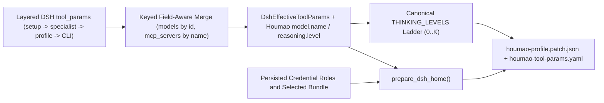

# Design

## Context

See `proposal.md` for motivation and `specs/` for normative behavioral requirements. This change stacks directly on top of prerequisite change `refactor-per-tool-params-pipeline`, which establishes `src/houmao/agents/tool_params/` (`DshToolParamsAdapter`) across all five configuration layers (`adapter.yaml` -> `<setup>/tool-params.yaml` -> `Specialist`/`Preset` -> `Profile`/`LaunchProfile` -> CLI `--tool-params`), retires standalone `dsh-setup.yaml` and `selected_model`, and materializes `<DSH_HOME>/houmao-tool-params.yaml` plus `<DSH_HOME>/houmao-profile.patch.json`.

With the `tool_params` plumbing established by `refactor-per-tool-params-pipeline`, four DSH runtime and schema defects ([GitHub issue #85](https://github.com/igamenovoer/houmao/issues/85)) remain to be resolved inside `DshToolParams` and the DSH ACP/Web backends:
1. `dsh_configuration.py` restricts adapter and protocol pairs to `deepseek/messages` and `pi-ai/openai-completions`. Its schema drops other configurable protocols, `compat`, `input_modalities`, and `retry_policy`. The installed `pi-ai` OpenAI-compatible transport requires either a key or an authorization header before it dispatches.
2. `dsh_configuration.py` forces `"0": "off"` and emits `"reasoningEfforts": {effort: effort}` (`{"off": "off"}`), conflating Houmao's integer reasoning index (`0..K`), DSH's canonical `THINKING_LEVELS` slot (`off`, `minimal`, `low`, `medium`, `high`, `xhigh`, `max`), and the wire string or `null` sent upstream (`catalog.ts:75-86, 223-231`).
3. `prepare_dsh_home()` patches `approval: {policy: "never"}` and `sandbox-policy: {mode: "workspace-write"}` without registering a matching preset in `id: permission` (`@deepseek-ai/dsh-permission-presets`), causing `PermissionPresetService` activation failure on every ACP startup (`packages/interaction/permission-presets/src/index.ts:154-195`), whereas `dsh_web.py:392-403` carries a partial Web-only `permission` patch that omits DSH's standard presets.
4. `DshAcpRequestError` (`dsh_acp_connection.py:29-43`) drops `error["message"]` completely (`ACP request failed (-32603)`), and `dsh_web.py:473, 880` drops supervisor startup errors and `DshWebError` messages.

## Goals / Non-Goals

**Goals:**
- Upgrade `DshPartialToolParams` and `DshEffectiveToolParams` (`src/houmao/agents/tool_params/dsh.py` and `src/houmao/agents/dsh_configuration.py`) to express DSH's native `llm-pi-ai` and `llm-deepseek` contracts with snake_case authoring and camelCase Cordis patch serialization.
- Separate Houmao's `0..K` integer reasoning ladder from DSH's `THINKING_LEVELS` slots and provider wire values across launch-time projection (`prepare_dsh_home`, `model_mapping_policy.py`) and request-scoped ACP overrides (`dsh_acp_driver.py`).
- Make unattended Cordis permission composition valid by construction in `houmao-profile.patch.json` for both ACP and Web, removing the duplicate Web-only patch block in `dsh_web.py`.
- Introduce one shared secret-redacting diagnostic formatter used across `dsh_acp` and `dsh_web` for JSON-RPC errors, Web API errors, and worker/supervisor startup failures.
- Support endpoint-only configuration for explicitly selected self-hosted `pi-ai/openai-completions` routes and use persisted credential roles for custom environment names across `credentials.py`, `DshToolParamsAdapter`, and `fixturelib`.

**Non-Goals:**
- Supporting raw user-authored `cordis.patch.yml` files that could override Houmao's home isolation, persistence root, literal role section, or unattended sandbox policy.
- Retaining legacy per-index `models[].reasoning` mappings in `DshToolParams`.
- Changing `houmao-mgr project` authoring checks unrelated to DSH runtime integration.

## Decisions

### Decision 1: Native-Aligned `DshToolParams` Schema and Keyed Layer Merging

Extend `DshPartialToolParams` and `DshEffectiveToolParams` (`ConfigDict(extra="forbid")`) in `src/houmao/agents/tool_params/dsh.py`:



Schema rules verified against `extern/orphan/deepseek-harness/`:
- **Provider adapter and protocol**:
  - `adapter: "deepseek"` requires `protocol: "messages"` and non-empty `api_key_env: str` plus `base_url_env: str`, and rejects `compat` on route and models.
  - `adapter: "pi-ai"` accepts `protocol` in `{"openai-completions", "openai-responses", "anthropic-messages", "google-generative-ai"}` and requires `base_url_env: str`. The default `api_key_env` is `"OPENAI_API_KEY"`. Explicit `api_key_env: null` selects the endpoint-only path in Decision 5 and is valid only on self-hosted `openai-completions` routes.
- **Wire compatibility (`compat`)**:
  - Accepted on `provider.compat` (route default) and `models[].compat` (per-model override) for `adapter: "pi-ai"`, validated against DSH's protocol-specific `COMPAT_GATES` (`packages/llm/llm-pi-ai/src/catalog.ts:248-346`):
    - `openai-completions`: `supports_store`, `supports_developer_role`, `supports_reasoning_effort`, `supports_usage_in_streaming`, `supports_finish_reason`, `max_tokens_field`, `requires_tool_result_name`, `requires_assistant_after_tool_result`, `requires_thinking_as_text`, `requires_reasoning_content_on_assistant_messages`, `thinking_format`, `chat_template_kwargs`, `chat_template_args`, `supports_thinking_token_budget`, `thinking_token_budget_field`, `vllm_priority`, `supports_strict_mode`, `cache_control_format`, `supports_long_cache_retention`.
    - `openai-responses`: `supports_developer_role`, `supports_max_output_tokens`, `supports_strict_mode`, `supports_long_cache_retention`.
    - `anthropic-messages`: `supports_eager_tool_input_streaming`, `supports_long_cache_retention`, `supports_cache_control_on_tools`, `supports_temperature`, `force_adaptive_thinking`, `allow_empty_signature`, `supports_strict_tools`.
    - `google-generative-ai`: rejects non-empty `compat`.
- **Model metadata, retry policy, and layer merging**:
  - Effective `models[]` entries require `id`, `context_window` (`int > 0`), `max_output_tokens` (`int > 0`), and `reasoning_efforts` (`false` or slot-to-wire mapping), plus optional `name`, `input_modalities` (projected to `input` on `pi-ai` and `inputModalities` on `deepseek` per `packages/llm/llm-pi-ai/src/config.ts:339` vs `llm-deepseek/src/config.ts:88`), and `compat` (`pi-ai` only).
  - Optional `provider.retry_policy` validates `RetryPolicySchema` (`mode: "normal" | "always"`, `max_retries`, `retryable_codes`, `backoff: {initial_delay_ms, max_delay_ms, jitter_ratio}`) and projects to `retryPolicy` (`packages/llm/llm/src/retry-policy.ts:106-135`).
  - Partial `models[]` entries in higher layers (`profile` or `--tool-params`) merge by `id` against lower-layer models using `model_fields_set`, allowing a profile to patch `compat` or `reasoning_efforts` for one model without restating capacities.

### Decision 2: Three-Layer Reasoning Model Derived From Canonical `THINKING_LEVELS`

1. **Authoring and Wire Layer (`tool_params.models[].reasoning_efforts`).**
   - Use `false` for a model without reasoning. A reasoning map must declare at least one positive slot after merging. Quote `'off'` in YAML keys and string values so PyYAML preserves it as a string.
   - On `pi-ai`, keys are a subset of `THINKING_LEVELS = ("off", "minimal", "low", "medium", "high", "xhigh", "max")`. A `null` value for `'off'` omits the wire field, and `"none"` sends an explicit disable string. Positive slots map to non-empty wire strings.
   - On `deepseek`, keys are a subset of `("off", "low", "high", "max")`. The `'off'` slot accepts `null` or `'off'`, and positive slots map to their native names.
2. **Houmao Normalization Layer (`model_mapping_policy.py` and `DshToolParamsAdapter`).**
   - For a non-reasoning model, accept level `0` or an omitted level and reject positive levels.
   - For a reasoning-capable model, level `0` requires a declared `'off'` slot. Levels `1..K` map to declared positive slots in canonical `THINKING_LEVELS` order and saturate above `K`.
3. **Cordis and ACP Projection Layer (`prepare_dsh_home` and `dsh_acp_driver.py`).**
   - For `pi-ai`, emit `reasoningEfforts: false` on non-reasoning model entries. When the selected model is non-reasoning, omit the provider's `reasoning` default and skip ACP effort selection. For a reasoning-capable model, emit its slot-to-wire map verbatim and project the selected slot as the provider reasoning default.
   - For DeepSeek Messages, set `thinking: disabled` for a non-reasoning model. Keep `thinking: enabled` for a reasoning-capable model, including when `reasoningEffort` is `off`. This allows a later ACP turn to select a positive effort.
   - Resolve request-scoped overrides through `resolve_reasoning_mapping(tool="dsh", ...)`. Use the selected slot for ACP `thought_level` on reasoning-capable models. Keep each override local to the request so the next turn can use the materialized default.

Example specialist/profile `tool_params` for SGLang `Qwen/Qwen3.8-27B-FP8` (combined with `setup: openai-compatible`):
```yaml
provider:
  api_key_env: null
models:
  - id: Qwen/Qwen3.8-27B-FP8
    context_window: 262144
    max_output_tokens: 32768
    compat:
      supports_developer_role: false
    reasoning_efforts:
      'off': none
      low: low
      medium: medium
      high: high
```

### Decision 3: Unified Unattended `permission` Preset Composition in `houmao-profile.patch.json`

When `operator_prompt_mode == "unattended"`, `prepare_dsh_home()` emits `approval: {policy: "never"}`, `sandbox-policy: {mode: "workspace-write"}`, and `permission` (`presets` containing `read-only`, `workspace-write`, `danger-full-access`, and `houmao-unattended` with `defaultPreset: "houmao-unattended"`) directly into `houmao-profile.patch.json`. Remove the redundant Web-only `id: "permission"` append in `src/houmao/agents/realm_controller/backends/dsh_web.py:392-403` so ACP, raw launch, and Web share one identical unattended permission contract. When `operator_prompt_mode == "as_is"`, none of the three unattended overrides are emitted.

### Decision 4: Shared Secret-Redacting Diagnostic Sanitizer Across ACP and Web

Implement `sanitize_dsh_diagnostic(text: str, *, secret_values: Iterable[str] = (), max_length: int = 512) -> str` (longest-first exact and URL-encoded scrubbing of resolved secrets from private env, Web `launch_token`, and cookie credentials, plus regex scrubbing for `Bearer`, `sk-*`, `api_key`, `apiKey`, `access_token`, `launch_token`, and `cookie` patterns, single-line normalization, and bounded truncation) and apply it to:
- `DshAcpRequestError` (`dsh_acp_connection.py`): format `ACP request failed (<code>): <sanitized message>`.
- `DshAcpConnection` / `dsh_acp_driver.py`: append sanitized worker stderr tail summary on `DshAcpProtocolError` crashes before JSON-RPC settlement while keeping raw stderr in `0600` `provider-stderr.log`.
- `dsh_web.py`: surface sanitized startup failure reason from `exit.json` / supervisor logs (`lines 471-476`) and sanitized `DshWebError` messages on control operations (`lines 264, 880, 1057, 1088, 1118`).

### Decision 5: Persist Credential Roles and Support Endpoint-Only Launches

Persist a non-secret mapping from the endpoint and API-key roles to their environment variable names alongside the selected credential bundle's `vars.env`. Keep values in the private bundle. `credentials dsh add|set` accepts `--base-url-env` and `--api-key-env`. Updates and `--clear-base-url` or `--clear-api-key` target the stored roles when the names are omitted. Rebinding a role replaces its name and value atomically and preserves other bundle entries. `get` reports the API-key role by name and presence with its value redacted, regardless of the name's spelling.

Use `validate_dsh_env_name()` for distinct POSIX identifiers. Reject reserved runtime and process names such as `PATH`, `HOME`, `LD_PRELOAD`, `DSH_HOME`, `DSH_AGENTS_HOME`, and tmux selectors, plus the `XDG_` and `HOUMAO_` prefixes. In launch preflight, match `tool_params.provider` references to the selected bundle's stored roles. Use the endpoint role and, for authenticated routes, the API-key role to project the native environment. Reject collisions with persistent environment records and one-shot overrides. A missing value for a named API-key role is an error.

For an explicitly selected self-hosted `pi-ai/openai-completions` endpoint, `api_key_env: null` permits a bundle containing only the endpoint. Project native `apiKeyEnv` to the reserved `HOUMAO_DSH_LOCAL_API_KEY` variable and supply the fixed public value `houmao-local-no-auth` in the native process environment. The placeholder comes from launch preparation. Bundle storage, authored parameters, and public launch metadata contain no placeholder value. The SDK sends the placeholder in the `Authorization` header, so the selected endpoint must accept that header. Other protocols and endpoints that require an absent `Authorization` header are outside this endpoint-only path.

A mocked prompt with the installed SDK completed with a public placeholder and recorded the expected authorization header. Qualify the full DSH path with a completed SGLang prompt using an endpoint-only bundle in both ACP and Web.

## Risks / Trade-offs

- **[Breaking replacement of per-index `models[].reasoning` in `DshToolParams`]** -> All DSH starter `tool-params.yaml` files, test fixtures, `fixturelib`, `iter1_dsh.py`, and unit/integration suites are updated together, and `DshToolParams` raises an explicit validation error naming `reasoning_efforts`.
- **[Upstream error messages echoing secrets]** -> `sanitize_dsh_diagnostic` scrubs both exact resolved secret values (raw and URL-encoded) and common bearer/key/token patterns before error strings leave `0600` turn artifacts.
- **[Replacing `permission.config.presets` in Cordis]** -> Emitting `read-only`, `workspace-write`, and `danger-full-access` alongside `houmao-unattended` keeps DSH's standard presets intact in Web UI and session catalogs.

## Migration Plan

1. Apply and verify prerequisite change `refactor-per-tool-params-pipeline` first.
2. Upgrade `src/houmao/agents/tool_params/dsh.py`, `src/houmao/agents/dsh_configuration.py`, `src/houmao/agents/model_mapping_policy.py`, and `src/houmao/agents/realm_controller/backends/dsh_web.py` with native `compat`, `pi-ai` protocols, `input_modalities`, `retry_policy`, endpoint-only launch, the three-layer reasoning contract, and unified unattended permission presets.
3. Add `sanitize_dsh_diagnostic()` and wire it into `dsh_acp_connection.py`, `dsh_acp_driver.py`, `dsh_acp.py`, and `dsh_web.py`.
4. Extend `src/houmao/srv_ctrl/commands/credentials.py` with persisted credential roles. Update `scripts/agents/test-fixtures/`, `scripts/explore/houmao-3-0-interactive-review/iter1_dsh.py`, `docs/reference/run-phase/{dsh-headless.md,dsh-web.md}`, and unit and integration suites. Run live qualification against SGLang `Qwen/Qwen3.8-27B-FP8` with an endpoint-only bundle.
