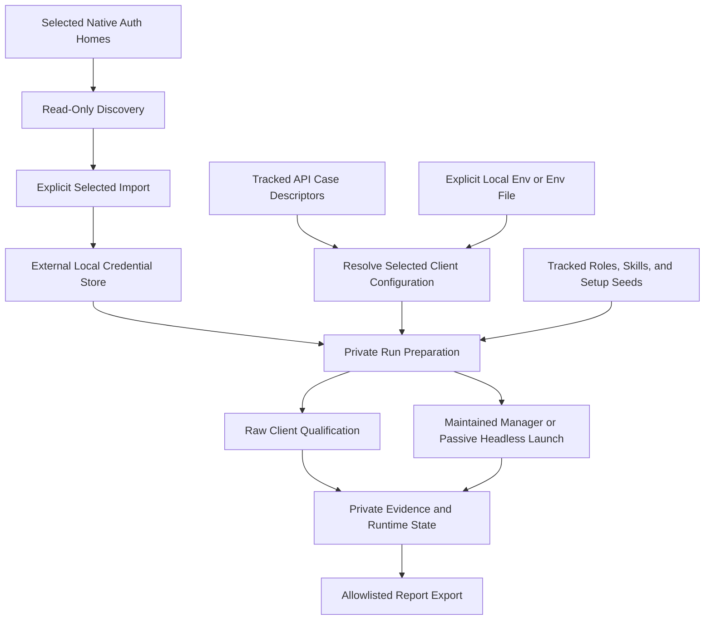

# Design

## Context

See [proposal.md](proposal.md) for motivation and the delta specs for the externally visible contract. Read-only inspection found these integration constraints:

- `tests/fixtures/plain-agent-def/` already separates roles, skills, presets, adapters, setups, and auth mount roots. It is a seed for direct native builds, not a mutable project overlay. Preserve that distinction.
- `tests/fixtures/auth-bundles/` currently tracks README/ignore files rather than real auth JSON. Its documentation and consumers nevertheless require predefined local bundle names. Replacing those defaults is a reproducibility and local-state placement change, not a credential-history cleanup.
- `tests/fixtures/plain-agent-def/tools/codex/setups/yunwu-openai/config.toml` fixes both provider identity and endpoint. Codex's current adapter accepts `OPENAI_API_KEY`, `OPENAI_BASE_URL`, and optional `auth.json`; a setup must render the selected endpoint into its provider block, not assume an env variable overrides a static TOML URL.
- The working change-local launch aids demonstrate isolated CLI homes and provider-specific invocation. Their Qwen model ID, fixed port, context window, reasoning effort, and capability list cannot become generic fixture defaults.
- The local `.env` has populated `DEEPSEEK_API_KEY`, `DEEPSEEK_BASE_URL_ANTHROPIC`, and `DEEPSEEK_BASE_URL_OPENAI` references. No key values were copied into planning artifacts. Model selection is an explicit additional run input.
- `src/houmao/srv_ctrl/commands/credentials.py` already imports supported tool auth files and validates env names against adapters. `src/houmao/srv_ctrl/commands/main.py::main(argv)` provides in-process access to maintained commands. Reuse that behavior rather than writing catalog storage directly.
- Project starter adapters and plain fixture adapters are separate checked-in assets. Update and test any required projection settings together; a working raw launcher is insufficient evidence that managed projection receives the same settings.
- The minimal demo runner still contains old root-level `agents launch/stop/prompt/state` calls despite current fixture guidance using scoped commands. Its contract tests also assert fixed auth paths. Repair those consumer assumptions during migration.
- `tests/manual/manual_kimi_hook_observation_smoke.py` automatically copies personal Kimi state into a repository-local fixture when missing. Replace that side effect with explicit discovery/import and selected external run state.
- `src/houmao/demo/shared_tui_tracking_demo_pack/agent_assets.py` owns the shared demo's fixed fixture lookup and source symlink. Its live-watch, recorded-capture, and long-horizon callers need explicit prepared inputs; packaged code must not import development utilities or test-only modules.

Current primary-source checks on 2026-11-13 confirm that DeepSeek exposes [Anthropic Messages](https://api-docs.deepseek.com/guides/anthropic_api/) and [Responses](https://api-docs.deepseek.com/guides/responses_api/), including a [Codex integration guide](https://api-docs.deepseek.com/quick_start/agent_integrations/codex/). Local Codex source at `extern/orphan/codex/codex-rs/model-provider-info/src/lib.rs` accepts Responses and rejects the removed Chat wire mode. Local Kimi `packages/node-sdk/src/config/env-model.ts` supports its OpenAI env-model configuration. These source checkouts inform the design; shipped helpers and tests must not require them.

## Goals / Non-Goals

**Goals:**

- Resolve one explicit API configuration that both raw client qualification and managed creation can consume.
- Keep reusable credentials and credential-bearing run state outside the checkout, including generated project overlays and runtime homes.
- Make auth discovery reproducible and read-only, with deliberate import and clear unsupported/ambiguous results.
- Preserve current project/native construction ownership, prompt policy, gateway behavior, and accounting boundaries.

**Non-Goals:**

- Installing a model server, operating a tunnel, adding a protocol translation proxy, or choosing a cloud plan.
- Building a general credential discovery service or expanding production credential CLI flags solely for fixture convenience.
- Copying complete personal homes, automatically logging in, refreshing vendor tokens during discovery, or supporting remote-machine credential harvesting.
- Changing usage accounting semantics, rewriting historical captures, or implementing new GUI behavior.
- Preserving old account aliases, fixed provider defaults, or repository-local private output placement through compatibility shims.

## Decisions

### 1. Keep Cases Declarative and Separate From Client Rendering

Create `tests/fixtures/agent-launch/self-hosted.yaml` and `cloud-api.yaml`, with a README and an env example containing names/placeholders only. Reuse `tests/fixtures/plain-agent-def/` for roles, skills, and tool seed assets. Do not create a second copy of the plain agent-definition tree.

The descriptors use a small versioned schema containing case ID, local value references, protocol endpoint references, optional model metadata, and supported client mappings. A normalized in-memory configuration identifies the selected case, client, mode, surface, model, endpoint, auth method, and qualified capability overrides. Secret values remain separate from its serializable description.

The initial cloud descriptor has this shape:

```yaml
schema_version: 1
case: cloud-api
service: deepseek
model_env: HOUMAO_TEST_CLOUD_MODEL
api_key_env: DEEPSEEK_API_KEY
endpoints:
  anthropic_messages:
    base_url_env: DEEPSEEK_BASE_URL_ANTHROPIC
  openai_responses:
    base_url_env: DEEPSEEK_BASE_URL_OPENAI
  openai_chat:
    base_url_env: DEEPSEEK_BASE_URL_OPENAI
```

`--model` overrides the selected model reference. The self-hosted descriptor uses `HOUMAO_TEST_SELF_HOSTED_MODEL`, `HOUMAO_TEST_SELF_HOSTED_ANTHROPIC_BASE_URL`, and `HOUMAO_TEST_SELF_HOSTED_OPENAI_BASE_URL`, with an optional `HOUMAO_TEST_SELF_HOSTED_API_KEY`. A missing self-hosted key can resolve to an explicit anonymous placeholder for clients that require a nonempty key; cloud credentials can never use that fallback. Neither case has a model-name or endpoint default copied from Qwen.

Endpoint support remains per protocol even when two protocols share a URL. Required fields are validated only for the selected client. A Chat Completions server does not satisfy a declared Responses requirement. Preserve operator-supplied base-path conventions and validate the composed request path instead of repeatedly trimming/appending `/v1`.

For API values, explicit non-secret invocation overrides take precedence over referenced process env values, which take precedence over an explicitly selected env file. Env files accept documented literal assignments and quoting; they are never shell-sourced and do not execute substitutions. Reject unsupported executable syntax without printing the offending value. Do not silently load unrelated env files or infer a key from another client account.

**Alternative considered:** retain three provider-specific shell wrappers and rename Qwen variables. That duplicates case resolution and allows raw/managed behavior to diverge. One normalized configuration makes that divergence testable.

### 2. Use Existing Client Credential Channels and Explicit Model Metadata

| Client | API Protocol | Key/Endpoint Projection | Model-Specific Inputs |
| --- | --- | --- | --- |
| Claude | Anthropic Messages | `ANTHROPIC_AUTH_TOKEN`, `ANTHROPIC_BASE_URL` | Pin the selected model across supported main/helper model lanes; apply only explicitly qualified context/effort settings. |
| Codex | OpenAI Responses | `OPENAI_API_KEY`; rendered `api-compatible` provider block with `env_key`, resolved URL, `requires_openai_auth=false`, `wire_api=responses` | Resolve model through launch-owned configuration; provide supported model metadata/catalog overrides when the installed client requires them. |
| Kimi | OpenAI Chat Completions | `KIMI_MODEL_API_KEY`, `KIMI_MODEL_BASE_URL`, `KIMI_MODEL_PROVIDER_TYPE=openai` | Explicit model, context, capability, and reasoning-key fields required by the selected model/client configuration. |

Replace the fixed Codex fixture setup with `api-compatible`. Render its concrete non-secret provider routing into run-local setup state before constructing a home. Keep the real key out of TOML and use the existing allowlisted `OPENAI_API_KEY` channel. Other tools similarly receive only their supported credential fields.

Do not copy Qwen's `xhigh`, 262144-token context, `image_in`, or thinking behavior into either generic case. Optional settings require explicit operator configuration or a checked, model-specific metadata record. If Kimi or the installed Codex version requires metadata that is unavailable, fail preparation with that field named. Default qualification uses a small text/tool smoke and does not claim image or advanced reasoning support.

Update required allowlist/projection settings in plain fixture and project starter assets together. Non-secret runtime policy fields use existing launch/setup configuration; credential-owned env values do not enter persistent specialist `launch.env_records`.

**Alternative considered:** use one generic `OPENAI_BASE_URL` for all clients and depend on ambient defaults. Claude uses a different protocol, and Codex's provider TOML is authoritative. Explicit projection avoids successful launches against the wrong backend.

### 3. Store Reusable Auth and Private Runs Outside the Checkout

| State | Default | Override |
| --- | --- | --- |
| Imported credential store | `${XDG_DATA_HOME:-~/.local/share}/houmao/test-fixtures/auth/` | `HOUMAO_TEST_AUTH_ROOT` or `--auth-root` |
| Private run state | `${XDG_STATE_HOME:-~/.local/state}/houmao/test-fixtures/runs/` | `HOUMAO_TEST_RUN_ROOT` or `--run-root` |

Resolve paths canonically, including symlinked parents, and reject roots inside the checkout. Treat a supplied run root as a parent and allocate a unique child run ID partitioned by case/auth method, client, mode, and surface. Never reuse another run merely because its provider or turn index matches.

Imported bundles keep the existing `files/` and `env/vars.env` projection shape under `<auth-root>/<tool>/<name>/`. Private runs own their generated project/native roots, client homes, credential copies, raw output, and lifecycle metadata. Use user-only directories and credential files. A run-local projection may use the existing builder's internal copy/symlink modes only after credentials have been copied into that run; a live CLI must not write through to the reusable store or original vendor home.

Only allowlisted sanitized reports may be exported under ignored repository scratch space. Such exports do not change the private run root. Existing demo options that select a credential-bearing output root must resolve externally; an inside-checkout root is an actionable error rather than a silent relocation.

**Alternative considered:** keep secret files ignored under `tests/fixtures/auth-bundles/`. That still places live auth in the checkout and preserves host-specific preparation assumptions. External storage gives the tracked fixture tree a complete secret-free contract.

### 4. Discover Locally, Then Import a Selected Candidate

Expose `discover-auth` and `import-auth` through `scripts/agents/test-fixtures/fixture.py`, run via `pixi run python`. Helper code stays development utility code under that purpose-specific directory.

Default discovery checks the selected tool's configured home, then its standard home; it also accepts explicit source/search roots. Additional recursive searches are bounded by the supplied roots, do not follow escaping symlinks, and skip unrelated history, sessions, repositories, and caches. Canonical paths deduplicate candidates. Scope and precedence affect discovery order, not an automatic choice among several accounts.

| Tool | Auth Material | Supported Companion Inputs |
| --- | --- | --- |
| Claude | `.credentials.json` in `CLAUDE_CONFIG_DIR` or the default Claude home | Supported companion `.claude.json`, including the default home's parent-level state location when applicable. |
| Codex | `auth.json` in `CODEX_HOME` or `~/.codex` | Read non-secret config metadata needed to identify the auth kind/provider; do not import unrelated MCP, trust, or session state. |
| Kimi | `credentials/kimi-code.json` in `KIMI_CODE_HOME` or `~/.kimi-code` | Matching supported `config.toml`; do not promise arbitrary scoped OAuth filenames that current import cannot represent. |

Candidates report an opaque candidate ID, selected tool, source path, auth kind, supported companions, and local validation/importability status. Discovery does not prove that tokens are accepted by a service. Report helper-only, keychain-only, empty, malformed, or unsupported scoped auth as limitations without running a helper or synthesizing credentials.

Import consumes an explicit candidate or source. Validate required structure, stage supported files in a private temporary bundle, preserve opaque JSON bytes, and atomically publish the bundle. Fail on duplicate names unless `--replace` is explicit. Do not modify the original files, normalize tokens, delete old fixture material, or copy an entire personal home. Native candidate config is not copied into a generic API run; native-login selection preserves its provider-owned routing and remains independent of the two API cases.

**Alternative considered:** copy the newest discovered auth automatically. File timestamps do not identify the intended account and can select unrelated credentials. Explicit selection makes unattended preparation deterministic.

### 5. Prepare Once, Then Choose an Existing Launch Surface

The helper exposes `prepare`, `launch`, and `check` alongside auth discovery/import. These are utility commands, not new `houmao-mgr` command families.

Proposed invocation shapes are:

```bash
pixi run python scripts/agents/test-fixtures/fixture.py discover-auth --client codex
pixi run python scripts/agents/test-fixtures/fixture.py import-auth --client codex --source /path/to/auth.json --name work
pixi run python scripts/agents/test-fixtures/fixture.py prepare --case cloud-api --client claude --model MODEL --mode headless --surface manager --env-file .env
pixi run python scripts/agents/test-fixtures/fixture.py launch --run-dir /external/prepared-run
```

Native-login preparation uses an explicit auth-method/bundle selector instead of inventing another API case or combining vendor OAuth with DeepSeek routing. Its optional model behavior follows the selected native provider; the mandatory generic API model rule does not force provider remapping for vendor-login smoke tests.

`prepare` validates configuration, executable availability, roots, supported surface/mode combinations, and required metadata before creating managed state. It creates an external private project for managed runs or an external isolated native home for raw qualification. `launch` is the explicit operation that starts clients. `check` performs offline validation by default; network/real prompt checks require explicit live selection and never turn a missing prerequisite into a passing result.

For managed preparation, use the maintained project init, tool setup, credential, and specialist behavior with explicit project selection. Secret-bearing credential creation invokes the existing manager command entrypoint in-process with structured argument lists, captured/redacted output, and an isolated environment. It must not place resolved keys into OS process arguments or a shell command log. Non-secret project/launch commands may run normally through the supported CLI. Do not write catalog tables or opaque bundle references directly.

Both raw and managed paths render from the same normalized configuration. Raw mode starts the actual installed client for source-format qualification. Manager mode launches through `houmao-mgr project agents launch`. Passive-server mode uses maintained headless launch/turn APIs; it does not add a passive-server TUI launch capability. Managed TUI creation uses the manager, with existing passive gateway projection available for observations.

Preparation initializes the isolated managed workdir as a Git project, which satisfies Codex's headless workdir requirement. The shared headless bridge reads selected environment bindings from a mode-0600 file and removes that file after reading. Its process arguments contain only the file path. Raw TUI execution likewise reads private inputs inside its tmux child before replacing that process with the client. Known and inherited competing provider bindings are cleared without changing the shared tmux server environment.

Packaged consumers read the prepared-run data contract through `houmao.demo.fixture_inputs`, without importing development utilities. Existing mail demos copy the selected setup/model and preserve Kimi context/capability values through the same credential writer as the CLI. Secret-bearing credential commands execute in-process with scoped environment/cwd and redacted diagnostics. Child manager commands reuse the parent's managed CLI executable, preserving the selected external cwd and redirected overlay.

Scrub competing provider credentials/routing before launch. Account for inherited tmux environment by explicitly clearing non-selected bindings in the created launch environment, without mutating the global tmux server or unrelated sessions. Verify the effective child environment with synthetic regression cases. Source auth homes and reusable imported bundles remain read-only inputs to run preparation.

Retain unattended as the default posture and reuse qualified launch policy behavior. In particular, preserve Kimi's distinction between TUI `--auto` and noninteractive prompt mode, and leave managed hook/accounting support with the existing runtime. Use managed IDs returned by launch for selected-agent state/stop/cleanup; never perform cleanup by matching an entire provider process name.



**Alternative considered:** implement a second managed launcher or import the plain fixture tree as a complete project overlay. Existing project commands already own catalog identity, credential projection, specialists, and runtime launch policy. Reusing them also repairs the old demo commands without adding compatibility aliases.

### 6. Migrate Consumers as One Contract Change

The migration inventory is explicit:

- Refresh `tests/fixtures/plain-agent-def/` setup/preset selections, replace Codex Yunwu variants with generic API-compatible variants, and remove personal account defaults from reusable presets.
- Add `tests/fixtures/README.md` to route contributors to seed fixtures, generic cases, the helper, and external local state. Retire old account-specific auth placeholder guidance while preserving ignore coverage for local files that may still exist.
- Migrate `scripts/demo/minimal-agent-launch/` and `shared-tui-tracking-demo-pack/` bootstrap/configuration, plus maintained single-agent/writer-team guides that reference old auth paths. Preserve their role/transport responsibilities; the minimal demo need not gain another client just because the shared helper supports Kimi.
- Update `tests/manual/manual_claude_official_login_smoke.py`, `manual_kimi_hook_observation_smoke.py`, maintained interactive exploration launchers, and related workflow instructions to select external credentials/runs explicitly. Remove automatic personal-home copying into the checkout.
- Update `AGENTS.md`, getting-started agent-definition guidance, vendor-login and internals references, the AG-UI workbench's Kimi live-validation guidance, and maintained usage qualification instructions.
- Update contract tests that assert old auth paths and removed root-level commands. General credential names such as `work` remain valid user choices; arbitrary example strings in unrelated command schemas do not require a broad rename campaign.

Historical files under `scripts/demo/legacy/`, completed OpenSpec changes, and sanitized captured corpora remain factual history. Do not rewrite their model IDs or make durable helpers import code from a change directory. The new usage qualification procedure can reference the shared helper while its executed historical results remain labeled accurately.

For the packaged shared tracker demo, expose `--prepared-run` for live entrypoints and pass the resulting explicit prepared asset/auth paths through `agent_assets.py` and its callers. The utility resolves cases and credentials before that boundary; packaged demo modules consume ordinary prepared inputs and never import `scripts/` or `tests/` modules. Copy run-local material into the demo's own private generated tree and retain its capture/ownership behavior. Repair touched construction calls to current preset/`BuildRequest` fields rather than adding legacy aliases. Offline validation that does not launch a client remains credential-free.

**Alternative considered:** retain fallback reads from old fixture roots. Breaking changes are accepted here; direct consumer repair produces one active contract and prevents new credentials from being written to the old lane.

### 7. Verify Resolution Separately From Live Provider Qualification

Hermetic unit tests cover descriptor validation, local env parsing/precedence, missing/zero-like values, model metadata, protocol/base-path composition, auth discovery boundaries, opaque import, duplicate replacement policy, root checks, permissions, and redaction. Synthetic credential bytes and fake client executables verify that the launched process receives the selected settings without exposing them through reports or arguments.

Integration tests exercise the shared helper with real project credential/specialist preparation and controlled subprocess/tmux boundaries. Cover all three clients, both API cases, and both execution modes; also cover explicit native-login preparation, the supported passive headless surface, failure cleanup, and concurrent runs. Inspect actual generated configs and child env rather than only asserting that a string exists in a script.

Live qualification uses an explicitly selected currently available DeepSeek model in all six client/mode lanes through maintained managed launches, with raw client captures for protocol/config verification. Exercise at least a fresh and resumed headless prompt and direct unattended TUI interaction. Reuse the existing usage endpoint/verifier where accounting evidence is available, preserving its known managed-TUI association limitation.

For self-hosted live qualification, require an explicitly supplied compatible endpoint and a model other than Qwen3.8. Run available client/mode lanes and record unsupported protocols or missing prerequisites explicitly. A missing self-hosted deployment does not change the implementation contract and is not mislabeled as tested; hermetic protocol coverage remains mandatory. Native vendor-login live tests depend on separately imported valid login state and remain an explicitly selected optional lane.

Reports retain actual binary versions, model IDs, protocol, case/auth method, surface, outcomes, and limitations. Sanitized usage captures retain exact accounting facts. No live secrets enter committed fixtures, report exports, or command logs.

## Risks / Trade-offs

- **Client-specific metadata drifts:** keep supported settings tied to actual client versions and model configuration, validate required inputs, and retain raw/managed parity checks.
- **DeepSeek protocol support is partial:** qualify streaming, tool calls, resumed execution, and model effort settings with the installed clients; report unsupported optional features instead of injecting a proxy or guessing.
- **Imported OAuth state can expire:** discovery proves local shape only. A later launch failure identifies the need to re-import or use the existing login workflow; discovery does not refresh or rewrite original state.
- **Runtime projection could mutate a shared credential source:** copy into each run before existing projection and test that source/store files remain unchanged after simulated client refresh writes.
- **Retiring nested ignore files could expose old local secrets:** add protective ignore coverage before removing tracked account placeholders, and verify old local material stays ignored without reading or deleting its contents.
- **Consumer migration touches old CLI assumptions:** replace those calls with current project/scoped behavior and test real controlled execution rather than preserving a compatibility wrapper.
- **No default self-hosted deployment is promised:** offline preparation and hermetic tests remain usable everywhere; live coverage reports distinguish unavailable infrastructure from a failed configured run.

## Migration Plan

1. Deliver the helper and secret-free descriptors with hermetic tests before switching consumers. Keep real local credentials outside every artifact in this change.
2. Allow operators to explicitly discover/import any desired existing native login files into the external store. An operator can name the old ignored fixture directory as an explicit source/search root if they choose; it is never an automatic fallback.
3. Refresh seed assets, generic Codex setup, project projection parity, and maintained consumer bootstrap logic. Change private output defaults to external run roots, and reject inside-checkout private output overrides with actionable messages.
4. Replace old guidance/defaults and retire account placeholders only after protective ignore coverage exists. Preserve all operator-owned files; migration does not automatically move or delete them.
5. Run focused hermetic and consumer regressions, then the managed DeepSeek matrix and any configured non-Qwen3.8 self-hosted lanes. Retain reports with explicit gaps and clean up only run-owned processes/sessions through their captured identities.
6. Run repository format/lint/typecheck/unit checks, targeted integration checks, and strict OpenSpec validation. Review the delta set before normal verification/archive; do not reopen the completed usage change to rewrite its historical qualification.

Rollback is a code/configuration revert. Preserve the external store and private run directories for operators to reuse or inspect. Do not copy credentials back into the checkout as part of rollback.
