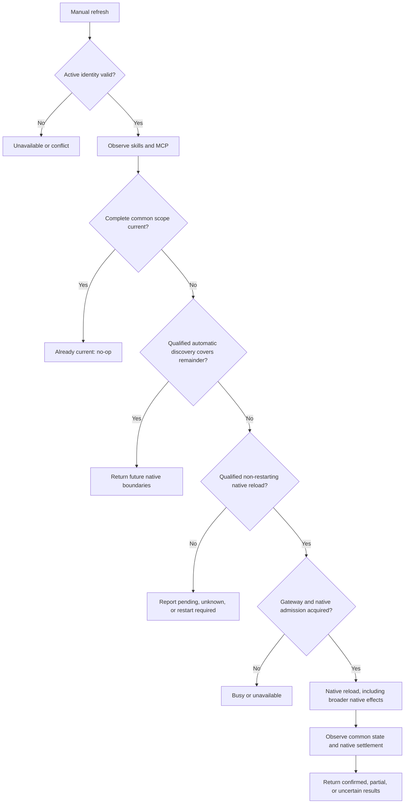

# Design

## Context

See [proposal.md](proposal.md) for the scope of issue #82. The common contract covers skills and MCP, called `common-plugin`. Agent-specific extensions are `native-special-plugin`; their inventory and freshness have no common query API in this change. A native refresh may nevertheless reload those extensions and other native configuration.

DSH is the primary target. The [preflight report](../../../../context/plans/native-agent-home-refresh/preflight.md) and [reusable probes](../../../../scripts/qualification/native_refresh/README.md) contain executed observations for installed DSH 0.2.2-rc.3, Kimi Code 2.6.0, Codex 0.169.0, and Claude Code 2.1.325. The separate PATH DSH rc.1 remains unqualified. Native server or SDK capability does not establish an owned control connection from a maintained Houmao backend.

The existing implementation supplies these integration points:

| Surface | Current Behavior | Consequence |
| --- | --- | --- |
| [Scoped commands](../../../../src/houmao/srv_ctrl/commands/agents/core.py) and [target helpers](../../../../src/houmao/srv_ctrl/commands/managed_agents.py) | Resolve explicit selected agents or the current registered session. Relaunch has additional stopped/degraded recovery authority. | Home, observation, and refresh use ordinary active-agent authority; they do not revive targets. |
| [Runtime lifecycle](../../../../src/houmao/agents/realm_controller/runtime.py) | Relaunch rebuilds a provider-start plan from persisted launch inputs. | Refresh stays outside home construction and manifest-backed generation. |
| [Gateway](../../../../src/houmao/agents/realm_controller/gateway_service.py) | Owns managed prompt/plugin/reminder admission and independent operator controls. | Reuse admission for Houmao-initiated reload, without claiming ownership of native automatic updates. |
| [DSH configuration](../../../../src/houmao/agents/dsh_configuration.py) and [ACP entrypoint](../../../../src/houmao/agents/realm_controller/backends/dsh_acp_entry.py) | Disable HMR and skill watching; ACP preparation reprojects home materials for every invocation. | Separate materialization from consumption and qualify observation/automatic discovery before advertising it. |
| [DSH Web companion](../../../../src/houmao/agents/assets/dsh/managed-web.mjs) | Shares one native session with the browser and supports native maintenance. | Add bound common-plugin observation and non-restarting native refresh. |
| [Passive server](../../../../src/houmao/passive_server/service.py) | Projects typed owning-gateway operations. | Forward state and refresh evidence without another coordinator or inventory store. |

The DSH probes establish both useful refresh behavior and partial native effects. Explicit configuration reconciliation plus a skill-provider resource reload preserved process, session, managed identity, and journal cursor while applying skill/MCP add/update/remove. Broad HMR can apply plugin changes before returning pending host modules; failed replacement can leave the old plugin inactive. Those behaviors require truthful reporting, rather than an all-or-nothing guarantee.

## Goals / Non-Goals

**Goals:**

- Observe the effective skills/MCP state and distinguish current, pending, and unverifiable updates from every writer.
- Accept automatic native refresh independently of Houmao triggers and avoid redundant work when common-plugin state is confirmed current.
- Use the least destructive qualified native method while permitting its normal broader effects.
- Preserve the running agent process and bound conversation; keep restart and launch-material generation in explicit relaunch.
- Deliver positive DSH headless/Web evidence first, then support verified secondary paths on a best-effort basis.

**Non-Goals:**

- Installing/upgrading skills, MCP packages, harnesses, or extensions through a new API.
- Common inventory, version, freshness, or management APIs for native-special-plugin.
- A universal guarantee that native reload affects skills/MCP exclusively or applies all changes atomically.
- Reapplying edited Houmao launch profiles, regenerating prompts, or changing relaunch conversation policy.
- A generic filesystem watcher, desired-revision database, universal native package resolver, or compulsory body upgrade.
- Pi integration, remote ownership/authentication, a refresh queue, or Python gateway-plugin replacement.

## Decisions

### 1. Separate Common Observability From Native Refresh Effects

Classification follows the exposed resource. A native extension can contribute a skill or MCP server whose common view is inspectable without inspecting or managing the extension itself. The common view includes effective skills and MCP declarations/runtime contributions for the bound agent. Houmao gateway plugins remain a separate extension system.

A native reload may reconfigure or replace native-special-plugin and other native resources. Prefer a smaller qualified native operation when useful, but do not reject a working native reload merely because it also reloads extensions. No whitelist whose sole purpose is to prohibit those effects is required.

Assess the common result against skills/MCP evidence. Pending host modules or native-special-plugin changes do not make current common-plugin state stale. A native failure that breaks common resources, disposes the bound agent, or leaves readiness uncertain remains material. Keep safe native operation diagnostics and partial-effect information without claiming an inventory or freshness guarantee for every native extension.

### 2. Preserve Runtime Authority and Current Materialized Inputs

Native-home inspection returns schema version, agent identity, backend/tool, `home_dir`, known `home_env_var`, and captured execution identity. Use active runtime authority, including a valid headless envelope between workers; do not guess from the caller's OS home or project directory. Unknown joined homes, stopped/stale targets, ambiguous references, and external communication-only records fail explicitly.

Observation and refresh use effective native skill/MCP inputs and native precedence, including selected project roots or scoped providers. The home descriptor is an entry point for caller tooling, not a claim that every resource lives directly below that directory. Do not resolve edited Houmao launch profiles or rebuild, repair, reinstall, or restore home material. Home inspection itself reads no secret contents; common observation can inspect the inputs needed for evidence but must never publish raw configuration, credentials, skill bodies, or environment dumps.

Relaunch retains its provider-start projection and stored/default conversation-selection policy. It is not exact continuation by default. Native refresh can reread an existing materialized prompt as a broader effect; Houmao does not generate a new prompt from changed launch inputs.

### 3. Define Freshness Independently From Health and Operation Completion

Use a typed common-plugin observation containing captured identity, observation time/scope, backend/build/mode/profile capabilities, effective inventory coverage, and resource results. Resource details can distinguish skill catalog/body boundaries and MCP declaration/connection/tool evidence; an unsupported detail stays explicit rather than disappearing.

| Freshness | Meaning |
| --- | --- |
| `current` | Evidence establishes that the observed effective input is available under the stated qualified native boundary. |
| `pending` | An observed change is known not to have taken effect at that boundary. |
| `unknown` | Source comparison, runtime evidence, or coverage is insufficient or inconsistent. |

Aggregate common freshness is current only when coverage is complete and every required common component is confirmed current. A known pending component remains visible even when another component is unknown. Authoritatively empty or intentionally disabled resources can be current; an unobservable inventory cannot be assumed empty.

Health and freshness are independent. An MCP declaration can be applied while its endpoint is unreachable. A connected server does not prove its declaration or implementation is current. Native operation completion also remains independent: an acknowledged command or completed native call does not establish resource freshness.

Adapters compare current effective inputs with native applied-state evidence where available. A bounded per-observation comparison or native generation is allowed; a Houmao-managed installation generation or persistent content inventory is not required. Use scope, completeness, and native revisions only where supported, and never invent an installed revision. Do not return hashes derived from credential-bearing configuration. If relevant files or runtime identity change during comparison, invalidate or qualify the observation instead of claiming a stable global snapshot.

For skills, state the next catalog/step/load boundary. Current body availability does not mean an older tool result was rewritten or the model reread instructions already in history. For MCP, distinguish declaration application, tool discovery, and implementation revision. An unchanged command after an external package upgrade is not proof that the existing server subprocess loaded the upgrade; report unknown for unverified implementation freshness.

### 4. Observe First and Permit Native Automatic Updates

The same observation contract applies whether updates came from an editor, native installer, agent tool, or native watcher. Do not require an earlier Houmao refresh receipt or treat native updates outside gateway admission as an error. On-demand observation is sufficient; this change requires no additional filesystem watcher or continuous polling service.

A manual refresh follows this policy:

1. Validate active identity and observe common-plugin state.
2. Return `method=noop`, `outcome=already_current` only when the complete common scope is confirmed current.
3. Prefer qualified automatic discovery when it covers the remaining common resources without a native mutation. Report its future boundary explicitly; do not start a worker, submit a probe turn, or claim that the boundary has already occurred.
4. Otherwise perform a supported native reload under admission, then observe again. Unknown freshness does not prohibit a qualified reload attempt, but it cannot justify an already-current no-op.
5. Preserve partial common results and report known common restart requirements, unsupported paths, or missing evidence without restarting or retrying automatically.

Use `automatic` for a qualified future-boundary result, distinct from an already-current no-op. A headless envelope without a live worker must not claim observed live resources; it can report its qualified next-invocation behavior with the corresponding freshness limitations.



A native-special-plugin update pending restart can coexist with current common-plugin state and a successful common result. Do not translate every native pending-module warning into an aggregate common `restart_required`. Conversely, current skills cannot hide stale or unverifiable MCP coverage.

### 5. Keep Public Reads and Mutation Separate

Maintain the existing route family and add check mode to the scoped CLI:

```sh
houmao-mgr agents single --agent-id <id> home
houmao-mgr agents single --agent-id <id> refresh --check
houmao-mgr agents single --agent-id <id> refresh
houmao-mgr agents self home
houmao-mgr agents self refresh --check
houmao-mgr agents self refresh
```

Single scope uses group-level selectors; self uses current registered-session authority. Root `--print-json` returns the typed descriptor, observation, or action result.

| Method | Route | Meaning |
| --- | --- | --- |
| GET | `/v1/native-home` | Bound native-home descriptor. |
| GET | `/v1/control/refresh` | Common-plugin capabilities, inventory coverage, freshness, health, boundaries, and safe evidence. |
| POST | `/v1/control/refresh` | Observe first, then no-op, automatic discovery, or one bounded native reload. |

GET and `--check` do not initiate invalidation, forced rescans, reload, worker startup, or a provider turn. Native autonomous activity can continue during reads; querying is not a freeze or an update trigger. If a tool's force-rescan API changes its catalog, classify that as refresh rather than disguising it as a read.

POST remains a strict request with only `schema_version` and optional finite bounded `timeout_seconds`. No caller-supplied home/owner override, package source, replacement content, desired revision, arbitrary command, force, or restart field is accepted. Responses include common observations, selected method, common outcome, captured identity, native completion/effects, and safe diagnostics. There is no common native-special-plugin list or freshness field.

A completed observation returns HTTP 200 even when freshness is pending or unknown. POST returns 200 for verified already-current, confirmed common refresh, or qualified automatic coverage; 409 for busy or known common restart requirements; 422 for invalid input; 501 for unsupported control; and 503 for unavailable, failed, partial/unverified, or uncertain execution. Preserve resource results on every typed outcome. Partial native-special effects alone need not fail a confirmed common result when native readiness is valid; safe native diagnostics must retain what happened.

Check mode exits 0 only for confirmed complete common freshness, and nonzero for pending, unknown, or unavailable observation. Refresh exits 0 for already-current, confirmed common refresh, or fully qualified automatic coverage with explicit future boundaries. Other outcomes exit nonzero. Native readiness uncertainty cannot be converted into success because a cached catalog looks current.

The passive server mirrors both reads and POST under `/houmao/agents/{agent_ref}/gateway/`. It forwards typed observations/outcomes without re-evaluating freshness or adding a second coordinator. Missing/unreachable gateway remains 502; typed upstream results retain their status. Align client/proxy HTTP timeouts with the bounded native deadline plus response overhead.

### 6. Preserve One Managed Admission Authority Without Owning Native Watchers

Local home/check operations can use qualified active local authority without starting a gateway. Without live native evidence, local check returns bounded unknown state and capabilities rather than fabricating freshness. Without a gateway, refresh permits qualified no-op/automatic decisions or explicit refusal; mutating reload requires explicit gateway attachment. An attached gateway owns the managed request; refusal never authorizes a direct-control fallback.

For a Houmao-initiated reload, capture identity and reserve admission under the gateway mutex, then release the mutex before bounded native work. Semantic prompts, ordinary plugin dispatch, and reminders observe the reservation. Native admission must also cover browser input and affected child/shared executions. Busy or uncertain boundaries fail immediately; do not interrupt, wait for the caller's own active turn, or queue deferred refresh work.

This reservation governs Houmao-triggered reload and managed admission. It does not claim to intercept every native watcher, installer, browser setting, or external mutation. Use native serialization where available, and report superseded/unknown observations when independent native changes race the operation. Do not disable otherwise qualified native automatic refresh merely to force all changes through Houmao.

### 7. Never Restart the Agent or Promise Atomic Native Application

Refresh does not invoke relaunch, stop/start, process respawn, tmux recreation, cold session activation, or a native exit/restart hook. Internal resource objects, native plugins, or MCP subprocesses can reload under the same running agent and bound conversation.

Qualify the selected native operation so it does not take a known host-exit/restart path. This lifecycle check is separate from examining every pending native-special-plugin change. Native pending/restart diagnostics can follow partial application; preserve those effects rather than describing the whole operation as a refusal that changed nothing. A preflight refusal has no Houmao-initiated effects, but independent native updates can still occur.

If common resources require restart, return their pending results and `restart_required`; leave the existing process running and let the caller choose explicit relaunch. Preserve any already-applied common or broader native effects. A failed import is a failed activation, not proof that restarting would fix invalid files.

### 8. Implement and Qualify DSH First

Split DSH launch/relaunch materialization from ordinary ACP loading. The ACP entrypoint consumes current native material and keeps per-attempt companion/configuration, model overrides, credentials, dispatch guards, and accounting private and transient. It must not reproject saved role/setup snapshots over external edits. Qualify skill and MCP add/update/remove for exact next-invocation continuation, with no worker or model turn started by refresh.

For Web, add common observation and native refresh to the owned companion/client/backend. Qualify source-versus-runtime evidence for skill catalogs and MCP declarations/tool state. A catalog marked complete or an MCP manager marked connected is insufficient alone. Expose unknown where evidence is missing; add bounded companion evidence where the supported native APIs permit it.

Use native maintenance and serialization for manual reload. The tested app-boot configuration path and selected skill-provider resource reload provide one implementation route. Native HMR reconciliation is also eligible when its selected path preserves the agent and conversation; partial application or broader extension reload is not disqualifying. There is no requirement to retain broad HMR disabled. If a launch profile enables it, account for native automatic configuration watches and avoid source-watcher paths that invoke the host exit hook.

Do not add an atomic host-module preflight or protected-native-plugin whitelist merely to prevent allowed native-special effects. Preserve agent identity/control readiness, and report failed activation or uncertain effects honestly. Native `runMaintenance()` can return to idle and wake input in its finalizer, so failure containment must keep unsafe work blocked until settlement without claiming rollback.

Qualify every affected skill provider/native execution rather than generalizing the one-provider probe. Respect native patch precedence: current home/profile patches are reread, while CLI overlays are captured launch data. Masked or frozen input edits must be reported with their scope/limitations rather than as proof that all home files were applied. Edited Houmao profiles remain outside refresh.

Existing hosts receive no in-place companion/profile upgrade through refresh. Obtain new launch-time capability through a separate normal launch/relaunch. An old host reports its actual observation/control limitations.

### 9. Support Other Maintained Agent Bodies on a Best-Effort Basis

Investigate Kimi Code, Codex, and Claude Code by selected version, mode, profile, and actual maintained transport. Implement every qualified automatic discovery, read-only observation, or native reload path available there. Secondary limitations do not block DSH acceptance and do not erase a tool's positively verified resource capabilities.

Kimi's tested server reload is broader than skills/MCP and is permitted as a native mechanism, but a standalone server endpoint does not control an existing managed TUI. Codex's tested MCP reload affects all loaded app-server threads; the old Houmao app-server backend is unmaintained and must not be revived implicitly. Claude's tested skill reload and known-server MCP reconnect do not establish arbitrary declaration reread or an owned input stream for its current headless runner.

Use a native command only through qualified delivery and completion evidence, not as model text. A native setter populated from current native inputs needs qualified parsing/precedence and an owned transport; it is not ruled out solely because it uses an internal setter. No public request accepts replacement definitions. Unknown observation and unsupported control remain explicit where no maintained path can be qualified.

Publish executed positive cases and source-only/unexecuted limits separately. Do not install/upgrade a body or create an unrelated control backend just to turn best-effort support into a universal promise. Pi remains postponed.

### 10. Separate Native Failure From Missing Freshness Evidence

Record safe native completion diagnostics and effects as absent, confirmed, partial, or unknown. Native plugin replacement can stop the old code before failing. Do not claim rollback, restore caller-owned files, or retry a mutation automatically.

A native-special failure alone does not erase confirmed current skills/MCP. Retain its safe diagnostic; common success still requires verified native readiness. If a failure impairs common resources or leaves agent availability/readiness uncertain, return partial, failed, or uncertain results and preserve explicit recovery control.

Keep the native guard while work remains active after caller timeout or response loss. Querying unknown freshness in an otherwise settled healthy runtime does not itself justify indefinite admission blocking; unknown operation settlement/readiness does. Health, state, interruption, and explicit relaunch remain responsive independently of native plugins. Changed execution identity never authorizes starting a replacement or replaying refresh.

## Risks / Trade-offs

- **False already-current results:** stale catalogs, old connected MCP processes, incomplete scope, or unchanged commands can hide updates. Use qualified effective-input/runtime evidence and explicit unknown state.
- **Broad native effects:** native refresh can alter extensions beyond the common view. Preserve native diagnostics and readiness without claiming complete extension freshness or atomic application.
- **Independent native activity:** watchers can apply changes before/during observation. Bound evidence to scope/time/identity; re-observe or qualify superseded state without adding a global mutation coordinator.
- **Nontransactional failure:** native resources may remain inactive after failed replacement. Preserve partial effects and operation guards until readiness is established.
- **Secondary transport gaps:** installed native capabilities may be inaccessible through maintained Houmao controls. Record best-effort limitations and avoid reviving deprecated backends.
- **Headless materialization regressions:** retain transient overrides, credential isolation, exact continuation, and usage tests while removing persistent per-turn rewrites.
- **Relaunch expectations:** restart guidance must preserve existing manifest generation and conversation policy rather than promising automatic exact continuation.

## Migration Plan

1. Add typed common observations, bounded refresh results, active-home resolution, and read-only routing.
2. Split DSH ACP materialization from current-home consumption and qualify exact next-turn discovery.
3. Add DSH Web observation/manual reload and native automatic-update qualification with the existing controlled fixtures.
4. Wire gateway admission, client, scoped CLI, and passive proxy to the same observations and outcomes.
5. Add each verified secondary path and publish per-version/mode/resource evidence, without delaying DSH acceptance for unsupported native facilities.
6. Run cross-surface no-op/automatic/partial/failure scenarios, lifecycle checks, documentation checks, and release gates. Update roadmap/issue completion only after separate implementation acceptance.

Rollback restores application code, not caller-edited home content. Existing native hosts retain their launch-time profile and companion; operators explicitly relaunch when a different capability is needed. No persisted content-generation migration is introduced.
