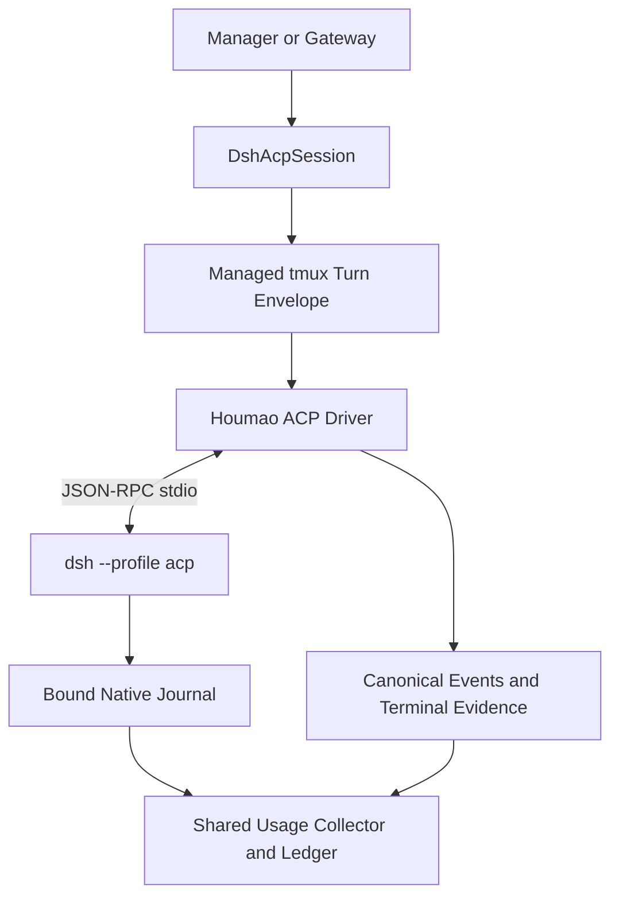

# Design

## Context

See [proposal.md](proposal.md) for motivation and scope. This is the first of two sequential DSH changes; [change 02](../2026-11-17-dsh-02-add-interactive-web-backend/proposal.md) depends on its configuration, prompt, lifecycle, and journal adapters.

The maintained runtime dispatches Claude, Codex, and Kimi headless turns through `HeadlessInteractiveSession`, `HeadlessCliRunner`, a separate capture/render bridge, and a stable tmux window. `codex_app_server` is explicitly blocked at launch and provides no maintained persistent-process pattern to reuse. Tool choices also occur in manager configuration, credentials, model projection, launch-policy registries, runtime schemas, and passive-server headless authorities. Adding a backend literal alone would leave those paths inconsistent.

The gateway's immediate plugin path fences native execution through `HeadlessDispatchControl`. The shared usage service owns immutable records and incremental native-source checkpoints. The existing manifest-preservation regression establishes that capability inspection and gateway lifecycle operations must not overwrite native conversation state saved by another controller.

### Upstream Evidence and Qualification Boundary

The design source reference is DSH commit `39163dd30f703a79079e2d2446545cff3c453738`. Source inspection establishes the following; it is not live-provider qualification:

| Source | Relevant Contract |
| --- | --- |
| [ACP reference](https://github.com/deepseek-ai/deepseek-harness/blob/39163dd30f703a79079e2d2446545cff3c453738/packages/acp/acp/README.md) | Persistent creation, exact resume, cancellation, semantic updates, permissions, and quiescent close; no `session/load` or transcript replay. |
| [ACP session implementation](https://github.com/deepseek-ai/deepseek-harness/blob/39163dd30f703a79079e2d2446545cff3c453738/packages/acp/acp/src/session.ts) | One pending ACP prompt per native session; settlement can span descendants and later root turns; close flushes persistence. |
| [ACP updates](https://github.com/deepseek-ai/deepseek-harness/blob/39163dd30f703a79079e2d2446545cff3c453738/packages/acp/acp/src/updates.ts) | `usage_update` reports context occupancy/capacity, not consumed tokens. Text updates project committed messages rather than raw provider token deltas. |
| [Persistence](https://github.com/deepseek-ai/deepseek-harness/blob/39163dd30f703a79079e2d2446545cff3c453738/packages/session/session-persistence-jsonl/README.md) | Default compression is Zstandard; `compression: none` explicitly supports external JSONL readers. Physical format generations have versioned filenames and headers. |
| [Token usage types](https://github.com/deepseek-ai/deepseek-harness/blob/39163dd30f703a79079e2d2446545cff3c453738/packages/llm/llm/src/types.ts), [exact turn fold](https://github.com/deepseek-ai/deepseek-harness/blob/39163dd30f703a79079e2d2446545cff3c453738/packages/llm/token-meter/src/turn-usage.ts) | Input is uncached input; cache buckets are disjoint; attempts and retry boundaries govern aggregation. |
| [System prompt](https://github.com/deepseek-ai/deepseek-harness/blob/39163dd30f703a79079e2d2446545cff3c453738/packages/core/system-prompt/README.md), [skills](https://github.com/deepseek-ai/deepseek-harness/blob/39163dd30f703a79079e2d2446545cff3c453738/packages/skill/skill-filesystem/README.md) | Literal native sections support `interpolate: false`; skill roots can be selected explicitly with default roots disabled. |
| [DeepSeek transport](https://github.com/deepseek-ai/deepseek-harness/blob/39163dd30f703a79079e2d2446545cff3c453738/packages/llm/llm-deepseek/README.md), [generic adapter](https://github.com/deepseek-ai/deepseek-harness/blob/39163dd30f703a79079e2d2446545cff3c453738/packages/llm/llm-pi-ai/README.md) | The native DeepSeek route uses Messages. Generic compatible routes can explicitly use `openai-completions` through the pi-ai adapter. |

No local DSH source checkout existed during planning. Implementation first prepares an ignored reference at `extern/orphan/deepseek-harness/` at this commit and records the executable version, installation source, and build identity tested against it. An npm/runtime build is not qualified merely because its ACP `agentInfo.version` says `0.0.1`.

## Goals / Non-Goals

**Goals:** Reuse current managed identity and headless execution authority; make native protocol evidence authoritative; keep model transport and tool identity separate; provide reusable DSH configuration, literal role projection, and journal accounting for change 02.

**Non-Goals:** No SDK or one-shot `dsh headless` backend, resident ACP daemon, native terminal parser, mandatory DeepSeek provider, general backend extension framework, automatic prompt resubmission, remote executor, or coordinated resource refresh. The managed profile initially disables autonomous root schedulers/goals; managed descendants inside an admitted ACP interval remain supported when qualified.

## Decisions

### 1. Use a Per-Turn ACP Driver Inside the Headless Envelope

Add `DshAcpSession` as a headless session implementation and a DSH-specific subprocess driver in `src/houmao/agents/realm_controller/backends/`. Factor only the envelope hooks needed to reuse the runner, tmux window 0, dispatch fencing, artifacts, rendering, stop, and recovery. Keep executable probing and policy resolution pointed at the actual `dsh` executable, even when the runner launches a Houmao driver first.

For each explicit turn the driver launches DSH, initializes ACP, creates or resumes the selected exact session, applies explicit model options when requested, submits one prompt, consumes updates until settlement, closes the session, and reaps the process. A later turn resumes the persisted native identity in another process. An invocation lock on the managed session prevents independently resumed controllers from creating overlapping drivers.

A resident server would avoid startup cost but would introduce another local service, IPC ownership, and recovery lifecycle. Reusing the maintained headless envelope is the smaller first integration. The native SDK exposes richer events but lacks per-session cancellation/closure in this revision. The one-shot CLI has a useful JSON projection but does not meet the selected ACP control contract.

### 2. Make DSH Setup a Typed Tool-Specific Input

Add a tool adapter and setup seed under the packaged starter definitions and the maintained fixture seed tree. Parse a DSH-owned setup document into canonical configuration and persist its non-secret resolved form and provenance with the build/launch metadata. It supplies the provider route and adapter/protocol, endpoint reference, explicit model catalog/capabilities, key reference, selected skill roots, MCP/tool entries, and HMR setting. Common `launch.model.name` and `reasoning.level` retain their existing precedence; the DSH mapping policy resolves those values against the selected exact route and qualified reasoning presets.

The native DeepSeek setup uses the Messages adapter and the selected `DEEPSEEK_BASE_URL_ANTHROPIC` reference. A generic self-hosted setup uses a separately declared compatible route, for example the DSH pi-ai adapter's `openai-completions` transport and the existing OpenAI endpoint reference. Never infer Responses, Chat, or Messages compatibility from a shared hostname. Require supplied or qualified capacity/output/reasoning metadata instead of accepting the upstream generic million-token fallback.

Generate `DSH_HOME`, a private `DSH_AGENTS_HOME`, profile patches, an explicit session root with compression disabled, and managed skill roots per agent. Disable implicit user skill roots, account/provider fallback, autonomous root scheduling, and profile HMR in the initial managed composition. Project instructions from the selected working directory remain a documented input. The credential environment includes only the selected route's key and routing variables; failure to resolve them blocks launch before provider fallback can occur.

DSH is externally installed and version-qualified. Product launch never clones upstream, installs npm packages, or downloads a runtime. Development preparation belongs in `tools/dsh/`; it does not become a runtime dependency.

### 3. Ship a Small Native DSH Companion as Product Assets

Place self-contained ECMAScript companion modules and composition templates under `src/houmao/agents/assets/dsh/`, included in wheel and sdist. Load them through the managed DSH profile patch. They use the provided native services and Node built-ins, avoiding a separate TypeScript build or package installation during agent launch. Qualify loading these assets with both the source reference and installed runtime early in implementation.

The initial companion registers the entire effective Houmao role as one ordered native system-prompt section with `interpolate: false`. It preserves DSH's built-in sections and tool schemas. A digest and projection provenance identify the role actually installed. An empty prompt removes stale managed content. No role bytes are passed as chat bootstrap or substituted through DSH's strict persona template grammar.

The companion also exposes minimal safe native admission/identity evidence to the driver through private runtime sidecars. It does not create a prompt queue or another usage ledger. This surface is deliberately narrow so change 02 can add authenticated native Web admission without forking DSH.

### 4. Keep the Connection Reader Independent of Pending Requests

One protocol reader demultiplexes responses, notifications, and server requests; writes are serialized, and pending requests are indexed by connection/request ID and exact native session. Drain stderr concurrently with bounded diagnostics so neither pipe can deadlock a prompt. Persist raw DSH stdout separately from canonical events, and point existing raw-artifact routes at that provider transcript. Console rendering consumes canonical events, never accounting evidence.

The state sequence is `initializing -> selecting_session -> dispatching -> active -> settling -> closing -> terminal`. Persist native session identity as soon as creation succeeds, before sending user input. ACP does not issue an independent accepted receipt: native inbox insertion/claim evidence tied to the driver's exclusive prompt interval establishes handoff. Merely launching the driver or writing a frame cannot call `confirm_handoff()`. A correlated terminal response is also sufficient if no earlier native receipt was available.

Unattended launch applies a qualified no-question permission preset and approval policy before work. Use explicitly configured native grants; deny required external approval when no permitted responder exists. The ACP permission handler stays serviceable while waiting and never bypasses native hard denies. An unsupported elicitation surface fails explicitly rather than hanging. `as_is` headless mode does not invent a browser or operator dialog.

Map normal `end_turn` settlement to completion and `cancelled` to interruption. Other stop reasons retain their exact diagnostic and incomplete/failed meaning. Connection loss, JSON-RPC errors, persistence-flush failures, and cleanup failures remain distinct diagnostics. Native model-request retries remain provider behavior and are accounted as attempts; Houmao never retries the submitted prompt automatically.

### 5. Fence Attempts Through Cancellation and Recovery

Capture managed generation, stable tmux surface, runtime session, attempt ID, exact native session, and process-birth identity at dispatch. Carry existing payload-free dispatch permission into the driver and recheck it immediately before native submission. Revoke abandoned permission, and signal only the captured process tree. The companion's native receipt is bound to that same attempt so stale files cannot authorize a later one.

Translate an explicit interruption to ACP `session/cancel`, keep reading until settlement, and then close/flush. Use a bounded terminate/kill ladder only when that path cannot settle. A controller timeout alone leaves accounting pending while execution remains live. Recovery can observe or reap the original process and reconcile terminal artifacts; it cannot recreate a driver to deliver the old prompt.

DSH owns durable pending input as well as history. During explicit restart/resume, the companion must identify and discard any unclaimed input belonging to an abandoned Houmao attempt through native inbox operations before the resumed loop can wake. It must not replay it or edit journal files. Preserve already claimed history as history. If safe pre-activation reconciliation cannot be established, refuse resume as unreconciled; never start a replacement conversation implicitly. Graceful close normally clears this boundary, but abrupt-death coverage is required.

### 6. Extend the Existing Journal Collector and Ledger

Use `compression: none` for managed DSH session persistence so the Python collector can consume the qualified physical JSONL format without implementing Zstandard recovery or importing a DSH SDK. Validate the header, native identity, selected format generation, and file continuity. Do not hardcode the documentation's example `v3` filename as the current format; the pinned build and fixtures establish the accepted schema.

Record a nonchargeable pre-dispatch boundary. Read `turn/start`, `step/start`, `request/header`/route context, settled `assistant/message` and `assistant/attempt` streams, retry boundaries, and terminal events. Use the attempt's final authoritative provider usage sample; do not add embedded and metadata copies. A separately settled billed retry adds a request. Validate inherited cuts so forked/copied parent evidence does not charge again.

Normalize DSH's disjoint uncached input, cache reads, cache writes, and output. Aggregate input is derived from all verified input buckets; a total is reported or derived only when its required evidence is complete. Reasoning is an output subset when established by the provider. Absent buckets and cost stay unknown; context occupancy stays outside consumed-token metrics. Port the semantics exercised by upstream's exact attempt fold into the DSH usage adapter with independent fixtures, rather than counting every event that happens to contain a token field.

One ACP interval can contain several native root turns. Extend correlation to a verified set/range of native turn identities and request observations while keeping one managed accounting turn ID. The native admission receipt and owned interval establish membership; timestamps alone do not. Read child evidence only when explicit native lineage proves ownership, preserve separate/overlapping scopes, and report unknown inclusion where it cannot be proven. Reuse the existing ledger, checkpoints, finalization cutoffs, immutable records, and accounting recovery. Never invent a second DSH-specific public stream.

### 7. Wire the Entire Maintained Product Path

Extend backend/tool enums, schemas, factories, allowlists, launch overrides, version-policy hooks, model projection, current-session environment, native state, gateway execution adapters, and passive-server headless authorities together. Keep gateway/plugin integration attached to the existing logical agent and exact execution generation. Mailbox transports and CCCC remain independent integrations using the ordinary semantic path.

Use persisted manifest state as authority when a held controller is stale. Verify continuation, capability inspection, gateway attach/detach, recorder recovery, and passive-server restart never restore older native-session fields. Keep native load/fork/delete/transcript replay and terminal keystrokes explicitly unsupported. Publish startup-only resource activation capabilities for later #82 work without claiming coordinated HMR support.

## Risks / Trade-offs

- [Per-turn startup cost] -> Measure startup and resume latency in qualification; retain the existing supervised lifecycle until evidence warrants a resident service.
- [Rapid upstream and journal changes] -> Pin source and executable build, validate protocol capabilities and physical journal headers, and fail or degrade explicitly on unqualified evidence.
- [No ACP acceptance frame] -> Use native admission evidence from the qualified companion; test rejection after helper launch and loss before handoff.
- [Native pending work survives a crash] -> Reconcile only identified abandoned inputs before activation, or refuse continuation. Never treat native persistence as permission to replay a failed request.
- [Partial native output or flush failure] -> Preserve raw and canonical evidence separately, report the actual native and managed outcomes, and keep unknown metrics explicit.
- [Ambient credentials or oversized model defaults] -> Generate isolated roots and explicit route/model metadata, scrub competing environment, and test with deliberately conflicting local state.

## Migration Plan

1. Qualify the pinned executable, companion module loading, ACP lifecycle, literal native role, and physical raw-journal fixtures before widening tool selectors.
2. Add DSH configuration and runtime support behind its explicit tool/backend selection, then wire gateway/passive-server and ledger paths. Existing tools require no compatibility adapters or stored-history migration.
3. Extend `scripts/agents/test-fixtures/`, `tests/fixtures/agent-launch/`, and `skillset/dev/houmao-dev-launch-agents/` with headless DSH instructions. Credentials and live run state remain external; no DSH account import or auth JSON is required for API cases.
4. Publish a reproducible setup guide and scenario-to-evidence acceptance map in normal docs/qualification locations. Run hermetic protocol and managed-runtime tests, the live DeepSeek ACP smoke, and explicitly configured self-hosted qualification where available. A missing self-hosted deployment is a recorded limitation, not a passing lane.
5. Validate and synchronize this change before applying change 02. Keep #74 open until the planned two-change scope is accepted. On rollback stop DSH executions before removing its adapter; preserve homes, native history, and ledger files, and report unsupported retained DSH manifests explicitly rather than reinterpreting them as another backend.
