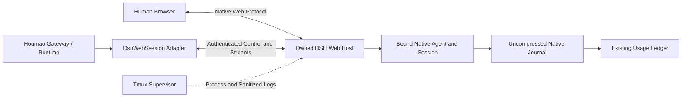

# Design

## Context

See [proposal.md](proposal.md) for the interactive scope. Apply this change only after [change 01](../2026-11-17-dsh-01-add-acp-headless-backend/design.md) is implemented, validated, and synchronized. Reuse its exact tool/build qualification, configuration resolver, native role companion, isolated homes, uncompressed journal reader, and usage ledger integration.

The confirmed interaction contract is `dsh + headless -> dsh_acp` and `dsh + tui/interactive -> dsh_web`. Interactive DSH uses the browser as its native human interface. Human and programmatic input must address one live native session. The implementation must preserve ordinary Houmao immediate-refusal and no-replay behavior.

Current Houmao code equates many interactive paths with `local_interactive`, terminal parser state, tmux pane capture, and terminal-specific gateway metadata. Passive-server observer selection currently treats a tmux session as evidence that a native TUI can be parsed. Web hosts still benefit from tmux supervision, so those implications must be separated rather than worked around by parsing logs.

### Native Web Evidence

Use DSH source reference `39163dd30f703a79079e2d2446545cff3c453738`, as qualified by change 01. Planning inspected these primary interfaces:

| Source | Relevant Behavior |
| --- | --- |
| [Session controller](https://github.com/deepseek-ai/deepseek-harness/blob/39163dd30f703a79079e2d2446545cff3c453738/packages/api/session-controller/README.md), [live-agent resolver](https://github.com/deepseek-ai/deepseek-harness/blob/39163dd30f703a79079e2d2446545cff3c453738/packages/api/session-controller/src/agent.ts) | Browser and API clients resolve the same live agent by native session ID. Ordinary controller calls can automatically resume cold sessions. |
| [Prompt and cancellation commands](https://github.com/deepseek-ai/deepseek-harness/blob/39163dd30f703a79079e2d2446545cff3c453738/packages/api/session-controller/src/commands.ts), [wire types](https://github.com/deepseek-ai/deepseek-harness/blob/39163dd30f703a79079e2d2446545cff3c453738/packages/api/session-controller/src/types.ts) | Prompts explicitly choose `queue` or `steer`; acceptance acknowledges inbox admission. Native cancel targets the active agent and preserves its pending inbox. |
| [API transport](https://github.com/deepseek-ai/deepseek-harness/blob/39163dd30f703a79079e2d2446545cff3c453738/packages/client/connection/README.md), [authentication](https://github.com/deepseek-ai/deepseek-harness/blob/39163dd30f703a79079e2d2446545cff3c453738/packages/host/authentication-token/README.md) | HTTP Remote calls and multiplexed WebSocket streams support non-page clients. `/connect` creates an independently authenticated API Peer. `interactions=none` avoids answering forwarded questions; it is not read-only authorization. |
| [Remote gateway](https://github.com/deepseek-ai/deepseek-harness/blob/39163dd30f703a79079e2d2446545cff3c453738/docs/api-gateway.md) | Generated methods have strict named arguments and Peer/resource authorization. Remote request cancellation and physical connection recovery have separate lifetimes. |

These contracts establish feasibility, but they do not prove Houmao's stricter ordinary admission. Browser/API race tests and native pending-input recovery remain implementation acceptance gates.

## Goals / Non-Goals

**Goals:** Preserve the existing user-facing interactive selection; make the human surface explicit; control and observe the browser's exact live session; admit ordinary input at a verified native boundary; attribute shared activity and usage faithfully.

**Non-Goals:** No production DOM automation, terminal emulation, shared ACP/Web writers to the same conversation, headless-to-Web live switching, adoption of any externally launched Web Host, remote/public Web hosting, browser-draft surveillance, general multi-user authorization, or coordinated HMR. DSH-internal model requests may reach the selected remote provider normally; that is separate from exposing the Web Host remotely.

## Decisions

### 1. Treat Interactive Posture and Native Surface as Separate Concepts

Add backend `dsh_web`. The existing project/profile interactive selection and `--headless/--no-headless` choice resolve through provider capability metadata: DSH chooses Web, while existing interactive providers keep their terminal backends. Do not route DSH through `LocalInteractiveSession` or its parser stack.

Introduce a typed native-surface discriminator for current launch, manifest, registry/discovery, gateway, and managed-state projections. Terminal surfaces retain their real tmux/terminal handle. Web surfaces expose a token-free browser location and exact native session reference. Process supervision has its own fields. The managed-agent transport/detail union gains a Web variant; launch posture may still be called `tui` in fixture and user selections.

For a runtime-owned Web agent, the supervisor's tmux session and primary pane remain useful execution and log authority. They are not the human interface. Terminal capture, parser snapshots, send-keys, terminal history, and TUI timing options return explicit unsupported-capability responses on Web targets. Common prompt, interrupt, status, usage, mailbox, gateway, and relaunch workflows remain semantic operations.

Renaming every existing user selection would create unrelated churn. Pretending the host logs are a terminal UI would fabricate readiness and raw-control support. A surface-aware backend is the direct extension.

### 2. Own One Local Web Host and Bind One Native Session

The first release controls only Web Hosts launched and owned by Houmao. An existing host started manually with `dsh web` remains outside this contract, even when its build and companion protocol are compatible. Adoption through `agents join` or a supplied endpoint returns an explicit unsupported-capability error without installing assets, importing credentials, changing the host, or taking lifecycle ownership. Reconnecting a client or attaching a gateway to an already verified Houmao-owned host preserves its established binding; it does not restart the host or retarget its session. Existing adoption support for other CLI tools does not extend to DSH Web mode.

Implement a `DshWebSession` runtime adapter with a small supervised Web Host process. Start the actual `dsh web --no-open` executable using the shared managed home/profile projection, explicit loopback listener, and the packaged companion. Allocate a port through the actual listener lifecycle and probe the resulting endpoint; do not assume a preflight free-port check reserves a port.

At explicit launch, verify the host's qualified build and companion protocol, create or explicitly restore the selected native session, apply the managed startup policy, and persist the binding before publishing ready authority. Initialization may use the native session controller's creation/resume services because it is an explicit lifecycle operation. Ordinary prompt delivery must not use a resolver that creates or resumes cold sessions.

Bind logical `agent_id` and runtime session to the managed generation, host boot nonce, native session ID, and a native-agent incarnation nonce. The host nonce changes on each process start. The companion assigns an agent nonce by live Agent object identity, so disposal and restoration of the same session ID cannot masquerade as the old body. No new logical agent identifier is derived from the browser URL, port, or session ID.

The human opens the bound session through its verified native browser location. Native navigation to another session does not retarget Houmao. Other native sessions the human creates in that private host remain outside the managed binding and its usage scope. Gateway detach leaves the owned host and browser running; managed stop shuts down the owned host; explicit relaunch can restore exact conversation history under new execution identities.

### 3. Add Authenticated Host-Side Managed Admission

Extend the companion assets from change 01 with a versioned managed-control surface under a dedicated route prefix, such as `/houmao/managed/v1/`. Keep it separate from generated browser Remote descriptors. Register routes through the native WebServer/Connection authorization path, require a live authenticated owner Peer, and bind all operations to the configured managed agent/session. Do not add an anonymous bypass or accept caller-supplied arbitrary process endpoints.

The internal surface supports capability/identity description, native state/observation, prompt admission, read-only receipt inspection, and interruption. A prompt carries a unique operation/input ID, captured execution identities, deadline, admission policy, and text. Receipt records contain input/turn identity and outcome metadata, never a retained prompt body to execute later.

For ordinary `ready_only` input:

1. Authenticate and validate the request and prepare any required native content without mutating the inbox.
2. Recheck its deadline and caller cancellation after preparation. Resolve only the exact live Agent already bound to the expected host and generation.
3. Claim the provider's true idle boundary, including absence of an active driver or maintenance task. The native Agent's qualified `runMaintenance` seam or equivalent synchronous idle claim is preferable to trusting its public `status` alone.
4. Verify no native pending input, interaction wait, conflicting admitted operation, or other qualified foreground activity. Unknown facts refuse admission.
5. Insert the identified native input and establish its admission receipt within that same synchronous native boundary, then release the claim. There is no intervening `await` between the final checks and native insertion.

This atomicity covers the check and handoff, not ownership of the entire future conversation. A browser request handled first makes the program's ready-only attempt fail. If the program wins, the human remains free to queue, steer, or cancel through native controls afterward. Do not lock the browser out for the duration of an automated task.

Calling the stock `session/prompt` endpoint after a Python readiness check is insufficient: that endpoint can queue into busy work or automatically resume a dead native Agent. The packaged host companion supplies the missing conditional native handoff without an upstream fork.

### 4. Preserve Explicit Operator Policies Without Weakening Ordinary Delivery

Use the following native mappings in the host companion:

| Policy | Native Preconditions | Input Behavior |
| --- | --- | --- |
| `ready_only` | Exact live incarnation, true idle, unblocked, empty native inbox, open core admission | Insert ordinary input into the newly admitted turn. |
| `if_no_pending` | Exact live incarnation, unblocked, empty native inbox; active work permitted | Explicitly queue a next-turn input. |
| `always` | Exact live incarnation and structural availability; readiness and pending checks bypassed | Explicitly queue input despite current activity or pending work. |

Only explicit operator direct-prompt calls may select the latter two policies. Ordinary plugin/message events, mail wakeups, and CCCC chat use ready-only admission. Their refusal creates neither a gateway queued request nor a native deferred input. Explicit operator queues remain native durable inputs by the operator's choice, not delivery retry state. Native browser queue/steer behavior remains available and visible. Preserve the ready-only precondition for explicit new-conversation reset.

Keep existing terminal policy semantics and their observational race contract unchanged. Web performs a stronger native check because it has a structured in-process handoff. Reject unsupported selectors and incompatible reset/policy combinations before side effects. Never infer provider pending-input state from Houmao's own queue or from browser-local editor drafts.

### 5. Use Independent API Credentials and Preserve Human Participation

Connect through the native `/connect` exchange using a private local credential channel. Keep the adapter's cookie jar and API Peer independent of the browser session. The default API connection requests `interactions=none`; human questions and approvals stay with the browser in `as_is` mode. That flag does not restrict writes, so native authentication and the companion's owner/session checks remain mandatory.

Capture token-bearing native startup output only in private supervisor state and redact it from ordinary console/status logs. Public launch and registry metadata contain the token-free origin/session location and credential reference only. Opening or signing into the browser is an explicit local operator action that consumes the private native sign-in mechanism. Neither launch tokens, cookies, signed URLs, API keys, nor credential-bearing headers enter tracked docs, acceptance reports, usage responses, or generic state output.

An expired/revoked API credential makes programmatic control unavailable without stopping a healthy browser-owned session. A new verified connection may resume observation. Disconnection or credential renewal is never authority to resend input. Remote binding, advertised public addresses, proxies/TLS deployment, and non-owner policies remain #84 work.

Apply startup permissions once according to the selected operator policy. In `as_is`, do not reapply unattended defaults or birth-time model choices on status, reconnect, or later prompts. Native human model/permission changes remain authoritative until the operator explicitly requests another supported change. The shared configuration still records launch provenance separately from live native state.

### 6. Observe Native State and Correlate Shared Activity

Use the host's structured session/state, history/follow, projection, and native interaction data, plus companion incarnation/admission evidence. Establish a baseline and native sequence watermark before following updates. Reconcile sequence gaps with bounded read-only native history and use a fresh state/identity snapshot after connection replacement. Do not fall back to DOM scraping or supervisory console parsing.

Common state reports readiness, active/last native turn, pending inbox, interaction wait, connectivity, and freshness. Host process health, authenticated control, native Agent liveness, and ordinary admission are separate facts. A browser-local unsubmitted draft is not visible native input; editing-input fields are unavailable/not applicable rather than invented. Native approval waits close ordinary admission while leaving gateway health intact.

Add Web-specific gateway state/history endpoints, for example `/v1/control/web/state` and `/v1/control/web/history`, and a Web detail variant under the existing managed-agent namespace. The passive server chooses observers by native surface. It can use a verified live gateway source or safe direct Web observation; stale or unauthenticated state produces unavailable semantics, never persistent idle readiness. Terminal-only detail and history shapes remain terminal-specific.

An admission receipt identifies the native input, not its result. Associate the input with a native turn when its durable inbox claim/user-message evidence appears. Subsequent turn results and assistant events retain those native identities. Human steering can contribute to the same turn; later human follow-ups can run before a broad wait-for-idle completes. Report mixed activity and native boundaries instead of assigning the next assistant message or the entire wait interval exclusively to the programmatic prompt.

### 7. Make Interruption and Failure Incarnation-Aware

An explicit operator interrupt captures the current host/agent incarnation and native active-turn identity. The host rechecks that target at the cancellation boundary; replacement or a different current turn returns conflict instead of cancelling unrelated work. The operator may intentionally interrupt human-started work, and both clients observe the same native outcome.

Request abandonment is narrower. Cancel or remove only the native input/activity proven to belong to that attempt. If it is no longer the active turn, never cancel a later human turn. The stock cancellation operation preserves inbox contents, so expose the retained pending work and do not claim a cleared session unless native evidence establishes it.

Transport loss before a known receipt or terminal result returns uncertainty; read-only receipt/history reconciliation may discover what occurred. Reconnection never retries the mutation. Native receipt and terminal evidence are stored to support inspection and accounting, not later execution. Host/agent replacement fails affected pending operations and invalidates their dispatch permissions. A handoff acknowledgement already returned is not a promise of successful task completion.

Explicit relaunch first reconciles abandoned Houmao input using the pre-activation boundary established in change 01. Remove only verified unclaimed input from failed ordinary delivery; preserve unrelated human input and explicitly accepted operator queues. Native history already claimed remains history. If the companion cannot safely distinguish pending owners or prevent activation before reconciliation, keep the agent unavailable and require explicit reconciliation rather than replaying input. Do not modify journal files directly.

### 8. Reuse One Accounting Stream Across Human and Managed Work

Keep the bound raw native journal from change 01 as the authoritative consumption source. Web API events may supply identity/lifecycle evidence or a duplicate view of the same native requests, not another additive usage stream. Account only the bound native session and verified child lineage, with the established nonchargeable attachment boundary and inherited-history rules.

Human-started turns produce native-observed records when their terminal native identity is proven. Managed admissions correlate through native input identity and turn claims. A mixed-input native turn contributes once; no token-per-author split is inferred. Distinct later human turns do not become managed charges merely because they ran before a wait returned. Resolve managed/native association before finalization or explicitly report incomplete association, preserving the immutable-record contract.

Model and provider attribution comes from each actual native request, including changes made in the Web UI. Gateway restart, API event replay, and explicit host relaunch preserve accounting identities and continuity. Host incarnation is execution provenance, not a reason to recharge earlier journal entries.

### 9. Qualify the Real Web Interface Alongside the API

Extend the current fixture helper's `mode=tui` lane for DSH to start Web mode using the same case/model/protocol resolution as headless. Preserve unattended defaults in automated fixtures; use an explicitly selected `as_is` lane for human-question coexistence. The generic `cloud-api` case needs only the local DeepSeek key/endpoint/model; no self-hosted model or DSH auth JSON is required.

Use Playwright through the existing Bun toolchain for browser tests. Hermetic integration runs a qualified DSH host with a controlled model and synthetic credentials, drives native browser input, and controls the same session through the API adapter. Test both orders of the human/program admission race, browser questions, native pending input, cancellation before/after turn replacement, lost responses, revoked connections, host/agent restart, preserved model changes, and human/managed usage deduplication. Separate real DeepSeek smoke evidence from these deterministic checks. A supervisor log capture alone does not qualify interactive behavior.

## Risks / Trade-offs

- [Upstream Web Remote contracts change] -> Reuse the pinned source/build, validate the companion protocol and native wire descriptors, and qualify updates explicitly.
- [A client-side readiness check races a browser prompt] -> Perform final admission at a true native idle boundary after preparation; include deterministic race tests.
- [Native automatic cold resume violates ordinary delivery] -> Mutations require exact live Agent identity and never call a create/resume resolver; lifecycle restoration is explicit.
- [Shared work weakens per-prompt ownership] -> Correlate input IDs and native claims, expose mixed activity, and cancel only the captured native turn or proven attempt.
- [Credentials appear in native startup logs] -> Supervise and filter process output, isolate private credentials, and audit public status, artifacts, browser reports, and packaged examples.
- [HMR replaces authority during work] -> Keep managed HMR disabled by default, invalidate incarnations on native replacement, and defer coordinated refresh to #82.
- [Browser-created sessions or drafts are mistaken for the managed agent] -> Bind one explicit native session and report only server-observable facts.

## Migration Plan

1. Confirm change 01 is implemented, accepted, and synchronized; rerun its focused regression suite against the same pinned build before extending assets.
2. Add typed Web surfaces and companion conformance tests, then the supervised Web backend, native conditional admission, authenticated client, and shared observation. Rebuild current schemas directly; no compatibility facade should pretend Web is a terminal.
3. Wire gateway and passive-server semantic paths and Web detail/history, preserving terminal-provider regressions. Update manager, launch profiles, fixture docs, and `skillset/dev/houmao-dev-launch-agents/` with token-safe browser entry and mixed-control instructions.
4. Complete hermetic browser/API acceptance and real DeepSeek Web smoke, including human-origin usage, failure after admission, native pending-input recovery, and two isolated hosts. Record credentials/prerequisites as references, not values.
5. Run required code, distribution, documentation, and OpenSpec checks. Mark #74 complete only when the acceptance maps for both sequential changes pass. On rollback stop the owned Web hosts, preserve their homes/history/usage, and report the uninstalled Web backend explicitly; never silently convert a live Web agent to ACP.
