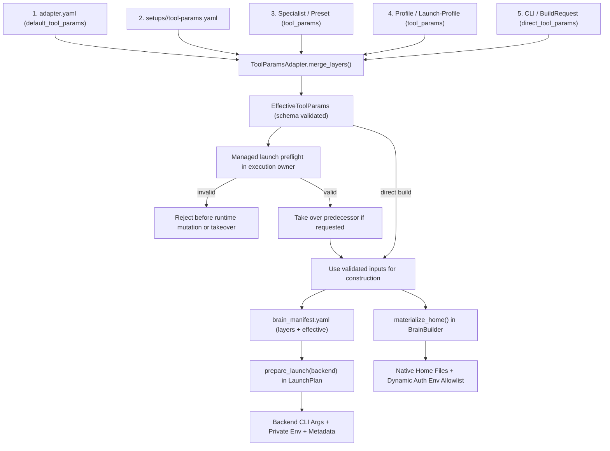

# Design

## Context

See `proposal.md` for motivation and `specs/` for normative behavioral contracts. Across Houmao's configuration pipeline (`adapter.yaml`, `setups/`, `Specialist`/`Preset`, `LaunchProfile`, `BuildRequest`, `BrainManifest`, and `LaunchPlan`), cross-tool concepts (`model`, `reasoning.level`, `operator_prompt_mode`, `env`, `skills`, `mailbox`) have uniform first-class fields, whereas CLI-specific configuration was split between two incompatible mechanisms:
1. `src/houmao/agents/launch_overrides/{models,resolver}.py` restricted `tool_params` to `ToolParamValueType = Literal["boolean"]` translated exclusively to flat CLI `args` via `adapter.yaml` `launch.metadata.tool_params` (`claude.include_partial_messages` is the sole user in the repository), and omitted `tool_params` from `Specialist` and `LaunchProfile` altogether.
2. `tools/<tool>/setups/<name>/` stored unindexed raw directories on disk (`settings.json` for Claude, `config.toml` for Codex, and a bespoke Python-only `dsh-setup.yaml` file for DSH), while `src/houmao/srv_ctrl/commands/project_tools.py` omitted `dsh` from `project agents tools`.

Because each CLI consumes settings through different native mechanisms (CLI flags, `settings.json`, `config.toml` plus `-c` overrides, or Cordis JSON patches plus ACP session options), Houmao should standardize **where `tool_params` lives and how layers compose**, while letting each tool's Python adapter own **validation and launch materialization**.

## Goals / Non-Goals

**Goals:**
- Introduce `src/houmao/agents/tool_params/` with a typed `ToolParamsAdapter[PartialT, EffectiveT]` protocol and per-tool registry (`claude`, `codex`, `kimi`, `dsh`).
- Support `tool_params` uniformly across all five configuration layers: (1) `adapter.yaml` `launch.default_tool_params`, (2) optional `<setup>/tool-params.yaml`, (3) `Specialist` / `Preset`, (4) `Profile` / `LaunchProfile`, and (5) one-shot CLI / `BuildRequest` overrides.
- Retire `adapter.yaml` `launch.metadata.tool_params`, `launch.overrides.tool_params`, and DSH's standalone `dsh-setup.yaml` / `selected_model` format cleanly without legacy compatibility shims.
- Preserve between-turn native-home continuity (`native_refresh.py`) by materializing `<DSH_HOME>/houmao-tool-params.yaml` alongside `<DSH_HOME>/houmao-profile.patch.json`.
- Expose consistent `--tool-params <json-or-@path>` and `--clear-tool-params` options across `houmao-mgr` authoring and launch commands, plus `dsh` in `project agents tools`.
- Validate effective managed launches in the execution owner before creating runtime state, stopping a predecessor, or modifying its home.
- Persist DSH MCP header and environment references and resolve their values from the selected private credential bundle for native invocation.

**Non-Goals:**
- Expanding `CodexToolParams` or `KimiToolParams` beyond strict extensible baseline schemas in this change (existing Codex and Kimi `config.toml` / env workflows stay intact).
- Upgrading DSH's `pi-ai` wire compatibility, three-layer `reasoning_efforts` ladder, unattended `permission` preset composition, or ACP/Web error redaction in this change (those land immediately on top in stacked change `align-dsh-native-configuration`).

## Decisions

### Decision 1: Per-Tool Python `ToolParamsAdapter` Protocol Instead of Declarative YAML Projection

Create `src/houmao/agents/tool_params/` containing `base.py`, `registry.py`, `claude.py`, `codex.py`, `kimi.py`, and `dsh.py`. Each registered tool adapter implements a typed Python interface backed by `pydantic` v2 models (`ConfigDict(extra="forbid")`, no `m_` prefix on Pydantic data models per `AGENTS.md`):



Core adapter responsibilities:
- `parse_partial(raw: Mapping[str, Any], *, source: str) -> PartialT` validates each layer against its strict schema. Credential-bearing fields use typed references. Validation diagnostics expose the source layer, schema field path, and a safe reason.
- `merge_layers(layers: Sequence[tuple[str, PartialT]]) -> EffectiveT`: merges partial models in layer order using Pydantic `model_fields_set` so omitted fields inherit from lower layers, explicit `null` values in `model_fields_set` clear or set `None`, and keyed entity lists (`models` by `id`, `mcp_servers` by `name`) patch matching items or append new ones deterministically.
- `extract_model_baseline(effective: EffectiveT, *, home_path: Path, auth_env: Mapping[str, str]) -> ModelConfig | None`: supplies tool-native baseline model defaults when no higher layer sets `model.name` (for DSH, returns `ModelConfig(name=effective.models[0].id)` when `effective.models` has exactly one model, and `None` when multiple models require explicit `model.name`).
- `materialize_home(effective: EffectiveT, context: HomeMaterializationContext) -> HomeMaterializationResult`: writes tool-owned files inside `home_path`, contributes setup-referenced env names to `selected_env_names`, and returns secret-free construction provenance.
- A read-only launch check validates the effective parameters against the selected backend and model, verifies credential references against the selected bundle, and checks projected args against `_RESERVED_ARGS_BY_BACKEND`. Managed launch uses the check before mutation. Direct brain construction validates the effective schema and defers backend applicability until a backend is selected.
- `prepare_launch(effective: EffectiveT, context: LaunchPreparationContext) -> LaunchPreparationResult` applies the validated parameters to backend-specific CLI args, private environment, and runtime metadata.

*Alternatives considered*:
- **Extending `adapter.yaml` `launch.metadata.tool_params` with `string`, `int`, `object`, and file-template rules**: Rejected because re-implementing schema validation, conditional TOML/JSON/Cordis patching, and per-backend branching in YAML duplicates Python and Pydantic poorly.

### Decision 2: Five-Layer `tool_params` Storage, CLI Input Parsing, and SQLite Catalog Persistence

1. **Uniform CLI Input Loader (`parse_tool_params_cli_input`)**:
   - Accepts either inline JSON (`'{"include_partial_messages": true}'`) or `@<path>` pointing to a UTF-8 `.yaml`, `.yml`, or `.json` mapping file, parsed safely via `yaml.safe_load` / `json.loads` without shell evaluation.
2. **SQLite Catalog & Compatibility Projections (`src/houmao/project/catalog.py`)**:
   - **Presets / Specialists**: store validated `tool_params` inside `presets.launch_payload["tool_params"]` (or dedicated JSON column) and project top-level `tool_params:` into `.houmao/agents/presets/<name>.yaml`. Reject legacy `launch.overrides.tool_params` in `definition_parser.py`.
   - **Launch Profiles (`easy_profile` and `launch_profile`)**: add `tool_params_payload TEXT NOT NULL DEFAULT '{}'` to `launch_profiles` in `catalog.py` (including an idempotent `ALTER TABLE` check for existing project catalogs) and project top-level `tool_params:` into `.houmao/agents/launch-profiles/<name>.yaml`.
   - **Mutation semantics**: on `specialist set`, `presets set`, `profile set`, and `launch-dossiers set`, `--tool-params` deep-merges against existing stored `PartialT` via the tool adapter's partial merger; `--clear-tool-params` resets stored `tool_params` to `{}`; same-lane `create --yes` / `add --yes` replacement clears omitted `tool_params`.
3. **Setup Seed Layer (`tools/<tool>/setups/<name>/tool-params.yaml`)**:
   - When `_copy_directory_contents(setup_dir, setup_destination)` runs in `BrainBuilder`, exclude `tool-params.yaml` (and `README.md` if appropriate, or keep existing README behavior while excluding `tool-params.yaml`) from raw native file copying; instead, parse `<setup_dir>/tool-params.yaml` as Layer 2 `PartialT`. Reject legacy `dsh-setup.yaml` with an actionable error pointing to `tool-params.yaml` / `tool_params`.

### Decision 3: Initial Adapter Implementations Across the Four Tools

- **`ClaudeToolParamsAdapter` (`claude.py`)**:
  - `PartialClaudeToolParams` / `EffectiveClaudeToolParams`: `include_partial_messages: bool = False`.
  - `materialize_home`: no extra files (preserves `setups/default/settings.json`).
  - `prepare_launch`: when `include_partial_messages` is `True`, appends `("--include-partial-messages",)` on `claude_headless` and raises `ValueError` on backends that do not support `include_partial_messages` (matching existing `recipe-launch-overrides` behavior).
- **`CodexToolParamsAdapter` (`codex.py`) & `KimiToolParamsAdapter` (`kimi.py`)**:
  - Strict empty `ConfigDict(extra="forbid")` Pydantic models in this refactor; existing `config.toml` and env projections in `brain_builder.py` / `launch_plan.py` remain untouched so Codex and Kimi suites suffer zero churn while gaining the adapter hook for future tool-specific fields.
- **`DshToolParamsAdapter` (`dsh.py` delegating to refactored `dsh_configuration.py`)**:
  - Lifts DSH's `provider`, `models`, `skill_roots`, and `mcp_servers` into `DshPartialToolParams` / `DshEffectiveToolParams`, removing `version` and `selected_model` (model selection now flows exclusively through Houmao's `model.name`, defaulting to `models[0].id` when `models` has a single entry).
  - Starter setups `tools/dsh/setups/default/tool-params.yaml` and `tools/dsh/setups/openai-compatible/tool-params.yaml` provide Layer 2 `provider` defaults (`deepseek/messages` and `pi-ai/openai-completions`), so a specialist or profile only needs to supply `tool_params.models` (and any `provider` overrides)!
  - `materialize_home()` writes `<DSH_HOME>/houmao-tool-params.yaml` (`0600`) and `<DSH_HOME>/houmao-profile.patch.json` (`0600`), keeping `load_dsh_home()` and `native_refresh.py` reading materialized `<DSH_HOME>/houmao-tool-params.yaml` between turns without touching stored profiles.

### Decision 4: Validate Managed Launch Before Runtime Mutation

After resolving the launch source in the execution owner, merge the five layers, resolve the backend and effective model, and validate the credential binding and backend behavior. Read referenced files in that owner's context, including `--tool-params @<path>` for delegated launches. This preflight runs before allocating or modifying runtime state and before either force mode stops the predecessor or cleans up its artifacts.

Pass the same validated inputs and layer provenance into brain construction and launch planning. Materialization uses this configuration without re-reading authoring layers after takeover. The resolved configuration keeps credential references and binding information. Native invocation resolves the values privately from that binding.

### Decision 5: Persist References for DSH MCP Values

DSH `mcp_servers[].headers[]` and `mcp_servers[].env[]` entries use `name` and `env_ref`. Each `env_ref` names a value in the selected owner-private credential bundle and resolves to the complete header or environment value. Command arguments and URLs carry non-secret connection parameters.

```yaml
mcp_servers:
  - name: audit
    type: http
    url: https://mcp.example.test/audit
    headers:
      - name: Authorization
        env_ref: AUDIT_MCP_AUTH
```

Validate the reference shape and required binding before runtime mutation. Resolve the values for the supported native invocation using the selected bundle, including when ACP reads current materialized MCP declarations between turns. Project each resolved value only into its declared MCP header or environment entry. Catalog rows, YAML projections, the brain manifest, and generated home configuration store references. Credential inspection omits MCP values, and bundle updates preserve referenced values outside the fields being changed.

Reject literal header or environment values before persisting a layer. Report the source and field path for malformed or missing references, with value-free errors at authoring, build, and launch boundaries.

## Risks / Trade-offs

- **[Breaking removal of `dsh-setup.yaml` and `launch.overrides.tool_params`]** -> All starter templates, `plain-agent-def` fixtures, `scripts/agents/test-fixtures/`, and unit/integration tests are updated atomically, and parsers emit explicit migration errors naming `tool_params` and `tool-params.yaml`.
- **[Existing SQLite `.houmao/catalog.db` overlays missing `tool_params_payload`]** -> Add a lightweight column-presence check in `ProjectCatalog` initialization so pre-existing local overlays gain `tool_params_payload TEXT NOT NULL DEFAULT '{}'` cleanly without manual database deletion.
- **[Separation between `refactor-per-tool-params-pipeline` and `align-dsh-native-configuration`]** -> Keeping Change 1 focused on the cross-config `tool_params` pipeline + structural lift of DSH/Claude ensures every architectural layer (`catalog`, `CLI`, `BrainBuilder`, `LaunchPlan`) is verified independently before Change 2 expands `DshToolParams` with `pi-ai` `compat`, `reasoning_efforts`, unattended `permission` presets, and error redaction.

## Migration Plan

1. Create `src/houmao/agents/tool_params/` (`base.py`, `registry.py`, `claude.py`, `codex.py`, `kimi.py`, `dsh.py`) and refactor `src/houmao/agents/launch_overrides/` + `starter_agents/tools/*/adapter.yaml` to remove `launch.metadata.tool_params`.
2. Wire `tool_params` through `definition_parser.py`, `project/catalog.py`, `project/launch_profiles.py`, `project/agent_definitions.py`, `brain_builder.py`, `model_mapping_policy.py`, `launch_plan.py`, and `native_refresh.py`. Run the shared launch check in the execution owner before force takeover and pass the validated inputs to the builder.
3. Add `--tool-params` / `--clear-tool-params` to `houmao-mgr` commands (`project_easy.py`, `project_definitions.py`, `project_launch_profiles.py`, `brains.py`, `managed_agents.py`) and add `dsh` to `project_tools.py`.
4. Migrate starter DSH setups, `tests/fixtures/`, `scripts/agents/test-fixtures/`, unit tests, integration tests, and CLI/build docs from `dsh-setup.yaml` and `launch.overrides.tool_params` to `tool_params` / `tool-params.yaml`. Provision MCP secrets in the selected private bundle and replace literal header and environment values with references.
