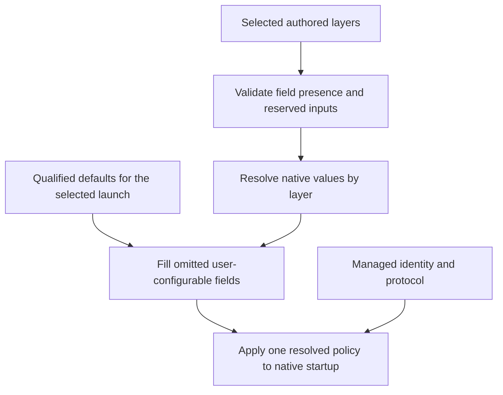

# Design

## Context

[The proposal](proposal.md) defines the policy change. `ToolParamsAdapter` already merges partial layers with field presence intact. `brain_builder.py` records both the authored layers and the effective mapping. The versioned launch-policy engine subsequently mutates the managed home and argument list. Codex app-server and Kimi ACP also apply permission settings when binding a native thread or session. DSH generates a profile that must agree with its selected native permission preset. The self-status commands currently resolve their target through a runtime resume that refreshes gateway capability and the registry.

## Goals / Non-Goals

**Goals**

- Resolve native settings once for provider start, with deterministic precedence and field-specific validation.
- Preserve operator-authored values and project the resolved values at each native startup boundary.
- Make self-status independent from registry publication while retaining manifest-first discovery and signed gateway access.

**Non-Goals**

The selected execution owner and native administrative policies define the permission ceiling. Provider startup establishes the initial policy. Live human changes use the established native session controls.

## Decisions

### Resolve Field Presence Before Materialization

Keep the five existing typed layers. For permissions with a qualified native setup-file representation, import the supported keys into the setup layer ahead of its `tool-params.yaml`. Normalize recognized permission aliases from the selected managed raw argument override at the layer where the argument came from. Use the typed value when both forms supply the same field in one layer. The existing argument-section selection still determines which raw overrides participate.

Use the validated partial mappings or their persisted `launch_contract.tool_params.layers` to distinguish omission from explicit values. Select versioned defaults for gaps only after the tool, run mode, backend, and detected version are known. Keep secret-free effective value and source data in existing launch provenance or diagnostics. Treat an earlier generated runtime projection as output of that generation. Ordinary headless calls keep the established behavior of consuming materialized native inputs at the tool's existing read boundary.

Deducing authorship from the final file would confuse generated fallback values with explicit configuration. The saved partial layers give provider start and explicit relaunch the same inputs, including when a managed home is reused. Rebuild or update the affected projection keys from those inputs and the selected native baseline, preserving unrelated setup, credentials, and native history.

### Reserve the Fields Required by Managed Control

Separate the strategy's declared writable runtime paths from the fields requiring exclusive runtime ownership. Associate each reservation with the selected backend and the invariant it protects. Examples include the private service endpoint, the output protocol, the provider continuation selector derived from a verified session, and DSH's startup-only configuration boundary. Authoring validation can catch tool-wide reservations. Launch preflight checks the backend-dependent ones after selecting the owner and backend.

Check authored presence before merge discards lower-layer values. Recognize equivalent supported flag and config representations for reserved fields. A supplied field produces an error identifying the setting, its origin, the backend, and the supported Houmao control where one exists. Derive reserved values independently from the permission-default logic. This lets preflight reject an invalid request before a force takeover stops its predecessor.

DSH currently accepts `hmr: false` while always disabling HMR in the managed native profile. Reserve `hmr` to protect the managed activation boundary. Remove it from authored examples and packaged starter settings. Previously generated effective values are runtime output and can be distinguished through the recorded authoring layers.

### Project the Resolved Permissions at Native Boundaries

Expose typed provider-specific fields through the existing adapters. Use Claude and Kimi `permission_mode`, Codex `approval_policy` and `sandbox_mode`, and DSH `permissions.sandbox` and `permissions.approval`. Validate values against the tool and actual selected native path. Preserve authored provider rules and qualify supported values for the detected version.

| Provider | Defaults for Omitted Unattended Settings | Projection |
| --- | --- | --- |
| Claude | Qualified bypass-permissions mode | Project the resolved permission mode through the private home and the native start option. Apply startup-only warning suppression when appropriate for that mode. |
| Codex | `danger-full-access` and `never` | Use the resolved home config and final CLI overrides for CLI modes. Use the same values for app-server thread start or resume and verify the returned policy. |
| Kimi | Native `auto` | Apply the resolved mode through qualified TUI or service/Web startup inputs. Verify the selected mode at session binding when the API exposes it. Native `-p` selects `auto`. Reject incompatible authored settings before invocation. |
| DSH | `danger-full-access` and `never` | Generate the sandbox and approval fragments and select a matching permission preset from the same resolved pair for headless, ACP, and Web. |

An explicit permission value can limit authority or request interactive approval. Existing native hard denials and backend interaction behavior determine what happens when the tool asks for human input. A known unsupported combination fails preflight. A backend that can verify its permission state at startup reports a mismatch before publishing readiness.

DSH has two native owners of the permission configuration. Its sandbox and approval services provide the composed defaults, and its permission-presets service selects the initial preset. Emit a consistent pair and preset in the private profile. For example, an override of only `workspace-write` combines with the unattended `never` default in the selected preset. With `as_is`, derive only the projection needed for supplied fields against the qualified native baseline.

### Observe the Current Session Without Publication

Reuse the existing read-only runtime reconstruction for `agents self state` and `agents self mail status`. Select it explicitly during manifest-first target resolution. Carry that observation intent through downstream status helpers so they can read existing gateway and runtime artifacts, use an already-authorized signed gateway client, or return local mailbox channel status from the persisted binding. Session validation remains tied to the current managed generation.

The registry heartbeat and gateway capability publication belong to their existing lifecycle owners. A valid target can be observed under a workspace-restricted sandbox with the registry outside the workspace, regardless of the agent's permitted write radius. In the attached case, the gateway applies its usual authorization. A detached session can report local mailbox status with channel availability.

## Risks / Trade-offs

- [Broader DSH defaults] → Document `workspace-write` as the explicit way to retain the former workspace boundary. Verify both the default and the restricted override in isolated managed homes.
- [Native configuration can differ by version or entrypoint] → Use the existing versioned strategy and preflight boundaries. Cover fresh starts and exact relaunches, including Kimi's forced native headless mode and saved interactive permission state.
- [A generated default can appear in a reused home] → Resolve defaults from the saved authoring inputs and use source information to distinguish them from runtime projections.
- [A state helper can invoke a mutation after target lookup] → Verify self-status end to end with registry writes denied and instrument both gateway publication and registry lock acquisition in focused tests.

## Migration Plan

To retain the previous DSH workspace boundary, set `permissions.sandbox` to `workspace-write` in the setup's `tool-params.yaml` or under `tool_params` in the specialist or launch profile. An unattended launch still fills omitted approval with `never`. Remove authored `hmr` values and use Houmao's native-home refresh and relaunch controls. Apply the settings at the next supported provider start. An explicit `permissions.approval` value of `never` records the previous paired default independently of prompt mode.
