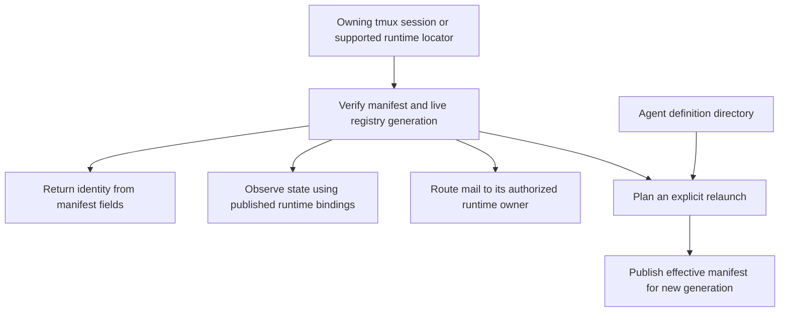

# Design

## Context

See [proposal.md](proposal.md) for the failure observed in the Web mailbox campaign. `agents self identity`, state, and mail share a target resolver in `srv_ctrl/commands/managed_agents.py` and `agents/gateway.py`. It resumes a `RuntimeSessionController` before returning a target. `realm_controller/runtime.py` loads the role package during that resume, even in read-only mode. The attached gateway client already has a manifest-path entry point in `gateway_access_runtime.py`.

## Goals / Non-Goals

The boundary covers local managed-agent self queries and the live runtime paths they use, including the notifier mailbox round and shared gateway binding. Agent identity, effective configuration, and resource locators come from the committed runtime manifest. Observable state continues to come from the verified runtime sources identified there. The maintained operation and result contracts govern output, freshness, authorization, and exit status.

## Decisions

### Verify the Manifest Before Dispatch

Separate current-session discovery from controller construction. Find the manifest through the owning tmux session or an already supported runtime-owned locator. Check the socket and session for tmux-backed runtimes. Verify the manifest path, agent ID, execution binding, and current generation against the matching live record in the owning registry. Reuse the manifest and registry checks used by `agents/instance_state.py` where applicable. Identity verification also works for sessions that have no memory binding.

Keep tmux publication of `HOUMAO_MANIFEST_PATH` and `HOUMAO_AGENT_ID`. The Web supervisor supplies the native process with runtime-owned locator context for the exact owning socket and session, so tool commands can select that owner with an empty `TMUX`. The CLI validates the locator against persisted authority. A bare session name, current directory, prompt-provided gateway URL, or environment hint alone is insufficient proof. A failed ownership check ends the operation before gateway or backend access.

### Publish Effective Query Inputs With the Session

Use the typed session manifest as the representation for effective agent metadata. It already carries identity, mode, tool, backend, native surface, runtime session ID, execution and tmux bindings, and the launch plan's native home and mailbox slots. Project the existing `HoumaoManagedAgentIdentity` fields from these values and the verified manifest location. This projection is read-only and needs no provider or gateway availability check.

For other queries, reuse manifest fields for native home, observer parameters, memory, and runtime authority. Publish a typed field at launch, join, or relaunch when an existing query needs an effective value that only exists in the launch definition today. Keep gateway keys, provider secrets, and raw environment values in their private runtime locations. Normal manifest publication and fenced updates own effective fields throughout the generation. A query does not backfill missing fields by reading the definition directory.

### Observe Live State Through Runtime Authorities

Pass the verified manifest to `state`, `home`, `refresh --check`, gateway inspection, turn evidence, mailbox queries, and memory readers. A manifest supplies the identity and locators for those commands. TUI tracking, Web and service owners, and headless turn artifacts retain responsibility for current readiness and turn observations. If the owner cannot verify freshness, return the existing unavailable or unknown result with the verified identity. Writing a health snapshot at launch would misrepresent transient state as current.

Use `owner_gateway_client_binding` and the manifest-backed mailbox resolver to reach the current gateway and verify its incarnation. Preserve the existing local signer, gateway authentication, and expected mailbox binding checks. When local fallback is authorized, use the runtime-published mailbox slots and current binding authority. This includes detached mailbox status. The notified agent can complete status, list, read, reply, and archive through the same verified context. The system skill continues to verify identity before it routes the round.

### Separate Running-Session Reconstruction From Launch Planning

Keep role loading and definition resolution in launch and explicit relaunch planning. A running session can rehydrate the parts of its controller that it needs from the persisted launch plan, effective system-prompt and role inputs, and owned runtime artifacts. Capture any additional execution inputs required for this at launch and reference the resulting runtime-owned artifact from the manifest. An ordinary headless turn uses the prepared runtime plan for its one-off worker.

Apply this boundary through the gateway and observer paths used by self operations. Gateway status or attachment can select the verified runtime from its manifest. Backend observers and attached gateway adapters that currently call `resume_runtime_session` with `agent_def_dir` use the committed runtime inputs. Fixing only the CLI resolver would leave those downstream paths coupled to the same definition directory.

## Risks / Trade-offs

- A valid manifest pointer can become stale after relaunch. Match the live registry generation and owner binding before returning identity or dispatching a request.
- The fixture's private tmux shim can mask incorrect session selection. Exercise the Web tool context with empty `TMUX` and verify that it selects its own session even when another session exists.
- Manifest metadata can be valid while an observer or gateway is unavailable. Preserve existing unavailable results, signed gateway behavior, and authorized fallback rules.
- Existing manifests may lack a field required by one observer. Use fields already published by the current schema where sufficient. Report the specific missing runtime evidence when safe observation is impossible.

## Migration Plan

Update manifest publication and verification before switching readers. Read existing persisted fields directly when they satisfy the query contract. Newly required fields are populated on launch, join, or relaunch. Relaunch is the path to publish launch-derived fields for an existing session that lacks them. Existing live and stopped generations keep their recorded authority and relaunch inputs.
