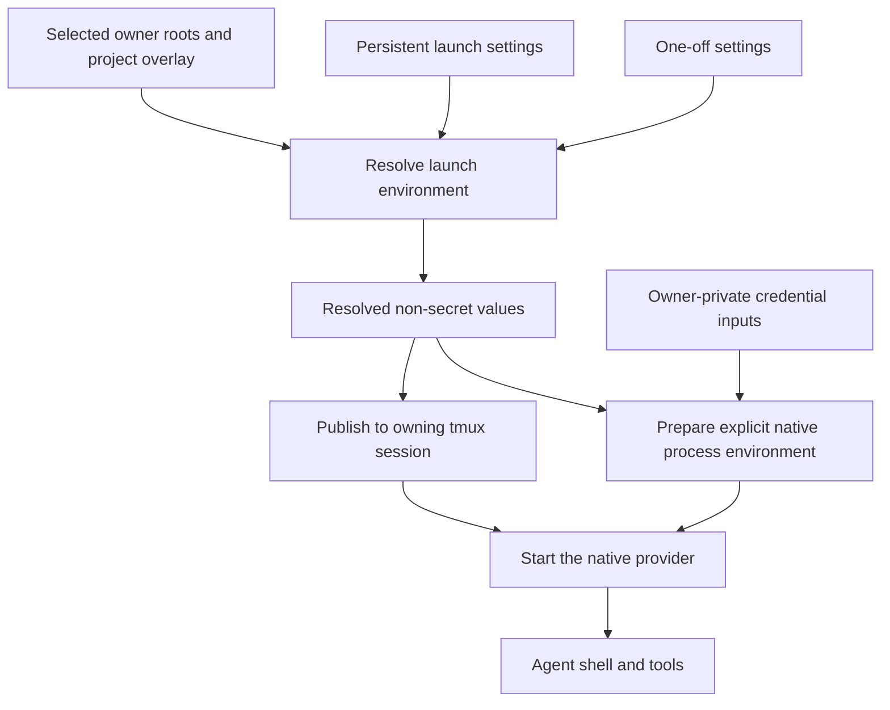

# Design

## Context

The runtime binds the launch plan to an execution owner and saves the selected environment in an owner-private launch record. Web and Service assemble their native environments in supervisors, while Headless and local TUI share a publisher that copies the manager environment and launch plan into tmux. Project launch passes overlay runtime and mailbox defaults as explicit paths. These boundaries explain where selected roots and launch settings can be lost or overexposed. [Proposal](proposal.md) · [Runtime launch](../../../src/houmao/agents/realm_controller/runtime.py#L2169) · [Project launch](../../../src/houmao/srv_ctrl/commands/agents/core.py#L887) · [Headless publisher](../../../src/houmao/agents/realm_controller/backends/headless_base.py#L755)

## Goals / Non-Goals

**Goals**

- Give provider start, live reattach, and relaunch a common source for the selected environment and its lifetime.
- Apply settings at the owner and startup boundaries while retaining each tool's required home, startup options, and private credentials.

**Non-Goals**

The design applies to providers that Houmao starts. Joined sessions have their own adopted relaunch contract. A verified self query reads the agent's own bindings from its manifest. [Joined Session Contract](../../../openspec/specs/brain-launch-runtime/spec.md) · [Self Identity Contract](../../../openspec/specs/houmao-managed-agent-self-identity/spec.md)

## Decisions

### Resolve Root Context at Launch

Pass the resolved overlay from the launch entrypoint into runtime preparation. Use the existing root resolvers against the selected owner and overlay, with authorized explicit settings before shared-root environment overrides and overlay defaults. For delegated and passive-server births, use the owner or server's configured authority. Persist safe selection metadata with runtime launch authority and reuse the recorded execution and mailbox bindings for agent-specific paths.

Set `HOUMAO_GLOBAL_REGISTRY_DIR` from the execution binding. Publish `HOUMAO_GLOBAL_RUNTIME_DIR` and `HOUMAO_GLOBAL_MAILBOX_DIR` for selected shared roots and `HOUMAO_PROJECT_OVERLAY_DIR` for the selected overlay. A shared `--mail-root` is an explicit selection. An overlay-local fallback supplies the runtime or mailbox placement and uses the overlay selector for subsequent project-aware commands. Carry the selected overlay even when the agent's working directory is elsewhere. Correcting only `agents global list` would recover discovery for one command while leaving the rest of the launch context missing. [Root Selection](../../../src/houmao/project/overlay.py#L489) · [Registry Lookup](../../../src/houmao/srv_ctrl/commands/managed_agents.py#L5555)

### Resolve Environment Values With Their Source and Lifetime

Build the effective environment at provider-start preparation. Begin with an approved owner baseline, apply persistent profile or specialist env, then apply one-off `--env-set` values to ordinary keys. Resolve bare-name references under the execution owner. Apply trusted runtime bindings such as identity, manifest and memory pointers, and required tool homes through their owning code paths. Preserve each one-off assignment's lifetime even when it replaces a durable key. Feed runtime-generated values such as the private workspace pointer through the trusted path.

Build the non-secret publication mapping before merging private values. At the credential input boundary, the adapter already knows its selected allowlist and credential binding names. Use that provenance to keep credential and hook or MCP values private, with explicit adapter-owned projections for documented non-secret settings such as Claude model selectors. Reject reserved-name and credential-binding collisions in user records, and report validation failures by variable name. Declaring a normal environment record makes it eligible for tmux publication. Authentication values belong in the selected credential input. Inferring visibility from the final flat `LaunchPlan.env` would lose this provenance. [Credential Selection](../../../src/houmao/agents/realm_controller/launch_plan.py#L447) · [Launch Env Validation](../../../src/houmao/agents/launch_env.py)

### Publish Before Starting the Provider

Call a shared session publisher after verifying the exact owning tmux session and before starting any provider or its supervisor. Reconcile Houmao-owned keys, including removal markers for expired keys and inherited credential names. Scope edits to the owned session. Use a scrubbed environment for commands that can start the tmux server, and avoid importing caller environment on managed session creation. Report failure with the publication step and variable name. Clean up newly owned resources through the launch failure path.

Use the same resolved values in explicit child process environments. Headless workers read the current generation inputs for each turn. TUI can extend the owner-private launch wrapper so private values reach the provider without entering the idle shell. Web and Service pass the environment through their existing private supervisor inputs. Keep native home preparation, terminal color and loopback proxy behavior, and the Web and Service owning tmux locators in their existing roles. Tmux inheritance alone cannot supply the full environment for native workers launched outside their pane, including credentials.

Use the publisher for the retained CAO session startup as well. CAO creates a new shell window before initializing the provider. Scope a private shell bootstrap to the CAO terminal window, provisioned in its owning session and restored after terminal creation. This gives the CAO provider private inputs through its shell with only the bootstrap path in tmux-visible configuration. [Tmux Environment Helpers](../../../src/houmao/agents/realm_controller/backends/tmux_runtime.py#L623) · [Private TUI Wrapper](../../../src/houmao/agents/realm_controller/backends/local_interactive.py#L423) · [CAO Terminal Creation](../../../extern/tracked/cli-agent-orchestrator/src/cli_agent_orchestrator/services/terminal_service.py#L104)

### Tie Environment Lifetime to the Managed Generation

Extend the existing owner-private launch record with the provenance and published key set needed to restore and reconcile a live generation. Reattach and continued headless turns use that record. A managed relaunch takes the recorded root context, rebuilds from durable launch inputs, and prepares a new private record. Exact chat resume selects conversation history independently of that rebuild. Stage and validate the replacement inputs before relaunch, then use the normal readiness path to publish the new generation. Reading old tmux values as launch inputs would revive expired values and make the result depend on the last pane environment. [Private Launch Record](../../../src/houmao/agents/realm_controller/runtime_launch_environment.py) · [Relaunch Plan](../../../src/houmao/agents/realm_controller/runtime.py#L4026)

## Risks / Trade-Offs

- **Ambient env dependency**. Existing TUI or Headless workflows may depend on incidental inheritance. Preserve documented non-secret inputs and document how custom env can be declared with a persistent setting or `--env-set`.
- **Root placement changes on new launches**. A shared override may previously have been hidden by a project default. Use binding-backed placement for existing agents and make selected roots visible in launch results.
- **Stale or inherited keys**. Clearing a session-local entry can reveal the tmux server value. Reconcile the recorded keys with explicit removal markers and test new panes against a deliberately conflicting server environment.

## Migration Plan

New launches establish the recorded context and owned publication keys. The next supported relaunch uses the existing agent's recorded bindings and derives any available launch context from trusted persisted inputs. A fresh launch with the intended selectors establishes any context that an earlier manifest did not record. A rollback uses the previous release and explicit root and environment inputs on a fresh launch.
