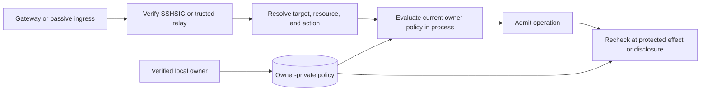

# Design

## Context

Gateway middleware matches real routes and verifies bounded, exact HTTP request proofs. The verifier currently returns a broad role, and downstream consumers use it for mailbox attachments, Web entry, streaming, and passive relay. The passive server can also act directly against a retained owner binding. Both processes therefore need the same policy implementation and a shared decision source. [Gateway Admission](../../../src/houmao/agents/realm_controller/gateway_admission.py) · [Gateway Access](../../../src/houmao/gateway/access.py) · [Passive Admission](../../../src/houmao/passive_server/admission.py)

## Goals / Non-Goals

Use one in-process authorization engine and one retained policy per observed owner domain. Make both ordinary operations and new scoped permissions expressible with the same model. The scope covers current gateway and selected-agent passive HTTP operations, plus local access administration. Native authentication, provider accounts, filesystem isolation, and direct local execution authority belong to their existing systems. The file-edit proposal will add its own resource and action declarations when that feature is implemented.

## Decisions

### Match Explicit Permissions With a Fixed PyCasbin Model

Use the published `pycasbin` PyPI distribution. Add it with `pixi add --pypi "pycasbin>=2.8.0,<3"` so Houmao's package metadata and Pixi lock carry the runtime dependency. Use the library's exact-match, allow-only ACL and domain-scoped roles. Keep the model in package code as trusted configuration. Use typed policy administration for policy data. A fixed model makes permission assignment auditable and keeps request interpretation inside the application that owns each operation. [PyPI Package](https://pypi.org/project/pycasbin/2.8.0/) · [Casbin Domain Roles](https://casbin.apache.org/docs/rbac-with-domains/)

```ini
[request_definition]
r = sub, dom, obj, act

[policy_definition]
p = sub, dom, obj, act

[role_definition]
g = _, _, _

[policy_effect]
e = some(where (p.eft == allow))

[matchers]
m = r.dom == p.dom && r.obj == p.obj && r.act == p.act && (r.sub == p.sub || g(r.sub, p.sub, r.dom))
```

Use the target agent's canonical ID and verified execution-context ID for the domain. Resolve aliases and owner bindings before policy lookup. Resource IDs come from the selected domain and its resource catalog. Bind replaceable resources such as plugin instances and mailbox bindings to their canonical identity. Generate exact permissions for the gateway-admin role from every supported client-facing action and resource in the target's catalog. Use the parsed semantic intent and actual effect resources, including every protected component of a compound request.

| Resource | Action examples |
| --- | --- |
| Agent control | Observe state or artifacts, send a prompt, interrupt, send raw input, select a session or execution model, and attach, detach, or stop where an existing HTTP surface supports the operation |
| Native home | Inspect the home, observe refresh state, and apply refresh |
| Bound mailbox, memory, and reminders | Read or mutate the selected resource, send ordinary mail, post as an operator, read an owner-local attachment for a mail send, or change a binding or notifier |
| Native Web entry and AG-UI | Enter the native browser, connect and observe, submit a run, publish events, detach a connection, or select a destination |
| Plugin instance | Use declared namespaced actions on the bound instance and use separate host lifecycle and diagnostic actions |

### Establish the Caller With SSHSIG

Split credential verification from policy evaluation. A caller challenge uses an enrolled key for an operator, service, or logical agent. A managed self request to its own gateway can use its target's current generation key. First-admin enrollment and interactive native Web approval retain purpose-specific proofs. Sign and consume an expiring challenge bound to the issuer, target domain, admitting listener incarnation, exact method, path, query, raw body digest, and credential enrollment or self generation. First-admin proof also binds the proposed key, principal, and empty-roster revision. Use the existing in-process OpenSSH signature verifier. Reject supplied proof that fails verification before protected input handling or anonymous admission.

An operator, service, or peer agent has a stable principal in the target's policy. The target owner enrolls a public key for that identity through the same trusted local administration. The peer grant can be created while the source is offline. For example, `bob` can grant `reviewer` access using its enrolled public key even when `reviewer` runs as `alice` or moves to a container. Store the logical agent ID and its approved key binding. A claimed agent ID or a shared registry entry cannot establish the key binding. Multiple credentials or explicit key rotation retain the same principal, and the owner can revoke each enrollment independently.

Provision a peer signing credential separately from managed self proof. Keep the private signer in an explicit owner-protected credential source where authorized users or workloads of that logical agent can use it. The client chooses that signer independently of target discovery. The target verifies each request against its enrolled public key without reaching the source account, filesystem, or live runtime. A peer grant survives source relaunch or placement changes if the caller keeps an enrolled credential. Self proof for the acting agent's own gateway remains generation-bound and runtime-verified.

### Preserve the Empty-Roster Rule in the Common Policy

Derive the gateway-admin role from the exact authenticated key's current admin enrollment. Each key for a principal can use that principal's scoped grants. On keyed targets, only keys explicitly enrolled in the admin roster receive the reserved admin role. Select that role through a host-controlled subject in the policy snapshot and keep ordinary role assignments independent of roster membership. When the roster is verified empty, every caller receives the same role. It covers all supported client-facing target operations, including owner-local attachments, plugin actions and, once implemented, versioned file edits. Record the actual caller and authorizing basis. Existing operation guards govern availability, transport, path validation, native readiness, and public input.

Keep the operation-specific proof contract for roster changes. Empty-roster first enrollment requires exact proposed-key proof. On a keyed target, proof from an currently admin-enrolled key authorizes live roster changes. A key already enrolled resolves to its own stable principal, and a previously unknown key receives a new principal identity. Labels remain display data. Local policy administration and direct execution use verified OS owner authority. Internal backing uses its configured service binding.

Update membership, credential state, and roster revision atomically. The roster counts live administrator key enrollments. Removing an admin qualification ends that key's admin authority. Revoking the credential invalidates the signing key altogether and removes any roster qualification in the same transaction. Enroll a replacement as admin before removing the existing last admin key to keep the gateway keyed. The first admin enrollment closes open access and losing the last admin key reopens it, even when ordinary keys remain. Increment the open epoch on both transitions so earlier open admissions stay invalid after reopening. Missing or invalid policy cannot establish open mode.

### Keep Policy and Effect Authority Owner-Local

Store versioned principal, enrollment, role, grant, roster, and audit data in owner-private SQLite bound to the target domain. Keep its security checks and durability on the owner side using the existing private-path conventions. Seed authorized new births explicitly and retain state across same-domain reattach and relaunch. Build evaluator snapshots from the current revision's validated, unexpired rows. Keep enrollment, target incarnation, and any applicable self-generation checks current on each decision. Reuse a compiled evaluator only while its revision is current and none of its included grants has expired. A load or evaluation failure returns a safe policy error for dependent operations.

Expose a narrow authorization interface that accepts resolved operation requirements and returns the verified actor, authorizing basis, resource, action, target, and policy or enrollment evidence. Owner-local access commands can inspect decisions without initiating operations. Use sanitized reasons, revisions and operation IDs in audit records. Credentials, proofs, provider secrets, ticket bearers and private paths stay out of those records.

Order policy writes and mutation handoff through the same short owner-side transaction or fence. Acquire the operation's native or lifecycle admission and prepare external inputs before the final check where applicable. Revalidate the actor and all exact requirements while recording or consuming an operation-scoped handoff. An operation admitted on named-admin authority retains the exact key enrollment and admin qualification for revalidation. Removing that qualification fences old admin-bound admissions, including after the target becomes open. Revocation that wins the fence prevents the effect. An already admitted handoff follows its settlement rules. Release the fence before long-running work. A later status or stream read uses current data-access permission.



### Keep Each Existing Ingress Bound to Its Actual Effects

- The gateway resolves the matched operation before authorization and validates typed inputs that determine protected variants after proof verification. Startup checks the core route inventory. An owner-file attachment requires ordinary send permission and authority to read owner files.
- The passive server uses the same retained authorizer for direct operations, even when the gateway is detached. An owner-local relay carries the original signed or anonymous caller and any open epoch. It binds the exact transformed request, resolved operation, and receiving gateway instance. The receiver rechecks current policy. Backing tokens remain one-use service authority scoped to the configured target and operation. Verified owner-local manager and executor commands follow their native owner binding when a gateway is absent.
- Web entry requires the declared entry permission, direct owner-local origin, and exact native execution. Apply the permission during approval, ticket issuance and redemption. Provider authentication governs the resulting native session. AG-UI checks the actual destination and operation. Run streaming needs both submission and output access. Recheck the specific observation permission before stream output and during idle polling so revoke can detach the observer while admitted work settles.
- The plugin host validates explicit action declarations and binds them to the exact installed instance. Each supported plugin action joins the target's gateway-admin role automatically. Scoped grants can give non-admin callers selected actions. Migrate bundled plugin declarations and SDK consumers together. The verified caller and configured plugin service identity stay independently attributable.
- Publish a new versioned, secret-free endpoint authorization descriptor with admin mode (`open`, `keyed`, or `unavailable`), supported proof protocol and challenge information, and enabled public operations. Clients locate the listener, select their signer and let current policy decide. Discovery omits per-caller effective permissions and roster contents.

### Forward Workbench Requests as the Operator

Keep the Fastify workbench single-user. Alice runs a local workbench with her SSH key and can observe `writer`. Bob runs his own workbench with his key and can also start runs if the owner grants that permission. Select a signer from explicit operator-owned configuration bound to the verified agent and gateway origin. The browser uses an authorized local operator session and sends its intended operation through the private workbench API. Keep private keys, paths, and upstream proof headers server-side.

Require a local operator session established from a short-lived one-use secret delivered at launch. Keep session authority ephemeral and check single-use bootstrap, audience, and exact local origin before signed forwarding. In signed mode, restrict ingress to loopback and require the same local operator session for host bridges that can exercise local authority, including tmux attachment. Prevent generic upstream content from executing on the signing origin. Reuse the common SSHSIG caller client through a bounded local helper so Fastify can sign the exact outbound method, URL, and serialized bytes before forwarding the same bytes. Preserve SSE streaming in Fastify.

Bind each signer to an approved target domain and trusted endpoint source. The local server resolves discovered targets through the operator-approved source and verifies the live listener and outbound origin. A manually configured binding pins its origin. Changing a pane's URL directly clears its inherited signer selection. Limit signing to supported AG-UI operations and refuse redirects. A host allowlist governs network reachability. Generic HTTP fetch and arbitrary manually entered destinations have no signing authority. Unsigned open and generic AG-UI workflows remain available. On an explicit authorization refusal, panes and watchers show the error and wait for an explicit reconnect. Temporary connection failures continue to use the existing resolution loop.

## Risks / Trade-offs

- An empty roster intentionally exposes the full target operation set, including owner-local mail attachments and installed plugin actions, to anyone who can use its listener. Keep loopback as the default, preserve explicit wider-listener selection and public-input enablement, and show the effect of last-admin removal in owner tooling and docs.
- Several operations can perform the same effect through different endpoints. Map typed effects to common permissions and test relay, detached, plugin, stream, and browser entry paths beside direct gateway calls.
- A caller with direct OS authority can act outside HTTP policy. Shared-UID agents are in the same OS trust domain. Isolate execution where callers must be held to operating-system access boundaries.

## Migration Plan

Preserve selected public keys and stop serving affected domains through old ingresses during cutover. Deploy the updated gateway, passive server, manager clients, and plugin SDK consumers together. Existing targets with pre-refactor authorization metadata enter a protected unavailable state until the verified execution owner provisions a new-schema policy. Re-enroll selected callers with explicit principals and grants, or deliberately initialize an empty roster. Recreate the managed binding if remaining runtime state also requires replacement. Use the new store as authority after provisioning. Remove the former state loaders, route-class evaluator, descriptor and proof schemas, and SDK access declarations. Update launch inputs and named callers, including bundled skills, AG-UI consumers, examples, and independently installed plugins maintained in this repository.

Implement `add-versioned-agent-file-edits` after this change. Its mount actions use the common policy and handoff mechanism. Full admin access includes those actions. Scoped non-admin access uses exact mount grants, and all callers follow the adapter's draft, lease, revision, and publication rules.
