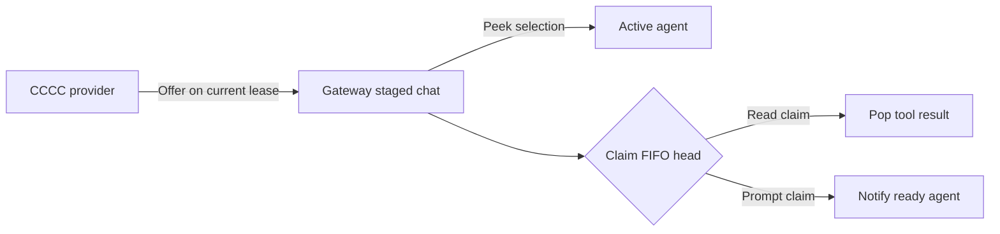

# Design

## Context

See [proposal.md](proposal.md). The CCCC plugin keeps a bounded FIFO of staged offers under its single Actor receiver lease. It seals scheduled pull snapshots, individual ASAP messages, or timed push batches. Its automatic dispatcher waits for body readiness, then starts and settles the exact head through CCCC. The gatewayless CLI's direct pull requires its own lease. [Delivery buffer](../../../../packages/houmao-cccc/src/houmao_cccc/delivery.py) · [Dispatcher](../../../../packages/houmao-cccc/src/houmao_cccc/plugin.py) · [Direct pull](../../../../packages/houmao-cccc/src/houmao_cccc/direct.py)

## Goals / Non-Goals

Give the active agent access to the staged chat for its selected binding. Keep one provider-owned delivery order, an exact receipt for each read, and ordinary notifications when the agent yields. Use the CCCC instance's existing intake policy and bounded staging. The queue surface covers ordinary chat in that gateway run. Gatewayless clients use the Actor-profile direct-pull interface, and deferred Mail uses its own cursor and notice path.

## Decisions

### Use the Gateway's Staged Queue

Offer both paths from the same FIFO. An agent that yields becomes eligible for the next ordinary prompt under the configured pull or push policy. An agent that stays active can make a tool call to its gateway while intake and batch sealing continue. Acquiring a direct pull lease for that call would compete with the existing gateway lease and lose the gateway's sealed batch boundaries.

### Let Peek Preview the Next Pop

The gateway selects the longest leading prefix of whole sealed batches that fits its effective count and complete encoded response limits. It preserves original delivery order and reports the boundaries within that selection. An open timed batch contributes only progress information, such as its message count. An oversized head produces an explicit content-limit result and remains eligible for ordinary delivery. Allowing callers to skip to a selected sender or split a sealed batch would change the existing FIFO and batching guarantees.

Peek returns the selection's message projections and an opaque, expiring snapshot token. Scope the token to the owner, instance, binding, live gateway run, and receiver lease. Bind it to the exact selected attempts and batch boundaries. An append behind the selection leaves the old token usable for that prefix. A changed head, expired offer, or retired lease makes it stale. Use the existing delivery-change signal for optional bounded waits, and recheck eligibility after each wake. A wait returns the available selection or an empty result at its deadline.

### Share Ownership Between Pop and Dispatch

Use one lease-scoped queue-head reservation for both paths. A pop acquires the reservation and validates the snapshot against the current eligible prefix. The dispatcher rechecks the head and generation after waiting for readiness, then acquires the same reservation before a provider start. Intake and sealing can continue while a reservation is pending. A competing caller whose selection loses receives a typed conflict. A late ready-only refusal that proves the body received nothing releases the reservation through the existing defer path.

The gateway releases staging credit after CCCC records the claim. CCCC reserves the whole selected prefix atomically and rejects a claim for attempts already started, consumed, or scoped to a different lease. Keep delivery credits, order, and payload recovery with the existing provider-ledger design. Persisting a second gateway queue would require reconciling two owners on restart.

An ambiguous provider response keeps the reservation while the gateway reconciles the same operation. If reconciliation cannot finish within the request budget, retire the lease and let CCCC recover eligible staged work. A committed tool-read claim survives lease retirement.

### Keep a Durable Tool-Read Receipt in CCCC

Extend receiver v2 with a negotiated `chat_gateway_queue_reads` capability. `chat.gateway-read.claim` takes the live lease, caller operation ID, snapshot fingerprint, and ordered attempt groups. Persist the exact decision and receipt before exposing contents. Distinguish a gateway tool-read reservation and acknowledgment from a gateway prompt handoff and a direct read.

`chat.gateway-read.result` resolves a recorded pop by operation ID within the Actor registration and logical gateway binding. Use a stable tag derived from the validated gateway owner, instance, and CCCC binding to correlate operations across gateway runs. CCCC authorizes the Actor grant. The gateway enforces the owner and instance scope on its HTTP surface.

A matching retry first reconciles a previously committed claim, including after lease retirement. A fresh claim requires a valid live snapshot and lease. A reused operation ID for another snapshot yields a conflict. Reconstruct a known result from the recorded attempt identities and provider history, with reply handles minted for the current gateway run. After the finite result recovery window, retain enough metadata to report an expired decision to the same Actor registration. This retains one provider source of truth and avoids a persistent gateway payload copy.

Extend `chat.ack` for exact gateway tool-read receipts. The same authorized binding can acknowledge after the original lease is gone. An unacknowledged receipt expires to uncertainty under a finite window. A recorded read excludes those attempts from automatic prompts during and after receipt reconciliation. A definitively uncommitted claim leaves the head eligible for either path.

### Expose Queue Operations on the Selected Instance

Use the existing verified managed gateway selection or explicit authorized gateway selection. Declare a read action for peek and a consuming action for pop, pop recovery, and acknowledgment. Build peek, pop, and recovered results from the compact CCCC request projection, with the existing sender, timestamp, mode, text, and per-message reply handle.

| Gateway route under `/v1/plugins/{instance}` | CLI |
| --- | --- |
| `GET /chat/queue` with optional `min_messages` and `wait_seconds` | `chat peek` |
| `POST /chat/queue/pop` with `snapshot` and `operation_id` | `chat pop` |
| `GET /chat/queue/pops/{operation_id}` | `chat pop-result` |
| `POST /chat/queue/ack` with `receipt` | `chat ack` in gateway mode |

The peek query has a finite maximum wait and rejects thresholds outside the effective message limit. Pop and result recovery use the same gateway response budget, including their envelope. Keep the current gatewayless acknowledgment path for direct CLI use.

## Risks / Trade-offs

| Risk | Mitigation |
| --- | --- |
| The head changes after peek | Pop validates the exact prefix at the current lease and returns a conflict for a stale fresh claim. |
| A gateway dies after a claim but before the agent sees the result | The provider's recorded operation returns the same attempt set or the explicit expired or uncertain outcome. |
| A waiting peek outlives its receiver | Wake pending reads on lifecycle and lease changes and bound each wait by its request deadline. |
| A head batch fits the queue but exceeds the tool-result budget | Check the full projection before claiming, return the content limit, and retain the batch for ordinary delivery. |

## Migration Plan

Roll out the receiver extension and matching plugin and CLI. Existing v2 providers continue ordinary delivery and the gateway reports queue access unavailable until the provider advertises the full claim, result, and acknowledgment contract. Preserve recorded read decisions when reverting gateway code so claims with possible exposure can still settle or expire in CCCC.
