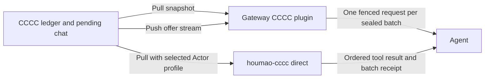

# Design

## Context

See [proposal.md](proposal.md) for the motivation. The CCCC receiver patch currently admits at most one pending or offered attempt per Actor, and `lease.next` returns one offer. The CCCC plugin builds a message hint with routing fields, and the gateway serializes that hint and the full event metadata into the agent prompt. The CLI currently requires a gateway URL. [Receiver patch](../../../../extern/tracked/cccc-receiver/patches/0001-external-receiver.patch) · [Gateway dispatch](../../../../src/houmao/agents/realm_controller/gateway_service.py) · [CCCC CLI](../../../../packages/houmao-cccc/src/houmao_cccc/cli.py)

## Goals / Non-Goals

Keep one authority for CCCC pending messages, ordering, and receipts. Let the CCCC plugin group and stage offers while using the host's normal ready-only prompt admission. Keep gateway use and direct CLI use bound to the same explicitly provisioned Actor. The integration operates within CCCC's Actor authority. CCCC operations that require operator authority remain the CCCC operator's responsibility, and deferred Mail uses its existing cursor and read receipts.

## Decisions

### CCCC Owns Pending Chat and Delivery Outcomes

Introduce external receiver protocol v2 in the tracked CCCC patch series. Store the original message body and timestamp in the existing CCCC ledger. Commit first-delivery identities with the original chat so recovery can reconstruct pending entries for the exact recipient registrations. Each entry has an attempt identifier and a stable delivery sequence. New chat can reach pending state while the gateway is down or the body is busy. Cap pending age and capacity with explicit provider results when a limit is reached.



Keep one lease per Actor registration. A lease selects the intake transport and binds claims to a receiver generation. For pull, return one ordered, count- and byte-bounded leading batch at a single snapshot boundary. For push, the plugin opens an authenticated CCCC offer stream and grants bounded intake credit. CCCC emits offers in delivery order with original timestamps. Stream frames and pull batches carry exact attempt identities. The plugin deduplicates repeated offers within a lease. Work beyond the current credit or response limit waits at CCCC. An individual message above the negotiated maximum gets an explicit size outcome.

An outbound stream works with a loopback gateway and remote CCCC. Group-ledger reads provide observation. Actor delivery also needs exclusive claims and settlement, which the receiver stream and pull operation provide through the same pending queue. Mail notices use separate typed offers on the gateway lease and follow immediate ordinary admission. Give push notices separate bounded credit and expose notice pulls independently of chat snapshots. Direct CLI sessions claim ordinary chat and read Mail explicitly.

### Delivery Start Fences Recovery

Keep a bounded, lifecycle-scoped staging buffer in the CCCC plugin. Open and sealed batches reference the exact provider attempts and retain only the payload needed for current delivery. The durable queue stays in CCCC. Record a fenced start for the exact batch in CCCC before the irreversible prompt submission. Give each start a distinct ID scoped to the receiver lease. Repeating the same start or settlement resolves its original decision. A later start after proved pre-handoff refusal gets a fresh ID and keeps the batch membership. Settle all attempts in the batch together after the host confirms delivery to the selected body. For a native queued receipt, use handoff evidence for the exact native prompt within the confirmation deadline. If that evidence is inconclusive, settle the batch as uncertain.

The plugin observes a read-only readiness signal through the gateway SDK. The host applies its authoritative current-body and ready-only checks at dispatch. If readiness changes after start and the host proves that it sent nothing, the plugin can defer that same fenced batch and retry admission as the body becomes ready. When the handoff result is ambiguous, CCCC records uncertainty and requires the sender's explicit decision for a fresh attempt. A lost start response is reconciled in CCCC before the plugin submits a prompt.

On a transport switch, the plugin stops old intake and finishes settling any in-flight handoff within a bounded deadline. It then releases and fences the old receiver generation before activating the new transport. CCCC can reassign pending or provably unstarted work in order. Started unresolved work becomes uncertain. The same rules cover restart or takeover. After an unexpected gateway loss, a direct receiver can acquire intake when the gateway lease expires.

### Delivery Settings and Prompt Boundaries

Use one validated per-instance delivery settings model for launch and runtime. Add a repeatable `--plugin-config-override INSTANCE=JSON` launch argument to the managed gateway attach path. It overlays values inside an explicitly selected instance's `config` and uses that plugin's configuration validation. For example, `--plugin-config-override 'team={"delivery":{"transport":"push","push_policy":"asap"}}'` sets the `team` instance. The CCCC plugin's authorized `GET` and `PUT /v1/plugins/{instance}/delivery` read or change settings for the current binding and report desired and effective settings and transition status. Startup settings default to pull. Runtime updates apply to the current gateway run. Validate a positive pull interval, `asap` or `batch` for push, and positive batch intervals with `quiet_interval` at most `max_wait`. Use a settings revision to reject conflicting updates and apply a new receiver generation when changing transport.

Pull takes one snapshot on each scheduled pull with available staging capacity. Each non-empty result seals one batch at that pull boundary. ASAP seals one message as soon as the stream delivers it. Push batching uses the earlier of `last_arrival + quiet_interval` and `first_arrival + max_wait`, measured on the gateway's monotonic clock. Only a newly staged message updates either arrival time. The plugin seals the existing batch before admitting an offer at or after its deadline. A push policy or timing edit seals the current open batch and applies to later offers. All sealed batches wait in order when the body is busy, and one supervised dispatcher advances them through readiness.

### Request Fence and Agent Rules

At handoff, render one host-owned request fence around the full `messages` list. Use a one-entry list for a single message and put the entire ordered list inside the same fence for a batch. Each entry shows the CCCC sender label, original timestamp, mode, text, and an opaque message handle. Serialize and escape the entries as data so sender or body text cannot close the fence or introduce extra fields. The host checks the final encoded size and retains routing metadata for internal correlation. Use the provider delivery sequence for order. Include the local plugin instance selector in the handle format so the managed CLI can find the correct plugin through verified gateway discovery.

Use the trusted instruction pattern for Houmao work requests. The host identifies the content as a request from CCCC and tells the receiving agent to apply its current instructions, priorities, confidentiality rules, and tool permissions. Sender labels are CCCC attribution. The configured Actor binding and current lease authorize intake. The CCCC worker uses the ordinary ready-only plugin dispatch path for the whole fenced request. Gateway HTTP callers exercise the declared action on the bound plugin instance when they read details or reply. [Work-request renderer](../../../../src/houmao/gateway/work_requests.py) · [Plugin authorization](../../../../docs/reference/gateway/plugins.md#inspect-and-operate-the-host)

Render the receiving agent's Group and Actor from the validated CCCC binding above the fence. State the resolved owner-local gateway base URL once using the live listener metadata. List the relative binding, message detail, and reply endpoints under the selected plugin namespace. The reply hint names `handle`, `operation_id`, and `text`. Use the same owner-local URL that verified managed-self calls use. Apply the prompt size limit to the complete header and fenced content. [Listener metadata](../../../../src/houmao/agents/realm_controller/gateway_plugin_host.py) · [Managed-self verification](../../../../src/houmao/gateway/client.py)

```text
Houmao received a request from CCCC. Decide how to handle it under your
current instructions and tool permissions.

Your CCCC identity is Actor reviewer in Group code-review.
Gateway base URL http://127.0.0.1:43000
- GET /v1/plugins/team/binding to inspect your CCCC binding
- GET /v1/plugins/team/messages/{handle} for message details
- POST /v1/plugins/team/chat/reply with handle, operation_id, and text

<<< BEGIN CCCC REQUEST >>>
{
  "messages": [
    {
      "sender": "alice",
      "timestamp": "2026-11-25T10:30:01Z",
      "mode": "request_reply",
      "text": "Could you review the failing test?",
      "handle": "msg_team.7tP4sK9q"
    },
    {
      "sender": "build-agent",
      "timestamp": "2026-11-25T10:30:02Z",
      "mode": "send",
      "text": "The failure is in test_receiver_recovery.py.",
      "handle": "msg_team.kR8nV3mL"
    }
  ]
}
<<< END CCCC REQUEST >>>
```

### Gateway and Direct Client Operations

Gateway `GET /v1/plugins/{instance}/messages/{handle}` reads a narrowly projected view of the exact event through the provider. `POST /v1/plugins/{instance}/chat/reply` resolves a handle to that exact parent and passes the caller's `operation_id` and text to CCCC. Mint short handles before handoff, scope them to the gateway process, owner, instance, Actor binding, and receiver generation, and expire them after a finite interval. A stale, expired, or mismatched handle returns a typed conflict and points the agent to explicit history. An authorized caller can select an exact history event to get a fresh handle. Common sends derive the binding from the selected plugin and use a short connection token as the freshness precondition associated with recipient discovery.

The plugin and `houmao-cccc` share common operation contracts and the same explicit private Actor profile format. Gateway mode uses the verified managed gateway or an explicit authorized gateway binding. Direct mode selects an owner-bound profile and invokes CCCC through the provider client. Direct mode is pull-only. A single pull returns one ordered batch with CCCC-issued Actor-scoped references that later CLI invocations can use. CCCC records the exact direct retrieval before returning content and issues an expiring receipt that the CLI can acknowledge in a later invocation. The receipt settles only that direct read and survives release of the temporary intake lease. Missing acknowledgment after possible exposure yields uncertainty. A gateway authentication failure or uncertain mutation stays associated with the original request and binding.

An authorized discovery operation in either mode returns the selected CCCC origin, Group, Actor registration, and capabilities. Provision Actor-scoped credentials privately for the CCCC operations the agent can call directly. The current receiver bearer is limited to its RPC path, so any advanced API must explicitly map to an authorized CCCC operation. Identity discovery returns public routing descriptors without disclosing credential values.

## Risks / Trade-offs

- Proving pre-handoff failure can cost an extra provider round trip. Use exact-batch idempotent transitions and keep the host's admission lock outside network waits.
- Busy turns can outlast the batching timers. Seal membership at the deadline and expose waiting state and bounded capacity while CCCC retains overflow.
- Batches can outgrow the raw offer budget after escaping and handle formatting. Apply count and byte limits to complete ordered entries and validate the rendered prompt before starting delivery.
- The CLI can lose its output or acknowledgment after CCCC has exposed a direct result. A caller that has the receipt can reconcile it within its Actor scope. An unacknowledged claim expires to an uncertain result.

## Migration Plan

Build and qualify the patched receiver from the tracked pin and patch series. Roll out the matching Houmao and `houmao-cccc` builds with the compatible receiver. Quiesce v1 receivers and settle or classify unresolved v1 attempts before switching to v2 intake. Carry forward authoritative CCCC history, terminal receipts, and Mail cursor and read receipts. Treat any v1 offer whose handoff cannot be established as uncertain. Reject unsupported provider versions with a compatibility diagnostic. Update clients and agent guidance to use handle-based replies, verified gateway discovery, and explicit direct profiles. Qualify both transports and the gatewayless path before advertising support.
