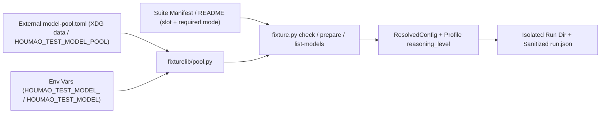

# Design

## Context

See `proposal.md` for motivation. Today `scripts/agents/test-fixtures/fixture.py` already enforces a clean boundary between tracked generic descriptors (`tests/fixtures/agent-launch/{self-hosted,cloud-api}.yaml`), external local native-login bundles (`${XDG_DATA_HOME:-~/.local/share}/houmao/test-fixtures/auth/`), and isolated run state (`${XDG_STATE_HOME:-~/.local/state}/houmao/test-fixtures/runs/` or `tmp/<purpose>/`). However, every caller must still pass 6 to 10 machine-specific flags (`--case`, `--client`, `--model`, `--base-url` or `--env-file`, `--context-window`, `--max-output-tokens`, `--dsh-reasoning`, `--dsh-compat`, `--executable`), plus a post-prepare `houmao-mgr project profile set --name fixture-agent --reasoning-level N` step for non-Kimi manager clients because `fixturelib/config.py` currently restricts `--reasoning-level` to `client == "kimi"`. As a result, all four instructional suites under `tests/instructional/` hardcode `Qwen/Qwen3.8-27B-FP8`, `http://127.0.0.1:14888/v1`, and `$REPO_ROOT/tmp/dsh/...`.

## Goals / Non-Goals

**Goals:**
- Provide one central `fixturelib/pool.py` loader and validator consumed by `fixture.py` so instructional suites, qualification scripts, and manual smoke runs share identical pool and slot semantics.
- Keep `model-pool.toml` strictly secret-free on disk while co-locating it with the existing external fixture data root (`~/.local/share/houmao/test-fixtures/model-pool.toml`).
- Support both homogeneous single-variable test execution (`HOUMAO_TEST_MODEL=<key>`) and heterogeneous multi-agent role assignment (`HOUMAO_TEST_MODEL_<SLOT>=<key>`) without modifying tracked files.
- Eliminate DSH-specific post-prepare shell steps in instructional suites by supporting manager-surface `--reasoning-level` across clients that expose indexed reasoning presets in Houmao profiles.

**Non-Goals:**
- Changing production `houmao-mgr` or `houmao-passive-server` configuration files (`src/houmao/` remains untouched; `model-pool.toml` is strictly developer test-fixture infrastructure under `scripts/agents/test-fixtures/`).
- Supporting automatic fallback to ambient shell credentials (`OPENAI_API_KEY`, `ANTHROPIC_API_KEY`) or implicit default pool keys when `HOUMAO_TEST_MODEL*` variables are unset.
- Storing raw API keys or OAuth tokens inline inside `model-pool.toml`.

## Decisions

### 1. Co-locate `model-pool.toml` in External XDG Fixture Storage with Strict Path and Permission Checks
- **Choice**: Default to `${XDG_DATA_HOME:-~/.local/share}/houmao/test-fixtures/model-pool.toml` with override `HOUMAO_TEST_MODEL_POOL` or `--model-pool`, validated through `validate_external_path(..., allow_checkout_tmp=False)`. Require a regular non-symlink file owned by the current UID and reject group/other write or read permissions when world/group-accessible (`mode & 0o077 != 0`, matching `0600` private fixture hygiene).
- **Rationale**: Reuses the exact XDG mental model and path validator already proven in `fixturelib/auth.py`, guaranteeing developers never accidentally point `HOUMAO_TEST_MODEL_POOL` at a tracked file or `tmp/` scratch path inside the checkout.
- **Alternatives considered**:
  - *Ignored `.env` or `model-pool.local.toml` at repository root*: Rejected because multiple worktrees/checkouts on one dev box would require duplicating or symlinking the pool file, and checkout-resident config risks accidental staging.

### 2. Keep `model-pool.toml` Secret-Free by Referencing `env_file` and `auth_bundle`
- **Choice**: Parse `model-pool.toml` with stdlib `tomllib` into strict Pydantic models (`extra="forbid"`). Each `[models.<key>]` entry declares `client`, either `case` (`"self-hosted"` | `"cloud-api"`) or `auth_method = "native-login"` + `auth_bundle`, non-secret model metadata (`model`, `base_url`, `descriptor`, `context_window`, `max_output_tokens`, `dsh_reasoning` as table or `false`, `dsh_compat` as table, `dsh_protocol`, `capabilities`, `reasoning_key`, `reasoning_effort`, `support_efforts`), optional `executable`, optional `reasoning_level`, and optional `supported_modes`. Cloud keys remain in external `env_file` paths validated outside the checkout.
- **Rationale**: Developers often inspect or share snippets of `model-pool.toml` when debugging model metadata (`context_window`, `dsh_reasoning` maps); forbidding `api_key` / `auth_token` fields prevents secret sprawl while reusing `fixturelib/config.py`'s existing `env_file` and `auth_bundle` loaders unchanged.
- **Alternatives considered**:
  - *Allowing inline `api_key` inside `model-pool.toml`*: Rejected because it creates a second secret-storage format alongside `.env` files and `auth/` bundles and increases redaction risk on parse errors.

### 3. Two-Tier Environment Variable Slot Lookup Without Implicit Defaults
- **Choice**: Add `--pool-key <key>` and `--pool-slot <slot>` (mutually exclusive) to `fixture.py check` and `fixture.py prepare`. Normalize `<slot>` via `re.sub(r"[^A-Za-z0-9]+", "_", slot).strip("_").upper()`, look up `HOUMAO_TEST_MODEL_<SLOT>` first, then `HOUMAO_TEST_MODEL`. Do not support a `default_key` inside `model-pool.toml`; if neither env var is set, raise `FixtureError` listing the expected env vars and the available keys in `model-pool.toml`.
- **Rationale**: Preserves Houmao's core fixture invariant ("never choose ambient auth/models as a fallback") while keeping single-command developer ergonomics (`HOUMAO_TEST_MODEL=qwen38_dsh` sets every agent in a 4-agent test at once, and `HOUMAO_TEST_MODEL_ALGO=deepseek_cloud_dsh` overrides just one specialist).
- **Alternatives considered**:
  - *Fallback `default_model` key inside `model-pool.toml`*: Rejected because running a test in a fresh shell without noticing an expensive cloud default could silently issue paid API calls.

### 4. Centralize Executable Selection and Manager `reasoning_level` in `fixture.py prepare`
- **Choice**:
  1. When `--executable` is omitted on `fixture.py prepare`, use the pool entry's `executable` before falling back to `shutil.which(config.client)`.
  2. Lift the `client == "kimi"` restriction on `reasoning_level` in `fixturelib/config.py` for `surface == "manager"`. Validate `reasoning_level`:
     - For DSH: if `dsh_reasoning` is `False`, allow only `None` (or `0` when `0` means off? Reject any positive level when `dsh_reasoning is False`; when `dsh_reasoning` is a dict of `K` slots, validate `0 <= reasoning_level <= len([k for k in dsh_reasoning if k != "off"])` or `0 <= reasoning_level < len(dsh_reasoning)` matching Houmao's DSH preset indexing where `off, low, medium, xhigh` maps `0 -> off` and `1..3 -> low/medium/xhigh`). Verify against `houmao/agents/dsh_configuration.py` preset indexing so `fixturelib` validation matches `houmao-mgr project profile create --reasoning-level` 1-to-1.
     - For Kimi: preserve existing `support_efforts` validation.
     - For Claude/Codex: allow manager `reasoning_level` when supported by `houmao-mgr project profile create`, or let `manager_call` validate against the specialist's tool catalog while rejecting raw/passive surfaces.
  3. Record `"pool_key"` and optional `"pool_slot"` at the top level of `run.json` (and in `check` output) while stripping local filesystem paths such as `env_file` from public summaries.
- **Rationale**: `_prepare_project` in `fixturelib/prepare.py` already passes `--reasoning-level` to `houmao-mgr project profile create` whenever `config.reasoning_level is not None`. Removing the Kimi-only gate in `config.py` lets every instructional suite drop its DSH-only `profile set --reasoning-level 3` boilerplate so switching `HOUMAO_TEST_MODEL` between DSH, Kimi Web, or another Web-capable pool entry works out of the box.
- **Alternatives considered**:
  - *Keeping `profile set --reasoning-level` inside each instructional suite's `README.md` / helper*: Rejected because different pool entries have different reasoning slot counts (or none), breaking cross-model portability.

### 5. Instructional Suite Integration Pattern

The instructional suites in this change follow `imsight-project-mgr->agent-driven-testing`. Each bundle's tracked `README.md`, case files, and optional helpers guide an agent through a live run and define the soft goals it judges from captured evidence. Runs use isolated output directories for runtime state and evidence, with reports stored separately. The model pool supplies the launch inputs for each agent slot.

- **Choice**: Update `tests/instructional/agent-cccc-cuda-coop/` (including `manifest.toml` `[team.slots.<role>]` metadata and `cuda_coop_lab.py` Doctor/configure provenance), `tests/instructional/agent-cccc/`, `tests/instructional/agent-mail-stalwart/`, and `tests/instructional/skill-update/` so their `Launch` sections prepare each role via `fixture.py prepare --pool-slot <role> --mode web --surface manager ...` without hardcoded `MODEL`, `BASE_URL`, `DSH_EXECUTABLE`, or manual `profile set --reasoning-level 3` commands. Add `fixture.py check --pool-slot <role> --mode web --live` in `Launch` preconditions instead of `curl -fsS "$BASE_URL/models"` so endpoint liveness checks work across both OpenAI-compatible self-hosted routes and cloud/Anthropic/native routes.
- **Rationale**: Replacing raw `curl $BASE_URL/models` with `fixture.py check --pool-slot <role> --mode web` avoids assuming every pool entry speaks unauthenticated OpenAI `/v1/models`.

## Risks / Trade-offs

- **[Risk] Pool entry selected by `HOUMAO_TEST_MODEL` lacks a capability required by a specific instructional suite (for example `managed_web_skills` in `skill-update`, which currently requires DSH Web)** → **Mitigation**: Suites with client-specific native feature requirements declare that constraint explicitly in their `Launch` check (for example verifying `jq -e '.configuration.client == "dsh"'` on `skill-update` where DSH `managed_web_skills` is specifically under test), while client-agnostic gateway suites (`agent-cccc`, `agent-cccc-cuda-coop`, `agent-mail-stalwart`) require only `--mode web`.
- **[Risk] Developers leave permissive file modes on `model-pool.toml`** → **Mitigation**: Check `(st_mode & 0o077) != 0` on POSIX and emit an exact `chmod 600 <path>` remediation message.
- **[Risk] Existing developer muscle memory or scripts still pass `--case` and `--model` directly to `fixture.py`** → **Mitigation**: Keep direct `--case` / `--auth-method` flags 100% supported; `--pool-key` and `--pool-slot` are additive and mutually exclusive with conflicting routing flags (`--case`, `--client`, `--auth-bundle`, `--base-url`, `--env-file`).

## Migration Plan

1. Implement `fixturelib/pool.py`, wire `list-models` and `--pool-key` / `--pool-slot` / `--model-pool` into `fixture.py`, and generalize manager `--reasoning-level` validation in `fixturelib/config.py`.
2. Add `tests/fixtures/agent-launch/model-pool.example.toml` and hermetic unit tests under `tests/unit/` covering pool loading, path/permission checks, slot env resolution, mode mismatches, and DSH/Kimi manager `reasoning_level` profiles.
3. Update `scripts/agents/test-fixtures/README.md`, `tests/fixtures/agent-launch/README.md`, `AGENTS.md`, and the four instructional bundles under `tests/instructional/`.
4. Rollback is self-contained within `scripts/agents/test-fixtures/` and `tests/` since no `src/houmao/` package interfaces or stored runtime formats change.
