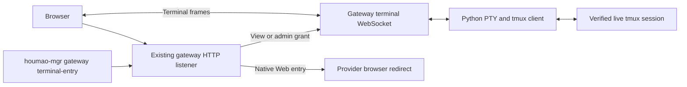

# Design

## Context

`GatewayServiceRuntime.dashboard` verifies the current managed owner and renders native Web availability. `/v1/web/enter` uses provider-specific login and a redirect. The gateway route inventory currently accepts HTTP routes and its admission middleware forwards non-HTTP scopes without resolving an operation. The new terminal routes need an explicit WebSocket boundary as well as a separate login purpose.

The runtime already verifies a selected agent's manifest, execution owner, generation, and recorded tmux socket. `TmuxServer` resolves the live session and builds the native attach invocation. `TerminalNativeSurfaceV1` identifies a provider TUI, while the saved tmux section also covers supervisor sessions for other modes.

## Goals / Non-Goals

The running gateway owns the terminal page, assets, authorization, and attach-client lifecycle. The browser acts as an operator terminal for that gateway's managed tmux session. Provider-native entry and structured agent control remain their own contracts. The initial transport is the existing direct owner-local origin, including private TCP forwarding that preserves that address.

## Decisions

### Use the Gateway Listener for Every Entry Point

Register the exact viewer and administrator routes on the existing gateway app. Use `GET /v1/terminal/view` and `GET /v1/admin/terminal/attach` for browser entry. Each has a dedicated `POST .../ticket` operation and `.../stream` WebSocket route. Browser admin sign-in, approval, and claim stay under the admin route prefix. Both modes use the same static page and asset set. The public dashboard adds bare links and reads live eligibility without minting grants or creating clients.

The route inventory recognizes only the two core terminal WebSockets and validates their access class at startup. Existing HTTP and plugin route validation continues to apply. Gate the global HTTP effect dependency on HTTP scope so the WebSocket handler can enforce its own admission lifecycle. Use the actual peer, exact Host, expected scheme, and browser Origin on terminal requests. Reject forwarding and relay metadata. The gateway uses proxy headers for other surfaces, so check the transport facts before any forwarded metadata can change them. A private TCP forward sends the same gateway host and port through one tunnel.

### Bind Login and Grants to One Access Mode

Register `Permission(resource="native:terminal", action="terminal.view")` and its admin counterpart `admin.terminal.interact` in the Houmao permission catalog. Register `terminal.view` as a public read effect. Direct owner-local access supplies that effect on open and keyed gateways, without caller proof or a policy grant. Interaction uses an admin-exclusive effect and additionally requires `basis="admin"` for the exact caller key, checked against its current enrollment revision. The explicit proof prerequisite matters because generic authorization can supply effective admin permissions through open or default admission. Reuse the per-key check used for roster updates. First-key bootstrap follows its existing contract. An owner who wants interaction limited to preselected operators can seed the roster before exposing the private endpoint.

Reuse the existing SSHSIG challenge and browser approval primitives with a distinct terminal purpose, exact access mode, and operation. Retain the accepted policy decision and original principal through issue, approval, claim, and stream admission. For multi-key approval, evaluate both signature and required authority for each candidate. Use an in-memory, one-time connection grant with a 60-second redemption window. Bind it to gateway presence, current owner and generation, exact tmux identity, and mode. Only the initiating tab can claim an approved browser login. A CLI link carries its secret in the fragment. The page removes the fragment and sends the secret in a bounded initial WebSocket message. Validate the connection's transport before upgrading and redeem the grant before allocating a PTY or emitting terminal data. Use no-store and no-referrer headers and omit credentials, proofs, and terminal bytes from logs and status.

Use the existing authorization revalidation and owner effect fencing for administrator access. Recheck the live binding for both streams and the exact admin qualification for interaction before forwarding input or releasing further output, with bounded checks while idle. A lost grant or binding closes the stream and requires fresh entry. The one-time grant's expiry governs admission. Current authority governs the admitted stream.

### Attach a Native Client to the Verified Tmux Session

Resolve the owner and active generation through the same verified manifest boundary as gateway control. Read the saved tmux section for every eligible mode and validate the session and its recorded managed surface. Verify the session's live managed identity as well as its native ID and tmux server incarnation. Use the recorded socket, clear inherited `TMUX` and `TMUX_PANE`, and disable tmux server startup. Fence the final identity check and attach in the same tmux server command queue, for example using a tmux format condition over the expected server and session metadata. The session ID is unique only within a server lifetime.

Use Python's standard POSIX PTY support with a fresh helper process that acquires the controlling terminal and execs the fixed tmux invocation. Use `attach-session -E` to preserve the existing session environment. For View, add `-r` and an unsized, read-only tmux control client to keep the viewer out of window sizing even when no native client is attached. Acquire and release both as one attachment. Reject all viewer input and resize messages at the gateway. Use observed dimensions for the initial viewer and browser-local display and scrolling. A view opens the session at its existing focus. Interactive attachment forwards input and dimension changes and uses normal tmux client semantics. It carries the execution owner's terminal privileges, including ordinary tmux navigation.

Keep terminal output binary and send small separate control messages for dimensions, flow acknowledgments, and status. Bound pending bytes and use acknowledgments from xterm.js write completion to pace output. On EOF, disconnect, timeout, revocation, or shutdown, close the PTY and terminate and reap only the attachment child with a bounded deadline. Check effective `destroy-unattached`, `exit-unattached`, and `detach-on-destroy` behavior before admission, since custom tmux settings can make an ordinary disconnect destructive or permit automatic session switching. Keep application task lifetime, tmux server lifecycle, and browser client cleanup separate.

### Deliver the Browser Page in Python Distributions

Vendor pinned browser-ready `xterm.mjs`, `addon-fit.mjs`, and `xterm.css` with their checksums and license files under `src/houmao`. Use `importlib.resources` and exact asset paths, following the package's existing browser asset pattern. Use plain HTML and a small ES module with same-origin imports. The release pipeline copies package resources into the wheel and source distribution. Asset refresh is a maintainer task that can use the upstream release archives directly. The browser consumes the assets locally at runtime.

### Put Terminal Link Issuance on the Scoped Gateway CLI

Register `gateway terminal-entry` on the `agents single` gateway group. Use existing target selectors and extract the owner-local live gateway verification shared with `gateway web-entry`. Verify the endpoint, owner, generation, and listener presence before requesting a ticket. View is the default and `--interact` selects the admin operation. An optional `--signer` uses the existing explicit signer convention. The view command is unsigned on both open and keyed gateways. Interactive entry always requires a current enrolled signer. Use the existing gateway client and output modes to return URL, mode, and expiry. A detached gateway produces guidance for explicit `gateway attach`.

## Risks / Trade-offs

- An authorization revocation or session replacement can race browser I/O. Revalidate the exact admitted authority at effect handoff and shut down the bridge when its target or policy becomes invalid.
- Normal tmux clients can affect shared window sizing and focus. Apply viewer restrictions both at WebSocket admission and on the tmux client. Document normal shared-terminal behavior for administrators.
- Target-specific proxy rules must work alongside ordinary gateway routing. Exercise native Web login and redirect, rejected proxy and cross-origin terminal traffic, and registered core and plugin route inventories in the same test suite.
- Large terminal output can starve control operations. Bound the browser's unacknowledged window and detach stalled clients while keeping the gateway responsive.

## Migration Plan

Install the updated Houmao distribution and restart or reattach the gateway using the existing lifecycle command. The terminal uses the current policy and existing agent manifests. Owner-local viewers can connect anonymously. The existing administrator roster governs interaction. Rollback uses the previous gateway package and lifecycle command. The agent's native process and saved mode remain under their existing lifecycle authority.
