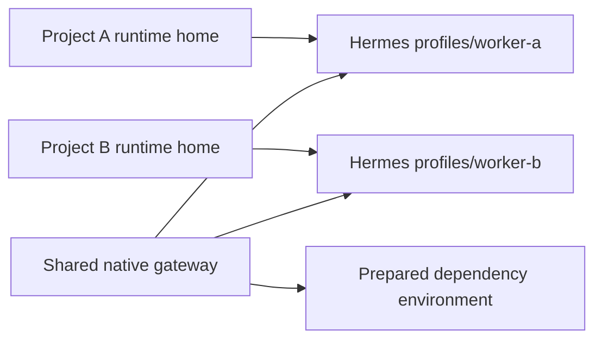

# Design

## Context

Houmao builds standalone Hermes homes under each project runtime root and currently treats the daemon for that exact home as worker authority. Stock Hermes prepares a dependency environment for each standalone data root. Named profiles below one root share the selected dependency generation and can be served by the root gateway. [Proposal](proposal.md) · [Hermes Package Management](https://hermes-agent.nousresearch.com/docs/reference/package-management#writable-state) · [Current Hermes Discovery](../../../src/houmao/agents/realm_controller/backends/hermes_native.py#L286)

The completed #104 and #105 changes establish exact session admission, detached managed self, and qualified unattended behavior. These are the implementation baseline. Their completed deltas must be reflected in the durable specs before the overlapping requirements from this change are synchronized. [Issue #104 Design](../fix-hermes-managed-control-and-fixtures/design.md) · [Issue #105 Design](../enforce-unattended-permissions-and-fix-hermes-mail/design.md)

## Goals / Non-Goals

**Goals**

- Use the same prepared dependencies for managed workers in Service, TUI, and Headless.
- Keep construction, verification, and retirement attributable to one exact managed profile even when the gateway PID is shared.
- Preserve the operator's local home path and workspace controls with explicit ownership of both home artifacts.

**Non-Goals**

- Standalone cold-start timeout tuning, runtime distribution packaging, and unrelated GitHub issues are separate work.
- Owner-side preparation is a deliberate deployment operation. A worker launch consumes the prepared installation and its approved dependency set.
- Existing standalone state uses its recorded retirement path. Cutover creates a named profile with a fresh native conversation.

## Decisions

### Prepare and Select One Owner Installation

Resolve the executable, canonical shared Hermes root, gateway rendezvous, and prepared runtime selection in the selected execution owner's trusted configuration. Bind them to the execution context. The root may be placed on an owner-approved filesystem and should be dedicated to the managed profiles under that configuration. Launch input selects the worker and its profile settings. Shared root selection and dependency updates belong to the owner. This keeps two projects in one execution context on the same prepared runtime while separating other owners' resources.

Use stock Hermes v0.23.4 at `8fc037444731` as the first qualification target. Identify the actual installed build and prepared dependency selection with a read-only check of native runtime evidence. Check currency for the selected source, dependency selection, and provisioned hook along with the required native profile and client capabilities. Directory presence and `hermes --version` alone give insufficient evidence of a current environment. An invalid setup returns an owner-side preparation diagnostic before allocating a profile or retiring an existing worker.

Provision the required extras and the trusted, dependency-free self hook during owner preparation. Launch the shared host and each native client with the qualified prevention of lazy installs, including any generated managed launch helper. Enforce the same gate when starting a replacement host or invoking a finite headless worker. Verify that changes in required dependencies fail before mutation and that the prepared dependency selection stays current across launches. Hermes's source launcher can synchronize a borrowed standalone root, so embedding the current source launcher in each project home would reproduce #106. [Hermes Source Install and Package Rules](https://hermes-agent.nousresearch.com/docs/reference/package-management#source-installs-and-packaged-builds)

### Materialize a Named Profile and a Separate Project Link

Choose a unique native profile name for the owned home. Store it with the owner context, prepared root, canonical profile home, and project-local link in the existing build and runtime binding. Bind cleanup and preserved-home reuse to that recorded identity. Use the normal `runtime/homes/<home-id>` path as a project entry that points into the shared root. Preserve the independent working directory. A profile or project path claimed by a different owner is a preflight error.

Materialize a new profile privately in an undiscoverable sibling staging directory, including the native parked marker and the complete role, settings, and credential references. Publish it atomically at a qualified named-profile path. Stock profile creation can advertise a profile immediately to the running gateway. Parked publication lets Houmao finish configuration and reserve the managed generation before the profile is served. Qualify this staging path against the selected native build's recognition and lifecycle rules. Create the project link using the recorded exact target, with a confined path check and ownership record. Rollback may retry a partially published pair using that record. [Profile Home Layout](https://hermes-agent.nousresearch.com/docs/developer-guide/session-storage) · [Native Parking](https://hermes-agent.nousresearch.com/docs/user-guide/multi-profile-gateways#stopping-one-profile-without-stopping-the-host)

Put the selected provider credential and launch-owned tool settings into private profile-scoped Hermes inputs supported by the qualified native build. The shared gateway environment carries owner-level inputs. Verify that different synthetic profile credentials reach the correct endpoints and that a missing selected credential fails explicitly. Apply `unattended` or `as_is` only to the selected profile, using profile-scoped effective configuration evidence and the existing exact-session ACP edit-mode readback. Keep the profile parked during replacement of launch inputs. Verify accepted fresh configuration before reopening admission.

### Bind Each Native Client to the Shared Gateway and Exact Profile

Acquire or start the qualified root gateway once under an owner-scoped lifecycle lock. Configure native multiplexing explicitly so an initial parked profile does not lead to incidental single-profile startup. Verify the root daemon's canonical root, peer process identity, live incarnation, and expected installed build. Platform account defaults and a local PID alone give insufficient proof of the selected root. Worker start can serve its profile on a verified gateway. Ordinary stop keeps the host available for siblings and subsequent launches.

Discover the worker through the root control socket using native `resolve-profile` for its canonical home. Require a ready, served profile and the necessary capabilities. Mint a profile-scoped one-use ticket and verify `runtime.describe` on the resulting connection. Record the root process and gateway incarnation separately from the profile authority epoch. A profile can be served again under the same gateway PID with a different authority epoch. Require the exact profile ID, profile home, native session ID, workspace, and generation at handoff, observation, interruption, and recovery. [Hermes Gateway Internals](https://hermes-agent.nousresearch.com/docs/developer-guide/gateway-internals) · [Existing Session Verification](../../../src/houmao/agents/realm_controller/backends/hermes_native.py#L539)

Launch TUI and finite Headless through the canonical native profile selector and preserve their full exact-session selectors. Negotiate ACP on its own persistent client and qualify its selected native profile and session after the handshake. Stock clients can attempt gateway startup or reattachment, so verify the serving gateway again before accepting the result. A mismatched or unavailable shared binding fails without starting a per-agent daemon or silently choosing another conversation. Preserve #104 queue receipts and #105 permission and pending-approval behavior with profile-qualified evidence. [TUI Start](../../../src/houmao/agents/realm_controller/backends/hermes_tui.py#L246) · [ACP Binding](../../../src/houmao/agents/realm_controller/backends/hermes_acp_service.py#L155)

### Prove Managed Self From the Routed Execution

A shared daemon has one PID for multiple profiles. Use stock Hermes's `register_session_env` hook as the first implementation path for local tools. The hook runs for a tool spawn with a native profile scope and session identity. A Houmao-owned hook in the prepared installation requests a bounded opaque proof from an owner-local private broker whose issuance checks the OS peer against the verified daemon PID and process birth. The broker issues proof only for the authoritative hook's exact profile, native session, profile authority epoch, and current managed generation. Qualify the stock hook path under actual local tools and its behavior across concurrent profile dispatch before relying on it for signed operations. [Hermes Session Environment Hook](https://hermes-agent.nousresearch.com/docs/developer-guide/plugins#give-each-sessions-commands-its-own-environment-variables) · [Current Detached Self Check](../../../src/houmao/agents/realm_controller/hermes_self.py#L260)

Treat home and manifest environment values as locators. Self resolution verifies the bounded native origin proof, current binding, confined manifest, and live registry generation before obtaining the existing key. Receiving ingress verifies the current native profile liveness and generation before accepting the existing listener-bound SSHSIG proof, including at the protected effect boundary. Revoke origin authority when the profile is unserved, its epoch changes, or its generation retires. Keep proofs, provider credentials, and native tickets out of project links, arguments, logs, and reusable shell state. A runtime without the required stock hook or equivalent qualified origin is incompatible with managed readiness. An individual caller outside an attributable tool path receives unavailable self authority. This is attribution within the configured execution owner trust domain. [Current Self Ingress](../../../src/houmao/agents/realm_controller/gateway_access_runtime.py#L85) · [Execution Context Contract](../../specs/agent-execution-contexts/spec.md)

### Park, Recover, and Remove One Profile at a Time

Fence new managed admissions before stop or replacement. Close the selected owned clients and reconcile native accepted work. Request native park and unserve, then verify the profile is unavailable for routing and any active writers are settled. Stock unserving may acknowledge while reservation or writer cleanup remains pending, so retain evidence and report that state before reusing or removing a profile home. Reopen a retained profile only through a qualified start or relaunch that rechecks its configuration, exact session, and fresh managed generation.

Tie profile restart and crash recovery to the context-owned gateway lock and current recorded claims. Reverify every affected profile and its saved conversation under a replacement host. An unknown admission retains its evidence and closed input until settlement. Shared host shutdown is an owner-level maintenance operation that verifies the incumbent and confirms the absence of active or pending profile claims. Fixture teardown uses its test-owned root and exact host identity.

Update build cleanup and clean replacement to plan two actions. After owner and retention checks, invoke native profile deletion in the prepared root so Hermes tombstones the profile, releases native ownership, and settles routing state. Then unlink the recorded local alias after checking the link itself against the expected target. A raw path traversal through the link cannot authorize deletion. Retain the binding and disposition until both actions settle. If native cleanup interrupted after removal, use the stock identity-settlement operation only for the exact still-retired profile identity. Reject reusing a pending name and recheck both actions on retry. [Hermes Profile Deletion](https://hermes-agent.nousresearch.com/docs/reference/profile-commands#hermes-profile-delete) · [Build Cleanup](../../../src/houmao/srv_ctrl/commands/runtime_cleanup.py#L637)

## Risks / Trade-Offs

- A shared host increases the impact of host loss. Keep host operations owner-scoped and require profile-qualified recovery and reconciliation.
- Profile parking and deletion can outlive the initial CLI response. Require release evidence before handing off a preserved or replacement home.
- Profile dependency changes can affect the selected environment for siblings. Gate those changes through owner preparation and qualify ordinary worker startup with dependency installation disabled.
- A stock tool subprocess may bypass or omit the qualified origin hook. Verify the actual hook path early and test missing, copied, and stale evidence before enabling signed self on the shared gateway.

## Migration Plan

Prepare and qualify one native Hermes installation per participating execution context. Deploy the new binding and fixtures before enabling named-profile launches. Existing standalone workers retain recorded authority for inspection, stop, and explicit cleanup. Operators start a fresh named-profile launch for cutover. A request to carry an exact standalone conversation into the new layout fails before retiring that worker. Retained standalone homes stay eligible for their existing scoped cleanup after retirement. Subsequent named-profile relaunches reuse the canonical home for exact continuation.
