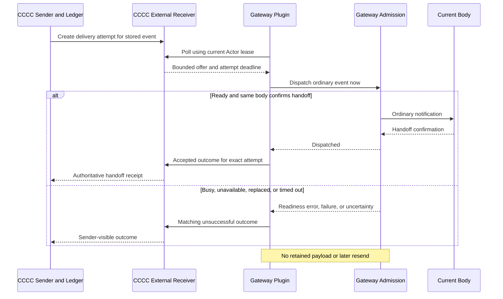

# Design

## Context

See [proposal.md](proposal.md) for the outcome and issue #77 scope. The design applies because this change crosses a separately installed Python package, the gateway dispatch boundary, and the CCCC service.

The inspected CCCC reference is `ChesterRa/cccc` at `d12732ebd6dfdbc260a59a286bd5e510d04d4832` (0.4.56). Its native daemon and Web UI run through [the separate Pixi workspace](../../../tools/cccc/README.md), as recorded in [SERVICES.md](../../../SERVICES.md). That qualification establishes service startup, not external receiver support.

Relevant existing boundaries are:

- [The public SDK](../../../src/houmao/gateway/plugins/contracts.py) supplies immutable owner/binding context, private selected credentials, contained non-message state, supervised workers, and immediate `events.dispatch()`. Plugin registration permits relative HTTP routes, not application mutation or inbound WebSocket routes.
- [The plugin guide](../../../docs/reference/gateway/plugins.md) requires gateway restart for changed implementations, immutable settings, or credential references. The body can remain running. Dispatch returns only after same-body handoff; readiness refusal cannot become a local retry queue.
- [CCCC Web messaging](../../../extern/orphan/cccc/crates/cccc-web/src/routes/messaging/web_authority.rs) forces the signed-in human `user`. Its administrator MCP endpoint is privileged, and its Web Model connectors are provider/conversation-specific. None is an ordinary generic Actor endpoint for this integration.
- [CCCC native receivers](../../../extern/orphan/cccc/crates/cccc-contracts/src/local_session.rs) identify Codex, Claude, Pi, and OpenCode sources. Their receiver and delivery code supplies useful lease, generation, and acknowledgement patterns, but forging one of those sources would misrepresent the controlled body.
- [CCCC delivery recovery](../../../extern/orphan/cccc/docs/guide/runtimes.md#delivery-and-recovery) separates ledger append from claimed/accepted/failed/ambiguous handoff. Existing activation recovery can recover pending work. The new external receiver must not make receiver reconnect equivalent to a fresh sender retry.
- [Email bindings](../../specs/agent-mailbox-bindings/spec.md) remain exactly one optional offline slot and one optional online slot. Canonical mail identity is online-first independently of connectivity. CCCC is outside that model.

## Goals / Non-Goals

**Goals:** Prove extension through independently installed wheels; make every Actor operation owner-bound; establish a real provider acknowledgement boundary; and preserve the current body, identity, and ordinary admission behavior.

**Non-Goals:** Broaden the SDK, expose remote gateway routes, install MCP into bodies, give CCCC process ownership, make CCCC an email provider, administer accounts from plugin routes, or claim that storage acceptance means completed work. Deferred Mail methods are introduced by change 02.

## Decisions

### 1. Ship One Optional Distribution and a Durable Provider Dependency

Use distribution `houmao-cccc`, import package `houmao_cccc`, and entry point `cccc` in `houmao.gateway_plugins`. Place released plugin source under `packages/houmao-cccc/`, with its own build metadata, Houmao compatibility range, and thin `houmao-cccc` CLI. This introduces a purpose-specific distro location because the core package and utility example do not represent an independent optional product. Update the repository purpose map and contributor checks during implementation. Keep the core wheel's explicit `src/houmao` boundary intact.

The plugin imports only public SDK types and its own dependencies. Use an asynchronous HTTP client; no additional plugin-support library is needed. Internal modules separate configuration, provider protocol, references, service operations, connection supervision, HTTP routes, and the thin CLI. Core Houmao must not import this optional package.

Extend CCCC with a generic external Actor/receiver source, independent of native CLI runtime variants and Web Model providers. Prefer an upstream implementation. Until a suitable upstream revision is available, retain a reviewed patch series and upstream revision manifest under `extern/tracked/cccc-receiver/`. Include protocol documentation, provenance, required license notices, and verification instructions there. Do not rely on changes made only in the ignored reference checkout.

The native utility builds a selected immutable upstream revision plus the tracked patch series in a disposable prepared source tree. Pin and report the revision, patch digest, and protocol version. Production users can select an already compatible CCCC deployment; the Python wheel never imports a source checkout or builds Rust on gateway startup. A later upstream equivalent can replace the patch series after the same conformance tests pass.

Alternative considered: put a built-in integration in Houmao or reuse administrator MCP/Web sends. Neither demonstrates the independent package boundary, and privileged Web/MCP access does not establish the required Actor identity or receive semantics.

### 2. Bind Configuration to One Provisioned Actor

The immutable plugin configuration selects `endpoint`, `group_id`, `actor_id`, and `actor_generation`, plus finite transport/content settings. `binding_identity()` derives a deterministic secret-free identity from the normalized endpoint and that Actor registration. The host adds its owner, runtime, implementation, and instance scopes. Credential bytes and connection epochs do not enter binding identity.

The selected private credential document declares its intended `agent_id`, matching endpoint/Actor descriptors, and provider bearer token. Validate those declarations against `context.owner` and configuration before opening business operations. The provider independently derives Group/Actor authority from the token, rather than trusting request selectors. Houmao interprets its agent ID; CCCC can retain an opaque association label without generating or interpreting Houmao identities. No name hash, email lookup, or new cluster identifier is introduced.

Credentials are required even for the local qualification deployment. Read them through the SDK's explicit private reference, with no environment/home discovery. Reject URL userinfo and credential query parameters. Require verified HTTPS for non-loopback service endpoints; permit explicit HTTP for local development. Refuse cross-origin redirects and service-supplied credential forwarding.

An external administrator/hub provisions the existing Group/Actor and mints its narrow receiver grant. A provider setup command can export the grant directly into a private file. No account creation, password reset, or management credential enters plugin attach or reconnect. Recreated Actors receive a new generation and require explicit operator reconfiguration.

Alternative considered: use the current canonical email or Actor display name as the binding key. Both can change independently of the owner, and Actor identifiers can be reused after removal.

### 3. Reuse Gateway Attachment and Supervised Connection Lifecycle

Install the wheel into the gateway interpreter, then select it through the existing `--plugins-config` or public Python configuration surface. A changed selection requires explicit gateway detach/attach; it never relaunches the body. A loaded instance can connect, disconnect, reconnect, or reread its already selected credential file. Ordinary routes accept an expected binding ID but no new endpoint, Actor, implementation, or credential path.

Create resources only in the plugin lifespan after host route validation. Start a supervised connection loop without waiting for a remote service to become healthy before core startup finishes. Model connection phases as `unattached`, `connecting`, `connected`, `reconnecting`, `degraded`, and `disconnected`, projecting them into the SDK's existing connection states. Distinguish protocol incompatibility and stale Actor identity from transient connection loss.

Serialize credential refresh/disconnect against intake using a local connection epoch. Close admission to the retiring epoch, cancel unstarted work, and finish or report uncertainty for started operations within a finite deadline. Never retry a mutation to make retirement appear successful. The provider lease generation fences old polls and outcomes independently of local cancellation. Core status and unrelated plugins remain available.

Alternative considered: add mutable plugin selection or a new gateway-wide attachment authority. The existing restart boundary already meets attachment without body restart and avoids changing the SDK for this provider.

### 4. Add an Authenticated External Receiver Protocol to CCCC

The proposed provider namespace is `/api/v1/external-receiver/v1`. These routes do not exist in the inspected stock service. Mount them with dedicated fixed-Actor authentication without weakening authentication or CSRF enforcement on existing Web routes. Explicitly deny administration, process-control, arbitrary daemon operations, and sender overrides.

The protocol supplies:

| Surface | Purpose |
| --- | --- |
| Binding/capability inspection | Confirm the grant's Actor generation, protocol version, supported operations, and limits |
| Receiver acquire/renew/release | Maintain one finite Actor lease with a monotonically replaced connection generation |
| Receiver next | Bounded long poll for at most one new delivery attempt |
| Receiver outcome | Settle one attempt with confirmed, refused, failed, or uncertain handoff |
| Chat send/reply/retry | Mutate as the authenticated Actor and reconcile caller operation IDs |
| History/members/delivery observations | Read Actor-visible bounded results and authoritative receipts |

Use an outbound HTTP connection from the plugin. Long polling avoids a public gateway callback and fits SDK v1 without adding inbound WebSocket support. The provider daemon owns leases and delivery decisions; the Web layer is a scoped protocol projection. Register generic external actors as externally controlled receive endpoints, with no CCCC-launched command or fabricated native session. Stopping a Group disables delivery; it does not stop the Houmao body.

The provider allows one active lease per Actor registration and one outstanding offered attempt by default. Concurrent acquisition conflicts. After a gateway crash, a replacement waits for the existing lease to expire; ordinary Actor credentials cannot supersede a live lease. Early takeover requires an explicit CCCC operator action through a separate provider management surface, with operator authority absent from plugin credentials and routes. Every operation validates the grant, Actor registration, and relevant lease generation again at its authoritative mutation boundary.

A proposed initial deployment uses a 45-second lease with 10-second renewal and at most a 20-second long poll. Delivery attempts carry finite remaining time, bounded by a 10-second gateway dispatch budget plus a small settlement margin. The plugin uses monotonic local deadlines derived from remaining duration; correctness does not depend on synchronized wall clocks. Smaller negotiated/provider limits win.

Clean shutdown or reconnect can release the current process's own lease using its live lease authority before acquiring another. A crashed gateway leaves no automatic lease-resumption mechanism: the replacement reports `receiver_lease_conflict` with bounded retry timing until expiry, or until an operator explicitly fences the old generation. With the proposed default, crash recovery can wait for up to the remaining 45-second lease lifetime. Acquiring a new lease changes intake authority only; it never retries an offered, refused, or uncertain message. See [the accepted lease-recovery decision](explore/adrs/0001-wait-for-receiver-lease-expiry.md).

Immediate takeover by any holder of Actor credentials and private lease-resumption secrets were considered. Waiting for expiry keeps ownership and recovery state simpler; explicit operator takeover remains available for an urgent recovery.

Alternative considered: a separate companion that watches the ledger and forwards text. Without an authoritative receiver/delivery hook it cannot establish correct receipts or prevent parallel native delivery. The chosen patch supplies that hook in CCCC rather than treating a watcher or PTY write as confirmation.

### 5. Keep Each Delivery Attempt Immediate and Fenced

An offer identifies native `event_id`, `attempt_id`, mode, Actor generation, lease generation, original sender/reply ancestry, and finite deadline. Validate the complete envelope and form an ordinary `PluginEvent` with the native event ID as correlation and selected-binding provenance. The gateway's dispatch port performs readiness, pending-input/hook, incarnation, and actual handoff checks. No direct prompt-control, reset, interrupt, or raw terminal path is used.

Map SDK `409` to retryable readiness refusal, `503` plus `dispatch_outcome=not_sent` to unavailability/failure, and `dispatch_outcome=unknown` or connection loss after an offer to uncertainty. Invalid envelopes fail permanently. Discard local payloads when the attempt ends. Limit settlement to the live attempt scope; repeating an outcome submission never calls dispatch again. Do not persist an outcome for gateway-side replay after restart.

Provider offers are owned once, not reissued as a reconnect convenience. Persist claims before external I/O and terminal outcomes in the CCCC authority. An offered attempt without a settled outcome after receiver/daemon loss becomes uncertain. Reject late settlement for another lease, generation, or expired attempt. Accepted and uncertain attempts are not eligible for native automatic recovery. A refused/failed attempt remains sender-visible and is not reactivated merely by receiver or Group reconnection.

An explicit original-sender retry targets the existing source event, obtains a new attempt ID, and independently tests readiness. Uncertain retry requires explicit `allow_uncertain_retry` acknowledgement because it can duplicate real handoff. Retrying a send operation ID reconciles the original ledger write; it does not request delivery retry. Preserve that distinction in both APIs and documentation.

Alternative considered: hold refused offers until idle or persist a last-seen message queue in plugin state. Both violate the existing agent-side no-cache/no-resend contract.

### 6. Separate Receipt Recovery, History, and Agent Work

Maintain only non-message connection metadata, scoped observation cursors, and reference-signing material in plugin state. CCCC owns the durable message and attempt receipts. A connection worker can reconcile bounded delivery metadata after restart, but it cannot turn ledger observations into prompt submissions.

Expose typed outcomes with separate `stored` and per-recipient handoff fields. Preserve provider attempt/event identities and unknown or partial results. Provider acknowledgement means handoff, not agent completion; replies and CCCC reply obligations remain separate facts. A failure after a completed successful handoff cannot retroactively alter that success.

Use caller `operation_id` on outbound send/reply. CCCC scopes idempotency to the Actor registration and operation, checks normalized request consistency, and returns the original event on matching reuse. The plugin does not automatically replay mutations after network errors. Explicit sender retry and receipt lookup are the recovery tools.

History defaults to 50 messages, with a hard maximum of 100 to match the inspected provider history limit. Apply a finite response byte budget, initially 256 KiB, and finite network deadlines. Preserve explicit native reply IDs while using versioned opaque `event_ref` and continuation handles for targeting. Authenticate those handles with owner/binding/generation and query scope; a persisted private signing key can preserve them across gateway restarts. Handles confer no provider authorization by themselves.

On stale observation/history cursor return a typed gap or stale-cursor response and offer bounded restart/reconciliation. Do not fetch all retained history, consume Mail, or dispatch the observed history. Byte truncation must be visible; incoming prompt payloads are rejected rather than silently truncated. Count/transfer bounds do not claim constant server-side ledger cost or target-scale capacity.

### 7. Publish a Narrow Agent-Facing Surface

All plugin paths below are relative to `/v1/plugins/{instance_id}`; host `/_status` remains reserved.

| Method and Path | Behavior |
| --- | --- |
| `GET /binding` | Curated owner/Actor descriptor and maintained connection snapshot |
| `GET /capabilities` | Effective provider/plugin operations, recipient scope, limits, and receipt meanings |
| `GET /members` | Actor-visible membership, public roles, and receive capability |
| `POST /connection/connect`, `/connection/disconnect`, `/connection/reconnect`, `/connection/refresh-credentials` | Same-binding connection operations |
| `POST /chat/send` | Explicit recipients, `send` or `request_reply`, expected binding, and operation ID |
| `POST /chat/reply` | Scoped parent reference, expected binding, and operation ID |
| `POST /chat/retry` | Fresh sender-owned attempt against an existing outgoing event |
| `GET /chat/history` | Bounded page or exact visible event lookup, without consuming Mail |
| `GET /chat/deliveries` | Bounded receipt lookup for scoped outgoing/incoming references |

The thin CLI delegates to these routes, accepts gateway URL and instance selection, and never resolves service credentials. Require explicit recipients; initially support the bound Group's qualified Actor/user audience and advertised aliases only. Reject mixed human/agent audiences, unsupported cross-Group routing, and email-looking recipients instead of attempting address translation. `request_reply` still produces ordinary gateway input. Mail is unavailable in change 01 even if the provider advertises native Mail elsewhere.

Member projections allow only public membership facts, not runtime commands, environment, credential paths, or homes. Unverified foreign participants stay CCCC participants; no synthesized Houmao IDs. Logs and host status remain content-free. Curated binding information is an explicit plugin response, not a raw configuration dump.

### 8. Qualify Installed Packages and the Real Provider Boundary

Use wire-level fake-provider tests for deterministic protocol errors, leases, duplicates, deadlines, retry authorization, content bounds, and sanitized failures. Reuse the installed-wheel pattern in [existing gateway qualification](../../../tests/integration/agents/realm_controller/test_gateway_plugin_packages.py), extending it to the real CCCC plugin and two owner-distinct gateways outside source checkouts.

Live service qualification must build/select the compatible CCCC revision and patches, provision isolated normal Actor grants as a separate setup action, and inspect authoritative ledger/attempt receipts. Exercise attachment, send/reply, partial receipts, busy refusal, body death/replacement, gateway/CCCC restart, lost acknowledgements, explicit retry, history cursors, and cleanup. Persistent stand-in bodies with PID/conversation markers remain required for deterministic crash and race oracles; report that scope precisely.

Issue #77 acceptance additionally requires a small smoke with two real managed coding-agent instances, distinct gateway/Actor bindings, the installed Houmao/plugin distributions, and the compatible actual CCCC service. One agent sends chat through its local gateway; the receiving real agent processes the ordinary notification and replies through its own gateway. Verify native event/reply ancestry and record client versions, selected model/fixture case, agent/Actor identities, and safe result references. The two agents may use the same supported client/profile; a full client/model matrix is not required for this acceptance gate.

Use the supported repository fixture launcher with an explicitly selected self-hosted-compatible API or cloud API configuration. Keep model and CCCC credentials in their existing private local sources, never tracked files or reports. Model-client MCP remains unchanged. This smoke is required before closure of #77; missing credentials, service compatibility, or an unsuccessful live run leave acceptance pending, even if all stand-in tests pass. Change 02 adds its own required two-real-agent Mail smoke before #78 closure. See [the accepted real-agent qualification decision](explore/adrs/0002-require-real-agent-smoke-for-issue-closure.md).

Create a scenario-to-evidence acceptance map and sanitized qualification report. Missing prerequisites fail setup or remain explicitly unexecuted without waiving either required qualification layer. Report native service health, protocol conformance, installed wheel behavior, deterministic stand-in checks, and the required real-agent smoke separately.

## Risks / Trade-offs

- Provider source extension and maintenance: pin the upstream revision, retain durable patches, test authentication and receipts, and replace patches only after equivalent upstream qualification.
- CCCC's existing activation recovery can conflict with sender-owned retries: give the external receiver an explicit attempt policy and test that reconnect does not revive failed or uncertain offers.
- A successful handoff acknowledgement can be lost: retain provider uncertainty and require explicit duplication acknowledgement for retry; do not claim exactly once.
- Credential rotation or lease loss can race mutations: fence both local epochs and provider generations, retain the original operation scope, and report uncertain outcomes without replay.
- An optional distribution adds packaging work: build it independently and enforce the public-SDK-only boundary in installed-wheel tests.
- Long polling creates per-Actor connections: enforce finite concurrency, deadlines, backoff, and byte limits; qualify the executed workload without claiming unmeasured scale.

## Migration Plan

1. Verify the completed gateway plugin change is implemented and synchronized into main specs before starting this change. Read the current email contracts to preserve their boundaries.
2. Implement and qualify the provider receiver extension as a reproducible pinned dependency before advertising plugin chat support. Preserve the stock reference checkout for comparison.
3. Build/install the optional wheel and explicitly configure isolated development Actors. Restart only selected gateways, preserving their bodies and mail bindings.
4. Run deterministic, installed-wheel, actual-service, and required two-real-agent chat qualification; document qualified protocol/version/patch facts and keep issue acceptance pending until all required checks pass.
5. Enable production bindings explicitly. Roll back by disconnecting/revoking the receiver, disabling the plugin through gateway configuration, and restoring a compatible provider build/state snapshot. Never replay uncertain attempts as part of rollback.
6. Synchronize this change's capabilities before applying `cccc-02-add-explicit-deferred-mail`. Keep issue #78 pending until that successor independently passes its acceptance checks.
