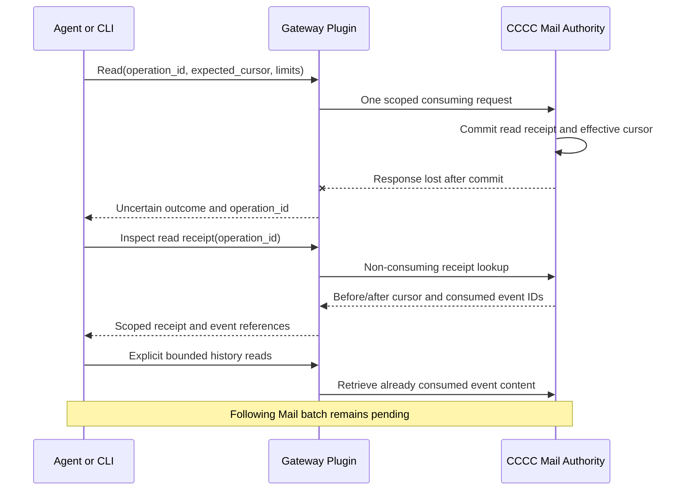

# Design

## Context

See [proposal.md](proposal.md) for issue #78 and the [preceding chat design](../cccc-01-add-owner-bound-chat-plugin/design.md) for installation, fixed-Actor authentication, leases, immediate dispatch, and deployment. Implement this change only after change 01 is qualified and its three capabilities are synchronized into main specs.

The inspected CCCC 0.4.56 code has distinct [peek/read/history operations](../../../extern/orphan/cccc/crates/cccc-daemon/src/ops/messaging_inbox.rs). `inbox_read` selects the next deferred batch and advances its cumulative append-order boundary. It is not an individually marked email list. [Cursor recovery](../../../extern/orphan/cccc/crates/cccc-core/src/inbox.rs) writes a pending marker, appends a `mail.read` fact, and persists the cursor under an exclusive lock. It does not expose a caller read-operation receipt for safely reconciling a lost response.

[CCCC notice policy](../../../extern/orphan/cccc/docs/reference/features.md#built-in-delivery-notices) is one bounded content-free notice for a concrete pending batch, without periodic escalation. Houmao's existing offline/online email notifier deliberately preserves periodic reminders for unchanged eligible work. These are separate policies, and neither overrides the other.

This design adds a Mail extension to the provider and optional distribution established by change 01. It does not modify the core email protocol or the generic gateway SDK.

## Goals / Non-Goals

**Goals:** Preserve native ordered consumption; make every read's side effects explicit and reconcilable; bound work before mutation; and keep CCCC usable independently of email provider health.

**Non-Goals:** Add CCCC as `mailboxes.online`, introduce another email slot, synthesize email archive/read flags, run an agent-side resend scheduler, promote Mail bodies into direct chat, or guarantee that consumption means the agent completed the task.

## Decisions

### 1. Extend the Same Plugin Through Explicit Mail Operations

Keep one installed `houmao-cccc` distribution, one authenticated Actor binding per instance, and the same connection epoch and provider grant. Extend the versioned provider capability inventory with qualified `mail.send`, `mail.reply`, `mail.peek`, `mail.cursor`, `mail.read`, and `mail.read-receipts` support. The effective plugin capabilities are the intersection of implemented plugin behavior, provider support, and grant authority.

Mail inherits change 01's accepted crash-recovery rule: a replacement gateway waits for an unexpired receiver lease unless a CCCC operator explicitly authorizes early takeover. Neither lease acquisition nor operator takeover consumes pending Mail or retries an unsettled notice.

Do not advertise consuming read until count/byte bounds, expected-cursor checks, operation receipts, and crash recovery are available together. An older chat-only provider remains usable for chat; it cannot silently fall back to stock `inbox_read`. Mail support is additive to the existing extensible protocol, not a revision of its owner or dispatch authority.

Select Mail by plugin instance and operation path, with response `backend="cccc-mail"`, binding identity, Actor address, native event IDs, and opaque references. Keep `/v1/mail/offline`, `/v1/mail/online`, the runtime manifest slots, registry ownership, and canonical mail identity unchanged. No discovery heuristic maps an email address to an Actor or chooses CCCC after an email failure.

Alternative considered: register CCCC as another generic email transport. That would violate the two-slot contract and misrepresent its recipient scope, ordered read cursor, and unsupported archive operations.

### 2. Preserve Deferred Send and Reply Semantics

Mail send/reply require expected binding ID and caller operation ID, using change 01's provider-side idempotency and uncertain-mutation behavior. Force native `mail` mode; a caller wanting immediate chat uses the distinct chat operation explicitly. Default recipient support is qualified Actors in the selected Group, with no human-user, arbitrary-email, offline-principal, or unqualified cross-Group delivery.

Preserve native event and reply-parent IDs. Sending a reply alone does not consume the original pending batch, mark an email answered, or archive anything. Report `stored` separately from `consumed`, notice handoff, and task completion. Surface unsupported email-style move/archive, per-message mark-unread, attachment, or submission operations directly.

Alternative considered: translate Mail reply into default CCCC direct send, or apply the email shared-reply state transitions. Both introduce effects the caller did not request and move the native read boundary without an explicit read.

### 3. Separate Non-Consuming Inspection From Mutation

Provide these routes beneath the existing `/v1/plugins/{instance_id}` namespace:

| Method and Path | Behavior |
| --- | --- |
| `GET /mail/status` | Maintained pending/connection snapshot with observation age, count accuracy, and unknown/stale markers |
| `GET /mail/peek` | Explicit bounded provider read of the next eligible batch and its current cursor; no consumption |
| `GET /mail/cursor` | Explicit non-consuming authoritative cursor inspection |
| `POST /mail/send` | Actor-addressed deferred send with expected binding and operation ID |
| `POST /mail/reply` | Scoped deferred reply with expected binding and operation ID |
| `POST /mail/read` | Explicit next-batch consumption with expected binding, expected cursor, operation ID, and limits |
| `GET /mail/reads/{operation_id}` | Non-consuming lookup of this binding's read outcome and bounded event references |

Extend the existing CLI with matching `mail` commands. Preserve its gateway-only connection and credential-free body interface. Use `chat/history` exact event lookup for content recovery after a consumed response is lost. A sequence of explicit bounded lookups can recover a receipt's events without scanning all history; apply request/time budgets and resumable progress to any convenience command.

Host `/_status` and maintained Mail status read snapshots without provider calls. `peek`, `cursor`, and receipt lookup are explicit service operations with finite deadlines. Count estimates identify caps/lower bounds and do not become exact totals merely because one bounded page was returned. Cursor recovery may finish an already committed provider journal operation, but inspection never initiates another read or consumes new Mail.

Alternative considered: implement status by calling the native consuming read. That would change provider state during polling and hide messages from the subsequent explicit read.

### 4. Bound the Complete Batch Before Committing It

Defaults are 50 Mail messages, a hard maximum of 200, and a 256 KiB complete-response budget with an initial supported maximum of 1 MiB. Smaller provider limits apply. These are negotiated defaults and compatibility limits, not performance claims. Make count, byte, and network/time budgets visible in capabilities.

The provider chooses the largest complete leading batch fitting the selected limits before committing the cursor. Account for serialized message data, receipt metadata, and bounded reference/wrapper expansion when calculating the wire budget. The plugin must not trim an already consumed result to meet its own response size. Never consume a count-bounded batch first and discard the tail afterward.

If the first pending message exceeds the supported complete-read budget, return a visible size error with unchanged cursor. Document that limitation and any separately qualified native content-retrieval procedure; do not silently skip the item or invent successful consumption. Peek/history can expose explicitly incomplete previews when supported, while consuming read returns complete selected message content or fails before commit.

Alternative considered: rely on the native count cap alone. One large message can exceed an HTTP/gateway response budget even in a one-message batch.

### 5. Commit Cursor Preconditions and Read Receipts in the Provider

Add a provider operation combining the existing Actor serialization/journal mechanism with an expected-cursor precondition and caller `operation_id`. Scope operation IDs to the Actor registration and operation kind. Normalize the expected cursor and count/byte limits into a request fingerprint.

Within the authoritative provider critical section:

1. Validate the current grant and Actor generation. Recover any earlier committed journal decision.
2. Resolve an existing matching operation ID before checking its now-stale cursor. Return its original receipt without new consumption; reject conflicting request reuse.
3. Compare the expected cursor with current authoritative state. A different cursor returns `409 cursor_conflict`, with no batch selection side effect.
4. Choose the complete leading batch within the pre-commit budgets.
5. Commit a durable read decision containing operation ID, fingerprint, Actor generation, before/after cursor, exact bounded native event IDs, and outcome. Couple its effective cursor change to the same journal/ledger recovery boundary.
6. Return the consumed messages and committed receipt. An empty read commits a stable empty operation outcome without advancing the cursor.

The read receipt is authoritative metadata attached to CCCC's existing storage; it is not another message store or an agent-side cache. Reuse native messages for content retrieval. Extend the existing pending marker/read fact recovery so a crash after durable fact append but before cursor publication exposes the same consumed boundary and operation receipt. Do not write a receipt after an independently completed cursor change and call that atomic.

Keep completed operation decisions durable for the Actor registration, including empty results. If an active receipt index is compacted, archived facts or explicit expiration authority must prevent reusing an old completed ID as a new read. Initial implementation can retain the metadata for the registration lifetime. Any later retention policy must preserve the same contract. Existing provider state snapshots and receiver patch versions must be backed up and rolled back together.

Alternative considered: retain the batch in the gateway until the client acknowledges it. That introduces an agent-side message cache and still cannot coordinate atomically with CCCC's cursor. Plain cursor inspection without operation identity is also insufficient to attribute consumption during concurrent reads.

### 6. Reconcile Lost Responses Without Advancing Again

The plugin makes one consuming provider request per caller read and disables automatic HTTP retries for it. If the response is lost, return an uncertain result containing the caller operation ID and expected binding. The CLI must surface those facts without printing private provider credentials. It must not silently generate a new operation ID to try again.

Receipt lookup reports the original consumed or empty result. A repeated matching `POST /mail/read` returns `already_completed` plus that original receipt and does not consume later Mail. Distinguish this response from a newly successful empty read; callers can use history to recover content. A missing or unavailable receipt during an unresolved operation remains unknown and is not proof of failure. Caller-directed repetition with the same operation ID remains safe because the provider serializes and resolves that identity; the plugin does not initiate it automatically.

This gives a precise provider read-operation guarantee. It does not strengthen the generic plugin event source ID into an exactly-once body-processing guarantee. Chat handoff outcomes, provider Mail consumption, and agent task completion remain different facts.

### 7. Keep Notices and Email Reminder Scheduling Separate

CCCC remains responsible for deciding when its native content-free pending-batch notice is eligible. Preserve the qualified policy (currently one bounded notice for a concrete batch, default delay 1,800 seconds, without periodic escalation). Ensure generic external receiver actors participate in that policy without inheriting a native runtime process or direct input path.

A notice carries only the CCCC Mail binding, pending metadata, and instructions for explicit inspection; it carries no Mail body. Deliver it through change 01's ordinary immediate handoff. If the body is busy or unavailable, report the failure or uncertainty to CCCC and discard the plugin's attempt. Reconnecting or becoming idle is not an instruction to replay that notice. Provider-authorized fresh attempts remain subject to its qualified notice policy and ordinary sender/attempt rules.

Mail status refresh and reconnection can update bounded metadata without consuming Mail or creating prompt work. Notice handoff does not advance the cursor. Preserve offline/online email periodic reminder intervals, admission keys, continuously eligible compaction memory, and archive completion guidance in their existing scopes. Do not run the core email notifier or a compaction/reset workflow on a CCCC batch.

Alternative considered: feed CCCC pending Mail into the existing email notifier. That imports a different completion model and reminder policy, and would bypass the plugin's immediate refusal contract.

### 8. Qualify the Provider Journal and Cross-System Boundaries

Add wire-level tests that distinguish peek/status/history from read and inspect exact provider requests. Cover interleaved chat/Mail, ordered batching, count and encoded-byte bounds before commit, oversize head items, stale expected cursor, concurrent readers, matching/conflicting operation reuse, empty-operation reuse after new arrival, lost read responses, and crash recovery after read-fact append.

Run actual-provider tests with two independent installed gateways and normal Actor grants. Prove that cursor changes occur only on explicit reads, no notice consumes a batch, replacement credentials/generations reject old handles, and recovery returns the original operation result without consuming the following batch. Exercise the provider's real journal and receipt routes, not only an adapter stub.

Add coexistence checks with offline and online slots: send CCCC Mail while a selected test Stalwart endpoint is unreachable, preserve canonical online identity, then restore the endpoint and verify existing periodic email reminders and compaction state. Use an isolated fault proxy or unavailable test URL instead of stopping unrelated development accounts. Verify explicit email and CCCC selections never mirror or fail over.

Issue #78 acceptance additionally requires a small smoke with two real managed coding-agent instances using distinct gateway/Actor bindings, installed Houmao/plugin distributions, and actual compatible CCCC. Verify agent-authored deferred send, explicit next-batch read by the receiving agent, and an agent-authored Mail reply with native ancestry. The smoke must demonstrate deferred behavior and cursor advancement without relying on a stand-in body to perform these agent actions. It is a separate required gate from change 01's chat smoke; passing chat does not establish Mail acceptance.

Use the existing supported fixture launcher and explicitly selected self-hosted-compatible or cloud API configuration. The agents may use the same supported client/profile; no full client/model matrix is required. Keep model and CCCC credentials in private local sources, record secret-safe client/profile/result references, and leave #78 acceptance pending if credentials are missing or execution fails. Deterministic stand-in tests remain required for crash, cursor, and race coverage. This follows [the accepted real-agent qualification decision](../cccc-01-add-owner-bound-chat-plugin/explore/adrs/0002-require-real-agent-smoke-for-issue-closure.md).

Extend the deployment example and agent guidance to explain consuming reads, receipt-based recovery, unsupported archive behavior, actor addressing, notices, and selected backend output. Record actual provider revision/patch/protocol identity and a scenario acceptance map. Report deterministic stand-in/provider qualification and the required real-agent Mail smoke as separate evidence layers; private credential sources remain outside tracked files.

## Risks / Trade-offs

- Cursor changes can succeed before an HTTP response: commit operation receipts in CCCC and require explicit non-consuming reconciliation.
- Provider journal and receipt schema changes affect crash recovery: test interruption at durable-fact/cursor boundaries and roll back compatible source/state snapshots together.
- Durable empty-read receipts can grow provider metadata: retain decisions safely, measure the executed workload, and avoid unsafe ID reuse when introducing future compaction.
- A large first message can block ordered complete reads: report the limit without skipping, consuming, or silently truncating it; document the actual supported recovery path.
- Existing CCCC native actors may also consume Mail: keep expected-cursor compare and Actor serialization at the provider boundary so gateway-only locks cannot give false isolation.
- Native notice policy differs from periodic email reminders: document the distinction and test both policies together without translating either backend's completion semantics.

## Migration Plan

1. Confirm change 01 is implemented, qualified, and synchronized. Reuse its installed package, provider pin, Actor grants, and external receiver authority.
2. Extend the pinned provider with Mail capabilities and read-operation journal/receipt support. Test it before advertising consuming-read capability.
3. Upgrade the plugin and restart only the gateway. Preserve existing email slots, body PID, Actor binding, and compatible provider Mail cursor; do not import Mail bodies into local state.
4. Run deterministic, installed-package, actual-provider, crash-recovery, coexistence, and required two-real-agent Mail qualification. Update the compatibility manifest, deployment documentation, and acceptance evidence; keep #78 acceptance pending until every required check passes.
5. Enable Mail explicitly per instance. For rollback, disable the capability and restore compatible provider source/state together when needed; preserve read facts and never rewind a committed cursor or retry an uncertain read/send automatically.
