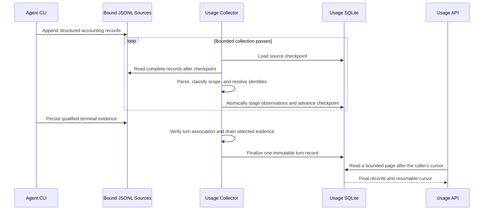
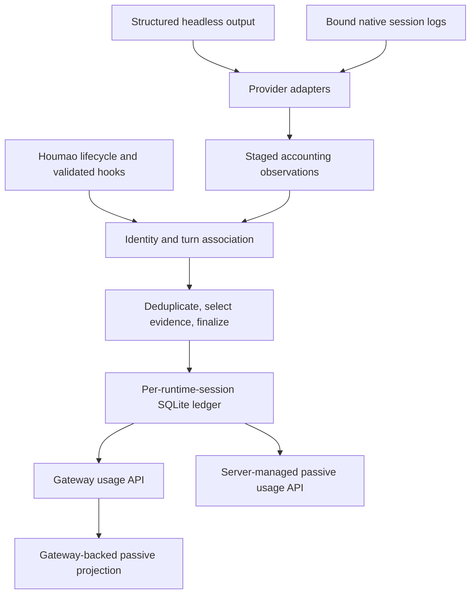

# Design

## Context

See [proposal.md](proposal.md) for motivation and the delta specs for the external contract. The relevant implementation constraints and reference findings are:

- `CanonicalHeadlessEvent.raw_payload` preserves structured provider evidence. The rendering helper `_normalize_usage_mapping` omits accounting fields and cannot define the accounting contract.
- Native session logs provide structured evidence independently of TUI or headless execution. Houmao's launch plan identifies the provider home; existing hook observations expose session and prompt/turn identities for association.
- Managed headless paths share `HeadlessInteractiveSession` and `HeadlessCliRunner`. Passive-server artifacts live under its managed-agent root, while ordinary runtime and gateway artifacts live beside the session manifest.
- `HeadlessSessionState.turn_index` advances only after successful execution. Failed attempts can repeat it and overwrite index-only artifact directories.
- ccusage at `aacb63f` demonstrates native-log discovery, provider-specific token mappings, transcript deduplication, and fork/subagent replay handling. Its report defaults and heuristics are references to qualify, not Houmao's public contract.
- Local Codex source at `0910087` fills exec `turn.completed.usage` from thread totals in `codex-rs/exec/src/event_processor_with_jsonl_output.rs::usage_from_last_total`. Its `TokenUsageRecord` separately carries request usage, response ID, turn ID, and turn/thread totals in `codex-rs/protocol/src/protocol.rs`. These source findings require qualification against the running binary.
- Local Kimi source at `67325c1` separates usage records from status totals. Legacy and current wire formats differ; their labels alone do not prove aggregation scope or complete coverage.
- Gateway queue storage remains separate. The passive server owns its managed-headless projection; other attached agents are projected through their live gateways.

The source checkouts under `extern/orphan/` are ignored local references. Production modules, durable tests, and workflows must not import them, require their presence, or invoke ccusage as a runtime accounting service.

## Goals / Non-Goals

**Goals:**

- Assemble one immutable record for each finalized managed headless turn and each verifiably associated native-observed turn.
- Preserve scope, coverage, provenance, and token-overlap semantics across multiple evidence sources.
- Recover collection and finalization after crashes without replay charges or changes to previously consumed records.
- Keep normal history reads bounded and independent of terminal execution locks.

**Non-Goals:**

- Public active-turn streaming, price estimation, budget enforcement, or a central cross-agent database.
- Arbitrary home-directory scans, mandatory pre-attachment backfill, or terminal-text accounting.
- Guaranteed per-turn accounting from session-only evidence or from an unqualified provider version.
- Automatic changes to immutable records after their recorded evidence cutoff.

## Token-Usage Reading Mechanism

Houmao reads counters that the agent CLI records in structured output and native session logs. The reader turns those counters into scoped observations, associates observations with a verified turn, and stores one final accounting record. The following collection cycle explains the mechanism; the decisions below define its ownership, data model, and failure behavior.

### 1. Locate the Bound Agent's Sources

Resolve the provider home from the managed launch plan's `home_path` and `home_env_var`. The collector uses that launch context, which may differ from the gateway process's own environment. Resolve provider session identity from structured startup/resume evidence and the existing runtime or hook association.

| Source | Candidate Location Under the Bound Home | Accounting Fields Read |
| --- | --- | --- |
| Claude native logs | `projects/**/*.jsonl` under the agent's `CLAUDE_CONFIG_DIR` | `message.usage.input_tokens`, `output_tokens`, `cache_creation_input_tokens`, and `cache_read_input_tokens`; `message.id` and `requestId` support deduplication. |
| Codex native logs | `sessions/**/*.jsonl`, plus qualified archived source copies under `archived_sessions/`, in the agent's `CODEX_HOME` | Preferred `token_usage_record.payload.usage` with `response_id` and `turn_id`; qualified older formats expose `event_msg.payload.info.last_token_usage` and `total_token_usage` when `payload.type` is `token_count`. |
| Kimi native logs | `sessions/**/wire.jsonl` under the resolved Kimi data root | Legacy `message.payload.token_usage` fields such as `input_other`, `output`, `input_cache_creation`, and `input_cache_read`; newer `usage.record` fields include `usage.inputOther`, `output`, `inputCacheCreation`, and `inputCacheRead`. |
| Managed headless output | The selected turn's `stdout.jsonl` and accounting-bearing `CanonicalHeadlessEvent.raw_payload` records in `canonical-events.jsonl` | Provider-specific request or completion accounting, including supported cost and duration fields outside the token object. |

These paths identify discovery trees, not permission to combine every file they contain. Select files by verified provider session metadata and follow child sources only through qualified lineage. A moved or archived file retains its accounting identity. File encodings and format variants require a supported reader/profile before contributing measurements.

The headless artifacts and native logs can contain the same request. They are alternative evidence for the assembler, not independent token streams to add together. A TUI agent uses the native-log path and the same assembler.

### 2. Establish the Starting Boundary

Before dispatching a managed headless prompt, register its accounting turn, snapshot the current generation, and record source positions and any verified cumulative baseline. A confirmed new provider session can start at zero. A resumed session needs its actual baseline or distinct new request evidence.

For first attachment to an existing TUI conversation, record the last complete source position as the collection boundary. Earlier records may establish identity, lineage, or a baseline, but their usage is excluded from new charges. If attachment occurs during a turn, preserve the incomplete coverage explicitly.

Persist this boundary once. Collector restart resumes the saved position; it does not reset the boundary to the file's current end or rescan earlier history as new work. Initial launch may use a provisional binding until structured evidence identifies the newly created provider session.

### 3. Read Complete Records and Stage Observations

The collector runs on bounded periodic polling and validated hook/lifecycle wakeups. For each bound source, it loads the saved file identity and byte position, reads a bounded batch, and parses complete JSONL records. A trailing partial line remains unread progress until a later pass completes it.

The adapter extracts identities and accounting fields from each recognized record. It labels the result as a request measurement, turn summary, cumulative snapshot, or unknown scope. Unrelated records can advance read progress without becoming token observations. Malformed accounting records create safe diagnostics and a coverage gap; they are not treated as zero-token requests.

The batch's accepted observations, relevant diagnostics, and new complete-record position commit together. The reader performs file I/O before that short SQLite transaction. A competing collector validates the checkpoint version before committing, so a stale read cannot move progress past evidence another writer has not accepted.



For headless execution, the runner's durable terminal facts trigger the final drain. Native-observed TUI turns use qualified provider markers and associated lifecycle evidence. The diagram's native terminal marker does not replace the runner outcome for a headless process.

### 4. Extract Counters With Provider-Specific Meaning

The following JSON objects are illustrative projections of source records, not captured fixtures or complete provider schemas. The qualification tasks establish which fields and semantics the running version actually supports.

A Claude message projection can look like this:

```json
{
  "sessionId": "claude-session-a",
  "requestId": "req-a",
  "message": {
    "id": "msg-a",
    "usage": {
      "input_tokens": 200,
      "output_tokens": 50,
      "cache_creation_input_tokens": 100,
      "cache_read_input_tokens": 700
    }
  }
}
```

Read the four counters separately and preserve their units and inclusion semantics. For a profile that verifies these buckets are disjoint, a derived total is `200 + 50 + 100 + 700 = 1050`. Mark that total as derived. Repeated content-block snapshots of `msg-a` do not become repeated requests. If a verified completion summary covers the same message, select the summary or its constituent measurements for each metric, not both.

A newer Codex request projection can look like this:

```json
{
  "type": "token_usage_record",
  "payload": {
    "thread_id": "thread-a",
    "turn_id": "provider-turn-7",
    "response_id": "resp-a",
    "usage": {
      "input_tokens": 1000,
      "cached_input_tokens": 700,
      "cache_write_input_tokens": 0,
      "output_tokens": 100,
      "reasoning_output_tokens": 40,
      "total_tokens": 1100
    }
  }
}
```

Here the qualified Codex profile treats cached input as included in input and reasoning as included in output. Preserve all fields, including the explicitly reported zero. The reported total remains `1100`; adding cached input and reasoning again would overcount it. Use `resp-a` within its verified ownership scope to reconcile repeated native/output copies, and `provider-turn-7` to associate the request with its accounting turn.

For older Codex `token_count` formats, a repeated `last_token_usage` can accompany an unchanged cumulative total. The qualified parser suppresses that repeated measurement. For the inspected exec implementation, `turn.completed.usage` contains thread totals, so the event name alone cannot make those values additive turn usage.

Kimi parsing follows the same separation between counter extraction and meaning. Read the legacy or newer field names only through their qualified profile. A `usageScope: "turn"` label does not by itself establish whether a record is one request increment or a complete turn summary. Source turn identity, repeated-record behavior, and coverage must also be verified.

### 5. Associate, Deduplicate, and Assemble the Turn

Maintain the association between the Houmao accounting turn and the provider session/turn key. Managed submissions register before dispatch. Direct TUI prompts receive native-observed accounting identities when structured evidence establishes their turn. Delayed acknowledgement or hook delivery leaves potentially matching evidence pending rather than allowing separate managed and native records.

Within that turn, reconcile requests by the provider profile's logical request identity. Source paths and byte positions locate evidence; they do not make copies into new requests. Apply verified fork/subagent replay rules before aggregation, and retain child breakdowns without adding measurements already included in a parent summary.

Select a verified complete turn summary where available. Otherwise aggregate distinct associated requests. When only comparable cumulative snapshots exist, derive the increment for the verified interval:

| Interval | Verified Baseline | Final Cumulative Total | Turn Increment |
| --- | ---: | ---: | ---: |
| Turn 1 in a confirmed new session | 0 | 1000 | 1000 |
| Turn 2 in the same counter epoch | 1000 | 1600 | 600 |

The two turn increments sum to `1600`. Adding the cumulative observations instead would incorrectly charge `2600`. Each derived metric references its two endpoints and derivation rule. A missing baseline, unexplained decrease, or provider-session reset prevents this calculation for affected fields.

If an interrupted turn has only a verified subset of request measurements, retain that subset with partial availability. If a source establishes only session totals, retain the cumulative evidence and identify that capability limit. It does not supply an arbitrary turn's token amount.

### 6. Finalize Once and Serve Stored Records

After terminal evidence and turn association are established, drain selected sources to the recorded complete-evidence cutoff. Persist the original outcome, identity, timing, and cutoff; then commit the assembled immutable record with its finalization sequence. Headless turns with no usable token evidence still receive a lifecycle record whose token metrics are unavailable.

Restart recovery resumes ingestion from its checkpoints and retries missing finalization with the same accounting identity. Repeated requests and equivalent finalization are no-ops. Evidence beyond a finalized cutoff cannot silently rewrite a previously returned record.

The gateway and passive-server usage routes read the stored finalized rows. They do not reopen native logs to answer each request. Active collection can continue while clients read prior history. A client retains the returned cursor even after an empty page so later polling retrieves newly finalized records.

## Decisions

### Decision 1: Separate Source Collection, Accounting, and Rendering

Implement supported Python infrastructure under `src/houmao/agents/realm_controller/`:

- `usage_models.py`: public records, metric provenance, capabilities, pages, and internal observation/binding/finalization types.
- `usage_adapters/`: Claude, Codex, and Kimi profiles with pure parsing, source discovery constraints, scope rules, deduplication keys, and validated lifecycle mappings.
- `usage_collection.py`: bound native-file ingestion, attachment boundaries, baselines, and incremental source progress.
- `usage_extraction.py`: source selection, request deduplication, overlap handling, and turn assembly.
- `usage_store.py`: staged observations, pending turns, checkpoints, immutable records, and bounded pages.
- `usage_support.py`: lifecycle integration, identity snapshots, recorder/reconciler orchestration, and shared source resolution.

Structured headless output and native logs enter the same observation/assembly path. Raw canonical payloads are inputs; display-oriented projections are not accounting authority.



**Alternative:** call ccusage and ingest its reports. Rejected because report aggregates do not provide Houmao's managed-turn identity, immutable finalization, source checkpoints, or unknown-value semantics.

### Decision 2: Bind Sources Before Charging Usage

Persist a `UsageSourceBinding` containing runtime and agent identities, attachment generation, provider home, provider session, adapter profile, counter epoch, collection-start boundary, and safe diagnostics. Private paths stay internal. Keep the binding identity stable while the provider session and verified turn-identity epoch remain continuous; collector restart, file rotation, and registry relaunch alone do not create a new accounting identity. Snapshot the applicable registry generation per turn.

A binding selects the exact session logs using provider session metadata and Houmao lifecycle evidence. A shared home, a recent filename, or modification time alone cannot establish ownership. Follow subagent/fork sources only when structured lineage establishes their relationship and the profile defines their accounting treatment.

At first launch or attachment, capture the last complete source position and any verified cumulative baseline. Earlier evidence may establish identity, lineage, or a baseline but is not new chargeable work. Attaching during an existing turn establishes partial coverage for that turn. Restarting a collector resumes the existing boundary rather than taking a new one.

A new provider chat creates a new binding or counter epoch. If provider identity is unknown during initial launch, keep the binding provisional until structured evidence resolves it. A confirmed new provider session may have a zero baseline; resumed or uncertain identity may not.

**Alternative:** scan all logs under a home and attribute by time. Rejected because unrelated sessions, shared homes, and copied history make that attribution unreliable.

### Decision 3: Preserve Scoped Observations Before Assembling Records

An internal `UsageObservation` contains:

- Source binding and source-profile identity, provider version/format evidence, source kind, and internal source position.
- Available provider session, turn, request/response, model, and parent identities.
- `measurement_scope = request | turn | session_cumulative | unknown`, accounting kind such as request or compaction, and coverage evidence.
- Nullable counters, reported cost/currency and timing, overlap semantics, and sanitized accounting evidence.

A single request can have source variants from stdout and its native log. The provider profile maps those variants to one logical accounting observation. Request keys remain stable across collector replacement and file movement within the same verified provider identity. Provisional variants may be reconciled before finalization; incompatible measurements remain explicit diagnostics rather than being added or combined with a per-field maximum.

Public measurement availability is `available | partial | unavailable`; provenance records `reported | derived` and the applicable rule/evidence. Missing values stay null. Explicit zero and verified derived zero remain distinguishable from absence.

**Alternative:** immediately append every usage-bearing event to the final stream. Rejected because events can be cumulative, repeated, or incomplete, and later source selection must not change consumed history.

### Decision 4: Select Evidence by Verified Scope and Identity

For each measurement and provider turn, select an authoritative representation:

1. Use a verified complete turn summary when the profile establishes its scope and coverage.
2. Otherwise aggregate distinct request observations whose turn association and accounting semantics are verified.
3. Derive a delta from cumulative snapshots only when both endpoints belong to the same provider session/counter epoch and cover the intended interval.
4. Preserve partial or unavailable metrics when evidence cannot establish a complete turn measurement.

A summary and its constituent requests never both contribute to the same metric. Preserve their provenance and detail without adding overlapping values. Equivalent stdout and native records contribute once.

Deduplication prefers provider request/response identities. Profiles may use fixture-backed fallback keys and replay rules for older formats, scoped to verified source ownership. Identical token counts alone do not prove a duplicate. Claude repeated message/content-block snapshots, forked transcripts, Codex compaction records, and inherited subagent history need explicit cases.

A missing baseline does not make the current cumulative total a turn measurement. An unexplained counter decrease is a discontinuity, not a zero-valued delta. Do not combine baselines across provider resets or registry generations without verified provider-session continuity.

**Alternative:** sum completion payloads or subtract adjacent global totals. Rejected because resumed Codex output can contain thread totals and counters can reset or contain nonbillable context adjustments.

### Decision 5: Qualify Provider Profiles Against Running Versions

| Provider | Preferred Evidence | Required Checks and Fallback |
| --- | --- | --- |
| Codex | Native request records with response and turn identities, where emitted by the running version | Deduplicate response IDs and establish turn membership. Recognize exec completion thread totals. Older `token_count` formats require advancing-snapshot, replay, compaction, and verified-baseline rules. |
| Claude | A verified completion summary or distinct message/request observations | Establish invocation versus session scope for `usage` and `model_usage` variants. Reconcile repeated content-block snapshots, parent/sidechain copies, cache fields, and partial execution. |
| Kimi | Validated wire usage records, including legacy `StatusUpdate` and newer `usage.record` variants when present | Verify whether each format carries request increments, turn aggregates, or session snapshots. Status totals and a `usageScope` label alone are insufficient to establish additivity or turn identity. |

Qualify Claude and Codex for headless and native-log collection first. Kimi's qualification task either supplies an exact-version supported mapping or documents unavailable token metrics for that format. Capability follows that evidence rather than an unconditional Kimi or TUI exclusion.

Capture sanitized fixtures showing source shape, scope, identity, coverage, cost/timing, and subagent treatment. Record the running binary version and local/upstream reference revision separately. Unknown formats remain unqualified until their mappings have evidence.

**Alternative:** select semantics from an event name or assume the reference checkout matches the installed binary. Rejected because provider output and native formats evolve independently.

### Decision 6: Expose One Final Record With Explicit Metric Semantics

Each `schema_version = 1` record contains:

- Stable `record_id`, `agent_id`, `runtime_session_id`, `generation_id`, `turn_id`, `turn_origin = managed | native_observed`, optional `turn_index`, provider session/turn identities, backend, and provider.
- `outcome = completed | failed | interrupted`, available start/completion timestamps, and timing with its measurement source. Recovery never substitutes its current time for original terminal facts.
- `token_usage` containing turn-scoped nullable input, output, cached-input, cache-write-input, reasoning-output, and total counters. Each metric identifies availability, units, evidence references, and reported/derived provenance.
- `token_semantics` declaring whether cached and cache-write counters are included in input, and whether reasoning is included in output. Unknown inclusion stays unknown; consumers must not blindly sum every field.
- Nullable cost with explicit currency and provider timing. Provider-reported cost remains distinct from any future estimated-price feature.
- `subagent_accounting = included | separate | excluded | unknown` plus a bounded accounting breakdown when the provider establishes parent/child association.
- `sources[]` with opaque source references, source kinds, event types, profile IDs, and allowlisted accounting evidence.

Derive `record_id` deterministically as `usage-v1:<runtime_session_id>:<turn_id>`. Both normal finalization and reconciliation use that identity rather than generating a new record ID.

Verified total formulas may derive a total with explicit provenance. Unverified sums remain unavailable. Session-cumulative and request observations remain separate from additive turn fields; safe evidence can identify their actual scope.

Keep separate subagent measurements as a breakdown inside their parent record in this version, with the parent turn ID, child identity, and explicit inclusion/overlap semantics. This preserves one final row per accounting turn without double charging a parent summary or conflicting with unique turn constraints.

Public evidence uses profile-defined allowlists, including any explicitly qualified extension counters. Full usage/event objects are not passed through automatically. Prompts, responses, tool data, environment values, credentials, and private paths are excluded.

**Alternative:** expose each raw source as a public record or normalize every missing field to zero. Rejected because it conceals gaps and leaves consumers to deduplicate overlapping charges.

### Decision 7: Associate Native Turns Using Structured Boundaries

Managed headless submissions receive their accounting turn ID before provider execution. Preserve caller-supplied IDs; otherwise generate `turn-<uuid12>` and use that unique artifact directory. Reject conflicting reuse rather than overwriting another attempt. Return the resolved ID in runner results and completion payloads.

For native-observed turns, derive a stable accounting ID from runtime identity, source binding, and a verified provider turn key. Associate a managed TUI submission with the same observed turn when structured evidence proves the relationship; direct human TUI prompts have native-observed origin. Steered inputs within one provider turn do not automatically mint another accounting turn.

Register managed submissions before prompt dispatch. Resolve their native association before finalizing potentially matching evidence, using the pending-turn index to prevent managed and native finalizers from emitting independent records for the same provider turn. A delayed hook or acknowledgement must not create a second charge; unresolved association remains an explicit limitation.

Consume existing hook observations as association and lifecycle evidence where their contract supports it. Hooks, prompt notes, timestamps, or terminal appearance do not establish token amounts. Require provider-native turn markers and terminal facts, or a qualified combination of structured lifecycle evidence. Without verified boundaries, retain the source's real scope and report unavailable per-turn accounting.

A TUI record may have unavailable Houmao wall time even when tokens are available. Do not turn collector receipt timestamps into claimed execution duration.

**Alternative:** infer a turn from a quiet terminal interval. Rejected because TUI appearance does not establish accounting boundaries.

### Decision 8: Persist Staging, Source Progress, and Final History Together

Create `<session-root>/usage/records.sqlite3` with an independent current-schema contract:

- `store_metadata`: schema version, runtime identity, and unique stream incarnation.
- `source_bindings` and `source_checkpoints`: ownership, collection boundary, counter epochs/baselines, source file identity, last complete position, and checkpoint version.
- `usage_observations`: deduplicated provisional evidence and source variants.
- `pending_turns`: turn-start identities, verified associations, terminal facts, and evidence-cutoff/finalization state.
- `usage_records`: unique record/turn IDs, `sequence INTEGER PRIMARY KEY AUTOINCREMENT`, finalized identity columns, and canonical immutable record JSON.

Accept an observation batch and advance its checkpoint in one SQLite transaction. Read files outside the transaction; competing collectors compare checkpoint versions and retry stale batches. A crash therefore leaves a reprocessable batch or a committed checkpoint whose observations already exist.

Only complete JSONL records advance progress. Detect truncation/replacement through file identity and source validation; reprocessing remains subject to request deduplication and baseline continuity checks.

Final record insertion and pending-turn finalization are transactional. Equivalent finalization is a no-op; incompatible repeated accounting raises an explicit conflict. Compare canonical record content rather than insertion time or transient collector metadata.

**Alternatives:** append-only final JSONL lacks the required transactional progress and indexed query behavior. Gateway queue storage has different ownership. A central server ledger would make local runtime accounting depend on a separate authority.

### Decision 9: Finalize After Durable Terminal Evidence and a Recorded Cutoff

Persist a turn-start snapshot before launching headless execution, including agent/runtime identities, registry generation, provider binding, accounting turn ID, start time, and initial source positions. The runner tracks interrupt requests and process identity.

On a terminal result, drain the selected complete evidence to a recorded cutoff, assemble accounting, and persist terminal facts before inserting the final row. Proposed private sidecars are `usage-start.json` and `usage-final.json` inside the unique turn artifact directory. They preserve outcome, original timestamps/duration, source boundaries, and evidence references for recovery.

For native-observed turns, retain equivalent start/terminal facts in staged durable state using the qualified provider markers. A provider final marker must establish which complete evidence is covered. If complete coverage cannot be established, finalize only available partial measurements and declare the gap.

Every instrumented managed headless terminal outcome produces a record, even if no provider metrics exist. Launch failure is terminal evidence; a controller timeout or lost connection while execution remains live is not. Process-exit and interrupt handling must give the same outcome through normal and recovery paths.

Evidence after the recorded cutoff cannot silently enrich an immutable record. Report a conflicting late observation safely while preserving the original row. A correction/revision API is outside this version.

**Alternative:** recompute final timing and metrics whenever a controller rebuilds. Rejected because identical recovery would then change previously consumed accounting.

### Decision 10: Recover Collection Without Putting Scans on the Read Path

Use bounded periodic collection and validated hook/lifecycle wakeups. Gateway startup resumes the bound TUI collector. Shared headless execution captures pre-run boundaries and performs its final evidence drain. Passive-server recovery uses the same collector, assembler, and ledger.

Recover pending ingestion and finalization at gateway startup, passive handle rebuild, and after recorder failure. Reconcile managed artifact directories and native source checkpoints against durable terminal facts. An equivalent repeated request or finalization never creates another charge.

Ordinary usage queries read the ledger and recorded collection health. They do not scan artifact/log trees, acquire terminal-mutation slots, or wait for active turns. A query may request background recovery while still returning readable finalized history. Storage failure returns an explicit safe error; source failure reports degraded collection while known history stays readable.

Collectors release workers on shutdown. Database checkpoint transactions coordinate overlapping recovery paths without terminal execution locks or dependence on a particular gateway process.

**Alternative:** run ccusage-style whole-history reports for every GET. Rejected because query work would grow with source history and would couple public latency to provider parsing.

### Decision 11: Use Resumable Finalization-Sequence Cursors

The page contains `schema_version`, `stream_id`, `capability`, `collection` health/as-of information, `records`, `next_cursor`, and `has_more`. Default `limit` is 100; maximum is 500.

For a queryable stream, `next_cursor` is always a versioned opaque base64url token containing stream incarnation and last returned sequence. Select later rows in sequence order with a bounded extra row to compute `has_more`. An empty page preserves the incoming position; an initially empty stream returns position zero. `has_more = false` means no later rows exist in that read, not that polling is finished.

Validate stream identity and sequence bounds. A new runtime session or replacement store has a distinct stream incarnation, so a stale cursor fails explicitly. Equivalent replay does not advance sequence; late finalization receives a new sequence regardless of turn timestamps.

An unsupported target that has never had a queryable ledger may return null stream/cursor fields with unavailable capability. Losing current collection support does not erase an existing stream or its resumable cursor.

**Alternative:** return null at the final page. Rejected because a budget controller must retain its position while waiting for future records.

### Decision 12: Share APIs and Report Capability From Evidence

`GET /v1/usage` and `GatewayClient.get_usage(after, limit)` use the same typed page for headless and qualified TUI targets. Capability exposes validated `source_kinds`, `observed_scopes`, `turn_recording` support, and safe reasons. Metric availability remains separate from the ability to record terminal lifecycle facts.

Session-only evidence is retained internally and identified in capability, but does not become a fabricated finalized turn. This version exposes a finalized-turn stream, not an additional public session-snapshot feed. A managed headless turn can still have a final record with unavailable turn metrics and nonadditive source evidence.

The passive usage route resolves sources in this order:

1. Existing server-managed headless authority selects its manifest-owned shared ledger, even without a live controller.
2. Other resolved attached agents use the live gateway usage route. The passive server does not independently ingest their provider files.

Preserve 404 unknown-agent, 409 ambiguous-reference, and 502 gateway-connectivity behavior. Invalid cursors/limits return 422. Incompatible or unreadable usage storage returns 503. Qualified TUI pages, session-only limitations, and degraded-source responses pass through without changing stream identities or cursor semantics.

**Alternative:** decide support from backend kind or read all attached agents' files from the passive server. Rejected because native evidence exists for TUIs and remote gateways require their own collection boundary.

## Risks / Trade-offs

- **Provider labels conceal cumulative or estimated counters:** qualify scope and exact-version fixtures; prefer explicit request accounting and reject uncertain baseline derivations.
- **Two sources describe one request differently:** select a qualified representation, preserve provenance, and surface conflicts instead of summing variants.
- **Attachment or file rotation loses attribution:** persist boundaries/file identity and mark incomplete coverage rather than charging replayed history.
- **Late evidence could improve a finalized partial record:** preserve immutability and expose the recorded cutoff/limitation; revisions require a future explicit contract.
- **Native turn boundaries remain unavailable on some versions:** expose actual observed scope and unavailable per-turn accounting while retaining known history.
- **Recovery relabels an old turn with a new generation:** use durable turn-start snapshots and original terminal facts.
- **Accounting evidence leaks private data:** enforce profile-defined allowlists and opaque public source references.
- **Collectors contend or fall behind:** use bounded batches, atomic checkpoints, independent read queries, and explicit collection health.
- **Unique artifact IDs affect existing operator tooling:** return resolved IDs and update inspection examples/tests together.

## Migration Plan

1. Capture exact-version source evidence and implement the shared observation/record contract. Qualify Claude and Codex profiles before advertising supported collection.
2. Add the independent ledger and transactional staging/checkpoints. No gateway queue migration is required.
3. Enable unique omitted headless IDs, durable start/final markers, shared assembly, and recovery. Existing explicit submission IDs remain valid.
4. Enable bound native collection for qualified attached sessions with a fresh attachment boundary. Historical backfill is not automatic.
5. Publish gateway and passive read routes after source, lifecycle, recovery, and cursor tests pass.
6. Rollback disables collectors/writers and new routes while retaining the usage ledger and durable sidecars. Do not rewrite history or rename unique artifacts back to index-only paths.

## Open Questions

- Exact Claude aggregation/subagent behavior and each Kimi format's supported measurements remain qualification results. Unsupported mappings stay explicit; they do not change the selected architecture, public unknown-value rules, or implementation task scope.
