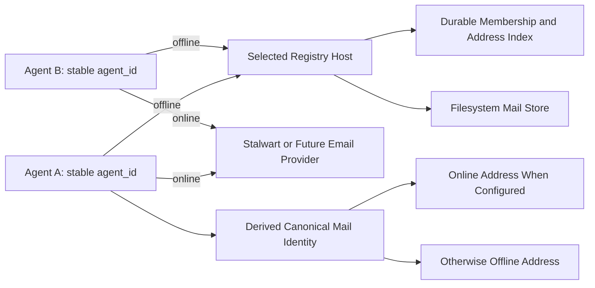

# Design

## Context

See [proposal.md](proposal.md) for scope and the ordered relationship to change 02. This design is required because the change crosses runtime persistence, mailbox ownership, discovery, remote access, and agent-facing workflows.

Observed implementation seams:

- `agents/managed_prompt_header.py`, `agents/brain_builder.py`, `realm_controller/runtime.py`, `realm_controller/manifest.py`, and `srv_ctrl/commands/runtime_artifacts.py` each participate in name-derived ID defaults. A UUID substitution in only one caller would leave inconsistent identities or generate new IDs during persistence.
- `LaunchPlan.mailbox`, launch/session boundary models, `mailbox_runtime_models.py`, and registry records carry a single filesystem-or-Stalwart union. `GatewayServiceRuntime` caches one adapter and one binding version.
- `registry_storage.py` publishes local lifecycle records, while `passive_server/discovery.py` probes local tmux sessions. Existing external communication imports are locators for another passive server, not offline cluster membership or mail storage.
- Filesystem registration already uses address locks and a shared SQLite index. It supports `safe`, `force`, and `stash`; the latter two conflict with the agreed rule that another agent cannot join using an occupied address.
- `RuntimeSessionController.persist_manifest()` rebuilds state from the controller and the manifest writer writes directly to its destination. Neither is a safe boundary for concurrent live mail updates.
- Existing mailbox skills resolve current manifest-backed state, and notifier prompts already provide API fallback when the native skill route is unavailable. Live binding use need not depend on refreshing a running CLI's skill catalog or environment.

The new capability specs are [agent-mailbox-bindings](specs/agent-mailbox-bindings/spec.md) and [offline-mail-registry](specs/offline-mail-registry/spec.md). The remaining deltas repair existing identity, registration, gateway, proxy, and skill contracts around them.

## Goals / Non-Goals

**Goals:** Establish one agent owner independent of names and mail; expose two isolated mailbox slots; let a registry host serve durable filesystem mail to remote members; make binding changes and offline address claims safe under concurrent operations; leave a usable foundation that change 02 can extend without another identity or routing redesign.

**Non-Goals:** Detect accidental agent-ID collisions, create a global identity authority or cluster identifier, bridge channels or registries, add Gmail, transfer remote body lifecycle authority, define general execution ownership from #81, or implement #79/#80 prematurely. The existing gateway plugin SDK and its immediate event-dispatch contract are separate.

## Decisions

### 1. Resolve Agent Identity at One Creation Boundary

Introduce one typed creation decision with supplied ID, `uuid` default, or explicit `name-hash`. Preserve the existing normalized-name hash algorithm for the opt-in mode. Distinguish an omitted CLI mode from an explicitly supplied mode so the default does not conflict with a supplied ID. A supplied ID plus an explicitly requested generation mode is an input error.

Generate UUIDs with the standard library. Record generation provenance for diagnostics, but treat the ID itself as opaque; hash-like or explicitly supplied values remain valid under the safe ID syntax. Do not add host or registry prefixes to IDs. Identical ID values always mean the same logical agent, even if different actors reused them accidentally.

Resolve identity before brain/home materialization, prompt-header rendering, runtime launch/join, and registry publication. Pass the selected ID through those paths. Reusable recipes and templates do not allocate a second agent's identity by inheriting another created agent's ID. Explicit reuse/resume of a durable agent uses its existing ID. Manifest serialization and read paths validate rather than generate identity. Keep session IDs and liveness generations independent.

Alternative considered: change every name-hash call to UUID generation independently. Rejected because repeated construction, header rendering, and persistence could disagree about the same agent's ID.

### 2. Persist Two Slot Envelopes With Explicit Revision Authority

Replace the single union with `mailboxes.offline` and `mailboxes.online`. Each slot retains a revision even while empty and contains an optional immutable binding. A binding contains owner `agent_id`, channel, binding ID, address, backend configuration, and a protected credential reference where needed. The online provider discriminates provider-specific configuration; JMAP fields do not become mandatory fields for every future online provider.

The offline connection is a typed local authority locator or remote registry URL plus a selected credential reference. Local configuration identifies the registry root and its configured mail store; remote callers cannot choose store paths. Do not add `cluster_id`, `registry_id`, or another generated identifier shared by cluster members. A per-agent mailbox binding ID is solely a reference/worker scope, not a cluster identity.

Compute `canonical_mail_identity={channel,address}` from one consistent snapshot: online if configured, otherwise offline, otherwise null. Never store it as an independently editable authority field. Connectivity belongs in operational status, so a provider outage cannot rename an agent. An offline canonical address is interpreted within the selected registry, not as a globally unique address.

The runtime snapshot owns configured bindings; the registry owns actual offline registration/address allocation; discovery records contain a safe projection. A cached registration claim is validated against its authority rather than becoming another address allocator. Online login names, account IDs, and mail addresses remain separate from the agent owner.

Alternative considered: make email the runtime primary key or keep one transport slot. Both conflict with stable internal identity and simultaneous mail channels.

### 3. Give Binding Fields One Mutation Path

Add a session-scoped interprocess lock and atomic write/replace operation. Normal controller persistence reads the latest snapshot under that lock and updates only its owned runtime/backend fields. Mailbox changes use a dedicated operation that compares the selected slot's expected revision, checks agent/session authority, preserves the other slot, assigns a new revision, validates, and atomically replaces the manifest. The empty-slot revision prevents detach/recreate ABA races.

All manifest writers must participate, including manager, passive headless paths, relaunch, join, and recovery. Update the controller's in-memory launch plan from the committed result. Do not fix only gateway writes while leaving an old controller able to overwrite them. Network requests, mailbox preparation, credential reads with remote effects, and worker shutdown do not run under the manifest or terminal-mutation lock.

Registry projection follows the binding commit. A failed projection returns a safe warning/error identifying the committed binding revision and reconciliation need; it does not undo a confirmed registry claim or invent another agent. Idempotent join and subsequent status allow repair after a lost response or interrupted local publication.

Alternative considered: maintain another mutable gateway binding file. Rejected because it would compete with manifest-backed runtime discovery and complicate stopped-gateway behavior.

### 4. Reuse Filesystem Mail Storage as the Offline Ownership Index

The registry host selects one filesystem mail store in its configuration. Extend that store's transactional registration index with durable member metadata keyed by stable agent ID and agent-scoped authorization digests. Keep registration/address ownership in this one index; registry JSON summaries remain projections. Registry-root configuration locates the store and does not copy mail into lifecycle records.

Use the existing deterministic address-lock discipline plus a transaction/unique ownership constraint for claim admission. Validate the sender/member and reserve the address before preparing its mailbox. Preparation has an explicit recoverable state; only a ready registration becomes publicly active. Retry by the same owner/address reconciles an interrupted attempt. Competing owners receive a conflict, never `force` or `stash` replacement.

Release is an explicit owner/admin operation. Preserve retained canonical messages and associate private views with their original registration. Before reassigning an address, retire its old routing entry and isolate retained owned directories under registration-scoped history. For symlink-backed private directories, retire only the registry routing entry; do not move/delete an external target. A later different owner receives fresh routing and view state, and cannot use the old owner's message references. Existing reserved operator and human principal rules remain distinct from agent-ID generation.

Keep membership separate from `live_agents/` and its lease/tmux cleanup. A stopped agent can receive mail. Remote presence uses reported remote locators/generation evidence, not local filesystem or tmux assumptions. An agent has at most one selected offline registration; this service does not attempt worldwide detection of a caller violating that contract elsewhere.

Alternative considered: use only shared filesystem mounts or keep separate authoritative address copies in each host's registry. Rejected because neither supplies the agreed single-host ownership authority for remote members.

Generic `houmao-mgr mailbox register` and project mailbox registration must use the same ownership index and conflict policy; `--yes`, force, and stash cannot be alternate takeover routes. Keep project-aware root selection for local maintenance, but require membership operations to validate that the selected store is the selected registry's configured store. Explicit local initialization can associate an unconfigured registry with a store; a later mismatched project/default root is an error, not an implicit second mail group or a rewritten registry configuration.

### 5. Add an Explicit Registry-Only Server Mode

Extend the supported `houmao-passive-server` executable with an opt-in `offline-registry` service mode and private configuration file. This mode mounts only health and registry membership/mail/attachment routes. It must not expose ordinary passive-server lifecycle, shutdown, gateway-control, or arbitrary filesystem APIs to remote members. The existing passive-server mode keeps its current discovery/proxy role.

Proposed remote surfaces:

| Surface | Authority |
| --- | --- |
| `/houmao/registry/members` enrollment and release | Administrative credential |
| `/houmao/registry/self` and offline mail lifecycle | Credential scoped to one admitted agent |
| `/houmao/registry/self/attachments` upload/download | Same member, bounded transfers and message ownership |

Use bearer credentials separate from agent identity. Administrative setup selects a private credential file. An enrolling CLI prepares a private member credential before the request, so a retry after response loss can reuse the same enrollment input rather than rotating secrets. Store verifier digests in private service persistence, never in public registry records. Use constant-time verification. Agents cannot choose another sender or another agent's `self` inbox through request fields. Explicit credential replacement is an administrative operation; ordinary rejoin does not rotate credentials.

Remote deployments use HTTPS termination or an SSH-tunneled loopback listener. Plain HTTP is allowed for loopback tests/tunnels; reject configurations that transmit credentials directly to a non-loopback plaintext endpoint. Do not broaden the existing gateway's loopback mail policy or implement general authenticated remote gateway exposure from #84.

Local trusted operator access invokes the same membership/mail services directly under host filesystem authority; it does not need a background daemon. Remote access requires the registry service to be reachable. Registry service unavailability affects offline access but does not choose online fallback or release addresses.

### 6. Select Channels Before Backend Dispatch

Move reusable mail operation contracts under `src/houmao/mailbox/` rather than making core mail behavior depend on HTTP handlers. The gateway and manager become adapters over a channel-selected service. Offline access uses local filesystem services or the remote registry client; online access uses the selected provider adapter. Adapt existing launch-time Stalwart configuration into the online slot and retain its current startup provisioning path until change 02 separates external attachment.

Expose `GET /v1/mail/status` for both slots and `/v1/mail/{channel}/...` for lifecycle operations. The scoped CLI retains existing action names with required `--channel offline|online`; `mail status` and `resolve-live` are summaries. Offline membership uses `mailbox offline status|join|leave`. Keep `agents single` and `agents self` targeting, with external communication imports retaining their existing lifecycle restrictions.

Every lifecycle request includes the expected binding ID from status or current round context. This also protects a fresh send/post, which has no existing message reference. Manager helpers resolve once per operation and do not retry on a replacement binding after conflict. Message/thread handles contain opaque owner, channel, binding, and provider/storage identity information. Validate scope before I/O. No parser infers channel from an email domain or preferred address. Replies retain their original binding, including after a canonical identity change. Mixed-channel recipient batches fail before side effects. Online-only email participants can remain without a Houmao agent ID; do not invent identities from incoming headers.

Remote attachments use content upload/download with bounded size, digest, and ownership checks. A remote path is never opened on the registry host. Trusted local path-reference support remains explicitly local; remote users receive managed locators.

Alternative considered: silently route by the online-first identity. Rejected because canonical identity is an external identification preference, not transport selection.

### 7. Preserve Per-Channel Notifier Behavior

Key notifier configuration, schedules, audit evidence, and one-shot compaction bookkeeping by owner/channel/binding. Use `/v1/mail-notifier/{channel}` and matching scoped CLI `--channel` controls. Preserve modes, appendix update semantics, context policies, readiness/pending-input/hook guards, and current queue admission. Canonical identity changes do not reset either channel's schedule or compaction state.

Both channels continue periodic reminders while eligible work remains. Suppress only duplicate admission of the same cycle and overlapping attempts; do not restore permanent digest suppression. Mailbox read/answered/archive truth stays in its backend. Prompts carry the exact gateway URL and selected channel and enter through the current public agent skill route when both static siblings exist. Otherwise use the maintained API fallback without native skill hot-reload assumptions.

This change makes notifier state channel-aware. It does not solve the current Stalwart full-inbox/body-fetch cost; change 02 replaces that poll implementation while preserving these semantics.

### 8. Make the Successor Dependency Concrete

Change 01 is independently verifiable with UUID/name-hash identities, two configured launch-time slots, local and remote offline communication, scoped references, revision persistence, and periodic per-channel reminders. Synchronize these deltas before applying change 02. The numbered names express order; OpenSpec does not enforce cross-change execution dependencies automatically.

Change 02 can then add online live attachment and bounded synchronization using these exact owner, slot, revision, scope, and notifier contracts. Do not mark #79 or #80 complete after this foundation alone.

## Risks / Trade-offs

- Registry host availability limits remote offline access. Keep mail durable, report unavailable connectivity, and reconnect without releasing membership or selecting another channel.
- A name-hash caller can reuse an ID unintentionally. Preserve the explicit opt-in and documented caller responsibility; do not promise collision detection.
- Registry claim and local binding publication are different commits. Use idempotent enrollment, explicit partial outcomes, and status-based reconciliation rather than a distributed transaction.
- File preparation and index updates can be interrupted. Reserve ownership before preparation and recover incomplete attempts without making another owner's mailbox visible.
- A registry-only listener adds an operational service. Keep it opt-in, narrow its route inventory, and test that remote member credentials cannot reach body-control routes.
- Existing tests and fixtures assume names determine IDs or one mailbox exists. Repair those assumptions explicitly; do not hide them behind compatibility coercion.

## Migration Plan

1. Update creation boundaries, models, packaged schemas, runtime/registry writers, mailbox services, and maintained consumers together. Use new schema versions for changed persisted shapes and reject unsupported legacy shapes clearly.
2. Preserve explicit IDs in supported current-format agent records; UUID generation applies to newly created agents. Do not re-key existing named agents or silently generate identity while loading unsupported records.
3. For disposable pre-1.0 mailbox roots whose ownership schema is unsupported, require an explicit operator backup/rebootstrap using the new format. Do not silently reset stores or implement an unrequested format migration.
4. Configure the registry host and private credentials, enroll members, verify local/remote mail, and update skill/CLI/docs examples. Leave Stalwart startup configuration available in the online slot.
5. Verify and synchronize change 01 before starting change 02. Rollback means restoring the prior compatible application/state snapshot together; older binaries must not mutate the new schema.

## Validation

Use hermetic unit tests for ID selection and non-generating reads, slot/canonical identity transitions, reference scope, revision races, credential authorization, and address claims. Use process/API integrations with disjoint runtime and filesystem roots to prove remote access does not depend on shared local paths. Test restart, lost enrollment responses, release/reassignment history isolation, inactive recipients, simultaneous channels, periodic unchanged-work reminders, and compaction continuity. Retain existing terminal-readiness and gateway plugin regression checks.

Run the affected suites, then the required Pixi unit/lint/type checks. Update mailbox/registry/CLI references and packaged skill assets as part of implementation. No production implementation is part of this planning change.
