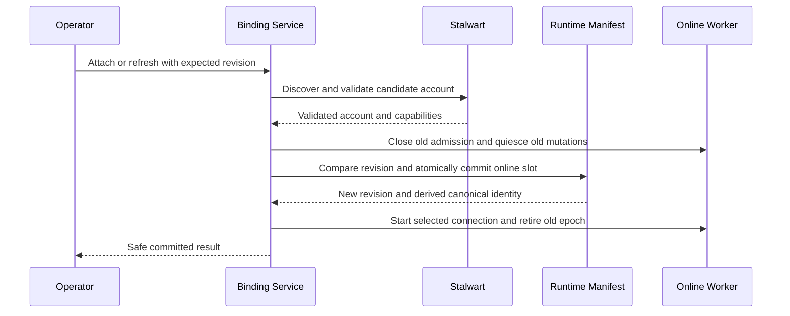

# Design

## Context

See [proposal.md](proposal.md) for motivation and issue coverage. This design extends [change 01](../mail-01-establish-identity-and-offline-mail/design.md), which must be implemented, verified, and synchronized first. Its stable owner, two slot envelopes, expected-binding preconditions, revision mutation service, remote offline registry, and per-channel notifier are prerequisites.

Current implementation evidence identifies the work to replace:

- `mailbox_runtime_support.bootstrap_resolved_mailbox()` invokes `ensure_stalwart_mailbox()` and the resolved model requires a management URL. Existing external accounts therefore lack an attachment-only path.
- `StalwartJmapClient.list_messages()` queries only mailbox membership on the server, fetches text bodies, and then applies read/answered/archive/time filters locally. A small limit can exclude older matching messages before filtering.
- `StalwartGatewayMailboxAdapter._client()` creates a client for each operation. `_box_name_for_mailbox_ids()` enumerates mailboxes while normalizing individual messages. Discovery and role requests are repeated unnecessarily.
- Session discovery performs GET against the configured URL, while base-URL resolution currently derives `/jmap`. The qualified local service exposes discovery at `/.well-known/jmap`, with a distinct advertised POST API URL.
- `_run_notifier_cycle()` requests all eligible inbox messages with `limit=None` while holding the gateway lock. Existing tests intentionally require repeated reminders for unchanged mail.
- `get_email()` currently requests at most 16,384 body bytes and normalizes text without exposing completeness. Content retrieval must not silently label truncated text as complete.

Primary protocol references are [JMAP standard methods](https://www.rfc-editor.org/rfc/rfc8620.html#section-5) and [JMAP Mail](https://www.rfc-editor.org/rfc/rfc8621.html#section-4). Inspect `extern/orphan/stalwart` for server behavior, noting that the reference checkout and local service may be different releases. The existing local qualification demonstrated bounded queries, metadata-only gets, `Email/changes`, and `Email/queryChanges` on Stalwart 0.15.5; it did not establish target-scale capacity.

## Goals / Non-Goals

**Goals:** Attach externally provisioned online mail without changing the body or offline binding; make query and notifier cost bounded at the client; persist reconnectable observation state; preserve lifecycle and periodic reminder semantics; expose failures and limits accurately.

**Non-Goals:** Add another identity model, provision accounts implicitly, add Gmail, mirror retained mail bodies, bridge channels, automatically retry sends, change general gateway plugin dispatch, or claim million-message/100-agent capacity without executing and measuring that workload.

## Decisions

### 1. Consume the Foundation Before Adding Online Controls

The first tracked task checks that change 01 is implemented and its capabilities have reached main specs. These deltas are authored against that post-01 state; the numbered names alone do not enforce execution order. Do not implement a temporary single-mailbox attach route and later migrate it.

Keep shared mail operations under the channel-selected mailbox service. Add online binding management through the same runtime mutation authority. Operator routes remain loopback/authorized-control surfaces; the offline-registry service mode exposes none of them.

| Gateway Route | Operation |
| --- | --- |
| `GET /v1/mail/online/binding` | Safe current binding, revision, and connection/sync snapshot |
| `PUT /v1/mail/online/binding` | Validate and attach; explicit replacement intent for another bound account |
| `POST /v1/mail/online/binding/refresh` | Validate the selected credential source for the same account |
| `POST /v1/mail/online/binding/reconnect` | Rebuild the selected connection without switching account |
| `DELETE /v1/mail/online/binding` | Revision-checked online detach |

Maintained passive-server operator proxies use `/houmao/agents/{agent_ref}/mail/online/binding...`. Scoped manager commands use `mailbox online status|attach|refresh|reconnect|detach`. A CLI without a live gateway can use the existing explicit companion-attach workflow first; no body restart is necessary. A normal attachment result distinguishes configured/actionable mail from notifier activity, which requires the gateway.

Alternative considered: overload filesystem join or require a gateway restart for account changes. Both obscure the independent online slot or add unnecessary disruption.

### 2. Validate Candidates Without Provisioning

The typed attachment input contains provider, JMAP discovery URL, requested mail address, login identity, protected credential reference, optional account selection, expected slot revision, and explicit replacement intent. Materialize a candidate credential snapshot into owner-private runtime storage only when needed; never put its bytes into manifests, public status, projections, tracked files, or raw diagnostics.

Discover the JMAP session, select an explicit or unambiguous primary mail account, and validate the requested address against the account's authorized sending identities. Do not fall back to the first account or first identity. Validate required mailbox/submission access and expose unsupported capabilities accurately. A convenience base URL derives `/.well-known/jmap`; honor the returned API URL under the selected connection policy. Management URLs and credentials are absent from attachment input.

Keep explicit account/domain provisioning as a separate administrative workflow. Resume, reconnect, adapter construction, and credential refresh do not call it or reset provider passwords. A login identity need not equal the sending address, but the selected account must authorize the address.

Alternative considered: reuse `ensure_stalwart_mailbox()` for attachment. Rejected because provisioning and credential generation have different authority and side effects.

### 3. Commit and Retire Bindings With Explicit Fencing

Validate a candidate outside the global terminal lock. Capture expected owner/session and slot revision. Reserve retirement of the old online connection, close new admission to it, cancel unstarted tasks, and wait for started mailbox mutations within a finite deadline. If quiescence cannot be established, report an explicit failure/uncertain operation rather than submitting that work again. Do not pretend that cancellation can undo a provider-side send already in progress.

Commit through change 01's revision service, preserve the offline slot, and publish the derived canonical identity from the same snapshot. Activate the candidate, invalidate pending old notifier work, and retire private old runtime credential copies only after users of that revision have finished. Never remove an externally supplied credential source. A failed pre-commit validation or revision check leaves the prior binding descriptor intact; its credential may already be invalid upstream and status must represent that honestly.

All requests include expected binding ID, including sends/posts without existing message references. References add message/provider scope. Workers capture binding revision plus a connection epoch. A refresh preserves binding ID/account and persisted sync state while publishing a new revision and epoch. Reconnect preserves account and checkpoint; automatic connection epochs do not change configured identity. A candidate account change during refresh is rejected and requires explicit replacement.

Alternative considered: update a credential file in place and let active clients reread it on their next request. Rejected because requests could silently change credentials or accounts while retaining old cached discovery and scope.

### 4. Return Metadata Pages Across Both Channels

Extend the common list request with finite `limit` and optional opaque `cursor`; keep channel and expected binding ID explicit. Default to 50 results and cap at 200, further constrained by provider limits. Preserve `messages` as the returned array, identify page-level message/open/unread counts, and add continuation plus `has_more`. Exact totals are optional and requested only when supported and useful. Do not present sample size as total inbox size.

Remove `include_body` from list and repair strict request models, CLI `--include-body`, proxies, skills, tests, and documentation. Offline listing uses the existing authoritative metadata indexes with bounded pages; it receives the shared shape without acquiring online synchronization machinery.

For Stalwart, compose the mailbox, `$seen`, `$answered`, archive-membership, and timestamp filters into one server-side query. Define and test timestamp boundary semantics consistently. Resolve requested roles explicitly; no missing-role null filter may widen the request to all account mail. Keep `collapseThreads` and sort policy fixed in the query fingerprint.

Use bounded `Email/query` followed by a batch `Email/get` for returned IDs and selected metadata properties. Fetch ID/thread, timestamps, addressing, subject, bounded preview, keywords, mailbox memberships, and lightweight attachment indicators. Do not request `bodyValues`, `textBody`, `fetchTextBodyValues`, full MIME, or attachment bytes. Cache the session/account and role map per connection epoch, refreshing on invalidation or bounded policy; no role enumeration per normalized message.

A versioned opaque continuation contains owner/binding/account scope, filter/sort fingerprint, query state, and next position. Check the returned query state before presenting a continued page. State drift produces a typed stale-cursor result; it never silently joins incompatible pages. Respect server result caps and use bounded continuation/probing to avoid false claims of end-of-results. Query state and email-object state are not interchangeable. Cursor contents are not credentials or authorization.

Alternative considered: fetch a fixed newest page and filter locally. Rejected because it misses older matching work and cannot represent trustworthy continuation.

### 5. Persist Bounded Observation State, Not a Message Mirror

Use the existing gateway-owned SQLite persistence boundary extended with scoped mail-sync tables. Key state by agent owner, channel, binding ID, provider account, and view-policy fingerprint. Credential bytes, credential revision, gateway PID, and body incarnation are not account identities. Keep configuration in the runtime manifest; SQLite stores derived observation state and notifier admission metadata only.

Persist:

- the committed `Email/changes` state;
- optional query-specific state keyed to exact filter/sort policy;
- a bounded current eligible metadata window and whether it is complete or only a sample;
- synchronization phase/progress and safe last-success/error information;
- existing compaction eligibility metadata and cycle admission state in their separate scopes.

Do not store bodies, MIME blobs, attachment bytes, provider passwords, or a pending message resend spool. Historical mail remains on Stalwart and is paged on demand. A missing cache is recoverable without redefining provider read/archive truth.

### 6. Define Bootstrap, Incremental Catch-Up, and Rebase Precisely

At initial attachment or stale-state rebase, obtain an email-state boundary before querying the bounded eligible window. Publish that window with its own query state, then process changes from the earlier email-state boundary. Do not obtain a later email state after the query and treat it as proof that intervening changes were applied. The window is a bounded view, not a claim that the full retained account has been synchronized.

For ordinary catch-up, call `Email/changes(sinceState, maxChanges)` and fetch only created/updated metadata in bounded batches. Remove destroyed IDs and reconcile authoritative `notFound` results. Apply state/view changes and the response's `newState` in one local transaction only after that batch is handled. Continue from intermediate state when `hasMoreChanges` is true, yielding at the cycle budget. Never advance directly to a newer state seen in `Email/get`, which could skip unapplied intermediate changes.

Recompute or refill the bounded eligible window when changed metadata invalidates it. Maintain an explicit indication of unseen eligible backlog; eviction or omission from a sample never means that a message was processed. If catch-up is incomplete, a bounded current filtered query can still establish eligible work without waiting to enumerate all retained changes.

Use `Email/queryChanges` only for a compatible exact cached query and supported behavior. Its `maxChanges` is a bound that can result in `tooManyChanges`; do not invent `hasMoreChanges` query pagination. On `tooManyChanges`, `cannotCalculateChanges`, unsupported query changes, or invalid cached state, invalidate that derived query view and use a fresh bounded filtered query. If email changes are unavailable, report bounded-requery/degraded capability rather than claim incremental support.

Before committing a worker batch, revalidate its owner/binding/revision/epoch. Use a short binding-authority critical section around the local checkpoint commit so replacement cannot race a stale worker's publication. Perform no network I/O under that section or the terminal lock.

Initial defaults: metadata pages 50 (hard cap 200), change batches 100 (hard cap 500), at most five JMAP method calls and ten seconds of work per sync cycle, and finite request timeouts constrained by remaining budget. Respect smaller server capabilities. These are configurable operational budgets; tests assert bounded work and continuation, not these defaults as performance guarantees. Apply bounded reconnect backoff and report `idle`, `catching_up`, `rebasing`, `degraded`, or unsupported status accurately.

Alternative considered: rebuild all inbox IDs or full bodies after every reconnect. Rejected because history size would determine recovery traffic and notifier latency.

### 7. Preserve Periodic Reminders and One-Shot Compaction

Synchronization and reminder scheduling are separate. Successful observation can advance the sync checkpoint while the body is busy; it never acknowledges task completion. Each due reminder cycle uses current eligible work, existing mode, and the ordinary readiness/admission gates. Unchanged work remains eligible for another reminder at the next interval.

Use a persisted owner/channel/binding/cycle admission key and one pending attempt to suppress same-cycle duplication and overlapping wakeups. Do not use the full eligible-set digest as permanent notification suppression. Keep request insertion and cycle admission atomic in gateway persistence. A busy refusal does not advance successful admission. Pending notifier work carries origin binding/revision and is checked before dispatch; detach/replacement cancels obsolete work. This applies to core mail reminders, not the separate generic plugin event contract.

Compaction state remains tied to a message's continuous eligibility stretch, not cache residency. Remove remembered state only on confirmed loss of eligibility or binding replacement. After a stale checkpoint, revalidate remembered entries in bounded batches before permitting another compaction for an uncertain entry. Metadata eviction, reconnect, credential refresh, and repeated periodic reminders alone never reset it. Preserve #37 compaction-loop and #51 prompt-readiness regressions.

### 8. Make Content Retrieval and Limits Honest

Keep peek non-mutating, read marking seen, reply marking its parent read/answered, and archive closing inbox work. These are provider operations, not cache writes. Reuse role/account scope and surface partial/uncertain mutation outcomes without automatic send/reply replay.

Read complete selected text when supported within explicit transfer budgets. Inspect provider truncation flags. If a selected message exceeds the supported body budget, return visible completeness/limit information and an authorized content/blob retrieval path when implemented, or an explicit unsupported limit. Do not normalize the current 16 KiB truncated value as a full body. Attachment transfers remain explicit and authorized.

### 9. Qualify the Actual Client and Runtime Boundaries

Wire-level fake JMAP tests assert requested properties and filters, server caps, cursor scope/state drift, intermediate changes, partial batch failures, disappearing messages, oversized deltas, expired checkpoints, and request budgets. Existing adapter mocks alone cannot detect accidental body fetching or per-message role requests.

Runtime/API tests cover initially mail-disabled agents, offline preservation, invalid credentials, endpoint failure, account/address mismatch, refresh, reconnect, detach, source-file replacement, old-worker completion, pending reminder cancellation, stale new-send binding preconditions, and uncertain mutations. Use fake bodies for deterministic CI; a body PID/conversation marker demonstrates no relaunch.

Live Stalwart qualification uses an explicitly selected private normal-account credential source, with no management credentials for attachment. Reuse the service deployment documented for this project. Exercise metadata list, selected content, send/reply/mark/archive, incremental changes, gateway restart, refresh, and detach. Any CLI-agent qualification uses the supported test-fixture launcher with an explicit self-hosted or cloud-API case and model; credentials and runs remain outside the checkout.

Create sanitized qualification tooling under `scripts/qualification/` with an explicit mail purpose and document a workload plan for 100 agents/millions of retained messages. Separate retained archive size from active inbox backlog. Measure request counts, transferred bytes, p50/p95 latency, process memory, recovery time, and reminder counts for idle, new work, busy body, reconnect, and stale-state cases. Reports state the actual executed scale. Only the plan and representative live checks are required for issue acceptance; no unexecuted target-scale capacity claim is allowed.

## Risks / Trade-offs

- State-validated pagination can become stale under continuous mutation. Return explicit restart/reconciliation guidance and measure stale-page frequency rather than fabricate snapshot guarantees.
- Account-wide change traffic can be large even when the eligible window is small. Bound catch-up work, retain intermediate progress, and query current eligible work separately when needed.
- Bounded metadata is incomplete history. Label samples/counts accurately and preserve explicit pagination and independent compaction state.
- Provider password rotation can invalidate the old connection before candidate activation. Preserve the old descriptor on failed refresh but report its real degraded status.
- A send may have reached the provider before a timeout or retirement. Report uncertainty pinned to its old binding and require caller-directed reconciliation; never automatically resend.
- Stalwart releases differ. Qualify discovery, capabilities, and error behavior against the running release and protocol tests; management compatibility is irrelevant to mailbox-only attachment.

## Migration Plan

1. Complete and synchronize change 01. Verify its scoped routes, slot revisions, expected-binding preconditions, and offline registry tests before changing online behavior.
2. Update strict page models, client/proxy/CLI consumers, provider calls, worker state, and skills together. Reject removed list-body fields rather than translating old payloads silently.
3. Existing configured online bindings establish their first observation checkpoint through bounded bootstrap; do not import old full-body poll output as authoritative sync state.
4. Operator-supplied external credentials enter only through explicit protected sources. Existing administrative provisioning stays opt-in and separate.
5. Execute deterministic suites and live normal-account qualification, publish sanitized evidence and limitations, and verify #79/#80 acceptance. Restore compatible binary/state snapshots together for rollback; do not let an older reader reinterpret new cursor or checkpoint formats.
