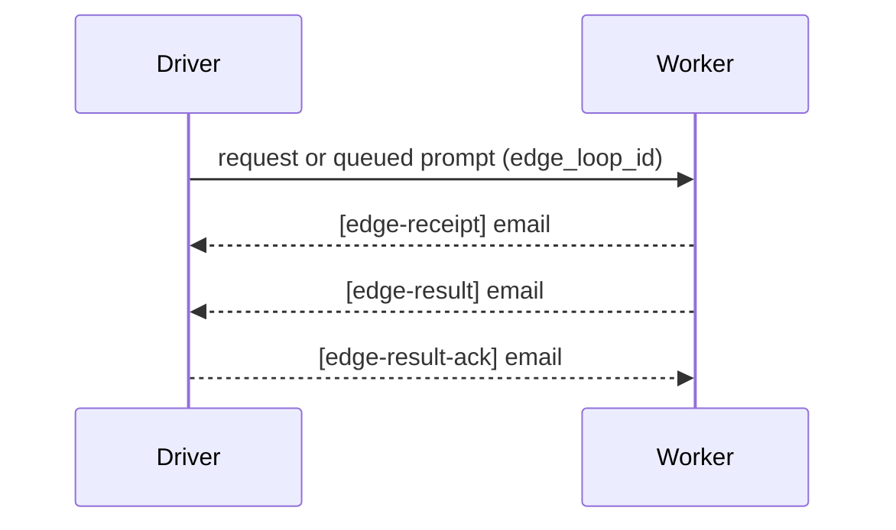

---
metadata:
  skill_invocation_notation: >
    Top-level skill entrypoints use SKILL.md. Parent-scoped subskill entrypoints use
    SKILL-MAIN.md and are loaded explicitly through their parent; nested SKILL.md is
    accepted only as legacy input when SKILL-MAIN.md is absent.
    Skill and subskill entrypoints use bare object paths: `X` invokes skill X and
    `X->Y->Z` invokes subskill Z. Subcommands use parenthesized components:
    `X->cmd()` invokes a direct subcommand, `X->Y->cmd()` invokes a subcommand of
    subskill Y, and `X->parent()->child()` invokes child subcommand child exposed
    by parent subcommand parent. Intermediate subcommands act as object generators.
    Forms such as `X()` and `X->Y()` are invalid for skill or subskill entrypoints.
---

# Local-Close Driver-Worker Edge Loop (`pairwise-edge-loop`)

Aliases: `local-close-edge-loop`, `pairwise edge-loop`, `pairwise-edge-loop-via-gateway-and-mailbox`.

## Workflow

1. **Confirm local-close topology fit**: one `driver` delegates one bounded round (`edge_loop_id`) to one `worker` with live gateway/mailbox reachability and expects the final result back at that same `driver` (escalate to `relay-loop` for forward multi-hop lanes, `houmao-agent-loop-lite` for generated Markdown/SQLite loops, or `houmao-agent-loop-pro` `tree-loop` for recursive/multi-edge graphs).
2. **Persist the local ledger row first** using the schema, timing fields, and single-reminder supervision contract in [../references/shared-loop-ledger-and-resend.md](../references/shared-loop-ledger-and-resend.md).
3. **Dispatch the request** via `houmao-shared-routines->houmao-agent-messaging`: prefer attributed `houmao-mgr agents single ... request --text <task>` (permitted under default `agent-requester` policy with automatic managed-session peer signing), or use `agents single ... prompt` when `agent-operator` turn injection is intended (or `houmao-cccc chat send --operation-id` when coordinating inside a CCCC group; do not mix channels mid-round).
4. **Arm the single repeating supervisor reminder** via `houmao-shared-routines->houmao-agent-gateway` (plus optional `[edge-backlog]` self-mail pointer) and **end the chat turn immediately** without waiting in-turn.
5. **Handle worker execution and driver review**:
   - **Worker**: deduplicate `edge_loop_id` (resending prior receipt/result if already seen), persist ownership, send `[edge-receipt]` via `houmao-shared-routines->houmao-agent-email-comms`, complete work, send `[edge-result]` to the same `driver`, and retain follow-up until `[edge-result-ack]` arrives.
   - **Driver wakeup**: follow the inspect-before-resend protocol in [../references/shared-loop-ledger-and-resend.md](../references/shared-loop-ledger-and-resend.md) (mailbox first -> `houmao-agent-inspect` peek -> last-resort probe -> resend with the **same** `edge_loop_id`), send `[edge-result-ack]` once `[edge-result]` is recorded, and stop.

If the request does not map cleanly to these steps, use the native planning tool to build a step-by-step plan from [../references/shared-loop-ledger-and-resend.md](../references/shared-loop-ledger-and-resend.md), the templates below, and the user request, then execute the plan.

## Local-Close Flow



## Message and Reminder Templates

### Edge-Loop Request (`request --text` or `prompt`)

```text
Role: You are the worker for edge-loop `<edge_loop_id>`.
Driver: <agent identity and mailbox address>
Action: Persist ownership, send `[edge-receipt] edge_loop=<edge_loop_id>` to `<driver>`, complete the task, and send `[edge-result] edge_loop=<edge_loop_id>` back to `<driver>`.
Ledger & timing: Record edge_loop_id, peer, phase, next_review_at=<...>, receipt_due_at=<...>, result_due_at=<...>, result_ack_due_at=<...>, max_attempts/give_up_at=<...>.
```

### Receipt, Final Result, and Ack Emails

- **Receipt**: `Subject: [edge-receipt] edge_loop=<edge_loop_id>` — state persisted ownership, worker/driver identities, current phase, `next_review_at`, and `result_due_at`.
- **Final result**: `Subject: [edge-result] edge_loop=<edge_loop_id>` — state worker/driver identities, result summary, and completion upon `[edge-result-ack]`.
- **Result ack**: `Subject: [edge-result-ack] edge_loop=<edge_loop_id>` — confirm driver recorded the final result so the worker marks the row complete and stops follow-up.
- **Supervisor reminder**: `Title: [edge-supervisor] review active edge loops` (`mode: repeat`, single reminder per agent) — reopen ledger, check mail first, peek due workers via `houmao-shared-routines->houmao-agent-inspect`, resend only unconfirmed overdue rows with the same `edge_loop_id`, update `next_review_at`/`attempt_count`, and stop.

## Guardrails

- DO NOT wait or poll inside a live turn for worker receipts or results, or mint a new `edge_loop_id` when resending the same round.
- DO NOT create one live gateway reminder per active `edge_loop_id` row, store mutable retry counters in `houmao-memo.md`/`pages/`, or expand into recursive multi-edge trees inline instead of using `houmao-agent-loop-pro`.
- DO NOT guess materially critical deadline thresholds when context leaves them ambiguous, or silently switch between `request`, `prompt`, mail, and `houmao-cccc`.
